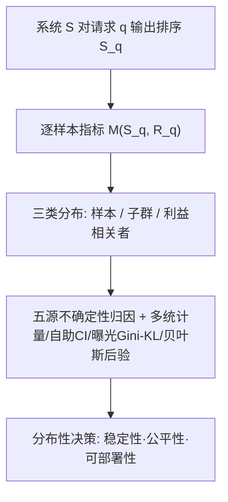
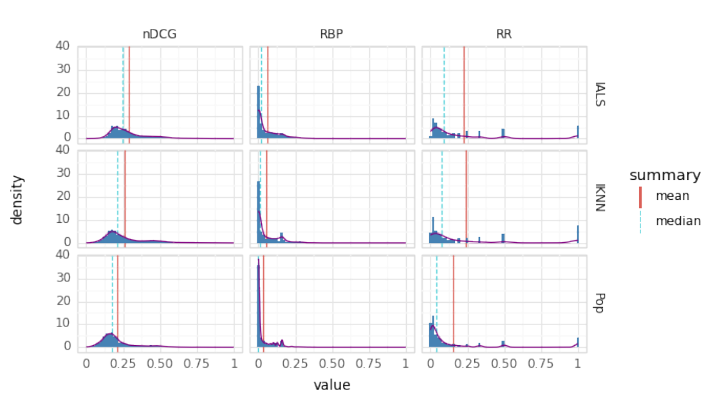
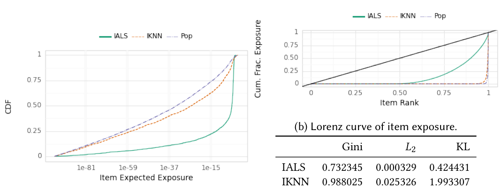

# Distributionally-Informed Recommender System Evaluation (面向分布视角的推荐系统评估)

- **会议/期刊**: ACM Transactions on Recommender Systems (TORS)
- **作者与机构**: Michael D. Ekstrand (Boise State / Drexel)、Ben Carterette (Spotify)、Fernando Diaz (CMU LTI)
- **推荐链路定位**: 离线评估 / 全链路实验方法论
- **研究方向**: 去偏公平、可信隐私与工业架构
- **论文原文**: [arxiv.org/abs/2309.05892v1](https://arxiv.org/abs/2309.05892v1)
- **开源代码**: [github.com/mdekstrand/tors-distribution-eval](https://github.com/mdekstrand/tors-distribution-eval)

## TL;DR (1分钟核心速览)

当前推荐评估几乎只看用户侧某一指标的**均值 + 显著性检验**，但均值会折叠用户间差异、子群差异、物品/生产者侧的影响以及实验全流程的不确定性，"平均用户"并不存在。本文以立场论文形式提出**分布性评估范式**：区分样本分布、子群分布、利益相关者分布三类分布，系统梳理实验/用户/物品/算法/仿真五类不确定性来源，并给出多统计量、自助 CI、分布差异、期望曝光 Gini/KL 等工具箱。MovieLens 上 IKNN→IALS 案例显示：主指标 RBP0.8 提升**统计不显著**（$p=0.071$），但女性用户效果显著改善、物品曝光更公平——均值视角会错判部署决策。

## Background & Motivation (背景与核心矛盾)

- **主流范式**：给定系统 $S$、指标$M$、请求集$Q$，以$\hat{M}_S=\frac{1}{|Q|}\sum_q M(S_q,R_q)$的点估计配合$t$-检验/置信区间作为系统排序与上线依据。
- **前人局限一**：均值只建模**单一用户视角、单一指标**，把用户视为可互换，掩盖了"系统对谁好、对谁差"（前作 helped-hurt 直方图、subgroup 分析仅零散触及）。
- **前人局限二**：把实验环境视为**确定性**，忽略划分随机性、标注噪声、浏览模型参数（$\gamma$）、模型随机性等多源不确定性；显著性$p$ 值本身丢掉了分布信息。
- **核心洞察 (Key Insight)**：作者观察到两类极端现象——均值差显著但逐用户差异几乎为 0 的"无感提升"（TREC8 左图 $+0.003$），与均值差更大却不显著、但存在$-0.5$级个体灾难的"高风险提升"（右图$+0.06$）。**相同均值可对应截然不同的用户体验分布**。
- **本文切入点**：将评估目标从"比较均值"改为"刻画并比较分布"，用分布差异、分位数、公平性统计量支撑更稳健的部署决策。

## Method (核心方法设计)

### 1. 整体框架 (Overall Architecture)

本文不提出新模型，而是构建一套**分布性评估的分析框架**：先由系统 $S$对每个请求$q$产出排序列表并计算逐样本指标$M(S_q,R_q)$，再沿三个正交轴（样本 / 子群 / 利益相关者）聚合为分布；随后把散布归因到五类不确定性来源（实验过程、用户-上下文-意图、物品、算法、仿真）；最后用图形化分布、多统计量 + bootstrap CI、分布差异度量、期望曝光分布型指标与贝叶斯后验五套工具做推断，输出"是否稳定、是否公平、是否可部署"的决策证据链。

### 2. 关键设计拆解 (Key Designs)

1. **三类分布的正交分类法（评估的组织骨架）**：痛点是传统报告只有一行均值，无法回答"收益给了谁"。作者形式化地按条件分布拆分——**样本分布**刻画点估计的不确定性（划分/种子/仿真重复），**子群分布**按用户人口属性、请求类型或物品类型切片 $E_S[M\mid g]$ 并比较条件分布，**利益相关者分布**则跨越用户↔物品/生产者边界。这一分类使"分布"从零散可视化上升为可系统执行的评估范式。

2. **期望曝光与分布型指标（把公平性量化）**：痛点是 RBP 只衡量用户侧效用，生产者侧被遗漏。作者利用 RBP 的几何浏览模型与 Expected Exposure 同构，把同一位置权重施加到物品侧，得到逐物品曝光分布，并用 Gini 系数、相对"理想策略"的 $L^2$ 与 KL 散度度量分配公平性：
   $$RBP_\gamma(L_u)=(1-\gamma)\sum_{i=1}^{N} r_{ui}\gamma^{i},\quad \text{Gini}(e)=\frac{\sum_{i}\sum_{j}|e_i-e_j|}{2n^2\bar{e}}$$
   直觉：理想策略按相关性均匀分摊曝光，系统分布越接近理想，$\text{KL}$ 越小，说明既公平又未牺牲相关性。

3. **不确定性的贝叶斯化处理（把 $\gamma$当随机变量）**：痛点是 RBP 的 patience$\gamma$被当作确定超参，"IALS 只在$\gamma>0.72$时更优"这类结论对参数敏感。作者把$\gamma$的先验建模为$\text{Beta}(5,2)$（众数 0.8），对后验做数值积分得到 RBP 的后验分布$p(\text{RBP}\mid \text{data})=\int p(\text{RBP}\mid\gamma)\,p(\gamma)\,d\gamma$，从而以概率质量而非单点回答"新算法更优的把握有多大"，并可按性别再分解验证稳健性。推理为纯数值后处理，无额外训练成本。

## Experimental Setup & Evaluation Protocol (实验设置与评估协议)

- **数据集与预处理**: MovieLens 隐式反馈，沿用 LensKit 默认参数；测试集为 1500 名用户、每人 5 条留出交互，每用户生成 1000 条推荐列表；相关性为 0/1 隐式指示。

| 数据集 | #Users | #Items | #Interactions | 划分/场景 |
| :--- | :---: | :---: | :---: | :--- |
| MovieLens (LensKit 默认) | 1,500 (test) | 全库 | 每用户 5 条留出 | 50 次不同随机划分与初始化 |

- **数据划分与防穿越 (Splitting Strategy)**: 随机 per-user 留出（hold-out），非全局时间戳切分；50 次重复以估计划分/种子方差。
- **排名评测协议 (Ranking Protocol)**: **Full-List 排序**（每用户 1000 条候选列表内排序），隐式 0/1 相关性，主指标 $RBP_{0.8}$，辅以$RBP_{0.5}$、HR、HR@10/20、nDCG、MRR；显著性用配对$t$-检验。
- **对比基线与超参设置**: IKNN（隐式 item-item KNN，现有系统）、IALS（隐式 ALS 矩阵分解，候选替代）、Pop（热门基线）；LensKit 默认超参，未调参。

## Key Experimental Results (实验关键数据)

### 1. 主实验对比 (Main Results)

| 方法 | RBP0.8 | RBP0.5 | HR@10 | HR@20 | nDCG | MRR |
| :--- | :---: | :---: | :---: | :---: | :---: | :---: |
| **IALS** | **0.061** | 0.045 | **0.495** | **0.681** | **0.286** | 0.223 |
| IKNN | 0.057 | **0.052** | 0.448 | 0.594 | 0.261 | **0.237** |
| Pop | 0.035 | 0.030 | 0.302 | 0.452 | 0.211 | 0.155 |
| $p$(IALS−IKNN) | 0.071 | 0.030 | 0.005 | <0.001 | <0.001 | 0.172 |

**分布统计（RBP0.8，bootstrap 95% CI）**：

| 方法 | Mean | 10%ile | Median | 90%ile |
| :--- | :---: | :---: | :---: | :---: |
| IALS | **0.061** (0.057,0.065) | 0.000 | **0.021** | **0.173** |
| IKNN | 0.057 (0.053,0.061) | 0.000 | 0.012 | 0.163 |
| Pop | 0.035 (0.032,0.038) | 0.000 | 0.000 | 0.134 |

<figure class="paper-figure" markdown="span">
  <figcaption>图1. 用户级效果分数（nDCG、RBP0.8 和倒数排名）的分布，分别以直方图和密度图展示。</figcaption>
</figure>

### 2. 消融式分析（不同分析维度对部署结论的影响）

| 分析维度 | 关键数值 | 得出的结论 |
| :--- | :---: | :--- |
| 均值 + 显著性 | RBP0.8 $p=0.071$ | IALS 略有优势但**不显著**，可能被否决 |
| 分布/中位数 | median 0.021 vs 0.012 | **多数用户**获益（中位差 $3.7\times10^{-5}>0$） |
| 差异分布 | 约 **30%** 用户变差 | 改善非全员正向 |
| 子群（性别） | 女性 $p=0.0134$，差距闭合 | 主要收益来自此前被低服务的女性用户 |
| 曝光公平 | Gini 0.732 vs 0.988 vs 0.995；KL 0.424 vs 1.993 | IALS 曝光显著更均衡 |
| 重复 50 次 | 总提升**不稳定**，性别差距缩小**稳定** | 总体结论脆弱，公平收益稳健 |

**物品曝光统计（对比理想策略）**：

| 方法 | Gini | $L^2$(ideal) | KL(ideal) | 类型$L^2$(ideal) |
| :--- | :---: | :---: | :---: | :---: |
| **IALS** | **0.732** | **0.000329** | **0.424** | **0.0002** |
| IKNN | 0.988 | 0.025326 | 1.993 | 0.0684 |
| Pop | 0.995 | 0.051245 | 2.398 | — |

<figure class="paper-figure" markdown="span">
  <figcaption>图8. 各个项目的期望曝光分布，同时以经验 CDF 和 Lorenz 曲线（用于计算 Gini 系数）展示，并给出该分布的统计量（Gini）以及项目曝光分布与理想排序策略分布的对比（𝐿2 和 KL）。可见 IALS 将更多曝光分配给更大集合的不同项目。</figcaption>
</figure>

### 3. 关键实验发现 (Key Findings)

1. **均值与分布给出相反的决策信号**：IALS 主指标 RBP0.8 仅 0.061 vs 0.057（$p=0.071$ 不显著），但在 HR@10（0.495 vs 0.448）、nDCG（0.286 vs 0.261）上显著更优，说明 IALS 更擅长把多个相关物品排进中高位置，而 IKNN 更擅长把一个相关物品排到最顶（MRR 0.237 反超）。只看单一均值排名会掩盖这种**结构性差异**。
2. **子群分析揭示收益来源与社会意义**：IKNN 在性别上存在明显性能差距，IALS 将这一差距闭合（女性用户提升 $p=0.0134$），且约 **30%** 用户效果变差，说明提升并非"人人有份"，但未系统性地伤害男性用户——这正是"均值提升"无法表达的公平性信息。
3. **曝光分布公平性可量化且稳定**：IALS 的 Gini 从 IKNN 的 0.988 降至 0.732，相对理想策略 KL 从 1.993 降至 0.424，类型级 $L^2$ 从 0.0684 降至 0.0002，表明 IALS 把曝光摊给更多物品且更贴合相关性理想；但 50 次重复中总体提升波动大，**公平收益稳健而总体性能提升不稳健**，构成部署决策中必须权衡的张力。

## Highlights & Limitations (亮点、对比与审稿批判)

- **与代表作对比 (vs. Prior Work)**: 相较于 Wang 等的 helped-hurt 直方图（仅展示差异分布）、Mehrotra/Ekstrand 等的子群差异分析（仅单一切片）、Diaz 等的 Expected Exposure（仅物品侧指标），本文把这些碎片整合为**统一的三类分布 + 五源不确定性 + 五套工具**的评估范式，并首次在同一案例中把用户侧效用与生产者侧曝光用同构位置模型并列比较。
- **可迁移亮点**: ①"逐用户指标的分布/中位数/差异 CDF"可直接嵌入任何离线实验报告，成本极低；②把 RBP 的 $\gamma$先验化后贝叶斯积分，为超参敏感的指标提供稳健性证明，可迁移到 nDCG@K 的$K$ 选择。
- **审稿级局限批判**: ①案例仅一个 MovieLens、三个默认参数算法，未做超参调优与多域验证，**外部有效性有限**；②50 次重复虽给出方差，但总提升不显著/不稳定，作者仍建议"可上线"，决策规则带有主观性，存在被误用为 $p$-hacking/挑子群的风险；③将$\gamma$先验设为$\text{Beta}(5,2)$ 纯属示意，**先验选择的敏感性未做系统评估**；分布性报告篇幅成本高，作者只能建议放附录，实操落地门槛不小。

## Rating (四维评分)

- **方法创新性 (Novelty)**: ⭐⭐⭐⭐ （非新算法而是评估范式，三类分布 + 五源不确定性的系统化组织具方法论价值，但技术增量以整合与形式化为主）
- **评估协议与实验扎实度 (Protocol & Experiments)**: ⭐⭐⭐ （50 次重复 + bootstrap CI + 贝叶斯后验设计严谨，但仅单数据集、默认超参、无多域复现）
- **写作与数学规范度 (Clarity & Rigor)**: ⭐⭐⭐⭐ （RBP/期望曝光同构推导清晰，图表与统计量定义规范，符号系统统一）
- **工业落地与复现价值 (Industrial & Practical Value)**: ⭐⭐⭐⭐ （开源代码与 LensKit/Quarto 模板可直接复用，逐用户分布报告几乎零成本，适合作为离线评估规范）

