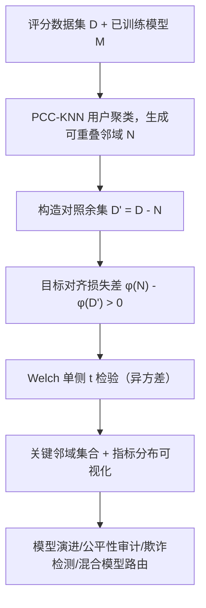
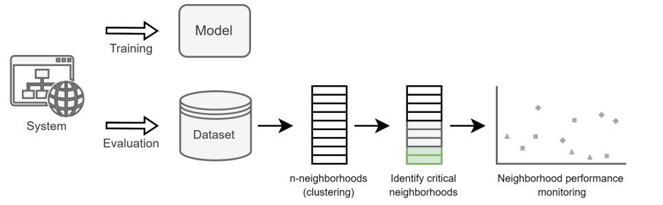
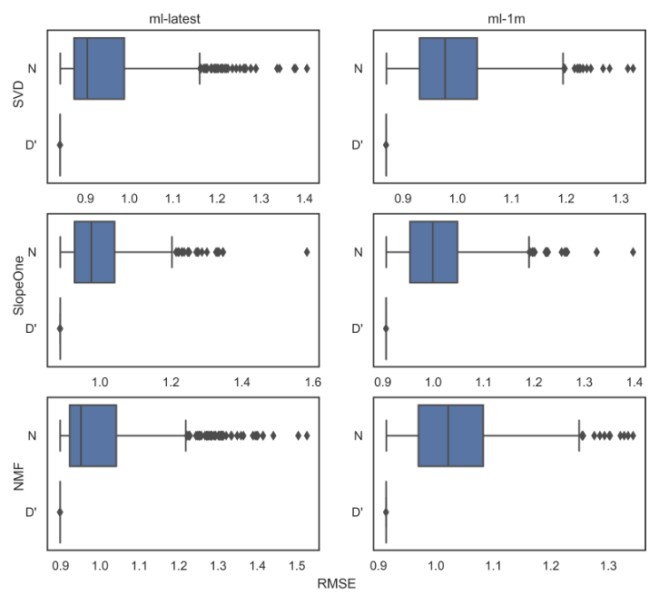

# Group Validation in Recommender Systems: Framework for Multi-layer Performance Evaluation (推荐系统中的群体验证：多层性能评估框架)

- **会议/期刊**: ACM Transactions on Recommender Systems (TORS)
- **作者与机构**: Wissam Al Jurdi (FEMTO-ST/CNRS, Univ. Bourgogne Franche-Comté；黎巴嫩大学 LaRRIS), Jacques Bou Abdo (Univ. of Nebraska at Kearney), Jacques Demerjian (黎巴嫩大学), Abdallah Makhoul (FEMTO-ST)
- **推荐链路定位**: 离线评估层（模型验证/监控），不改变召回-精排任意一级
- **研究方向**: 去偏公平与工业架构 / 冷启动与长尾（子群失效）
- **论文原文**: [论文原文链接](https://arxiv.org/abs/2207.09320v1)
- **开源代码**: 论文声明存在 Python 公开仓库（正文引注 [2]，兼容 Microsoft Recommenders），但未给出可解析 URL，暂未开源

## TL;DR (1分钟核心速览)

传统离线评估只在全库上报告单一均值指标，会把小用户群上的系统性失效平均掉（Simpson 悖论）。本文提出 neighborhood-based evaluation：用 PCC-KNN 把评分数据聚成可重叠邻域 $N$，以$D'=D-N$为对照，用损失差$\phi(N)-\phi(D')>0$加 Welch 单侧 t 检验筛出"关键邻域"，再按预测/排序目标选指标可视化。在 5 个 MovieLens/Personality 数据集与 SVD、SlopeOne、NMF、SVDpp、BPR 上，约 8%–20% 的邻域被判为关键，其 RMSE 高达 1.6，而$D'$ 指标几乎恒定。

## Background & Motivation (背景与核心矛盾)

- **主流范式**: 评估仍以全库 train/test 或交叉验证的单一聚合指标（RMSE、MAE、Precision@k）做模型排序，工具链（Elliot、Microsoft Recommenders、Sun 等的 top-N 基准）只保证流程可复现与协议标准化。
- **前人局限 1**: 聚合均值在 Simpson 悖论下会与子群趋势反向；Herlocker/Al Jurdi 等工作已证明指标冲突与噪声数据使排行榜不可靠，但缺少"定位到哪一小群人失效"的手段。
- **前人局限 2**: 最接近的 SliceFinder（Chung 等）依赖丰富 side feature（如 `country=DE ∩ gender=Male`）做决策树/格搜索切片，而推荐数据集通常只有 user-item-rating 三元组，切片在特征维度上无解；且其损失固定为分类交叉熵，与推荐的排序目标错配。
- **核心洞察 (Key Insight)**: 用户间的评分向量相似度本身就是一种无需 side feature 的"语义切片"信号——评分模式相近的用户，其预测误差高度相关，误差在群内叠加、在全库被稀释。
- **本文切入点**: 把切片评估从"特征空间"搬到"用户邻域空间"，并让损失函数随推荐器优化目标（评分预测 vs 排序）切换。

## Method (核心方法设计)

### 1. 整体框架 (Overall Architecture)

框架作为训练生命周期末尾的**附加评估层**运行：输入评分矩阵与已训练模型 $M$，先用 KNN 把用户聚成可重叠邻域$\{N_1,\dots,N_m\}$；对每个邻域构造余集$D'=D-N$，计算目标对齐的损失差并做统计显著性检验，仅保留"损失显著更高"的邻域进入关键区（critical zone）；最后把关键邻域送入指标组合（MSE/MAE/RMSE 或 Precision@k/F1）做分布可视化，输出可用于模型演进对比、欺诈/噪声定位与混合模型路由的报告。整个过程不改动模型本身，聚类核与损失函数均为可替换模块。

<figure class="paper-figure" markdown="span">
  <figcaption>图 1. 基于邻域的方法架构：执行数据切片以识别 top-n 问题邻域，并给出指标性能可视化</figcaption>
</figure>

### 2. 关键设计拆解 (Key Designs)

1. **PCC-KNN 可重叠邻域切分（用相似度替代 side feature）**：痛点是无用户画像特征可切；改用 Pearson 相关度量用户评分向量相似度并取 top-$k$ 邻居成团，邻域允许重叠以保留边界用户：
$PCC(u,v)=\frac{\sum_{i\in I_{u,v}}(r_{u,i}-\mu_u)(r_{v,i}-\mu_v)}{\sqrt{\sum_{i\in I_{u,v}}(r_{u,i}-\mu_u)^2}\sqrt{\sum_{i\in I_{u,v}}(r_{v,i}-\mu_v)^2}}$
  直觉：PCC 去中心化后能抵消用户打分偏置（严格型/宽松型），使"同质误差群"更纯净；MSD/COS/PBC 作为可替换核。

2. **关键邻域判别：损失差 + Welch 单侧 t 检验（把"看起来差"变成"显著差"）**：先算相对损失，预测目标用平方误差、排序目标用 Precision@k：
$\phi(N)=\sum_{r\in N}(r_{u,i}-\hat r_{u,i})^2,\qquad \phi(N)=\frac{TP}{TP+FP}$仅当$\phi(N)-\phi(D')>0$时进入候选；再做$H_0:\phi(N)\le\phi(D')$对$H_1:\phi(N)>\phi(D')$的 Welch t 检验（不假设等方差，因为$N$与$D'$ 样本量与方差悬殊）。价值在于排除"数据波动恰好让某群分数偏高"的假关键群。

3. **训练目标与推理开销**：本文不训练新模型、无负采样环节（复用 SVD/SlopeOne/NMF/BPR 原生训练流程），故无常规损失函数；代价全部在评估侧——$|U|$用户两两相似度约$O(|U|^2 d)$，邻域数$m$与$D'$重复评估使指标计算近似$m\times$ 全库开销。作者未给出近似近邻或采样加速方案，这是工程落地的主要摩擦点。

## Experimental Setup & Evaluation Protocol (实验设置与评估协议)

- **数据集与预处理**:

| 数据集 | #Users | #Items | #Interactions | 稀疏度 | 特征/场景说明 |
| :--- | :---: | :---: | :---: | :---: | :--- |
| ml-latest-small | 610 | 9,742 | 100,836 | 0.983 | MovieLens 评分，小规模调试 |
| ml-1m | 6,040 | 3,900 | 1,000,209 | 0.957 | 稠密子集，物品数少 |
| personality | 1,820 | 35,196 | 1,028,751 | 0.983 | 人格问卷+评分，"高可信数据" |
| ml-latest | 283,228 | 58,098 | 27,753,444 | 0.998 | 超稀疏全量 |
| ml-latest* | 16,000 | 24,316 | 1,571,685 | 0.995 | ml-latest 的 1.6 万用户采样版 |

- **数据划分与防穿越 (Splitting Strategy)**: **论文未显式声明**划分方式（仅称与 Microsoft Recommenders 的标准训练/测试流程兼容），亦未说明是否做时间戳切分或 $k$-core 过滤，这是复现时最需补齐的空白。
- **排名评测协议 (Ranking Protocol)**: 评分预测类用全测试集的 MSE/MAE/RMSE；排序类用 Precision@k 与 F1，相关性定义依赖阈值 $\theta$（真评$r_{ui}>\theta$且$\hat r_{ui}$位于 top-$k$ 内）。**未采用 Full-Ranking 全库排序，也未报告采样负例比例**，指标为邻域内聚合而非跨邻域平均。
- **对比基线与超参设置**: 预测优化组 SVD、SlopeOne、NMF；排序优化组 SVDpp、BPR；聚类核 MSD/COS/PCC/PBC 四选一（最终固定 PCC）。邻域规模 $k$、显著性水平$\alpha$ 未系统报告，无显著性检验之外的超参敏感性分析。

## Key Experimental Results (实验关键数据)

### 1. 主实验对比 (Main Results)

评估框架类工作没有"精度排行榜"，主结果即**各聚类核下的关键邻域检出比例**（原文图 2 报告，数值为图示近似）与关键区阈值：

| 聚类核 | ml-latest-small | ml-1m | ml-latest | 跨数据集一致性 | 关键区指标下界 |
| :--- | :---: | :---: | :---: | :---: | :--- |
| MSD (KNN-1) | ≈8% | ≈13% | ≈13% | 偏低、稳定 | MSE>0.85 |
| COS (KNN-2) | ≈15% | ≈16% | — | 波动最大 | MAE>0.75 |
| **PCC (KNN-3)** | 略高于 MSD | — | — | **四数据集最稳（采用）** | RMSE>0.90 |
| PBC (KNN-4) | 最低 | — | — | 受稀疏性压制 | — |

关键邻域内 RMSE 峰值达 **1.6**（ml-latest-small 与 personality、三种预测算法均出现），而对照组 $D'$ 的 RMSE 在所有邻域上几乎与全库均值重合。

### 2. 消融实验 (Ablation Study)

以"模块替换"形式给出（替换聚类核 / 切换损失函数），作者未逐一剥离统计检验模块：

| 配置 | 关键邻域占比 | 邻域 vs $D'$ 指标差 | 结论 |
| :--- | :---: | :---: | :--- |
| 预测算法 + 式(2) 平方误差 | personality ≈**3.8%**（最低） | 明显分离 | 高可信数据关键群更少 |
| 排序算法 + 式(3) Precision@k | 整体高于预测组；personality+SVDpp ≈**20%**（最高） | 明显分离 | 排序目标对小群更敏感 |
| 去中心化核 (PCC) vs 非去中心 (MSD/COS) | 8%→15% 间浮动 | 分离方向不变 | 结论对核稳健、绝对数不稳 |
| 缺失项：去掉 Welch 检验 | 未报告 | — | 无法判断误报率 |

**三算法关键邻域重叠（原文表 2，核心量化证据）**:

| 数据集 | 三算法共有 | 两两共有 | 单一算法独有 |
| :--- | :---: | :---: | :---: |
| ml-latest-small | 3.8% | 13.92% | **88.79%** |
| ml-1m | 2.94% | 16.47% | 88.58% |
| ml-latest | 4.1% | 19.98% | 98.88% |
| personality | 2.03% | 23.55% | **99.42%** |

### 3. 关键实验发现 (Key Findings)

1. **误差是模型特定的，不是数据固有的**：三算法共有的关键邻域仅 2.03%–4.1%，而单一算法独有占比高达 88.6%–99.4%，说明同一群用户换模型后往往脱离危险区——这直接支撑"混合模型路由"：把 NMF 判为关键的邻域交给 SVD 服务即可低代价止损。
2. **聚合指标确实系统性掩盖失效**：关键邻域 RMSE 峰值 1.6、普遍越过 0.90 的临界线，而对应 $D'$ 的 RMSE 在所有邻域上保持窄幅恒定（箱线图箱体几乎不移动），证明"全库分数好看"与"局部崩坏"可同时成立。
3. **排序目标比评分预测更脆弱**：预测组在 personality 上仅 ≈3.8% 邻域关键，而 SVDpp 在同一数据集上高达 ≈20%（1,820 用户 vs 35,196 物品、稀疏度 0.983 的极端长尾结构），提示 top-N 排序类系统更需子群级验证而非单一 NDCG 均值。

<figure class="paper-figure" markdown="span">
  <figcaption>图 6. 基于 RMSE 值、使用三种不同推荐算法和两个数据集（ml-latest 和 ml-1m）时数据集对 (𝑁, 𝐷′) 的箱线图。</figcaption>
</figure>

## Highlights & Limitations (亮点、对比与审稿批判)

- **与代表作对比 (vs. Prior Work)**: 相比 SliceFinder（依赖 side feature + 分类交叉熵，特征是切片入口），本文用评分相似度构图，解决推荐数据无画像可切的根本障碍；相比 Elliot（提供 per-user 粒度的 Wilcoxon/配对 t 检验，但分区方式未定义），本文给出显式"邻域"语义单元与关键区判定流程；相比 Simpson 悖论研究（解释现象、归因于曝光 confounder），本文提供可操作的检测工具而非仅诊断。
- **可迁移亮点**: ①"损失差 + 异方差单侧 t 检验"这套双阈值筛法可直接移植到 CTR/CVR 的分桶归因与多场景子群审计；②关键邻域集合可作为门控输入，构造按人群路由的混合精排/混合召回（MoE 式工程实现）。
- **审稿级局限批判**: ①**缺少 ground-truth 注入实验**——未人为构造已知失效子群，因而无法报告检出率/误报率，也未做 Bonferroni/FDR 多重检验校正（单数据集动辄上百邻域，$\alpha=0.05$下假阳性显著膨胀），"关键"的可信度未经标定；②**协议与规模不透明**——数据划分、$k$与邻域规模敏感性、$O(|U|^2)$ 相似度计算在大规模隐式反馈上的可行性均未交代，且框架仅限评分型稠密数据集，对序列/CTR/多模态场景无覆盖。

## Rating (四维评分)

- **方法创新性 (Novelty)**: ⭐⭐⭐ （把 SliceFinder 的切片思想迁移到无 side feature 的推荐数据，PCC-KNN + 目标对齐损失是合理但较直接的组合，无理论保证）
- **评估协议与实验扎实度 (Protocol & Experiments)**: ⭐⭐ （5 数据集 × 5 模型覆盖尚可，但划分协议缺失、无注入式真值校验、无多重检验校正、核心模块未逐一消融）
- **写作与数学规范度 (Clarity & Rigor)**: ⭐⭐⭐ （公式与三阶段流程清晰，PCC/损失定义完整；但多处关键数值仅以图呈现、缺超参与复杂度分析）
- **工业落地与复现价值 (Industrial & Practical Value)**: ⭐⭐⭐⭐ （零侵入的附加评估层、模块可插拔、直指混合模型路由与欺诈/噪声定位等真实运维需求；仅受限于评分数据与未公开的可解析代码链接）

