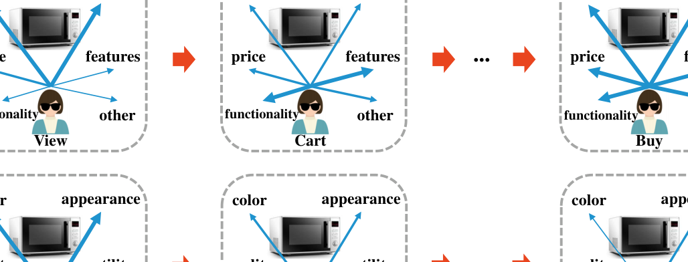
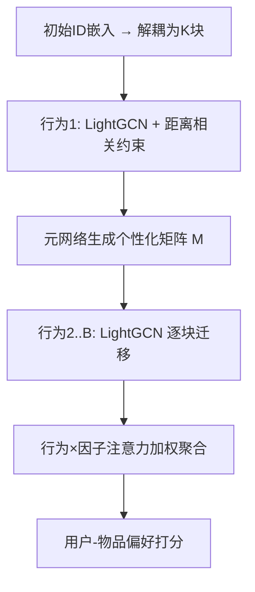

# Disentangled Cascaded Graph Convolution Networks for Multi-Behavior Recommendation (面向多行为推荐的解耦级联图卷积网络)

- **会议/期刊**: ACM Transactions on Recommender Systems (TORS) 2024
- **作者与机构**: Zhiyong Cheng, Jianhua Dong, Fan Liu, Lei Zhu, Xun Yang, Meng Wang (合肥工业大学 / 齐鲁工大 / NUS / 同济 / 中科大)
- **推荐链路定位**: 召回 (RecSys Top-N Recall)
- **研究方向**: 图神经网络与知识图谱推荐 / 自监督与去噪表征
- **论文原文**: [arXiv:2404.11519v1](https://arxiv.org/abs/2404.11519v1)
- **开源代码**: [GitHub: JianhuaDongCS/Disen-CGCN](https://github.com/JianhuaDongCS/Disen-CGCN)

## TL;DR (1分钟核心速览)

针对多行为推荐中用户偏好在不同行为间、以及同一行为内不同物品因素间高度纠缠且个体差异被共享变换器抹平的问题，本文提出 Disen-CGCN：将每个行为的 LightGCN 表征解耦为 $K$个因子块并用距离相关损失强制独立性，用元网络为每个用户/物品生成个性化行为迁移矩阵，最后以行为级注意力加权各因子打分。在 Beibei/Tmall 的 Leave-One-Out + Full-Ranking 协议下，相对最强基线 MB-CGCN 平均提升 7.07% 与 9.00%，$p<0.05$。

## Background & Motivation (背景与核心矛盾)

- **主流范式**: 多行为推荐 (MBGCN / NMTR / CRGCN / MB-CGCN) 利用浏览、加购等辅助行为补足目标购买行为的数据稀疏，近期工作把行为视作级联链，将上一行为学到的表征经共享特征变换后送入下一行为。
- **前人局限**: (1) 每个行为用一个稠密 embedding 表示用户与物品，"价格/外观/舒适/功能"等因素完全纠缠，无法解释"为什么在该行为下点击"；(2) CRGCN / MB-CGCN 在行为迁移时对所有用户、物品共享同一个变换函数，忽略个体偏好差异（同一微波炉，男用户重质量、女用户重性价比）。
- **核心洞察**: 同一用户在不同阶段的关注因素不同（浏览重外观→加购重舒适→购买重性价比），不同用户对同一物品的因子偏好也不同；因此需要**因子级细粒度建模 + 个体级迁移**。
- **本文切入点**: 因子块独立→元网络生成个性化算子→行为级注意力再聚合，让"哪个因子在哪个行为对谁更重要"显式可学。

<figure class="paper-figure" markdown="span">
  <figcaption>图1. 用户对不同类型行为的偏好示意图，其中每个箭头的粗细表示偏好程度。</figcaption>
</figure>

## Method (核心方法设计)

### 1. 整体框架 (Overall Architecture)

级联链按 view→cart→buy 依次运行 LightGCN；首行为初始 embedding 被拆成 $K$个因子块并施加距离相关约束，行为$b$到$b+1$ 通过元网络生成逐块个性化迁移矩阵，预测时用行为-因子双维注意力加权聚合行为维度，最终取用户与物品内积打分。

### 2. 关键设计拆解 (Key Designs)

1. **因子解耦与距离相关约束**: 将行为 $b$下 LightGCN 输出$\boldsymbol{e}_u^{(b)}$均分为$K$块，块间用距离相关惩罚强制独立，$\ell_d=\sum_{k<k'} dCor(\boldsymbol{e}_u^{(b,k)},\boldsymbol{e}_u^{(b,k')})$，距离相关比 Pearson 更能捕捉非线性依赖。**关键取舍**：仅在第一行为与 BPR 初始 embedding 上施加约束——级联迁移逐块进行保证因子一致性自然传播，避免块间对比学习随$B\cdot K$爆炸的$O(K^2)$ 对齐开销。

2. **个性化元网络迁移**: 元知识 $\boldsymbol{T}_u^{(b,k)}=\boldsymbol{e}_u^{(b,k)}\Vert\bigl(\cup_{i\in N_u}\boldsymbol{e}_i^{(b-1,k)}\bigr)/\sqrt{|N_u||N_i|}$，同时融合"当前行为自身表征"和"上一行为一阶邻居聚合"，二者拼接后经两层 FFN 输出逐块变换矩阵：$\boldsymbol{M}_u^{(b,k)}=f(\boldsymbol{T}_u^{(b,k)})$，再逐块迁移$\boldsymbol{e}_u^{(b+1,0,k)}=\boldsymbol{M}_u^{(b,k)}\boldsymbol{e}_u^{(b,k)}$。物理直觉：自身+邻居的拼接等价于跨行为的残差连接，既保留内在稳定因子又吸收新行为信号，且每个用户/物品拥有独立变换算子，天然携带个体偏好。

3. **双维注意力与训练目标**: 注意力 $\hat{a}_u^{(b,k)}=\boldsymbol{h}_u^{(b)T}\mathrm{Tanh}(\boldsymbol{W}_u^{(b)}[\boldsymbol{e}_u^{(b,k)};\boldsymbol{e}_i^{(b,k)}]+\boldsymbol{b}_u^{(b)})$，经放大系数$\rho$的 softmax 得到权重（$\rho$作为可调超参而非固定维度，避免块级权重被均匀化），最终打分$\hat{y}_{ui}=\sum_{k}\bigl(\sum_b a_u^{(b,k)}\boldsymbol{e}_u^{(b,k)}\bigr)^T\bigl(\sum_b \boldsymbol{e}_i^{(b,k)}\bigr)$。总损失$\ell=\ell_{rec}+\beta\ell_d$，BPR 配对采样（每正样本 1 负样本均匀采样，无负采样规避），全库排序推理。

## Experimental Setup & Evaluation Protocol (实验设置与评估协议)

- **数据集与预处理**（去重保留最早一次交互；行为链顺序 view→cart→buy）:

| 数据集 | #Users | #Items | #Buy | #Cart | #View | 场景 |
| :--- | ---: | ---: | ---: | ---: | ---: | :--- |
| Beibei | 21,716 | 7,997 | 304,576 | 642,622 | 2,412,586 | 母婴电商 |
| Tmall | 15,449 | 11,953 | 104,329 | 195,476 | 873,954 | 综合电商 |

- **划分方式**: `Leave-One-Out`，每用户最后一条目标行为交互为测试正样本，其余全部训练。
- **评测协议**: 无偏 `Full-Ranking`（未交互物品全库排序）；指标 Recall@10/20/50 与 NDCG@10/20/50；two-tailed paired t-test 检验 $p<0.05$。
- **对比基线**: 单行为 (MF-BPR / NeuMF / LightGCN / DGCF) + 多行为 (RGCN / GNMR / NMTR / MBGCN / CRGCN / MB-CGCN)；embedding 维度 $d=64$，batch=1024，Adam，LR ∈ {1e-2,1e-3,1e-4}；行为级 GCN 层数 Beibei={3,4,3}、Tmall={3,4,2}；$K,\rho\in\{1,2,4,8\}$，$\beta,\lambda\in\{1e{+1},\dots,1e{-5}\}$；早停策略。

## Key Experimental Results (实验关键数据)

### 1. 主实验对比 (Main Results)

| 方法 | Beibei R@10 | N@10 | R@50 | N@50 | Tmall R@10 | N@10 | R@50 | N@50 |
| :--- | :---: | :---: | :---: | :---: | :---: | :---: | :---: | :---: |
| LightGCN (SGL) | 0.0386 | 0.0203 | 0.1298 | 0.0395 | 0.0410 | 0.0246 | 0.0807 | 0.0332 |
| DGCF | 0.0402 | 0.0198 | 0.1413 | 0.0412 | 0.0404 | 0.0234 | 0.0784 | 0.0312 |
| NMTR | 0.0431 | 0.0192 | 0.1451 | 0.0391 | 0.0280 | 0.0144 | 0.1041 | 0.0385 |
| MBGCN | 0.0472 | 0.0263 | 0.1495 | 0.0454 | 0.0511 | 0.0295 | 0.1117 | 0.0459 |
| CRGCN | 0.0523 | 0.0245 | 0.1696 | 0.0490 | 0.0859 | 0.0444 | 0.2330 | 0.0857 |
| MB-CGCN | 0.0580 | 0.0288 | 0.1933 | 0.0577 | 0.1317 | 0.0686 | 0.3226 | 0.1101 |
| **Disen-CGCN** | **0.0620*** | **0.0314*** | **0.2044*** | **0.0617*** | **0.1469*** | **0.0761*** | **0.3430*** | **0.1186*** |
| Improv. vs MB-CGCN | +6.99% | +8.89% | +5.74% | +7.01% | +11.50% | +10.99% | +6.32% | +7.80% |

### 2. 消融实验 (Ablation Study)

| 变体 | Beibei R@10 | N@10 | R@50 | N@50 | Tmall R@10 | N@10 | R@50 | N@50 |
| :--- | :---: | :---: | :---: | :---: | :---: | :---: | :---: | :---: |
| MB-CGCN (backbone) | 0.0580 | 0.0288 | 0.1933 | 0.0577 | 0.1317 | 0.0686 | 0.3226 | 0.1101 |
| w/o. A&T (仅解耦) | 0.0595 | 0.0289 | 0.1956 | 0.0579 | 0.1339 | 0.0695 | 0.3296 | 0.1120 |
| w/o. A (解耦+个性化迁移) | 0.0606 | 0.0306 | 0.2020 | 0.0607 | 0.1438 | 0.0746 | 0.3415 | 0.1175 |
| w/o. T (解耦+注意力) | 0.0591 | 0.0293 | 0.1976 | 0.0588 | 0.1376 | 0.0708 | 0.3357 | 0.1137 |
| **Disen-CGCN (full)** | **0.0620** | **0.0314** | **0.2044** | **0.0617** | **0.1469** | **0.0761** | **0.3430** | **0.1186** |

### 3. 关键实验发现 (Key Findings)

1. **解耦是稳定的基础增益来源**: 仅把 MB-CGCN 输入切块并加距离相关损失（w/o. A&T），Beibei/Tmall 全指标平均分别提升 1.15%/1.68%——说明"因子分离"本身就缓解了多行为语义纠缠，且 Tmall 这种购买样本更稀疏场景提升更明显。
2. **个性化迁移 > 注意力**: w/o. A&T → w/o. A（加个性化迁移）在 Tmall 上 R@10 从 0.1339→0.1438（+7.4%），而 w/o. A&T → w/o. T（加注意力）仅提升 1.74%——元网络生成的个体级算子比行为级注意力对稀疏场景更敏感；两者互补而非冗余，full 模型显著超越全部三变体。
3. **元知识的"自+邻居"拼接优于"仅当前邻居"**: 采用本文元知识方案（拼接上一行为一阶邻居聚合）比仅用当前行为的邻居特征在 Beibei 上 R@10 提升 4.6%（0.0620 vs 0.0593），说明拼接结构起到跨行为残差连接作用，防止向前迁移时丢失内在因子。

## Highlights & Limitations (亮点、对比与审稿批判)

- **与代表作对比 (vs. Prior Work)**: 相比 MB-CGCN（共享特征变换 + 无因子解耦），本文把"共享变换"升级为"元网络个性化矩阵"并把 K 因子解耦引入级联链；相比 DGCF（单行为意图解耦），本文**只在第一行为**做距离相关约束并靠级联传播对齐，避免块间对比的 $O(K^2)$ 复杂度。
- **可迁移亮点**: (1) "首行为解耦 + 逐块级联迁移"这一 Paradigm 可低成本移植到序列推荐、跨域推荐，避免全链路解耦的高阶约束开销；(2) 元知识取"当前行为自身 + 上一行为一阶邻居"，是一种跨行为残差式特征保留技巧，可嵌入其他级联 GCN。
- **审稿级局限批判**: (1) 仅两个电商数据集、仅离线 LOO，缺少线上 A/B 与冷启动/长尾分桶评估；级联顺序 view→cart→buy 依赖电商平台强先验链式路径，短视频、资讯类非强链式场景迁移需重新设计行为序；(2) $K,\rho,\beta,\lambda$ 在 {1,2,4,8}×{1e-5..1e+1} 网格搜索，元网络额外两层 FFN + 逐块矩阵乘法带来显著训练开销，但论文未报告参数量/FLOPs 与 MB-CGCN 的对比。

## Rating (四维评分)

- **方法创新性 (Novelty)**: ⭐⭐⭐⭐ （首次将 K 因子解耦 + 元网络个性化迁移 + 行为级注意力组合进多行为级联 GCN，机制非革命性但组合合理且有距离相关独立性支撑）
- **评估协议与实验扎实度 (Protocol & Experiments)**: ⭐⭐⭐ （两数据集 LOO+全库排序+t检验规范，但仅两个电商数据集、无线上与冷启动分桶，消融中"w/o. A&T"需与 MB-CGCN 对照才读得通）
- **写作与数学规范度 (Clarity & Rigor)**: ⭐⭐⭐⭐ （公式定义清晰、距离相关与元知识拼接表达准确，图2架构完整；个别符号上下标在 Eq.9/11 间略有不统一）
- **工业落地与复现价值 (Industrial & Practical Value)**: ⭐⭐⭐⭐ （代码已开源 TensorFlow 实现，级联 GCN 可按行为逐个增量上线，元网络额外开销可接受，对多行为电商场景有直接工程价值）

