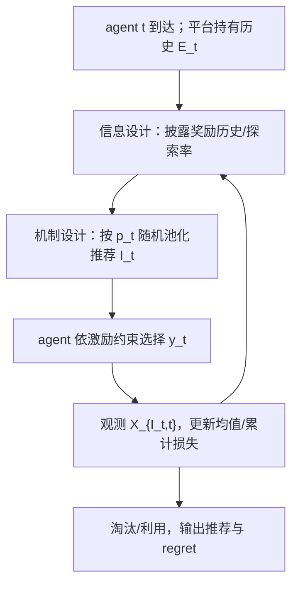
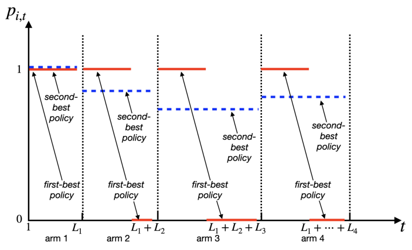

# Incentive-Aware Recommender Systems in Two-Sided Markets (双边市场中的激励感知推荐系统)

- **会议/期刊**: ACM Transactions on Recommender Systems (TORS), 2024
- **作者与机构**: Xiaowu Dai, Wenlu Xu (UCLA); Yuan Qi (Fudan University / Ant Group); Michael I. Jordan (UC Berkeley / Ant Group)
- **推荐链路定位**: 在线推荐/探索策略（Bandit 召回层）
- **研究方向**: 强化学习与动态探索推荐 / 去偏公平与可信推荐
- **论文原文**: [https://arxiv.org/abs/2211.15381v2](https://arxiv.org/abs/2211.15381v2)
- **开源代码**: 暂未检测到公开链接（原文称代码在 GitHub 提供）

## TL;DR (1分钟核心速览)

针对双边市场中用户因机会成本只愿“利用”、不愿“探索”，导致新物品/新创作者曝光不足，本文将推荐建模为带激励约束的多智能体 Bandit：用随机池化加自适应探索率（ARP）或累计损失指数权重（MARP）诱导用户跟随，并证明 ex-post 公平与 $O(\sqrt{mT\ln(mT)})$/$O(\sqrt{T\ln m})$ regret；仿真中 mean regret 显著低于 UCB、Elimination 与 Thompson。

## Background & Motivation (背景与核心矛盾)

- **主流范式**: 平台用 MAB/UCB/Thompson 平衡探索与利用，但默认 agent 会执行推荐。
- **前人局限**: 用户是 myopic 且可拒绝推荐；若推荐臂的期望收益低于机会成本 $c_t$，用户直接忽略，经典 Bandit 会因“无人探索”而卡死。另一矛盾是冷启动物品 ex-ante 不吸引人，但探索对集体有价值，用户却不内化这一收益。
- **核心洞察 (Key Insight)**: 平台不能强制用户探索，但可通过信息设计隐藏臂身份、只披露奖励历史与探索率，并用“好臂+未知臂”的随机池化制造可信推荐；只要探索频率足够低，用户会认为推荐大概率是真的好臂，从而愿意跟随。
- **本文切入点**: 把激励约束显式写入推荐机制，分别处理机会成本已知（ARP）与私有未知（MARP）两种场景。

## Method (核心方法设计)

### 1. 整体框架 (Overall Architecture)

每轮 agent $t$到达，平台先设计信息$\mathcal{E}_t$（披露历史奖励与当前探索率，不暴露臂身份），再按概率向量$p_t$随机推荐臂$I_t$。Agent 观察推荐后，依据激励约束决定$y_t\in\{0,1\}$是否拉臂；平台仅在被跟随时观测奖励$X_{I_t,t}$，并更新均值/累计损失以调整下一轮$p_t$。ARP 在已知$c^*$下做“好臂—未知臂”二臂池化，经采样、探索、淘汰后利用；MARP 在私有$c_t$ 下对全臂做指数权重池化，用动作反馈估计各臂损失。整体是“信息设计→随机机制→激励反馈→regret 控制”的闭环。

### 2. 关键设计拆解 (Key Designs)

1. **激励约束与随机池化推荐**：痛点在于用户只在 $\mathbb{E}[X_{I_t,t}\mid I_t=i,\mathcal{E}_t]\ge c_t$时跟随；平台用$I_t=\sum_{j\in\mathcal{A}}j\cdot\mathbb{1}(U_t\in(\sum_{s<j}p_{s,t},\sum_{s\le j}p_{s,t}])$ 实现可控随机化。这样推荐不是确定性“命令”，而是概率机制，使 agent 无法从单次推荐反推臂身份。

2. **ARP：已知机会成本下的自适应探索率**：先采样一个好臂 $1$且$\mu_1>c^*$，再对未知臂$i$ 设
$p_{i,t}=\frac{\lambda}{2(c^*-\hat M_i)+\lambda}\mathbb{1}\{\hat M_i<c^*\}+\mathbb{1}\{\hat M_i\ge c^*\}$，
其中 $\hat M_i$为历史跟随奖励均值，$\lambda\le\frac34(\mu_1-c^*)$是安全边际。若历史收益低于成本，探索率被压到刚好让用户愿意跟随；若已高于成本，则全速探索。图2 显示 second-best 的$p_{i,t}$ 受激励上限约束，探索比 first-best 更慢但可执行。

<figure class="paper-figure" markdown="span">
  <figcaption>图2. 说明最优与次优策略下 𝑝𝑖,𝑡 的路径。</figcaption>
</figure>

3. **MARP 与公平/regret 目标**：私有 $c_t$ 下无法逐臂保证激励，改用全臂池化
$p_{i,t}=\frac{\exp(-\eta\sum_{s<t}\hat l(i,y_s))}{\sum_j\exp(-\eta\sum_{s<t}\hat l(j,y_s))}$，
其中 $\hat l(i,y_s)=-X_{i,s}y_s/p_{i,s}$（当$I_s=i$，否则 0），$\eta=\sqrt{8\ln m/T}$。低损失臂获得更高曝光，用户忽略本身成为“高损失”反馈。公平约束为$\frac{\beta_t+\mathbb{1}\{\mathbb{E}[X_{I_t,t}]<c_t\}}{\alpha_t+1}\le\gamma_t$，防止回流用户被过度利用。设计目标是最小化
$R_T=\sum_t l(I_t,y_t)-\min_i\sum_t l(i,y_t)$，$l(I_t,y_t)=\max_i\mathbb{E}[X_{i,t}-X_{I_t,t}y_t]$。
无离线训练与负采样；每轮更新 $O(m)$，推理为按$p_t$采样一个臂，无 embedding/ANN 开销。理论上 ARP 达$R_T\le L^*+O(\sqrt{mT\ln(mT)})$，MARP 以高概率达$O(\sqrt{T\ln m})$，并给出匹配下界。

## Experimental Setup & Evaluation Protocol (实验设置与评估协议)

- **数据集与预处理**: 原文为理论+仿真，无真实推荐数据集；下表为模拟设置，无 $5$-core 等过滤。

| 模拟场景 | #Agents(T) | #Arms(m) | #在线交互 | 稀疏度/密度 | 奖励/成本说明 |
| :--- | :---: | :---: | :---: | :---: | :--- |
| Gaussian | 5000 | 5/10/15 | 每重复 $T$次 | 无评分矩阵 |$X\sim\mathcal{N}(\mu_i,0.1^2)\cap[0,1]$，$\mu_i\sim U[0,0.6]$；ARP 用$c^*\in\{0.20,0.25,0.30\}$，MARP 用$c_t\sim\mathrm{Beta}$ |
| Beta | 5000 | 5/10/15 | 每重复 $T$次 | 无评分矩阵 |$X\sim\mathrm{Beta}(1,\beta_i)$，$\beta_i$为$1..m$的随机排列；$c^*\in\{0.05,0.15,0.25\}$ |
| Bernoulli | 15000/8000 | 20 | 每重复 $T$次 | 无评分矩阵 |$X=\sum_{j=1}^{N}\xi_j/N$，$\xi_j\sim\mathrm{Bernoulli}(\mu_i)$，$\mu_i\sim\mathrm{Beta}(0.5,3)$；$c^*\in\{0.05,0.10,0.15\}$ |

- **数据划分与防穿越 (Splitting Strategy)**: 无离线训练/测试划分；agent 按 $t=1,\dots,T$在线到达，500 次独立重复（Bernoulli 为 500 次），不存在未来信息穿越。回流用户通过$(\alpha_t,\beta_t)$ 统计。
- **排名评测协议 (Ranking Protocol)**: 不是 Full-Ranking 或 Sampled Ranking；每轮只推荐一个 arm，评价指标为累计 regret $R_T$，报告 500 次重复的 mean 与 90% confidence interval，并辅以理论上下界。
- **对比基线与超参设置**: 通用基线为 UCB、Elimination、Thompson sampling；理论基准为 full transparency、first-best（忽略激励）与 second-best（ARP 属于此类）。ARP 设 $k=10$、$\tau=0.2$、$\lambda\in[0,1]$；Elimination 设$c=10,\delta=0.05$；MARP 设$\eta=\sqrt{8\ln m/T}$。原文无$p$-value，主要用 90% CI 与理论界。

## Key Experimental Results (实验关键数据)

### 1. 主实验对比 (Main Results)

Gaussian 奖励、$m=10$ 下 ARP 与基线（mean regret，越低越好；原文仅设 3 个通用 Bandit 基线）：

| 方法 | $c^*=0.20$|$c^*=0.25$|$c^*=0.30$ |
| :--- | ---: | ---: | ---: |
| **ARP** | **323.52** | **330.89** | **341.50** |
| Elimination | 547.65 | 892.02 | 1594.64 |
| UCB | 424.12 | 767.30 | 1410.50 |
| Thompson | 1272.91 | 1625.28 | 1943.88 |
| ARP 相对最优基线 ↓ | 23.7% | 56.9% | 75.8% |

Gaussian 奖励、$m=10$、私有成本$c_t\sim\mathrm{Beta}$ 下 MARP：

| 方法 | $\mathrm{Beta}(1,2)$|$\mathrm{Beta}(1,2.5)$|$\mathrm{Beta}(1,3)$ |
| :--- | ---: | ---: | ---: |
| **MARP** | **838.58** | **689.38** | **617.87** |
| Elimination | 1121.88 | 984.68 | 868.23 |
| UCB | 1043.24 | 859.13 | 726.49 |
| Thompson | 1641.67 | 1528.70 | 1412.68 |
| MARP 相对最优基线 ↓ | 19.6% | 19.8% | 15.0% |

### 2. 消融实验 (Ablation Study)

原文未设传统“w/o 模块”消融；下表汇总其成本/规模敏感性，作为激励强度与扩展性的机制证据：

| 机制/因素 | 设置 | mean regret | 观察 |
| :--- | :--- | ---: | :--- |
| ARP 成本升高 | $m=5,c^*=0.20/0.25/0.30$ | 159.51 / 165.87 / 172.94 | 机会成本越高，可信探索越难，regret 略升 |
| ARP 臂数增加 | $c^*=0.25,m=5/10/15$ | 165.87 / 330.89 / 475.08 | 臂数增大致 regret 近似升，但增幅可控 |
| MARP 成本降低 | $m=5,\mathrm{Beta}(1,2)/(1,2.5)/(1,3)$| 738.46 / 576.97 / 452.26 |$\beta$ 增大代表低成本用户更多，激励更易满足，regret 下降 |
| MARP 臂数增加 | $\mathrm{Beta}(1,2),m=5/10/15$ | 738.46 / 838.58 / 1013.10 | 全臂池化下规模增大仍保持最低 regret |

### 3. 关键实验发现 (Key Findings)

1. **激励约束是性能分水岭**：Gaussian $m=10,c^*=0.30$ 时 ARP 为 341.50，而 Elimination/UCB/Thompson 分别为 1594.64/1410.50/1943.88；后者“无激励地探索”导致用户大量忽略，累计 regret 反而爆炸。
2. **私有成本下 MARP 仍稳健**：$m=10,\mathrm{Beta}(1,3)$时 MARP 617.87，较最优基线 UCB 726.49 低 15.0%；$\mathrm{Beta}(1,2)$下较 UCB 低 19.6%，说明累计损失反馈可替代不可观测的$c_t$。
3. **成本降低显著缓解探索难度**：MARP 在 $m=5$下从$\mathrm{Beta}(1,2)$的 738.46 降至$\mathrm{Beta}(1,3)$ 的 452.26（降 38.8%）；成本越低，用户越愿跟随，池化探索的“可信预算”越大。

## Highlights & Limitations (亮点、对比与审稿批判)

- **与代表作对比 (vs. Prior Work)**: 相比 Mansour et al. 的 BIC 固定 explore pool，本文的 ARP/MARP 探索率自适应于历史反馈，并额外保证 ex-post 公平；相比 Che & Hörner 的两臂模型，本文扩展到 $m\ge2$ 且区分已知/私有成本。
- **可迁移亮点**: “随机池化+低频率探索”可直接用于新创作者/冷启动物品曝光；MARP 的累计损失指数权重可用于机会成本不可观测的在线重排或流量分配。
- **审稿级局限批判**: (1) ARP 依赖已知同质 $c^*$与可信好臂$\mu_1>c^*$，若没有“打底”好臂则冷启动失效；(2) MARP 不保证逐轮激励，仅保证公平与 regret，且主定理需已知$T$（虽有未知$T$ 变体）；(3) 仅仿真无真实平台 A/B，评价只有 regret，缺少 CTR/留存等业务指标。

## Rating (四维评分)

- **方法创新性 (Novelty)**: ⭐⭐⭐⭐ （把激励兼容、随机池化与公平约束统一进双边 Bandit，机制设计视角新颖）
- **评估协议与实验扎实度 (Protocol & Experiments)**: ⭐⭐⭐ （理论界完整、500 次重复+90% CI，但仅仿真、基线仅 3 个且无真实数据）
- **写作与数学规范度 (Clarity & Rigor)**: ⭐⭐⭐⭐ （算法、定理与证明链条清晰；常数与信息设计符号较密）
- **工业落地与复现价值 (Industrial & Practical Value)**: ⭐⭐⭐ （冷启动/创作者曝光场景强相关，但依赖已知成本或好臂，且未检测到公开代码链接）

