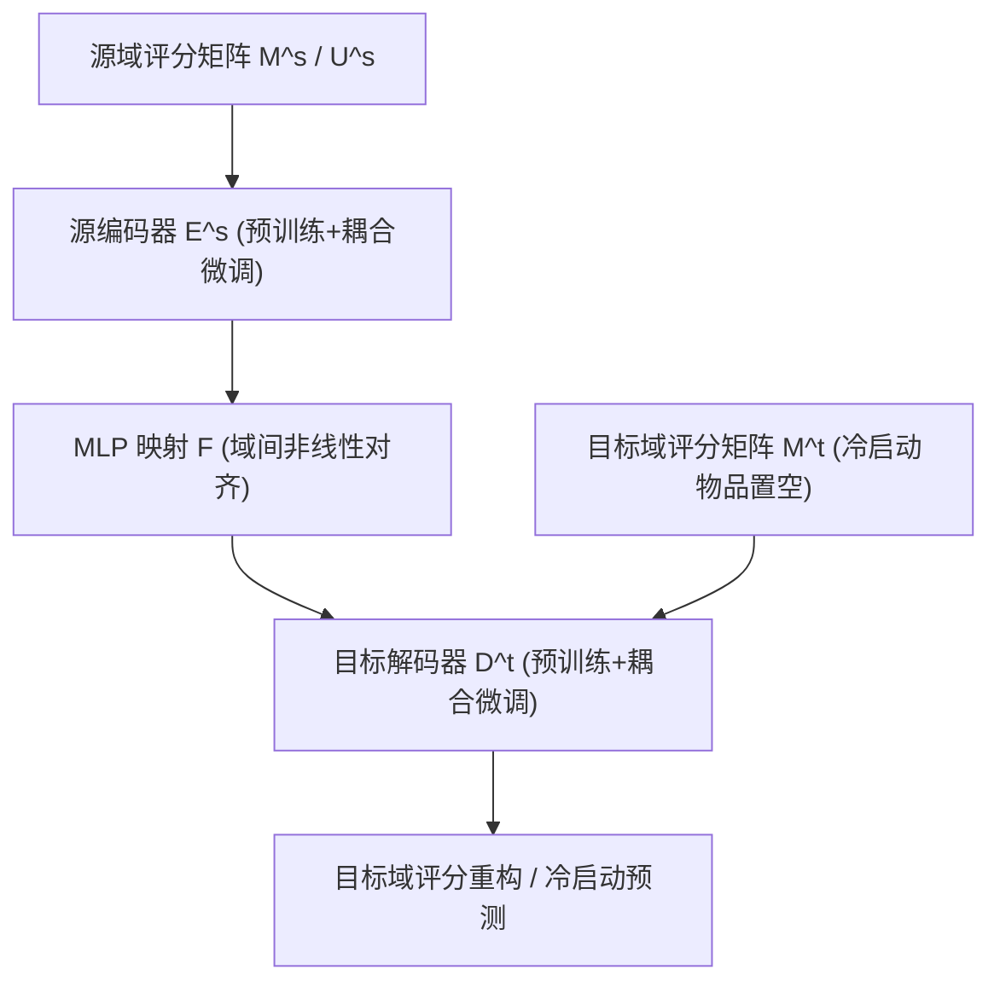
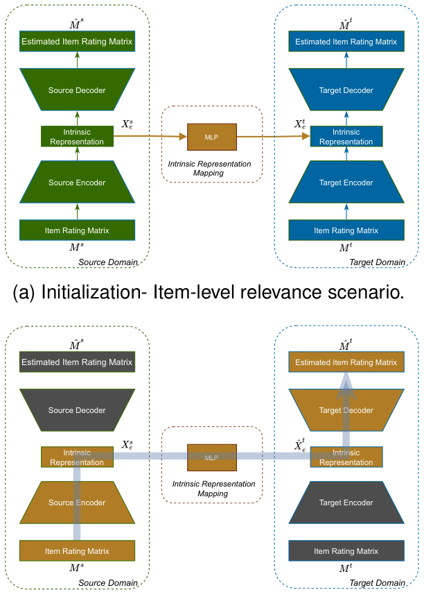
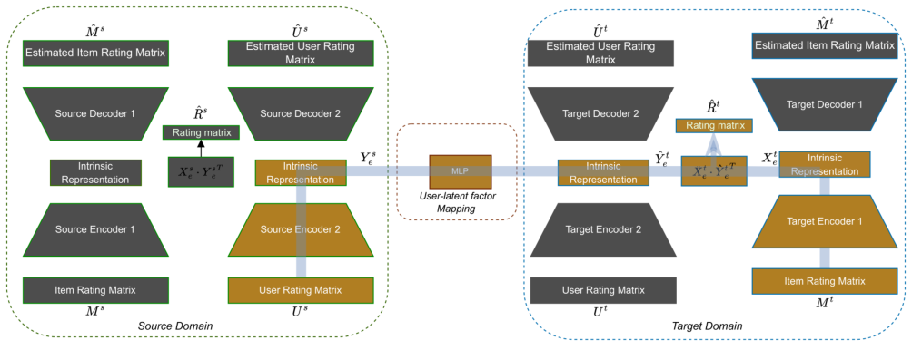

# A cross-domain recommender system using deep coupled autoencoders (基于深度耦合自编码器的跨域推荐系统)

- **会议/期刊**: IEEE TORS（稿件为 arXiv:2112.07617v5，2021 年提交 IEEE 审稿）
- **作者与机构**: Alexandros Gkillas, Dimitrios Kosmopoulos（希腊帕特雷大学 电气与计算机工程系）
- **推荐链路定位**: 召回/冷启动表征迁移（评分预测式跨域映射）
- **研究方向**: 跨域与多场景推荐 / 协同过滤
- **论文原文**: [https://arxiv.org/abs/2112.07617v5](https://arxiv.org/abs/2112.07617v5)
- **开源代码**: 暂未开源

## TL;DR (1分钟核心速览)

针对跨域推荐中“源域与目标域各自独立训练自编码器、隐表征与映射函数割裂导致迁移失效”的痛点，本文在**物品完全重叠/用户不重叠**（item-level，无用户评分泄露、保护隐私）与**用户完全重叠/物品不重叠**（user-level）两种场景下，提出 CACDR 与 LFACDR 两个耦合自编码器框架：先独立预训练再以“源编码器→MLP→目标解码器”堆叠网络进行端到端联合优化。在 MovieLens↔Netflix 冷启动物品设定（80/20 划分，RMSE/MAE）上，LFACDR 平均 RMSE 0.1855，较最强基线 DARec（0.1991）降低 **6.8%**，最高稀疏子集降低 **7.8%**。

## Background & Motivation (背景与核心矛盾)

- **主流范式**: 基于嵌入的跨域推荐（EMCDR、DDTCDR、DARec、CST、LFM）先用 MF/BPR 或自编码器分别抽取源域与目标域的 user/item 隐因子，再用 MLP 或正交矩阵学习域间映射。
- **前人局限**: 其一，MF 类方法只能捕捉线性浅层协同关系，无法刻画用户—物品的非线性结构；其二，更致命的是隐因子学习与映射函数**分阶段独立优化**，训练过程中两域互不影响，跨域迁移只发生在训练结束后的“后处理”环节，源域信息并未真正注入目标域表征。
- **核心洞察 (Key Insight)**: 若把源编码器 $E^s$、映射网络$F$、目标解码器$D^t$ 视为一条前向通路，则目标域评分重构误差可直接反传到源域编码器——域间对齐应当是**训练期内的耦合约束**而非事后拟合；同时物品重叠、用户不重叠的设定天然规避用户隐私泄露。
- **本文切入点**: 用“耦合学习 (coupled learning)”把两域自编码器与映射函数拼成一个可端到端反传的深网，并给出耦合目标下仅激活必要子网络的轻量实现。

## Method (核心方法设计)

### 1. 整体框架 (Overall Architecture)

输入为源域与目标域的评分矩阵（item-level 场景用物品评分矩阵 $M^s, M^t$；user-level 场景用用户评分矩阵$U^s, U^t$，二者共享同一批实体）。训练分两阶段：**Stage A 初始化**——各自训练两域自编码器得到内在表征$X_e^s, X_e^t$，再以 MLP 拟合映射$F: X_e^s \to X_e^t$；**Stage B 耦合学习**——把$E^s \to F \to D^t$串成堆叠网络，以目标域重构误差联合微调全部活跃参数。推理时，目标域冷启动物品先在源域编码、经$F$ 映射到目标表征空间、再由目标解码器还原评分向量，全程无需目标域历史交互。

<figure class="paper-figure" markdown="span">
  <figcaption>图3. 我们提出的跨域推荐CACDR模型示意图。(a) 初始化：首先训练自编码器学习源域和目标域的内在表示（阶段1），然后学习这些表示之间的映射函数（MLP）（阶段2）。(b) 耦合学习：由于自编码器独立训练且跨域间无迁移学习，采用耦合自编码器联合优化自编码器的所有活跃部分，即源编码器、MLP网络和目标解码器）参与……</figcaption>
</figure>

### 2. 关键设计拆解 (Key Designs)

1. **耦合自编码器 CACDR（把映射从后处理变成训练约束）**：分阶段训练下映射误差 $\|X_e^t-F(X_e^s)\|_F^2$与重构误差互不耦合；本文直接以目标域重构为目标，令$\mathcal{L}_{\text{coupled}}=\|M^t-D^t(F(E^s(M^s)))\|_F^2$，使源编码器、MLP、目标解码器共享同一梯度链。直观看，梯度会把“目标解码器难以还原的部分”回推为“源表征需携带的跨域可迁移信息”，从而学到域不变而非域特有的隐表征。

2. **潜因子耦合 LFACDR（在隐因子空间而非原始矩阵空间迁移）**：CACDR 迁移的是整行评分向量表征，维度高、噪声大；LFACDR 为每域配置用户/物品两个自编码器，用联合正则问题逼迫 $X_e, Y_e$同时满足“可重构行向量”与“可内积还原评分矩阵”：$\mathcal{L}^s=\|M^s-D_m^s(X_e^s)\|_F^2+\|U^s-D_u^s(Y_e^s)\|_F^2+\|Y_e^s-E_u^s(U^s)\|_F^2+\|X_e^s-E_m^s(M^s)\|_F^2+\lambda\|X_e^s(Y_e^s)^{\top}-R^s\|_F^2$。耦合阶段仅保留“源物品编码器 + MLP + 目标用户编码器”参与$\mathcal{L}=\|R^t-F(X_e^s)(Y_e^t)^{\top}\|_F^2+\|X_e^s-E_m^s(M^s)\|_F^2+\|Y_e^t-E_u^t(U^t)\|_F^2$，预测式为$\hat{R}^t(i,j)=\hat{X}_e^t(i,:)Y_e^t(j,:)^{\top}$——即只映射物品潜因子，用户侧仍由目标域自身数据驱动，避免负迁移。

<figure class="paper-figure" markdown="span">
  <figcaption>图4. 所提出的跨域推荐LFACDR模型示意图。(a) 初始化：首先训练自编码器获得源域和目标域的物品与用户隐因子（阶段1），然后学习源域和目标域物品隐因子矩阵之间的映射函数（MLP）（阶段2）。(b) 耦合学习：采用耦合自编码器模型联合优化自编码器中参与目标域评分预测的所有活跃部分（即 Source Encoder 1、MLP网络和 Target Encoder 2）。</figcaption>
</figure>

3. **训练目标、负采样与推理效率**：损失为 Masked RMSE（零值即缺失，不参与梯度），Adam 优化，ReLU 激活；CACDR 层结构 {256,128,64,64,128,256}、MLP {64,128}、batch 32、$k=64$；LFACDR 层 {512,256,128,128,256,512}、MLP {128,256}、batch 500、$k=128$。初始化阶段 250 epoch（lr$10^{-3}$），耦合阶段 300 epoch（lr$10^{-5}$）。复杂度：CACDR$O(nLkT)$，LFACDR$O((n+m)LkT)$，与 DARec/DDTCDR 同阶；推理仅一次编码+一次 MLP 前向+一次解码，无候选全库打分开销。

## Experimental Setup & Evaluation Protocol (实验设置与评估协议)

- **数据集与预处理**: 用户按“至少 5 次交互”下采样，并构造 4 个稀疏度递增子集；评分归一化到 $[0,1]$。

| 数据集 | #Users | #Items | #Interactions | 稀疏度 | 特征/场景说明 |
| :--- | :---: | :---: | :---: | :---: | :--- |
| ML↔Netflix No.1 | 40000 / 40000 | 5819 共有电影 | — | 97.22% / 94.80% | item-level，物品完全重叠、用户不重叠 |
| ML↔Netflix No.4 | 44850 / 43775 | 4200 共有电影 | — | 99.59% / 99.36% | 最稀疏子集 |
| Douban Book→Movie | 2120 共有用户 | 8659 / 16584 | — | 99.41% / 98.20% | user-level，用户完全重叠、物品不重叠 |
| Douban Music→Book | 1580 共有用户 | 6888 / 7545 | — | 99.45% / 99.50% | user-level |

- **数据划分与防穿越**: 对共有物品（或共有用户）做 **80%/20% 比例划分**，重复 10 次取均值；测试集物品在目标域中的**全部评分被移除**，构成严格冷启动物品；源域对应物品的评分保留用于迁移，杜绝目标域信息穿越。
- **排名评测协议**: 本文不做 Top-N 排序，采用 **评分预测**协议，指标为 RMSE 与 MAE（全测试集评分回归，非采样/全库排序），因此不存在负采样策略。
- **对比基线与超参设置**: CST、LFM（浅层 MF/迁移）、MF-EMCDR、BPR-EMCDR（分阶段映射）、DDTCDR、DARec（深度域适应）共 6 个 SOTA；隐维度在 {8,32,64,128,256} 上网格搜索，CACDR 最优 $k=64$、LFACDR$k=128$；未报告显著性检验。

## Key Experimental Results (实验关键数据)

### 1. 主实验对比 (Main Results)

MovieLens→Netflix 冷启动物品，RMSE（越低越好）：

| 方法 | No.1 | No.2 | No.3 | No.4 | 平均 | Improv. |
| :--- | :---: | :---: | :---: | :---: | :---: | :---: |
| CST | 0.2399 | 0.2314 | 0.2578 | 0.2673 | 0.2491 | -25.1% |
| LFM | 0.2341 | 0.2228 | 0.2513 | 0.2617 | 0.2425 | -23.5% |
| MF-EMCDR | 0.2289 | 0.2079 | 0.2387 | 0.2494 | 0.2312 | -17.9% |
| BPR-EMCDR | 0.2214 | 0.2018 | 0.2324 | 0.2435 | 0.2248 | -14.6% |
| DDTCDR | 0.2032 | 0.1956 | 0.2107 | 0.2229 | 0.2081 | -6.1% |
| DARec | 0.1783 | 0.1868 | 0.2093 | 0.2221 | 0.1991 | -1.5% |
| CACDR (本文) | 0.1772 | 0.1738 | 0.1980 | 0.2139 | 0.1907 | +4.2% |
| **LFACDR (本文)** | **0.1740** | **0.1711** | **0.1922** | **0.2047** | **0.1855** | **+6.8%** |

MAE 趋势一致（No.4：DARec 0.1687 → CACDR 0.1511 → LFACDR 0.1607 中 LFACDR 为 0.1607、CACDR 0.1511 除外，最优为 LFACDR 0.1607 对比 DDTCDR 0.1789 仍明显更优）。反向 Netflix→MovieLens 亦全面领先，No.4 RMSE 0.1937 vs DARec 0.1999。

### 2. 消融实验 (Ablation Study)

| 变体（MovieLens→Netflix） | CACDR No.1 | CACDR No.4 | LFACDR No.1 | LFACDR No.4 |
| :--- | :---: | :---: | :---: | :---: |
| w/o 耦合学习（仅 Stage A） | 0.1827 | 0.2333 | 0.1849 | 0.2288 |
| w/o 初始化（直接耦合训练） | 0.1801 | 0.2205 | 0.1814 | 0.2126 |
| **完整模型** | **0.1772** | **0.2139** | **0.1740** | **0.2047** |

### 3. 关键实验发现 (Key Findings)

1. **耦合学习的增益随稀疏度放大**：No.1 上 LFACDR 相对 DARec 仅降 2.4%，到 No.4 提升至 7.8%；消融中 LFACDR 去掉耦合阶段后 No.2 从 0.1711 退化到 0.2101（相对恶化 18.6%），说明目标域交互越稀薄，训练期反传注入的源域信号越不可替代。
2. **初始化阶段不可省，非凸优化的“两段式”是必要工程**：LFACDR 去掉 Stage A 后 No.4 由 0.2047 升至 0.2126（劣化 3.9%），CACDR 亦由 0.2139 升至 0.2205，印证端到端耦合若从随机初始化出发会陷入局部极小，预训练实质上是为耦合网络提供数据自适应初值。
3. **潜因子化并非总是更优**：LFACDR 多数场景胜出（因同时利用用户侧信息），但在 Netflix→MovieLens 的 No.2 上（0.1692 vs CACDR 0.1674）反被 CACDR 反超，且代价是参数量与复杂度从 $O(nLkT)$升至$O((n+m)LkT)$，说明当目标域用户侧信号不足时，跨域映射整行表征更稳健。

## Highlights & Limitations (亮点、对比与审稿批判)

- **与代表作对比 (vs. Prior Work)**: 相较 EMCDR（MF 隐因子 + 事后 MLP 映射）与 DDTCDR（双迁移 + 正交约束但两域仍分训），本文的本质差异在于**优化目标的耦合性**——把映射纳入目标域重构损失，使源域表征在训练中即受目标域监督；相较 DARec 的域适应式评分模式迁移，本文以“编码器—映射—解码器”堆叠实现更直接的梯度通路，且天然支持冷启动物品零交互推理。
- **可迁移亮点**: ①“预训练初始化 + 端到端耦合”的两段式训练范式可平移到任何“表征抽取器 + 跨域对齐层”架构（如跨域 GNN、跨场景 CTR 的域间 adapter）；②耦合阶段只激活必要子网络（源编码器+MLP+目标用户编码器），在不增加推理成本的前提下获得全链路反传收益。
- **审稿级局限批判**: ①评估仅限评分预测的 RMSE/MAE，缺少 Top-N 排序（HR/NDCG）与全库排序协议，与现代推荐评测范式脱节，且未报告显著性检验；②场景假设过强——要求物品或用户**完全重叠**，现实中多为部分重叠（如仅有 20%~60% 共有实体），模型对重叠率下降的鲁棒性完全未验证；③基线停留在 2019–2020 年（EMCDR/DDTCDR/DARec），未与图神经网络跨域方法或大规模预训练迁移方案比较；④映射方向单一（仅源→目标），无法双向互惠，也缺乏负迁移风险的定量分析。

## Rating (四维评分)

- **方法创新性 (Novelty)**: ⭐⭐⭐ （耦合学习把域间映射从后处理提升为训练目标，思路干净有效，但“自编码器 + MLP 映射”的组合本身并不新颖，缺理论支撑）
- **评估协议与实验扎实度 (Protocol & Experiments)**: ⭐⭐⭐ （冷启动物品置空、10 次重复、4 档稀疏度设计扎实，但仅 RMSE/MAE、无排序指标、无显著性检验，user-level 结果呈现简略）
- **写作与数学规范度 (Clarity & Rigor)**: ⭐⭐⭐⭐ （公式推导链清晰、逐层拆解耦合目标与预测式，符号表完整，复杂度分析到位；部分表格编号与文字引用错位）
- **工业落地与复现价值 (Industrial & Practical Value)**: ⭐⭐⭐ （推理开销与基线同阶、无需目标域冷启动物交互，具备工程可行性；但重叠率假设苛刻、未开源、Douban 子集规模偏小，复现与线上泛化需谨慎）

