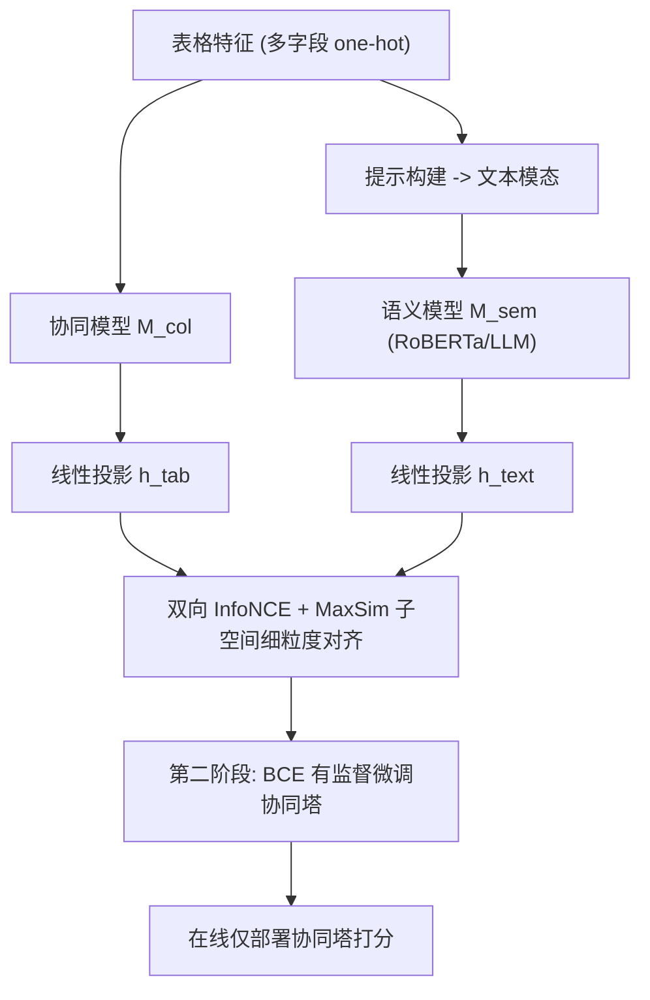
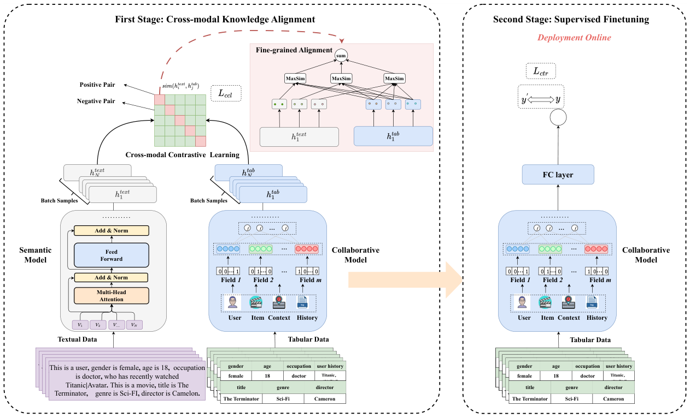

# CTRL: Connect Collaborative and Language Model for CTR Prediction (连接协同模型与语言模型做点击率预估)

- **会议/期刊**: TORS（ACM Transactions on Recommender Systems）；预印本 arXiv:2306.02841 (2023)
- **作者与机构**: Xiangyang Li, Bo Chen, Lu Hou, Ruiming Tang（华为诺亚方舟实验室）
- **推荐链路定位**: 精排（CTR 预估），训练侧引入 PLM，在线仅服务协同塔
- **研究方向**: CTR/CVR 预估与特征交叉 / 大语言模型推荐 (LLM4Rec)
- **论文原文**: [https://arxiv.org/abs/2306.02841v4](https://arxiv.org/abs/2306.02841v4)
- **开源代码**: 暂未开源

## TL;DR (1分钟核心速览)

传统 CTR 模型把多字段表格数据 one-hot 化，只保留共现协同信号而丢弃语义信息（冷启动/长尾失效）；P5、CTR-BERT 等纯语义模型又因 Transformer 结构导致在线推理不可行。CTRL 用「提示构建 + 双向跨模态对比对齐 + 任务微调」两阶段框架，把 RoBERTa/LLM 的语义知识隐式蒸馏进 AutoInt 等轻量协同模型，在线仅部署协同塔。在 MovieLens-1M、Amazon Fashion、Alibaba 三个数据集上（实例级 AUC/Logloss 评估）相对最优协同基线最高提升 4.45%（Alibaba），线上 A/B 七日 CTR +5%，推理时延与骨干完全一致。

## Background & Motivation (背景与核心矛盾)

- **主流范式**: 从 MF、FM 到 DeepFM/DCN/AutoInt，均按 field-wise one-hot 编码后靠内积、外积、cross layer 显式或隐式建模特征共现关系。
- **前人局限**: ① one-hot 化抹去原始特征语义，在冷启动与低频长尾特征上共现关系稀疏，预测失效；② 反其道而行之的 P5/CTR-BERT/P-Tab 直接把文本喂入 PLM，参数量与推理开销巨大（CTR-BERT 在 Alibaba 上单卡推理 4083s vs AutoInt 19s），且放弃协同信号后整体效果反而不如 DeepFM 族。
- **核心洞察 (Key Insight)**: 协同信号与语义信号是互补而非替代关系——PLM 提供的是训练期"外部世界知识 + 推理能力"，其价值应被"搬运"进协同模型，而非在推理期保留 PLM 本身。
- **本文切入点**: 将同一实例的表格形态与提示文本形态视为两个模态，用对比学习在潜空间对齐，使语义知识沉淀到协同塔参数中，部署时即可解耦 PLM。

## Method (核心方法设计)

### 1. 整体框架 (Overall Architecture)

输入是原始多字段表格实例 $x$；先经模板化的 Prompt Construction 转为自然语言句子（用户句 + 物品句，以句号分隔，逗号分隔字段，竖线分隔历史行为），得到$x^{text}$。第一阶段：表格$x^{tab}$进协同模型$\mathcal{M}_{col}$、文本$x^{text}$进语义模型$\mathcal{M}_{sem}$，各自经线性投影到同维度后做双向跨模态对比学习，联合更新两塔参数，把两模态拉入统一表示空间。第二阶段：冻结/丢弃 PLM，仅以对齐后的协同塔接一层随机初始化输出层，用 BCE 做下游 CTR 有监督微调。在线服务只推送协同塔，因此参数规模与推理时延与原骨干模型完全相同，可日更训练（工业侧 1+5 epoch 约 5 小时）。

<figure class="paper-figure" markdown="span">
  <figcaption>图 3：CTRL 的直观示意，其为两阶段框架；第一阶段使用跨模态对比学习对两种模态的知识进行细粒度对齐。第二阶段在下游任务上微调轻量级协同模型。红色方块表示批次中的正样本对，绿色方块表示负样本对。</figcaption>
</figure>

### 2. 关键设计拆解 (Key Designs)

1. **双向跨模态 InfoNCE（对齐两模态潜空间）**：仅用单向对比会产生朝向协同模态的空间偏置，故借鉴 J-S 散度思想构造对称损失。同一实例的文本/表格表示互为正对，批内其它实例构成负对，最终损失为双向平均：

$\mathcal{L}_{ccl}=\frac{1}{2}\left(\mathcal{L}_{text\to tab}+\mathcal{L}_{tab\to text}\right),\quad \mathcal{L}_{text\to tab}=-\frac{1}{N}\sum_{k}\log\frac{\exp(sim(\mathbf{h}^{text}_k,\mathbf{h}^{tab}_k)/\tau)}{\sum_{j}\exp(sim(\mathbf{h}^{text}_k,\mathbf{h}^{tab}_j)/\tau)}$

直觉：对称化使两空间相互靠拢而非单向坍缩，t-SNE 显示对齐前两模态完全分离、对齐后重合为统一流形。

2. **MaxSim 细粒度对齐（打破全局余弦的粗粒度瓶颈）**：余弦相似度只比较整体向量，忽略字段级语义对应。CTRL 将 $\mathbf{h}^{tab}$、$\mathbf{h}^{text}$各投影到$M$ 个子空间，逐子空间取最大相似再求和，替代原相似度函数：

$sim(\mathbf{h}_i,\mathbf{h}_j)=\sum_{m_i=1}^{M}\max_{m_j\in\{1..M\}}(\mathbf{h}_{i,m_i})^{\top}\mathbf{h}_{j,m_j}$

直觉：相当于允许"年龄子空间"去匹配文本中最相关的"年龄语义子空间"，实现类似多视角 late-interaction 的软对齐，缓解了全局池化造成的语义模糊。

3. **训练目标、负采样与推理效率**：负样本全部为 in-batch 采样（batch=6400，温度 $\tau=0.7$），无需显式难负例挖掘；第二阶段目标为$\mathcal{L}_{ctr}=-\frac{1}{N}\sum_k[y_k\log\hat{y}_k+(1-y_k)\log(1-\hat{y}_k)]$。投影统一压到 128 维，嵌入维度$d=32$，隐层$[256,128,64]$。关键工程性质：语义模型只在离线训练存在，在线零开销，可直接日级全量重训。

## Experimental Setup & Evaluation Protocol (实验设置与评估协议)

- **数据集与预处理**: 三份真实工业/公开数据，均转为隐式反馈点击样本：

| 数据集 | #Users | #Items | #Interactions | 稀疏度/密度 | 特征/场景说明 |
| :--- | :---: | :---: | :---: | :---: | :--- |
| MovieLens-1M | 6,040 | 3,952 | 1,000,000 | 用户 5 字段 / 物品 3 字段 | 电影评分转点击 |
| Amazon (Fashion) | 749,232 | 196,637 | 883,636 | 用户 2 字段 / 物品 4 字段 | 时尚品类评论 |
| Alibaba | 1,061,768 | 785,597 | 26,557,961 | 用户 9 字段 / 物品 6 字段 | 淘宝展示/点击日志 |

- **数据划分与防穿越 (Splitting Strategy)**: 沿用 DeepFM/AutoInt 系工作的样本级划分（比例切分构造训练/测试实例），未采用全局时间戳切分；论文未显式讨论时间穿越风险。
- **排名评测协议 (Ranking Protocol)**: **实例级二分类评估**而非全库 Full-Ranking，指标为 AUC↑、Logloss↓ 与 RelaImpr；负例由真实未点击曝光构成（非随机负采样）。AUC 提升 0.001 即视为显著，并做双尾非配对 $t$-检验（$p<0.05$，表中 ★）。
- **对比基线与超参设置**: 协同类 Wide&Deep/DeepFM/DCN/PNN/AutoInt/FiBiNet/xDeepFM；语义类 P5/CTR-BERT/P-Tab；默认骨干 AutoInt + RoBERTa，嵌入维度 $d=32$，AdamW，对齐阶段 lr$1\times10^{-5}$warm-up 至$5\times10^{-4}$、batch 6400，微调阶段 lr 0.001、batch 2048。

## Key Experimental Results (实验关键数据)

### 1. 主实验对比 (Main Results)

| 类别 | 模型 | MovieLens AUC | MovieLens Logloss | Amazon AUC | Amazon Logloss | Alibaba AUC | Alibaba Logloss |
| :--- | :--- | :---: | :---: | :---: | :---: | :---: | :---: |
| 协同 | DeepFM | 0.8268 | 0.4219 | 0.6969 | 0.4645 | 0.6280 | 0.1951 |
| 协同 | DCN | 0.8313 | 0.4165 | 0.6999 | 0.4642 | 0.6281 | 0.1949 |
| 协同 | AutoInt (骨干) | 0.8290 | 0.4178 | 0.7012 | 0.4632 | 0.6279 | 0.1948 |
| 协同 | FiBiNet | 0.8196 | 0.4188 | 0.7003 | 0.4704 | 0.6270 | 0.1951 |
| 协同 | xDeepFM | 0.8296 | 0.4178 | 0.7009 | 0.4642 | 0.6272 | 0.1959 |
| 语义 | P5 | 0.7583 | 0.4912 | 0.6923 | 0.4608 | 0.6034 | 0.3592 |
| 语义 | CTR-BERT | 0.7650 | 0.4944 | 0.6934 | 0.4629 | 0.6005 | 0.3620 |
| 语义 | P-Tab | 0.8031 | 0.4612 | 0.6942 | 0.4625 | 0.6112 | 0.3584 |
| — | **CTRL** | **0.8376★** | **0.4025★** | **0.7074★** | **0.4577★** | **0.6338★** | **0.1890★** |
| — | Improv.(AUC) | +1.90% | — | +3.08% | — | +4.45% | — |

**效率对照**（单卡 V100, Alibaba / Amazon）：CTRL 参数量 $8.82\times10^{7}$/$3.45\times10^{7}$、推理 19s / 0.59s，与 AutoInt 完全一致；P5 为$2.23\times10^{8}$、10832s / 440s，CTR-BERT 为 4083s / 144s。

**兼容性**（MovieLens AUC）：语义塔 TinyBERT(14.5M) 0.8347 → BERT 0.8363 → RoBERTa 0.8376 → BERT-Large 0.8380 → ChatGLM(6B) 0.8396；协同骨干全部受益：Wide&Deep 0.8261→0.8304、DeepFM 0.8268→0.8305、DCN 0.8313→0.8365、AutoInt 0.8290→0.8376。

### 2. 消融实验 (Ablation Study)

| 变体 | MovieLens AUC | Amazon AUC | 结论方向 |
| :--- | :---: | :---: | :--- |
| CTRL (完整) | 0.8376 | 0.7074 | 最优 |
| w/o MaxSim（退化为余弦） | 下降 | 下降 | 细粒度对齐有效 |
| w/o PLM 预训练权重 | 下降最大 | 下降最大 | 增益主因是语言模型世界知识，非对比框架本身 |
| w/ 端到端联合训练 | 低于两阶段 | 低于两阶段 | 多目标冲突损害 CTR 任务 |

### 3. 关键实验发现 (Key Findings)

1. **语义增益严格依赖 PLM 预训练知识而非对齐技巧**：去掉预训练权重后性能跌幅大于去掉 MaxSim 或改为端到端，说明对比学习只是"搬运管道"，知识源仍来自语言模型；这也解释了 ChatGLM(6B) 相对 RoBERTa(110M) 仅再涨 0.002 AUC 的边际递减。
2. **纯语义路线系统性失败**：P5/CTR-BERT 在三数据集 AUC 均低于最强协同模型（MovieLens 0.758 vs 0.831），且时延高 2 个数量级，证明"蒸馏语义进协同塔"是唯一同时兼顾精度与工业可行性的折中，Alibaba 上 +4.45% 的相对提升也说明特征越稀疏、协同共现越弱的数据集收益越大。
3. **提示模板是隐藏超参**：自然语言化 Prompt-1 显著优于去字段名（Prompt-3）或无规则拼接，字段名缺失导致语义信息大幅流失；而连接词用 "-" 还是 ":" 几乎无差异——应保留字段语义而非纠结句法细节。工业侧 7 天线上 A/B 相对基线 CTR +5%，离线 AUC 0.6683 vs AutoInt 0.6586，验证了增益可迁移。

## Highlights & Limitations (亮点、对比与审稿批判)

- **与代表作对比 (vs. Prior Work)**: 相较 P5（生成式全任务统一，重且不可在线）、CTR-BERT（双 BERT 双塔，纯语义、无协同信号）、P-Tab（判别式 MLM 预训练提示，但推理仍需语言模型），CTRL 的本质差异是**训练期对齐、推理期解耦**，把语义模型当作"知识教师"而非"在线打分器"。
- **可迁移亮点**: ① 双向 InfoNCE + MaxSim 子空间对齐可作为通用"跨模态/跨塔知识蒸馏"模块，迁移到序列推荐、跨域推荐或双塔召回；② 部署解耦范式（训练重、推理轻）对 LLM4Rec 落地极具借鉴价值。
- **审稿级局限批判**: ① 评估均为**实例级 AUC/Logloss**，未做全库 Full-Ranking 或冷启动分桶实验，而论文核心动机恰恰是冷启动/长尾，缺少针对性验证闭环；② 数据划分未采用全局时间戳切分，存在泄漏隐忧，且文本负例仅 in-batch、无难负例设计；③ 提示构建为人工模板，对特征数上百的工业场景需要人工筛字段，超参（$M$、$\tau$、128 维投影）敏感性未系统分析。

## Rating (四维评分)

- **方法创新性 (Novelty)**: ⭐⭐⭐⭐ （"训练对齐 + 推理解耦"的跨模态蒸馏思想清晰且工业味十足，MaxSim 子空间对齐有实质增量，但 InfoNCE 与 late-interaction 均为已有组件的合理组合）
- **评估协议与实验扎实度 (Protocol & Experiments)**: ⭐⭐⭐ （三数据集 + 兼容性 + 消融 + 线上 A/B 较完整，但仅有实例级 AUC、缺 Full-Ranking 与冷启动/长尾分桶验证，划分方式交代不足）
- **写作与数学规范度 (Clarity & Rigor)**: ⭐⭐⭐⭐ （提示模板、双向损失、MaxSim 公式定义清楚，效率对照表直观；局限在于缺复杂度与超参敏感性分析）
- **工业落地与复现价值 (Industrial & Practical Value)**: ⭐⭐⭐⭐⭐ （在线零额外延迟、模型无关可插拔、华为线上七日 +5% CTR 的真实落地，可直接复用为 LLM 知识蒸馏管线；仅未开源略减分）

