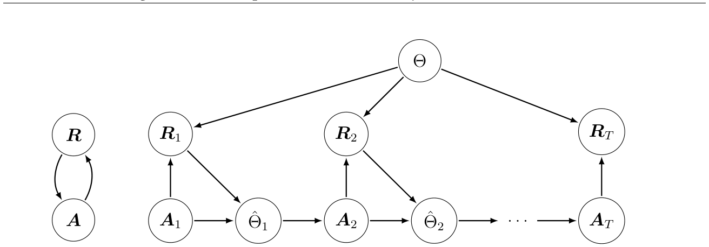
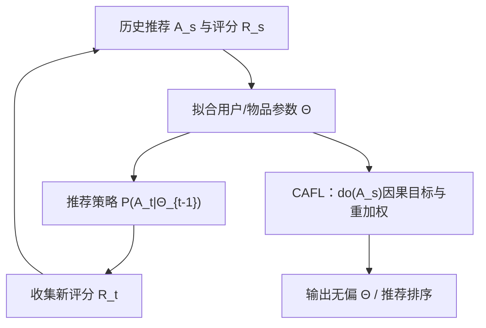

# Breaking Feedback Loops in Recommender Systems with Causal Inference (用因果推断打破推荐系统反馈回路)

- **会议/期刊**: TORS（目录归档 2026；原文 arXiv 2022）
- **作者与机构**: Karl Krauth, Yixin Wang, Michael I. Jordan；UC Berkeley / University of Michigan
- **推荐链路定位**: 多步重训练/召回与训练目标校正（可嵌入任意损失最小化推荐器）
- **研究方向**: 去偏公平、可信隐私与工业架构 / 协同过滤
- **论文原文**: [https://arxiv.org/abs/2207.01616v2](https://arxiv.org/abs/2207.01616v2)
- **开源代码**: 暂未开源

## TL;DR (1分钟核心速览)

多步推荐中“推荐 $A$影响评分$R$，评分又反过来训练推荐器”形成反馈回路，使训练数据被历史策略污染，导致偏好估计有偏、推荐同质化。本文提出 CAFL：把训练目标从观测似然$P(R|A)$改为干预分布$P(R|do(A))$，仅需按上一时刻偏好预测$\hat{\Theta}_{s-1}$ 对损失重加权，并用跨时间平稳性处理“不可重复推荐”导致的 positivity 违反。RecLab 仿真、随机 10 万测试对、10 次运行下，Table 1 的 MSE 从 Pan 的 1.896 降至 1.818（-4.1%），MAE 从 1.042 降至 1.015（-2.6%）。

## Background & Motivation (背景与核心矛盾)

- **主流范式**: 多步推荐交替执行“推荐 $\to$收集评分$\to$ 全量重训”，常用最大似然/矩阵分解聚合各时刻数据。
- **前人局限**: 直接对各时刻似然取乘积，隐含假设数据独立，忽略 $A_s\to R_s\to A_{s+1}$，故$\hat{\Theta}^{naive}_t$ 有偏；反馈回路还会造成“富者愈富”和用户推荐同质化。Pan 等 IPW 校正需长期观测的物品边缘概率，初始阶段不可估且估计误差大。
- **核心洞察 (Key Insight)**: do 干预切断 $A_s$与父节点$\hat{\Theta}_{s-1}$的连接，因此$P(R_s|do(A_s))$跨时间独立；反馈回路仅通过$\hat{\Theta}_{s-1}$ 混杂，调整它即可识别干预分布。
- **本文切入点**: 不改变推荐 backbone，只把因果目标转成加权 MLE，并处理不可重复推荐造成的 positivity 违反。

<figure class="paper-figure" markdown="span">
  <figcaption>图1：(a) 反馈回路描述了推荐 A 影响评分 R 的过程。由于推荐算法基于收集到的评分数据训练，评分 R 反过来又影响推荐 A。(b) 反馈回路展开后的推荐系统在多个时间步上的因果图。</figcaption>
</figure>

## Method (核心方法设计)

### 1. 整体框架 (Overall Architecture)

在 $t$时刻，推荐器依$P(A_t|\hat{\Theta}_{t-1})$推荐物品，收集评分$R_t$，再用历史$\{A_s,R_s\}_{s\le t}$拟合参数模型$P_\Theta$。CAFL 的核心是：训练时不再直接最大化观测似然，而是最大化推荐干预分布下的因果目标；对每个观测$(u,i)$，用其被推荐概率的倒数重加权；若该对在$s$时刻被推荐概率为 0，则用其他时刻的平稳干预分布均值插补。训练完成后仍按$\theta_u^\top\beta_i$排序/采样推荐。实现上只需改损失权重，推理与 backbone 同阶，训练开销随$T$ 线性增长。

### 2. 关键设计拆解 (Key Designs)

1. **因果目标替换观测似然**：naive MLE 将各时刻数据当独立，导致反馈偏差。CAFL 改为
   $\hat{\Theta}^{causal}_t=\arg\max_\Theta\sum_{s=1}^t\mathbb{E}_{A_s}\big[\mathbb{E}_{P(R_s|do(A_s))}[\log P_\Theta(R_s|A_s)]\big]$。
   do 干预切断 $A_s\to R_s\to A_{s+1}$，使目标不再受历史推荐污染；物理直觉是“只学习推荐动作对评分的因果效应，而非学习推荐策略自身的惯性”。

2. **基于 $\hat{\Theta}_{s-1}$的 IPW 与 CAFL 修正**：positivity 成立时，权重为$1/P(A_{s,ui}=a|\hat{\Theta}_{s-1})$，与单步推荐按用户协变量加权的 IPW 不同，它调整的是上一时刻推断偏好。不可重复推荐使该概率为 0、权重无穷；CAFL 用平稳性假设将不可观测项替换为其他时刻的似然均值，并选常数$\mathbf c$ 使各观测期望权重相同。特殊情形权重为
   $W_{ui}=\frac{UI}{UI-s}\big(t-s+\frac{UI-t}{UI-s+1}P(A_{s,ui}=1|\hat{\Theta}_{s-1})^{-1}\big)$，
   其中归一化、Fix 1、Fix 2 分别补偿剩余候选集大小、观测后未再被推荐的时间、早期推荐概率偏小的问题。

3. **训练目标、负采样与推理效率**：总损失为加权最大似然 $\hat L^{CAFL}_{causal}(\Theta;\mathbf c)$；无额外负采样，未推荐/未评分项由权重和常数吸收；backbone 可用 MF、加权 MF、Poisson MF、GMF 等。推理仍为内积排序，额外成本主要是每对$(u,i)$ 的推荐概率与跨时刻累计权重。

## Experimental Setup & Evaluation Protocol (实验设置与评估协议)

- **数据集与预处理**: 使用 RecLab 两个仿真环境及 Pan 复现基准；无真实数据过滤/5-core 步骤。

| 数据集/环境 | #Users | #Items | #Interactions/步数 | 稀疏度/密度 | 特征/场景说明 |
| :--- | :---: | :---: | :---: | :---: | :--- |
| beta-rank-v1 | 原文未列 | 原文未列 | 逐步生成至 100K 数据点 | N/A（仿真） | 合成偏好+反馈回路，测 RMSE/NDCG/同质化 |
| ml100k-v1 | 943 | 1682 | 由 ML-100K 拟合 MF 初始化，逐步生成 | N/A（仿真） | 真实数据初始化的动态仿真 |
| Pan 复现基准 | 3000 | 1000 | 30 步×3000 推荐；20 训练/用户，20 测试/用户 | N/A（仿真） | GMF 预测 MSE/MAE |

- **数据划分与防穿越 (Splitting Strategy)**: 仿真在线时间步收集；图 2/3 测试集为随机 10 万用户-物品对且运行中不可被推荐；Table 1 每用户前 20 个采样物品作训练，后 10 个不参与，另采 20 个未观测评分作测试。非 Leave-One-Out，非全局时间戳切分。
- **排名评测协议 (Ranking Protocol)**: 采样测试集评估，非全库 Full-Ranking；RMSE/NDCG 在随机 10 万测试对上计算，Table 1 在每用户 20 个未观测对上算 MSE/MAE；训练无负采样（显式评分，未推荐置 0）。
- **对比基线与超参设置**: MF 用 ALS；Table 1 用 GMF+Adam，沿用 Pan 等超参；ml100k-v1 隐向量 100 维；10 次运行报告均值与 95% 置信区间，原文未给 $p$ 值。

## Key Experimental Results (实验关键数据)

### 1. 主实验对比 (Main Results)

| 校正方法 | MSE↓ | MAE↓ | 相对 Pan 提升 |
| :--- | :---: | :---: | :---: |
| Naive | 2.001±0.066 | 1.087±0.021 | — |
| Pop | 1.990±0.035 | 1.080±0.010 | — |
| PF | 1.945±0.038 | 1.065±0.010 | — |
| Pan | 1.896±0.042 | 1.042±0.011 | — |
| **CAFL（本文）** | **1.818±0.019** | **1.015±0.005** | **MSE -4.11% / MAE -2.59%** |

### 2. 消融实验 (Ablation Study)

原文未提供逐模块消融；下表以 Table 1 的损失变体作可复核的组件/对照消融（同 backbone、同切分）：

| 训练目标变体 | MSE↓ | MAE↓ | ΔMSE vs CAFL |
| :--- | :---: | :---: | :---: |
| w/o causal reweight（Naive） | 2.001 | 1.087 | +10.1% |
| w/ popularity weights（Pop） | 1.990 | 1.080 | +9.5% |
| w/ PF | 1.945 | 1.065 | +7.0% |
| w/ Pan sequential IPW | 1.896 | 1.042 | +4.3% |
| CAFL full | **1.818** | **1.015** | 0 |

### 3. 关键实验发现 (Key Findings)

1. **CAFL 显著优于顺序 IPW 校正**：Table 1 中 CAFL 较 Pan 的 MSE 降 0.078（4.11%）、MAE 降 0.027（2.59%）；较 Naive 的 MSE/MAE 分别降 9.15%/6.62%，说明只调整“给定上一时刻偏好预测的推荐概率”比估计长期边缘概率更数据高效。
2. **仿真动态中提升预测与排序，但仍逊于 Uniform**：图 2/3 显示 CAFL 的 RMSE/NDCG 均优于 Feedback，但多数情形仍落后于 Uniform；这是因为 CAFL 只能用观测反馈逼近 Uniform 的经验风险，每步可观测数据量更少。
3. **同质化收益依赖反馈是否为因**：ml100k-v1 中反馈回路加剧同质化时，CAFL 降低 Jaccard 变化并接近 Uniform/Oracle；beta-rank-v1 中反馈不导致同质化时，CAFL 甚至可能提高 Jaccard，提示同质化并非总由反馈回路造成，评估必须隔离反馈效应。

## Highlights & Limitations (亮点、对比与审稿批判)

- **与代表作对比 (vs. Prior Work)**: 相比 Naive MLE，CAFL 显式建模跨时间依赖并用 do 干预切断回路；相比 Pan 的 IPW，它不依赖长期边缘观测概率，只条件于 $\hat{\Theta}_{s-1}$；相比 RLURE，Theorem 2 推广到每步多数据点与 positivity 违反场景。
- **可迁移亮点**: 只改损失权重即可嵌入任意损失最小化推荐器；用“上一时刻推断偏好”而非用户协变量做 IPW；用平稳性插补不可观测项，适合不可重复曝光场景。
- **审稿级局限批判**: 实验仅限仿真，无真实线上 A/B；Theorem 2 依赖无干扰与干预分布跨时间平稳，真实偏好漂移下可能失效；常数 $\mathbf c$ 与 backbone 选择敏感，且无开源代码，复现成本较高。

## Rating (四维评分)

- **方法创新性 (Novelty)**: ⭐⭐⭐⭐ （do 干预+CAFL 权重将反馈回路形式化为可识别因果目标，理论清晰但 IPW/do-calculus 非全新。）
- **评估协议与实验扎实度 (Protocol & Experiments)**: ⭐⭐⭐⭐ （10 次运行、95% CI、两套仿真+Pan 基准较完整；但缺少真实数据和逐模块消融。）
- **写作与数学规范度 (Clarity & Rigor)**: ⭐⭐⭐⭐ （Lemma/Theorem 链条完整，符号较密但定义清楚；权重直觉解释充分。）
- **工业落地与复现价值 (Industrial & Practical Value)**: ⭐⭐⭐ （仅改损失权重易落地，但需推荐概率、平稳假设与调参，且无开源代码、线上验证缺失。）

