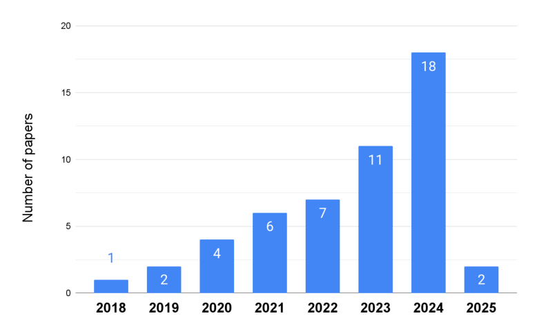
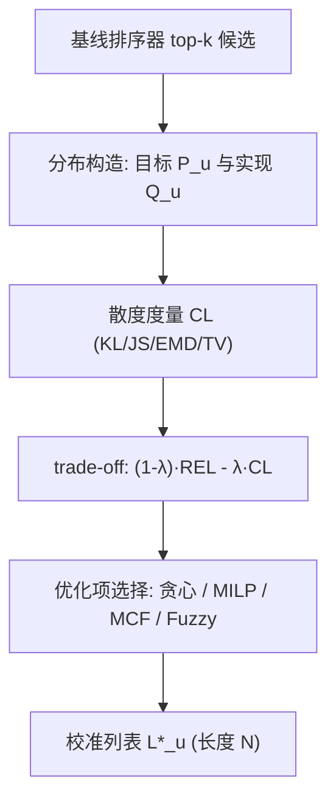
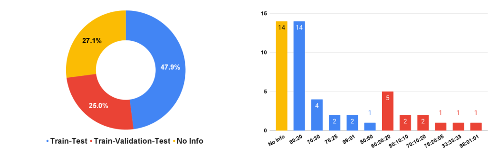

# Calibrated Recommendations: Survey and Future Directions (校准推荐：综述与未来方向)

- **会议/期刊**: ACM Transactions on Recommender Systems (TORS)
- **作者与机构**: Diego Corrêa da Silva, Dietmar Jannach（University of Klarentfurt, 奥地利）
- **推荐链路定位**: 重排（后处理式 Re-ranking，少数工作内嵌进模型训练）
- **研究方向**: 去偏公平、可信隐私与工业架构 / 多任务学习与列表级重排
- **论文原文**: [论文原文链接](https://arxiv.org/abs/2507.02643v1)
- **开源代码**: 暂未开源（综述性质，无新增代码）

## TL;DR (1分钟核心速览)

校准推荐要求推荐列表中物品属性（类型、流行度、质量）的分布与用户历史偏好分布一致，从而避免「单一主题化」推荐并缓解流行度偏置与公平性问题。本文以系统化文献法（ACM DL + Google Scholar，2018 年起）筛出 53 篇论文，首次把 Steck 的 KL 散度重排范式统一拆成七个可替换组件，并给出评测协议与实证效果的元分析：88% 工作仅做离线评测、仅 1 篇真实线上 A/B，且 27.1% 论文未报告数据划分方式，是该方向最重要的复现性缺口。

## Background & Motivation (背景与核心矛盾)

- **主流范式**: 近十年推荐研究以「把最相关物品排到列表头部」为目标，校准则属于 "beyond-accuracy" 思潮：在保持相关性的同时约束列表的属性分布。技术上以**后处理重排**为主，与底层召回/排序算法解耦，因此可直接套在任意 CF 模型之上。
- **前人局限**: 其一，均匀化的多样性（如 MMR、覆盖度最大化）是**全局、非个性化**的，会让「70% 言情 + 30% 动作」的用户收到 50:50 的列表；其二，静态校准假设历史偏好同权，忽略偏好漂移与近期意图，且 λ 与流行度阈值等超参缺乏标定准则，实际落地易失效。
- **核心洞察 (Key Insight)**: 校准的本质不是"更分散"，而是**列表属性分布 $Q$逼近用户画像分布$P$**；一旦把它写成「相关性 − λ·分布散度」的效用最大化问题，任何距离度量、任何属性（类型/流行度/质量/创作者）都可插拔复用。
- **本文切入点**: 不做新算法，而是把散落在 53 篇论文中的设计选择**归一化为同一组算子**，并横向对比其复杂度、评测协议与线上证据。

<figure class="paper-figure" markdown="span">
  <figcaption>图1. 每年校准推荐相关出版物数量。</figcaption>
</figure>

## Method (核心方法设计)

### 1. 整体框架 (Overall Architecture)

综述把 Steck (RecSys'18) 的流程抽象为七步流水线：先用任意基线排序器生成用户 $u$的相关性有序列表；截取 top-$k$（主流$k=100$，也有 10/20 或 1000）作为候选集；用相关性函数累加得到列表整体相关度；分别由历史交互$H_u$与候选列表$L_u$推导目标分布$P_u$与实现分布$Q_u$；选择散度度量$CL(\cdot,\cdot)$；用权衡系数$\lambda$把两个目标合并为单一效用；最后在候选集上用贪心/整数规划/分支定界/模糊逻辑求解长度$N$ 的列表。少数工作（DACSR、TecRec、GCN-POI、DecRS）跳过重排，把散度直接写进损失函数或邻居选择，从而避免二次打分开销。

### 2. 关键设计拆解 (Key Designs)

1. **多值属性的分布构造与零值平滑**：痛点在于一部电影同属多个类型，直接按计数会高估热门类型。作者归纳出统一算子——先按 $prop(g|i)=1/|g(i)|$均分类型权重，再以评分$w_{u,i}$ 加权聚合：

$p(g|u)=\frac{\sum_{i\in H_u}\mathbb{1}(g\in g(i))\,w_{u,i}\cdot prop(g|i)}{\sum_{i\in H_u}\mathbb{1}(g\in g(i))\,w_{u,i}}$实现分布$q(g|u)$同式但用预测分$\hat{w}_{u,i}$。长尾类型在$P$中占比极小，一旦被推荐就"超额"抬高散度而被永久排除，故 Steck 引入平滑$\tilde{q}(g|u)=(1-\alpha)q(g|u)+\alpha p(g|u)$（$\alpha=0.01$），保证每个类型在$Q$ 中非零、保留可探索性——这是整个框架中**唯一不可省的数值稳定项**。

2. **散度度量与权衡目标**：校准质量由 $CL_{KL}(P_u,Q_u)=\sum_g p(g|u)\log\frac{p(g|u)}{q(g|u)}$度量，选 KL 因其在$P=Q$ 时为零、对微小差异敏感且偏好平缓分布。整体目标为

$L_u^*=\arg\max_{L,|L|=N}(1-\lambda)\sum_{i\in L}\hat{w}_{u,i}-\lambda\,CL(P_u,Q(L_u))$

$\lambda=0$退化为纯精度排序，$\lambda=1$为极致校准。综述指出该式把「精度损失」与「分布偏离」放进同一量纲，是后续所有变体（对数化、个性化 λ、系统级全局 λ、混合整数线性规划 MILP 化）的共同母版；但 λ 与候选集大小$k$ 互为耦合，二者均无公认取值。

3. **优化项选择与推理开销**：精确求解是 NP-hard。Steck 用替代子模贪心获得 $(1-1/e)$近似保证；Top-Z 用$|G|\times Z$ 控制重排池以省算力；MCF 把问题化为最小费用流，MILP 与分支定界追求更优解，Fuzzy D'Hondt 兼顾公平排序。复杂度排序（Jeon 等的实测）为 MCF 最慢、MILP 次之，Steck 贪心与 Jeon 方法同级且显著更快——这决定了工业侧默认应选贪心族。

## Experimental Setup & Evaluation Protocol (实验设置与评估协议)

- **综述语料与筛选**: 检索式覆盖 "calibrated recommendation(s)/recommender(s)" 等 7 种变体，限定 2018 年后、英文、非预印本/学位论文，仅保留对校准有实质贡献者；ACM DL 命中 57 篇、Google Scholar 356 篇，最终纳入 53 篇（含 2011 PPTM、2017 Jugovac 两篇未使用"校准"术语的前驱工作）。

| 维度 | 统计结果 | 说明 |
| :--- | :--- | :--- |
| 年份分布 | 2018–2024 逐年上升，2024 增幅最大 | 领域仍在高速增长期 |
| 发表载体 | >80% 会议/ workshop，<20% 期刊 | RecSys 12 篇、UMAP 5 篇、WWW 4 篇 |
| 贡献类型 | 技术提案 ~58%、影响分析次之、对比研究最少 | 缺少统一 benchmark |
| 应用域 | 电影近乎全覆盖（多为 MovieLens），音乐次之，其余均 <5 篇 | 域外泛化性未知 |
| 基线算法 | ~90% 使用 CF；BPR、ItemKNN、UserKNN 频率最高 | 内容/混合/上下文方法 <10% |
| 校准目标 | 类型为主；流行度（Head/Middle/Tail 三档）、质量、视频标签、用户性别年龄 | 多目标仅 Jugovac、Gomez 等少数 |

- **数据划分与防穿越 (Splitting Strategy)**: 综述统计显示 **27.1% 论文完全未报告划分方式**；已报告者中 **47.9% 仅做 train/test 二划分（主流 80:20）**，**25% 采用 train/valid/test 三划分（主流 60:20:20）**，划分多按随机或时间戳。校准文献普遍**缺少验证集调 λ**，这是超参不可比的直接原因。
- **排名评测协议 (Ranking Protocol)**: 未形成统一协议；离线为主（88%），用户研究 8%（5 篇，样本 32–500 人），线上 A/B 仅 2%（1 篇）。精度侧常用 NDCG、Precision、Recall（MRR/MAP/MAE 少见），校准侧用 KL/JS/EMD/加权全变差，并出现 MACE、MRMC、CMC、CCE、NACE 等归一化校准专用指标以支持跨论文比较。显著性检验在多数原文中未统一执行。
- **对比基线与超参**: 因缺少统一框架，各文自选基线；λ 常在 $[0,1]$以 0.1 步长扫描，候选集$k$取值 10–1000，$\alpha$ 取 0.01。

<figure class="paper-figure" markdown="span">
  <figcaption>图6. 数据划分概览、划分分区及比例。</figcaption>
</figure>

## Key Experimental Results (实验关键数据)

### 1. 代表性方案横向对比（综述归纳，原文无统一实验表）

| 方案 | 校准目标/度量 | 项选择算法 | 相对表现与开销 |
| :--- | :--- | :--- | :--- |
| Steck (2018) | 类型 / KL | 替代子模贪心 | 基准方案；$(1-1/e)$ 保证，复杂度低 |
| Abdollahpouri CP | 流行度三档 / JS | Steck 重排 | 流行度偏置显著下降，精度小幅损失 |
| Naghiaei MILP | 类型 / JS | 混合整数线性规划 | 略优于贪心，**复杂度第二高** |
| Abdollahpouri MCF | 类型 / 散度 | 最小费用流 | 解质量好但 **最慢**，大规模不可用 |
| Top-Z (Zhao) | 类型 / KL（反向推荐用户） | 池大小 $|G|\times Z$ | 效率与校准折中更平滑 |
| Fuzzy D'Hondt | 类型 / 模糊逻辑 | 模糊比例分配 | 用户研究中**略优于纯多样化** |
| DACSR / TecRec | 序列分布 / 交叉熵 | 内嵌训练 | 免二次重排，适配序列场景 |
| DecRS (Wang) | 去偏 / 后门调整 | 因果图内嵌 | 抑制偏置放大，个性化 λ |

### 2. 组件与配置敏感性（"消融"归纳）

| 变更项 | 观察到的方向性结论 |
| :--- | :--- |
| 去掉分布平滑 $\alpha$（$\alpha\to0$） | 长尾类型被永久排除，校准与覆盖度同时恶化 |
| 候选集 $k$: 100 → 10/20 | 精度损失变小，但可校准空间被压缩 |
| 候选集 $k$: 100 → 1000 | 校准更优，重排开销线性上升 |
| 相关性函数：求和 → NDCG 型 | 基准实验显示二者性能接近，差异不显著 |
| 散度：KL/JS → 归一化分布 + 熵/时间权重 | 归一化稳定提升 precision 与 calibration；熵式分布优于归一化版 |
| 单一 λ → 个性化 λ（用户级） | 在部分基线上稳定增益，但效果依算法而异 |
| 57 种距离度量基准测试 | Vicis Emanon2、Kulczynski S、Kumar Johnson、Additive Chi 稳定最优，优于 KL/JS |

### 3. 关键实验发现 (Key Findings)

1. **评测协议远比算法创新薄弱**：88% 离线 / 8% 用户研究 / 2% 线上的失衡，加上 27.1% 论文未报告划分、47.9% 只用二划分，使跨论文的校准收益几乎不可比——58% 论文提出新技术，却无一篇在统一数据、预处理与基线上做全量对比。
2. **精度—校准权衡在真实系统中可能并不存在**：唯一的生产级 A/B（Klimashevskaia 等）显示，校准流行度可在**不损失 CTR** 的前提下提升长尾曝光；瓶颈不在精度，而在「Head/Tail 阈值」难以标定，阈值不当会让干预强度不足而无显著行为差异。
3. **校准对用户是"不可见"的**：Alves 等（500 人）与 Lesota 等（56 人）均发现，除非界面显式标注"已校准/更公平"，用户察觉不到分布变化；Ungruh 等（40 人）进一步显示流行度偏置变化不显著影响满意度，只影响熟悉度——即客观指标改善 ≠ 主观价值提升。

## Highlights & Limitations (亮点、对比与审稿批判)

- **与代表作对比 (vs. Prior Work)**: 相较 Steck 的单点方法论文，本文提供的是**组件级地图**（七步 × 各步可选实现）；相较 da Silva & Durão 的 57 种距离度量基准，本文把度量选择放回完整流水线中讨论；相较既有 beyond-accuracy 综述，本文首次量化了校准领域的**评测协议缺陷**与其对结论可信度的影响。
- **可迁移亮点**: ①「相关性 − λ·分布散度」的效用写法可直接迁移到多任务重排中的**公平性/多样性约束项**，只需替换 $P_u$的定义；②$\alpha$ 平滑是解决「目标分布零概率导致候选被永久屏蔽」的通用技巧，可复用于长尾扶持与探索-利用平衡。
- **审稿级局限批判**: ①作为综述，**未提供任何统一复现实验**，"哪种方法更好"的结论仍停留在原文自报口径，读者无法据此选型；②对工业侧最关心的**延迟预算与候选集规模的定量关系**仅引述他文复杂度排序，缺少绝对时延/吞吐数据；③未讨论冷启动（$H_u$缺失时$P_u$ 无定义）与偏好漂移下的形式化方案，仅作为 future work 提出。

## Rating (四维评分)

- **方法创新性 (Novelty)**: ⭐⭐⭐ （综述本身无新算法，价值在于七步组件的统一形式化与平滑项/度量族的系统梳理）
- **评估协议与实验扎实度 (Protocol & Experiments)**: ⭐⭐⭐⭐ （53 篇系统化筛选 + 划分/基线/指标/评测方式的量化元分析扎实，但缺统一复现实验）
- **写作与数学规范度 (Clarity & Rigor)**: ⭐⭐⭐⭐⭐ （符号表完整、目标/实现分布与权衡目标公式统一，组件替换关系表述清晰）
- **工业落地与复现价值 (Industrial & Practical Value)**: ⭐⭐⭐⭐ （明确指出贪心族优于 MCF/MILP 的开销结论与唯一线上 A/B 证据，对落地选型直接有用；无代码）

