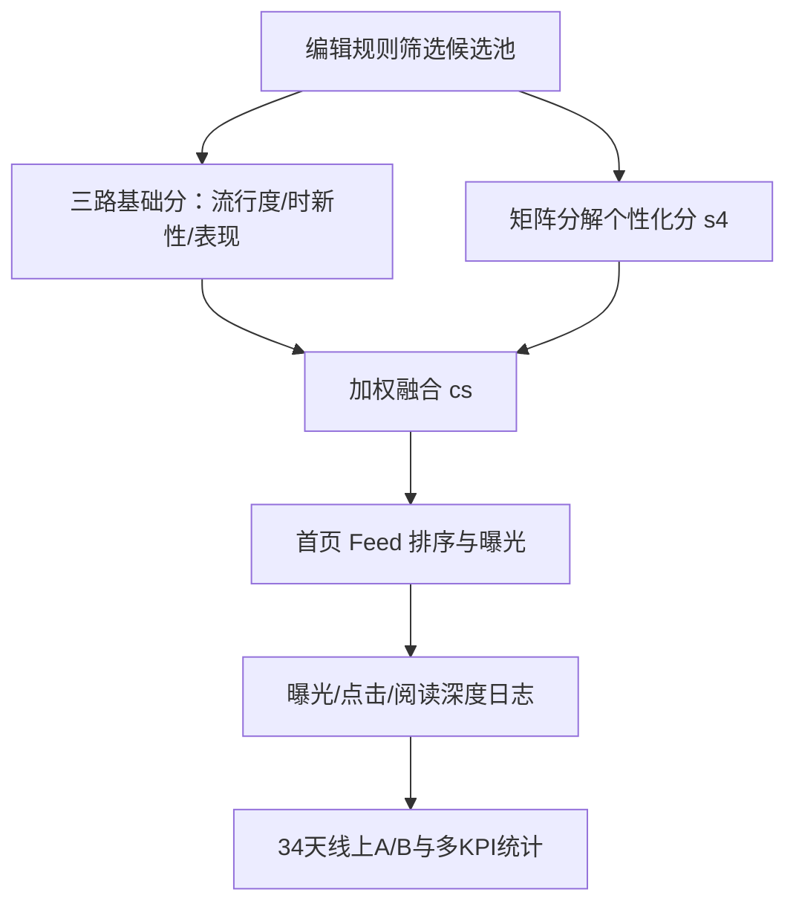

# Controlled Personalization in Legacy Media Online Services: A Case Study in News Recommendation (传统媒体在线服务中的受控个性化：新闻推荐案例研究)

- **会议/期刊**: TORS (ACM Transactions on Recommender Systems)
- **作者与机构**: Marlene Holzleitner, Stephan Leitner, Hanna Lind Jorgensen, Christoph Schmitz, Jacob Welander, Dietmar Jannach；University of Klagenfurt / Schibsted / University of Bergen
- **推荐链路定位**: 精排 / 首页 Feed 排序（重排级融合）
- **研究方向**: 去偏公平、可信隐私与工业架构 / 新闻推荐工业 A/B 与流行度去偏
- **论文原文**: [论文原文链接](https://arxiv.org/abs/2510.09136v2)
- **开源代码**: 暂未开源

## TL;DR (1分钟核心速览)

针对传统媒体不敢全盘算法化的痛点，本文在挪威 Aftenposten 首页 Feed 中，将矩阵分解个性化分以 20% 权重融入流行度/时新性/表现分，进行 34 天、约 5.8 万付费订阅者的线上 A/B。结果显示 CTR +14.6%、人均曝光 -11.7%、日点击覆盖率 +4.0%、流行物品点击占比 -4.1%，证明“受控个性化”可兼顾参与度与编辑价值。

## Background & Motivation (背景与核心矛盾)

- **主流范式**: 新闻推荐研究多聚焦 Google News、Yahoo! News 等聚合平台，以 CTR 为核心优化目标；传统媒体则采用编辑精选+算法排序的混合模式。
- **前人局限**: 其一，legacy media 的线上因果证据稀缺，既有 A/B 多只看 CTR，少评估多样性、覆盖率与流行度偏差；其二，编辑价值（公共议题、多元观点）与算法参与度目标存在张力。
- **核心洞察 (Key Insight)**: 无需让算法主导排序，只需引入有限个性化信号，就可能显著改变用户发现相关内容的行为。
- **本文切入点**: 在真实生产系统上做 34 天用户级随机 A/B，以多 KPI 检验“受控个性化”是否能在不牺牲编辑价值的前提下提升参与度。

## Method (核心方法设计)

### 1. 整体框架 (Overall Architecture)

系统先由编辑规则确定可自动排序的文章池，保留编辑对前四位及 3–4 个关键位的控制；对池内文章计算流行度、时新性、近期 CTR 三路 0–100 分，并新增矩阵分解个性化分。四路分数按固定权重归一化融合后生成首页 Feed 排序。个性化分每 3 小时用最近 21 天付费订阅者点击矩阵重训，仅作用于自动排序位。线上以用户级随机 A/B 比较 Control 与 Treatment，记录曝光、点击、阅读深度与停留时长，用于多 KPI 统计。

### 2. 关键设计拆解 (Key Designs)

1. **受控加权融合（Controlled Score Fusion）**：痛点是为保编辑价值不敢让算法主导。本文将个性化作为第四路分，$\mathrm{cs}_{i,u}=\frac{\sum_{n=1}^{3}w_n s_n+w_4 s_{4,u}}{\sum_{n=1}^{3}w_n+w_4}$，权重设为$(0.40,0.20,0.20,0.20)$，个性化最多占 20%。直觉是保留流行度/时新性锚点，避免个性化把头条与突发新闻挤出。
2. **21 天矩阵分解个性化分**：新闻生命周期短、兴趣漂移快。对付费订阅者隐式点击矩阵做 MF，仅保留 21 天内、文章累计 $\ge 100$ 点击的交互，分数归一化到 0–100，每 3 小时重训。短窗口适配新闻动态，冷启/突发内容仍由基础分兜底。
3. **曝光级多 KPI 评估**：既有 A/B 多只看 CTR。本文记录 impression、click、reading percentage、activity duration、section 与文章流行度，配合 bot 过滤与多种显著性检验，区分曝光多样性与消费多样性，从而排除“标题党式 CTR 上涨”。

训练目标为隐式交互矩阵分解的重建损失（细节因保密未披露）；未使用负采样；推理对约 1.6k 候选池全量打分，每 3 小时重训，在线开销低，但论文未报告延迟。

## Experimental Setup & Evaluation Protocol (实验设置与评估协议)

- **数据集与预处理**: 仅移动端、付费且订阅 $\ge 2$ 个月的活跃用户；排除编辑手工位，仅保留自动排序位；仅保留至少被点击一次的文章；bot 过滤规则为 >13 事件/分、>9 动作/<2 秒、>10 次点击 10 天前旧文。

| 组别 | #Users | #Items | #Clicks | #Impressions | 稀疏度/说明 |
| :--- | :---: | :---: | :---: | :---: | :--- |
| Control | ~28k | 1,621（全期） | ~336k | ~641k | 隐式曝光-点击日志 |
| Personalization | ~28k | 1,621（全期） | ~339k | ~563k | 同上，随机分流 |
| 合计 | ~56k | 1,621 | ~675k | ~1.204M | 约 2M 曝光+点击事件 |

- **数据划分与防穿越 (Splitting Strategy)**: 线上用户级随机 A/B，2023-11-30 至 2024-01-02，共 34 天，剔除首尾半天；非离线切分，无训练/测试穿越。
- **排名评测协议 (Ranking Protocol)**: 生产环境全量候选排序（非采样），曝光级 CTR；无离线 Full-Ranking。统计 $\alpha=0.05$，按分布用 t/Welch/Mann-Whitney/$\chi^2$/置换检验，报告 Cohen’s$d$、Cliff’s delta、Cramér’s V 与 bootstrap CI。
- **对比基线与超参设置**: 仅 Control（非个性化 ranker）vs Treatment（受控个性化），无外部 SOTA；权重见下表；MF 维度与正则未披露。

| Ranker | $w_1$Popularity |$w_2$Recency |$w_3$Performance |$w_4$ Personal. |
| :--- | :---: | :---: | :---: | :---: |
| Control | 0.50 | 0.25 | 0.25 | — |
| Personalized | 0.40 | 0.20 | 0.20 | 0.20 |

## Key Experimental Results (实验关键数据)

### 1. 主实验对比 (Main Results)

| 指标 | Control | Personalized | 相对变化 (Improv.) | 显著性 |
| :--- | :---: | :---: | :---: | :---: |
| CTR | 0.524 | **0.601** | +14.60% | $p<0.01$ |
| CCR | 0.015 | 0.015 | 0.0% | n.s. |
| IPU | 22.462 | **19.834** | -11.70% | $p<0.05$ |
| CPU | 11.786 | **11.924** | +1.17% | $p<0.01$ |
| RP (%) | 48.941 | 48.825 | -0.20% | $p<0.05$ |
| AD (s) | 103.363 | **105.085** | +1.67% | $p<0.01$ |
| 日 CTR | 0.525 | **0.601** | +14.48% | $p<0.001$,$d>2$ |
| 日点击覆盖率 | 0.902 | **0.938** | +3.99% | $p<0.001$ |
| PPI | 0.876 | **0.840** | -4.11% | $p<0.001$ |

### 2. 消融实验 (Ablation Study)

本文未做模型组件消融；以下以用户活跃度分层作为替代分析，展示个性化在不同人群上的异质效应。

| 分层 | Control CTR | Pers. CTR | ΔCTR | Control IPU | Pers. IPU | ΔIPU |
| :--- | :---: | :---: | :---: | :---: | :---: | :---: |
| Low | 0.611 | 0.672 | +9.98% | 1.617 | 1.555 | -3.83% |
| Medium | 0.527 | 0.594 | +12.71% | 2.775 | 2.556 | -7.89% |
| High | 0.449 | 0.544 | +21.16% | 5.515 | 4.481 | -18.75% |

### 3. 关键实验发现 (Key Findings)

1. **CTR 与滚动成本同步改善**：CTR 0.524→0.601（+14.60%），IPU 22.462→19.834（-11.70%），CPU 反升 1.17%，CCR 不变；说明用户更少滚动即可找到相关内容，且并非 clickbait。
2. **重度用户收益最大**：高活跃组 CTR +21.16%、IPU -18.75%，低活跃组仅 +9.98%/-3.83%；个性化对高频阅读者的排序收益更明显。
3. **多样性提升且流行度偏差下降**：曝光 Gini 0.650→0.615，日点击覆盖率 0.902→0.938（+3.99%），PPI 0.876→0.840（-4.11%），日 ARP 141.683→71.843（-49.29%），受控个性化反而削弱了流行度偏差。

## Highlights & Limitations (亮点、对比与审稿批判)

- **与代表作对比 (vs. Prior Work)**: 相比 Das 等 Google News 的 38% CTR 提升与 Liu 等的 +30% 混合模型，本文不是聚合平台算法竞赛，而是 legacy media 的 20% 受控融合；相比 Lu 等 10 天、1,108 人的“dynamism”实验，本文覆盖 34 天、约 5.8 万用户，并同时评估多样性、覆盖率与流行度偏差。
- **可迁移亮点**: 将业务规则分与个性化分做可解释加权融合，适合编辑权重的工业场景；曝光级日志+bot 过滤+多 KPI 统计管线可直接复用到新闻/内容平台。
- **审稿级局限批判**: 单站点、单设备（移动端）、付费订阅者样本，34 天难以覆盖长期留存与订阅流失；权重为专家手工设定，MF 细节与原始数据因保密缺失，部分指标效应量较小，且无外部算法基线与全目录覆盖率真值。

## Rating (四维评分)

- **方法创新性 (Novelty)**: ⭐⭐⭐ （算法增量有限，核心是受控融合与工业因果证据；多 KPI 评估视角有价值）
- **评估协议与实验扎实度 (Protocol & Experiments)**: ⭐⭐⭐⭐ （34 天、5.8 万用户随机 A/B，多种统计检验与效应量；但单站点、无外部基线）
- **写作与数学规范度 (Clarity & Rigor)**: ⭐⭐⭐⭐ （公式、KPI 与权重定义清晰；MF 细节与数据因保密缺失）
- **工业落地与复现价值 (Industrial & Practical Value)**: ⭐⭐⭐⭐⭐ （已上线生产，权重融合与曝光级评估管线可直接复用）

