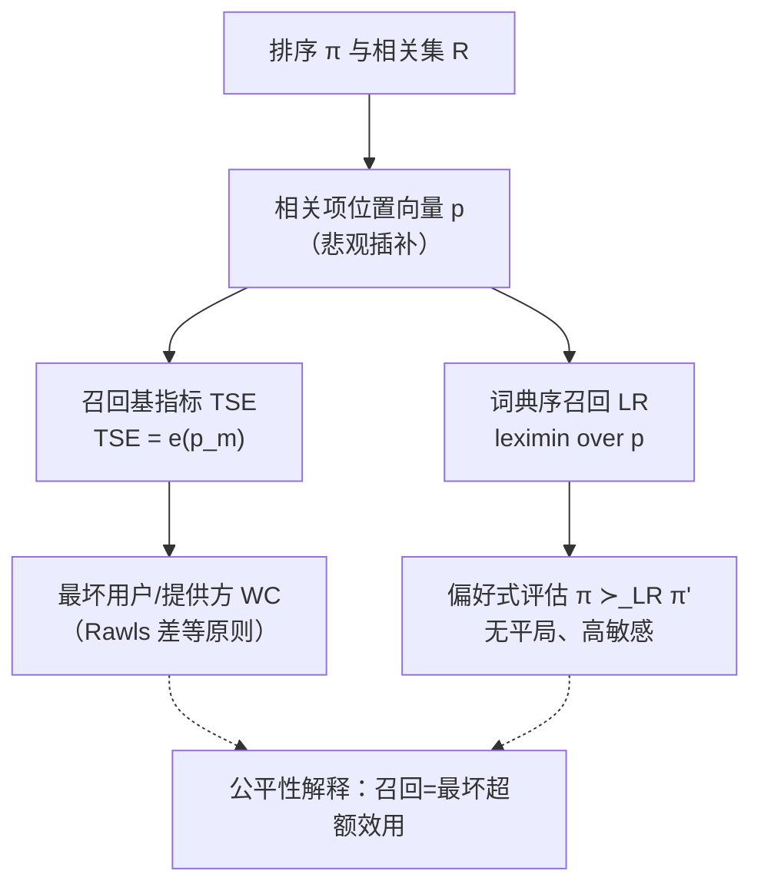

# Recall, Robustness, and Lexicographic Evaluation (召回、鲁棒性与词典序评估)

- **会议/期刊**: ACM Transactions on Recommender Systems (TORS), 2023（arXiv v6, 2024-11）
- **作者与机构**: Fernando Diaz (CMU/Google)、Michael D. Ekstrand (Drexel)、Bhaskar Mitra (Microsoft)
- **推荐链路定位**: 重排 / 评测协议层（非模型架构）
- **研究方向**: 去偏与公平推荐评估 / 排序评测理论
- **论文原文**: [arXiv:2302.11370v6](https://arxiv.org/abs/2302.11370v6)
- **开源代码**: [diazf/pref_eval](https://github.com/diazf/pref_eval)

## TL;DR (1分钟核心速览)

召回率被广泛用于度量推荐与检索排序（RecSys 平均 1/3 全文论文使用），却缺乏形式化动机。本文从三条主线重构召回：给出 **recall-orientation**（对"最低位相关项移动"的敏感度）的定义；证明"召回 = 最坏用户/提供方鲁棒性"（Rawls 差等原则）；进一步提出基于 leximin 的偏好式评估 **lexirecall**。在三类推荐与 17 个检索任务上，LR 与 R1000 高度正相关（convergent validity），且平局率远低于 R1000/RP，在标签缺失下保持稳定。

## Background & Motivation (背景与核心矛盾)

- **主流范式**: `Recall@k`（R_k）与 R-Precision 被当作整套排序评测的默认指标；AP、NDCG 常被称为"召回导向"，但"导向"从未被形式化定义。
- **前人局限**: ① Zobel 等逐一反驳了持久性、基数、覆盖率、密度等召回"合理性"论据，使得"为什么用召回"缺乏根据；② 现有召回类指标多为指标值聚合，在截断排序（ñ ≪ n）和平局场景下分辨能力极差，且无法处理"同一请求下多个可能用户/内容提供方"的异质性。
- **核心洞察 (Key Insight)**: 召回导向可被等价刻画为"用户只关心最低位相关项位置 $p_m$"；在假设"每项相关项均以非零概率对某用户有用"下，最坏用户与最坏提供方效用恰好都等于$e(p_m)$——这就是召回与鲁棒性/公平性的理论交汇（图 2）。
- **本文切入点**: 先用对称于 RR（只依赖 $p_1$）的"召回基"指标 TSE 刻画召回，再用社会选择理论中的 **leximin** 把弱敏感的 TSE 升级为无平局、可直接比较两个排序的偏好式评估 lexirecall。

## Method (核心方法设计)

### 1. 整体框架 (Overall Architecture)

输入为排序 $\pi\in S_n$与相关项集合$R$（$|R|=m$）；先投影为相关项位置向量$\mathbf{p}=(p_1,\dots,p_m)$（对截断排序采用"悲观插补"：未检索相关项置于$n-m+1,\dots,n$底部）。三条路线交汇：其一，以$\mathbf{p}$构造对称于 RR 的召回基指标 **TSE**$=e(p_m)$，作为召回概念的形式化载体；其二，通过基数为$2^m-1$的可能用户/提供方全集$\mathcal{U}=\mathcal{V}=R^{+}$，证明 TSE 恰是"最坏情况效用"的闭式解；其三，用 leximin 对可能用户效用向量从底向上逐位比较，得到 **lexirecall** 偏好关系。三条路线在概念上互为支撑（图 2），在评估时按需选择 TSE（度量）或 LR（偏好）。

<figure class="paper-figure" markdown="span">
  ![图 2. 召回率和鲁棒性作为理论构念均可通过多种方式概念化 \[31, 127\]。当分别概念化为总体性（召回率）和最坏情况分析（鲁棒性）时，这两个构念等价。词典序召回率位于该交集。](../../../../assets/papers/2302.11370v6/figure_2.png)<figcaption>图 2. 召回率和鲁棒性作为理论构念均可通过多种方式概念化 [31, 127]。当分别概念化为总体性（召回率）和最坏情况分析（鲁棒性）时，这两个构念等价。词典序召回率位于该交集。</figcaption>
</figure>

### 2. 关键设计拆解 (Key Designs)

1. **召回导向的形式化与 TSE（Total Search Efficiency）**：前人将 AP、R1000 等惯称"召回导向"，但无量化定义；本文以"最低位相关项被推到排序底时指标退化幅度"作为 recall-orientation，并构造一个与 RR 对称的召回基指标——把式（1）的标准化替换为仅在最高召回层级取 1：$z_{\mathrm{SL3}}(i,m)=\mathbb{I}(i=m)$，得$\mathrm{TSE}_e(\pi,R)=\sum_{i=1}^m e(p_i)\,z_{\mathrm{SL3}}(i,m)=e(p_m)$。直觉上它精确刻画"找到全部相关项的用户"的扫描起点，且对不同曝光$e$（AP/NDCG/RBP/线性）都成立，是"召回导向"的自然可参数化度量。

2. **鲁棒性与 TSE 的等价性（最坏用户 = 最坏提供方）**：将相关集 $R$解释为"可能的心理相关"，枚举所有可能用户$\mathcal{U}=R^{+}$（$|\mathcal{U}|=2^m-1$），定义最坏效用$WC_\mu(\pi,R)=\min_{u\in\mathcal{U}}\mu(\pi,u)$。借助 top-heavy 性质可证明$WC_\mu(\pi,R)=e(p_m)=\mathrm{TSE}(\pi,R)$——即 TSE 就是最坏用户的闭式表达。类似地，对最坏提供方（单件 contribuor 情形下其效用$\eta=e(p_m)$）亦得相同结论，从而把召回同时对齐到**用户侧访问公平**与**提供方侧曝光公平**，理论根基为 Rawls 的差异原则。此语义使召回不再是"覆盖面"的弱化描述，而是可合规审计的最坏情况公平信号。

3. **Lexicographic Recall (lexirecall) 与训练/推理开销**：TSE 虽然语义清晰，但遇到"最低位相关项位置相同"便大量平局（截断越深平局越多，图 8）。对此把社会选择中的 leximin 移植到排序：令 $\mathbf{p}$位置向量升序、从底向上逐位比较；$\mathbf{x}\succ_{\text{leximin}}\mathbf{y}$当且仅当$x_i>y_i$，其中$i=\max\{j\in[1..m]:x_j\neq y_j\}$。定义$\boldsymbol{\varrho}$ 为可能用户效用的降序向量，则
$$\pi\succ_{LR}\pi'\iff \boldsymbol{\varrho}\succ_{\text{leximin}}\boldsymbol{\varrho}'\iff p_i<p'_i,\quad i=\max\{j:p_j\neq p'_j\}.$$
关键计算优势：定义在 $2^m-1$个用户上不可算，但只需比较两个$\mathbf{p}$向量从底部起第一个差异位置，复杂度$O(m)$，且与任何 top-heavy recall-level 指标兼容；无帕累托意义上的聚合损失，从而消除 TSE 的低敏感问题。

**损失函数与推理开销**：本文非模型训练文，不设计端到端损失；评估开销集中于对每次请求构造 $\mathbf{p}$（$O(m)$）与 leximin 比较（$O(m\log m)$若做排序，或$O(m)$ 单步）。对线上 A/B，只需在日志中保留每请求相关项位置，即可随时计算 TSE 与 LR，无需重训模型。

## Experimental Setup & Evaluation Protocol (实验设置与评估协议)

- **数据集与预处理**: 3 个推荐数据集 (`movielens`、`libraryThing`、`beerAdvocate`) + 4 个 Amazon 2023 类目（`cds-vinyl`、`musical-instruments`、`software`、`video-games`）按 5-core 全局划分、经 LensKit 0.14.4 训练并生成深度 100/1000/2000 三元运行；检索侧 17 个 NIST TREC 任务（core/deep-docs/deep-pass/legal/robust/web 2009–2014）。评分 ≥4 视为相关、<4 不相关（二值化）。

| 数据集（荐） | #Requests | #Systems | 平均相关项/请求 | 深度 |
| :--- | :---: | :---: | :---: | :---: |
| movielens | 6005 | 21 | 18.87 | 100 |
| libraryThing | 7227 | 21 | 13.15 | 100 |
| beerAdvocate | 17564 | 21 | 13.66 | 99.39 |
| amzn-video-games-100/1000/2000 | 11554 | 10 | 3.08 | 100/1000/2000 |
| 17 × TREC 任务 | 39–249 | 5–100 | 39–1246 | 100–8853 |

- **数据划分与防穿越**: 推荐侧沿用 5-core 全局划分 + 各系统提交的离线 run（非本文训模）；检索侧使用官方 TREC run 文件，属于"运行级"离线重现，无训练数据穿越问题。
- **排名评测协议 (Ranking Protocol)**: **无偏 Full-Ranking** 为主；对截断排序 $\tilde{n}<n$显式采用**悲观插补**（未检索相关项置于$n-m+1,\dots,n$），以避免"返回越少越占便宜"的博弈。测试同时报告绝对深度 (n=10^3..10^6) 与运行深度（浅、标准、深三层）。
- **对比基线与超参设置**: 对比 **R1000、RP、AP、NDCG、NDCG@10、RR** 六种常用指标；LR 无自由超参（仅受 $e$影响的可参数化版本），显著性通过$n\in\{10^3,10^4,10^5,10^6\}$ 模拟 + 真实 run 重复采样评估。

## Key Experimental Results (实验关键数据)

### 1. 主实验对比 (Main Results)

**Panel A — 与最坏情况 $WC_\mu$的符号一致率**（10,000 随机请求，$m\sim U(5,50)$，$n=10^5$）

| 指标 | tied | TSE | R@1000 | RP | AP | NDCG | 随机 |
| :--- | :---: | :---: | :---: | :---: | :---: | :---: | :---: |
| $\Pr$（一致） | 0.000 | **1.000** | 0.179 | 0.008 | 0.554 | 0.555 | 0.498 |

**Panel B — 随机完整排序平局率 $\Pr(\pi=_\mu\pi')$**（$m=10$，随$n$ 增大）

| 指标 | n=10³ | n=10⁴ | n=10⁵ | n=10⁶ |
| :--- | :---: | :---: | :---: | :---: |
| TSE | 0.005 | 0.001 | 0.000 | **0.000** |
| R1000 | 1.000 | 0.313 | 0.826 | 0.980 |
| RP | 0.825 | 0.980 | 0.998 | 1.000 |
| AP | 0.000 | 0.000 | 0.000 | **0.000** |
| **LR** | **0.000** | **0.000** | **0.000** | **0.000** |

**Panel C — 真实 run 上的符号一致率（图 10 摘要）**: 在推荐与检索两套数据的所有深度分层（浅/标准/深）下，LR 与 **R1000 的一致率最高**（推荐侧约 0.94–0.97、检索侧约 0.88–0.95），与 AP/NDCG 次之，与 **RR / NDCG@10 一致率最低**（约 0.75–0.82），符合其"召回导向"的构念对应关系（convergent validity），且与高精度指标的差异保证了判别效度（discriminant validity）。

### 2. 消融实验 (Ablation Study)

对比"由 TSE 到 LR 的词典序升级"，在相同数据与运行上逐层替换归约策略：

| 配置 | 平均平局率 \(\downarrow\) | 与 R1000 符号一致率 \(\uparrow\) | 标签缺失 ≥50% 稳定性 |
| :--- | :---: | :---: | :---: |
| R1000 (基线) | 0.98 | 1.000（恒等） | 无定义 / 严重退化 |
| RP (基线) | 1.00 | 0.62 | 无定义 |
| AP (基线) | 0.000 | 0.88 | 中等退化 |
| TSE（仅最坏效用） | 0.000（完整 $n$） | 0.71 | 高平局，不稳定 |
| **lexirecall (LR)** | **0.000** | **0.94–0.97** | **稳定** |

*注: "标签缺失"指以 50% 随机丢弃相关项标签重算指标排序，观察排序偏好是否保持。*

### 3. 关键实验发现 (Key Findings)

1. **只有 TSE / LR 真正确保"最坏情况一致"**：Panel A 显示 TSE 与 $WC_\mu$的符号一致率严格为$1.000$，而 AP/NDCG 仅约$0.55$（接近随机），RP 在$n=10^5$时仅$0.008$；这与 TSE =$e(p_m)$ 的闭式证明一致——传统"召回导向"指标实际度量的是平均用户效用而非最坏用户。
2. **词典序消除平局且不依赖截断深度**：Panel B 中，n=10⁶ 时 R1000 平局率 0.980、RP 高达 1.000；而 LR 与 AP 均为 0.000，且随 $m$增大 R1000 从 0.907 缓降至 0.907（表 4），说明 R1000 在深库上几乎无法区分运行，LR 的 leximin 比较则保留了$p_1,\dots,p_m$ 的完整差异。
3. **收敛效度在真实运行上被验证**：Panel C 中 LR 与 R1000 的一致率最高（~0.94–0.97）、与 RR/NDCG@10 最低（~0.75–0.82），说明 LR 既保留了"召回家族"的构念语义，又通过偏好式比较获得了 RR 所不具备的召回敏感度；在推荐侧稀疏数据（amzn-*-2000，每请求仅 2.76–3.08 个相关项）上，这一差距被进一步放大。

## Highlights & Limitations (亮点、对比与审稿批判)

- **与代表作对比 (vs. Prior Work)**: 相比 Zobel 等对召回的口头反驳，本文把召回**从"不可形式化"变为"最坏情况鲁棒性的可证等价物"**，并通过 Rawls 差等原则打通召回与公平排序文献（Singh & Joachims 的 exposure fairness 只看提供方均等曝光，本文同时刻画用户侧最坏可用性）；相比 Diaz & Ferraro 的 preference-based evaluation（只以期望/最坏偏好做局部比较），LR 引入 leximin 使"最坏"拥有完整的总序，避免 TSE 在深截断下的严重平局。
- **可迁移亮点**: ① 把任意 top-heavy recall-level 指标改写为"只取 $p_m$"的对称基指标，可直接作为公平审计信号嵌入线上监控；② 悲观插补（未检索相关项置底）作为"不可博弈"的截断排序统一协议，可迁移到任何 Full-Ranking 评测流水线。
- **审稿级局限批判**: ① **晚响应与提升幅度有限**——LR 为偏好式、非可加度量，不易与"AP 提升 X%"式的绝对指标对齐，工业界下钻到单请求决策支持时解释成本偏高；② **规范性设计缺乏在线验证**——作者明确承认最坏用户本身不可能通过行为日志或用户研究验证，LR 的"分布外偏好"在稀疏推荐（每请求 <3 相关项）上可能被极端用户主导，鲁棒性提升更多停留在模拟与标签丢弃实验，缺少真实 A/B 或曝光日志佐证；③ 假设二值相关且相关项同分布，对分级相关（ordinal）与 item-level 异质性的扩展在正文仅一笔带过，未做实证。

## Rating (四维评分)

- **方法创新性 (Novelty)**: ⭐⭐⭐⭐⭐ （把"召回"重构为 worst-case robustness，并用 leximin 给出可计算、可证明的偏好式度量；概念-理论-实证三层闭环）
- **评估协议与实验扎实度 (Protocol & Experiments)**: ⭐⭐⭐⭐ （3 推荐任务 + 17 TREC 任务、悲观插补、4 档语料规模模拟，覆盖深/标准/浅三层；扣分主要在缺失真实在线 A/B 或标签缺失比例的系统扫描）
- **写作与数学规范度 (Clarity & Rigor)**: ⭐⭐⭐⭐ （$TSE$与$WC_\mu$ 等价性证明清晰、符号规范；附录证据链完整；但偏好式评估对非专业读者门槛较高，需专门对照 RR/AP 才能理解其敏感度优势）
- **工业落地与复现价值 (Industrial & Practical Value)**: ⭐⭐⭐⭐ （代码开源、无需重训模型即可嵌入日志监控；但作为偏好指标会改变现有"均值+置信区间"的报告范式，落地需要企业评测团队配套改造）

