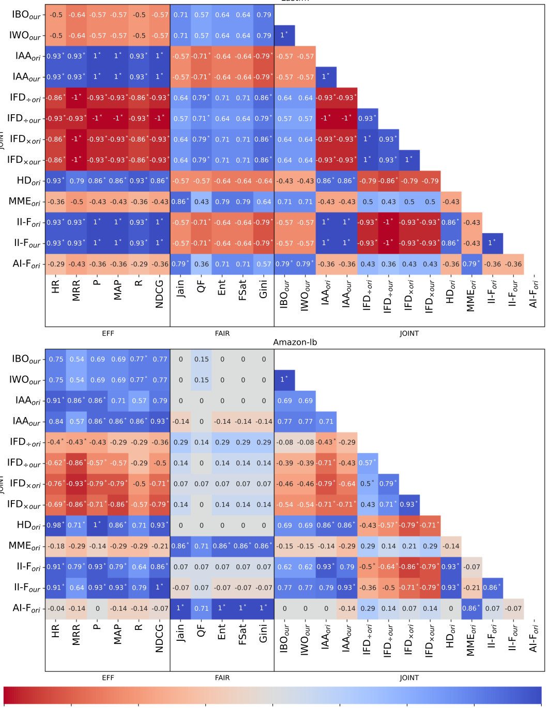
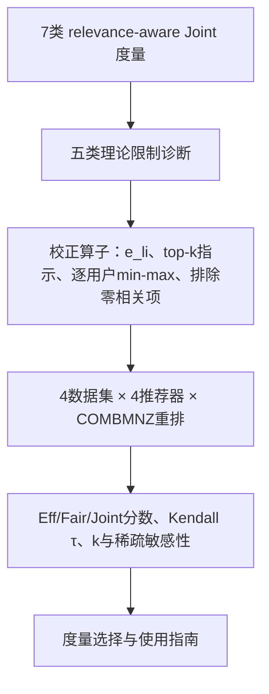
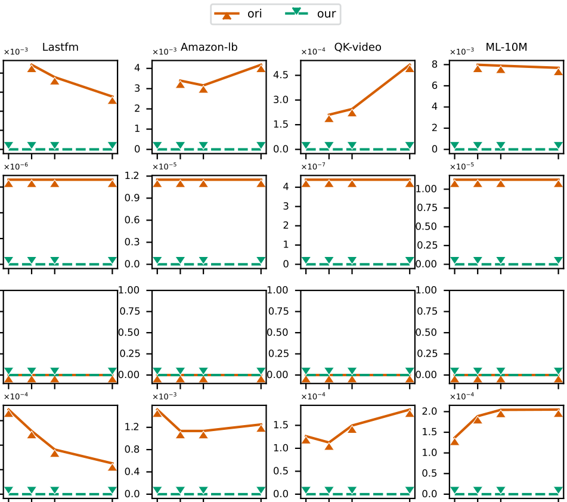

# Relevance-aware Individual Item Fairness Measures for Recommender Systems: Limitations and Usage Guidelines (相关性感知的推荐系统个体物品公平度量：局限与使用指南)

- **会议/期刊**: ACM Transactions on Recommender Systems (TORS) 2026
- **作者与机构**: Theresia Veronika Rampisela, Maria Maistro, Tuukka Ruotsalo, Falk Scholer, Christina Lioma；University of Copenhagen / LUT / RMIT
- **推荐链路定位**: 重排与离线评测协议
- **研究方向**: 去偏公平、可信隐私与工业架构 / 公平度量与重排评估
- **论文原文**: [论文原文链接](https://curis.ku.dk/ws/files/545706776/Relevance-aware.pdf)
- **开源代码**: [开源代码仓库链接](https://github.com/theresiavr/relevance-aware-item-fairness-measures-recsys)

## TL;DR (1分钟核心速览)

本文针对相关性感知个体物品公平度量缺乏系统审查的问题，收集 IAA、IFD、HD、MME、IBO/IWO、II-F、AI-F 等度量，指出非可实现性、非局部性、未定义、零曝光与 top-k 不敏感五类缺陷；通过逐用户 min-max 归一化、top-k 指示函数和线性曝光函数重定义进行校正，并在 4 个真实数据集、4 个推荐器与 COMBMNZ 重排下用全库排序协议验证校正后分数可解释且可区分模型。

## Background & Motivation (背景与核心矛盾)

- **主流范式**: 推荐公平评测分为曝光-only 与 relevance-aware 两类；后者同时考虑物品曝光与用户相关性，常用 IAA、IFD、HD、MME、IBO/IWO、II-F、AI-F 等度量。
- **前人局限**: 曝光-only 度量已被系统分析，relevance-aware 度量却多从 IR/bandit 迁移而来，其在 top-k、稀疏数据、二值相关性下的理论边界未被审查。
- **核心洞察 (Key Insight)**: 7 类度量全部至少存在一个限制；原式常把不公平压成近零或 `nan`，导致不同模型的公平结论不可比甚至被误读。
- **本文切入点**: 定义五类限制，能校正的给出修正，不能校正的证明不可解，并用真实与合成实验给出使用指南。

<figure class="paper-figure" markdown="span">
  <figcaption>图1. Joint、Eff 与 Fair 度量在 Lastfm 和 Amazon-lb 上的 Kendall 𝜏 相关性。星号（∗）表示经 Bonferroni 校正后具有统计显著性的相关性（𝛼=0.05）。</figcaption>
</figure>
*图1：Joint、Eff 与 Fair 度量在 Lastfm 与 Amazon-lb 上的 Kendall τ 相关性；Joint 度量与效果/曝光公平并非稳定一致。*

## Method (核心方法设计)

### 1. 整体框架 (Overall Architecture)

论文不训练新推荐模型，而把公平度量视为“曝光×相关性”的排序评估算子。流程为：汇总 7 类 Joint 度量并统一曝光函数；用理论反例与穷举合成数据识别五类限制；对可解限制施加逐用户归一化、top-k 指示和曝光函数修正；在 4 个数据集上以 4 个推荐器及其 COMBMNZ 重排结果计算 Eff、Fair 与 Joint 分数，并分析相关性、k 敏感性与稀疏扰动；最后给出度量选择指南。

### 2. 关键设计拆解 (Key Designs)

1. **逐用户 min-max 归一化（解决 C2 非可实现性）**：原式在相关性下降速率与曝光折扣不一致时产生残差，0/1 不可达。论文对每个用户构造最公平/最不公平排序，令 $M_{our}(u)=\frac{M_{ori}(u)-M_{\min}(u)}{M_{\max}(u)-M_{\min}(u)}$。IAA/II-F 用相关物品全置顶/置底；IFD÷ 用全置底 vs 半置顶半置底；IFD× 的最不公平排序由$n,k,|R_u^*|$ 模拟预计算。这样 0/1 分别对应可实现的最公平/最不公平，避免把残差误读为不公平。

<figure class="paper-figure" markdown="span">
  <figcaption>图3. 不同 𝑘 下可达到的最公平 ↓Joint 度量分数，包括原始（ori）和校正（our）版本。由于未定义性限制，IAAori 在 𝑘=1 时不可计算。两个 IFD× 版本重叠。</figcaption>
</figure>
*图3：不同 k 下可达的最公平 ↓Joint 分数；校正后度量的可实现边界更清晰。*

2. **线性曝光函数与 IBO/IWO 去未定义（解决零曝光/未定义）**：原 $\tilde{e}_{li}=(k-z)/(k-1)$在$z=k$给 0 曝光，且$k=1$分母为 0。改为$\tilde{e}_{our-li}(u,i,w)=\frac{k+1-z(u,i,w)}{k}$，使 top-k 末位仍非零、k+1 为零。IBO/IWO 原式除以$Imp_i^{unif}$，对无相关用户的物品为 0；改为只统计$I^-$并移去除数，$IBO_{our}=\frac{100}{|I^-|}\sum_{i\in I^-}\mathbb{I}[Imp_i(i)\ge1.1 Imp_i^{unif}]$，IWO 同理用 ≤0.9。直觉：消除 0/0 与双重计数，保留可解释百分比。

3. **IFD÷ 的 top-k 指示与使用边界**：原 $J_\div$不乘$1_{L_{u,w}(i)}$，k 外物品仍有曝光，导致 IFD÷ 对 k 不敏感。改为$J_{\div,our}(u,i)=\frac{1}{W}\sum_w\frac{\mathbb{I}[i\in L_{u,w}]\cdot e_{DCG}(u,i,w)}{r_{u,i,w}}$，再逐用户归一化。这样 k 变化会改变分子，避免 k 外相关物品被错误计入。本文无新训练目标；推荐器沿用 BPR/MultiVAE/NCL 损失，BPR 负采样、NCL 对比学习；度量校正为后处理，复杂度约一次全排序加$O(mn)$度量计算，IFD× 的 min/max 可按$n,k,|R_u^*|$ 预计算缓存。

## Experimental Setup & Evaluation Protocol (实验设置与评估协议)

- **数据集与预处理**: 统一 5-core 过滤，重复交互取最新；Amazon-lb/ML-10M 将评分 ≥3 转为 1，其余删除；Lastfm/QK-video 为隐式反馈。

| 数据集 | #Users | #Items | #Interactions | 稀疏度 | 特征/场景说明 |
| :--- | :---: | :---: | :---: | :---: | :--- |
| Lastfm | 1,859 | 2,823 | 71,355 | 98.64% | 音乐隐式反馈 |
| Amazon-lb | 1,054 | 791 | 12,397 | 98.51% | 电商，评分二值化 |
| QK-video | 4,656 | 6,423 | 51,777 | 99.83% | 视频分享隐式反馈 |
| ML-10M | 49,378 | 9,821 | 5,362,685 | 98.89% | 电影，评分二值化 |

- **数据划分与防穿越**: Amazon-lb/ML-10M 用全局时间戳 6:2:2 切分；Lastfm/QK-video 无时间戳，用全局随机 6:2:2；删除训练集交互 <5 的用户；测试时排除 train/val 物品。
- **排名评测协议**: 对每个用户对剩余物品做 **Full-Ranking 全库未交互排序**，取 top-10；非采样负例排序。
- **对比基线与超参**: ItemKNN、BPR、MultiVAE、NCL，RecBole 训练 300 epochs 并按验证 NDCG@10 早停选模；COMBMNZ 重排 top-25；HD 取 $\gamma=0.9$，II-F/AI-F 取$\gamma=0.8$；IBO/IWO 阈值 1.1/0.9 并缩放到 [0,1]；相关性检验用 Bonferroni 校正$\alpha=0.05$。主文未给统一嵌入维度$d$，超参见代码库。

## Key Experimental Results (实验关键数据)

### 1. 主实验对比 (Main Results)

Lastfm@10，8 个模型/重排变体；公平度量 ↓ 越低越公平，加粗为同列最优。因本文无统一优化目标，`Improv.%` 不适用，改用校正后度量在同组模型上的可辨识跨度 $\Delta$。

| 模型 | NDCG↑ | Jain↑ | IAA$_{our}$↓ | IFD÷$_{our}$↓ | IFD×$_{our}$↓ | II-F$_{our}$↓ |
| :--- | :---: | :---: | :---: | :---: | :---: | :---: |
| ItemKNN | 0.245 | 0.042 | 0.764 | 0.442 | 0.275 | 0.755 |
| ItemKNN+CM | 0.119 | 0.094 | 0.887 | 0.241 | 0.126 | 0.884 |
| BPR | 0.252 | 0.058 | 0.757 | 0.453 | 0.282 | 0.748 |
| BPR+CM | 0.126 | 0.140 | 0.881 | 0.250 | 0.134 | 0.878 |
| MultiVAE | 0.247 | 0.097 | 0.762 | 0.445 | 0.273 | 0.753 |
| MultiVAE+CM | 0.102 | **0.222** | 0.903 | **0.205** | **0.107** | 0.901 |
| NCL | **0.261** | 0.082 | **0.749** | 0.464 | 0.290 | **0.739** |
| NCL+CM | 0.115 | 0.215 | 0.894 | 0.232 | 0.122 | 0.890 |

注：原式 IAA$_{ori}$全为 0.004、IFD×$_{ori}$全为 0.000、IBO/IWO 为 `nan`；校正后$\Delta$IAA=0.154、$\Delta$IFD÷=0.259、$\Delta$IFD×=0.183，模型可辨识性显著提高。

### 2. 消融实验 (Ablation Study)

以 NCL 为例，对比原式与完整校正；`nan` 表示不可计算，空值表示原文未报告中间版本。

| 度量 (NCL) | Lastfm 原式 | Lastfm 校正 | Amazon 原式 | Amazon 校正 | 主要修正点 |
| :--- | :---: | :---: | :---: | :---: | :--- |
| IAA | 0.004 | 0.749 | 0.011 | 0.989 | 线性曝光函数 + 逐用户 min-max |
| IFD÷ | 0.076 | 0.464 | 0.005 | 0.016 | top-k 指示 + 逐用户 min-max |
| IFD× | 0.000 | 0.290 | 0.000 | 0.012 | 逐用户 min-max |
| II-F | 0.001 | 0.739 | 0.006 | 0.990 | 逐用户 min-max |
| IBO | `nan` | 0.242 | `nan` | 0.038 | 排除零相关物品、移去除数 |
| IWO | `nan` | 0.758 | `nan` | 0.962 | 排除零相关物品、移去除数 |

### 3. 关键实验发现 (Key Findings)

1. **原式失效不是边角情况**：Lastfm 上 IAA$_{ori}$全部为 0.004、IFD×$_{ori}$全部为 0.000、IBO/IWO 全部为 `nan`；校正后 NCL 的 IAA$_{our}$=0.749、IFD×$_{our}$=0.290、IBO/IWO=0.242/0.758，才开始具备模型区分力与可解释性。
2. **曝光公平与相关性感知公平存在冲突**：COMBMNZ 将 Lastfm-NCL 的 Jain 从 0.082 提到 0.215、Ent 从 0.671 提到 0.810，但 NDCG 从 0.261 降到 0.115，IAA$_{our}$从 0.749 升到 0.894、II-F$_{our}$ 从 0.739 升到 0.890；仅看曝光公平会掩盖效用与相关性感知公平的恶化。
3. **非局部性与 k 敏感性会改变结论**：同一用户 IAA 在 k 外未观测物品视为不相关/相关时可由 0.2 变 0.8；IFD÷ 原式在 k=1,2,3 均为 0.033，校正后 k=1 为 0、k=2 为 0.158，说明必须报告 k 并限制 top-k 外相关性依赖。

## Highlights & Limitations (亮点、对比与审稿批判)

- **与代表作对比 (vs. Prior Work)**: 相比曝光-only 度量分析（Rampisela 等）只检查曝光分布，本文将审查扩展到 relevance-aware；相比 IAA/HD 原始工作依赖模型预测相关性，本文统一用测试集真值并显式校正；相比 Diaz/Singh/Saito/Wu 等单度量定义，本文给出跨度量统一诊断与使用指南。
- **可迁移亮点**: 逐用户 min-max 归一化可迁移到任何 top-k 公平/多样性度量；top-k 指示函数可修复列表级度量对 k 不敏感的问题。
- **审稿级局限批判**: 校正仅覆盖二值相关性、单轮或确定性排序，C1 非可实现性与非局部性仍不可解；真实实验仅 4 个离线数据集、1 个重排器，无在线 A/B；IFD× 最不公平排序依赖模拟预计算，稀疏数据下 top-k 外相关性缺失会放大不稳定。

## Rating (四维评分)

- **方法创新性 (Novelty)**: ⭐⭐⭐⭐ （首次系统化梳理 relevance-aware 个体物品公平度量并给出可操作校正，但属评估框架而非新推荐模型。）
- **评估协议与实验扎实度 (Protocol & Experiments)**: ⭐⭐⭐⭐ （4 真实数据集 + 合成实验、4 推荐器 + 重排、Full-Ranking 与 Bonferroni 检验较扎实；仅一个重排器且无在线验证。）
- **写作与数学规范度 (Clarity & Rigor)**: ⭐⭐⭐⭐ （限制分类与公式清晰，45 页细节充分；部分 min/max 策略依赖模拟，理论闭式推导不足。）
- **工业落地与复现价值 (Industrial & Practical Value)**: ⭐⭐⭐ （开源代码与使用指南实用，但非局部性/稀疏依赖限制线上直接部署，计算与解释成本仍需工程封装。）

