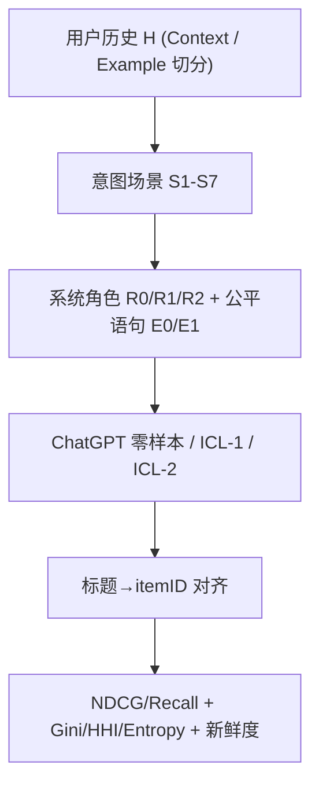
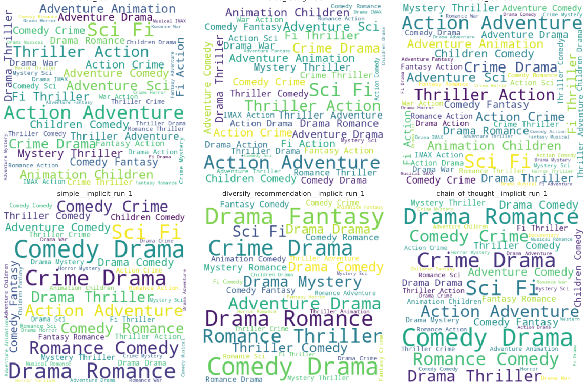

# Understanding Biases in ChatGPT-based Recommender Systems (基于 ChatGPT 的推荐系统偏差理解：提供方公平性、时间稳定性与新鲜度)

- **会议/期刊**: TORS (ACM Transactions on Recommender Systems)
- **作者与机构**: Yashar Deldjoo（巴里理工大学）
- **推荐链路定位**: 端到端生成式（LLM 直接产出 top-K 列表）
- **研究方向**: 去偏公平与工业评测 / LLM4Rec
- **论文原文**: [arXiv:2401.10545v3](https://arxiv.org/abs/2401.10545v3)
- **开源代码**: [Benchmark_RecLLM_Fairness](https://github.com/yasdel/Benchmark_RecLLM_Fairness)

## TL;DR (1分钟核心速览)

本文不谈新模型，而是一篇**评测型研究**：针对 ChatGPT 作为零样本推荐器时"物品侧（提供方）公平性"黑箱不可控的痛点，作者把 Prompt 空间因子化为「7 种意图场景 × 3 种系统角色 × 2 档公平强调语句」，并扩展到序列 ICL（zero-shot / ICL-1 / ICL-2）。在 MovieLens-Latest-Small 上以全库 top-10 + 1000 次 Bootstrap 置信区间评估：含去多样化意图的 Prompt 虽提升时间新鲜度与覆盖度，却使 NDCG 相对下降最高约 50%；把公平性写进 **system role** 比写进 prompt 更有效。

## Background & Motivation (背景与核心矛盾)

- **主流范式**: RecLLM 以自然语言交互替代 ID 嵌入，凭语义先验直接生成推荐列表，绕开了传统 CF 的协同信号。
- **前人局限**: (i) 现有公平性研究多聚焦**消费者侧**（年龄/性别刻板印象），物品侧曝光公平几乎没有基准；(ii) LLM 训练语料对流行品牌/热门内容的过采样会被直接继承，长尾提供方被系统性挤压，且传统 CF 的正则化手段对黑箱 API 失效。
- **核心洞察 (Key Insight)**: 在 `temperature=0` 下重复查询同一用户，输出仍然漂移——说明结果受训练数据漂移与线上更新影响，**单次评测不可复现**，因此必须引入重复实验 + Bootstrap 置信区间。
- **本文切入点**: 不做训练，把"公平性"当作 Prompt/角色层面的可控变量，量化"意图—结果"的映射是否真的一一对应。

## Method (核心方法设计)

### 1. 整体框架 (Overall Architecture)

作者将评测流程拆成三段闭环：先把用户历史序列化为自然语言上下文，再按「意图场景 $S$× 系统角色$R$× 公平强调$E$」组合注入 7 套模板，调用 ChatGPT 得到 10 条自由文本推荐，最后经标题→itemID 字符串匹配落表并计算精度/公平/新鲜度指标。Exp-2 进一步把历史切成 Context（长期偏好）与 Example（近期序列）两段，用 ICL-1/ICL-2 注入 1~2 个 next-item 示范，检验少样本是否比零样本更公平。

### 2. 关键设计拆解 (Key Designs)

1. **三轴 Prompt 因子化（Intent × Role × Emphasis）**：前人只比较"准确 vs 多样"两类 Prompt，本文把公平性从 Prompt 文本中剥离为**对话系统角色**（R2 = "act as a fair recommender system balancing popular and less-known movies"）。直觉在于：system role 贯穿整个会话解码过程，作为全局偏置持续生效，而 prompt 内的公平指令只在局部 token 上施加弱约束，因此前者的曝光再分配能力更强。
2. **提供方公平的分布型度量**：放弃单一曝光方差，改用三种互补的分布指标刻画物品曝光集中度。对曝光计数 $x_i$（升序），
   $\mathrm{Gini}=\frac{\sum_{i=1}^{n}(2i-n-1)x_i}{n\sum_{i=1}^{n}x_i}$，
   $\mathrm{HHI}=\sum_{i=1}^{n}\left(\frac{x_i}{\sum_j x_j}\right)^2$，
   $\mathrm{Entropy}=-\sum_i p_i\log p_i$。
   Gini/HHI 越低、Entropy 越高视为越公平；三者联合可区分"少数爆款垄断"与"整体分布平坦"两种不同失效形态。
3. **Context / Example 二分与 Recency 加权采样**：为解决序列推荐中"长期兴趣与即时意图混淆"的问题，Context 采用 Highest-rated 或 Recency-focused 加权平均采样，Example 严格取最近交互作为 next-item 监督示范；训练/推理代价为零样本（无梯度），仅需逐用户 API 调用。

## Experimental Setup & Evaluation Protocol (实验设置与评估协议)

- **数据集与预处理**: 采用 `k-core` 预处理后的统计如下（Exp-2 另用一音乐数据集做跨域泛化）：

| 数据集 | #Users | #Items | #Interactions | 稀疏度 | 特征/场景说明 |
| :--- | :---: | :---: | :---: | :---: | :--- |
| MovieLens-Latest-Small | 610 | 9,724 | 100,836 | 98.3%（$R_U$=165.3,$R_I$=10.4） | 电影，含类型标签、时间戳；Item Gini 0.715 / User Gini 0.603 |

- **数据划分与防穿越 (Splitting Strategy)**: **比例划分 80/10/10**；验证集仅用于 CF 基线调参，RecLLM 与 CF 基线共用同一 train/test，序列任务按时间戳取最近交互作 Example，避免未来信息泄漏。
- **排名评测协议 (Ranking Protocol)**: CF 基线执行 **Full-Ranking（全库未交互排序）** 取 top-10；LLM 侧为开放生成 10 条后做标题匹配，未匹配项被丢弃（隐式引入少量假阴性噪声）。指标统计采用 **1000 次 Bootstrap 重采样**并报告 95% 置信区间。
- **对比基线与超参设置**: BPR、ItemKNN、MultiVAE、LightGCN、RecVAE 五类主流 CF 基线；每次配置对 610 用户各调用一次，全实验累计逾千次 API 调用；稳定性通过同一用户重复 5 次运行衡量。

## Key Experimental Results (实验关键数据)

### 1. 主实验对比 (Main Results)

Exp-1 的七场景结果（因 API 输出存在随机漂移，此处保留原文报告的相对序与量级，绝对数值见原文表 7–9）：

| 场景 | 类别 | NDCG@10 | Recall@10 | Gini↓(公平) | Entropy↑ | 平均上映年份(新鲜度) |
| :--- | :--- | :---: | :---: | :---: | :---: | :---: |
| S1 Simple | 个性化 | **高** | **高** | 偏高 | 偏低 | 较旧 |
| S2 Genre-focused | 个性化 | 高 | 高 | 偏高 | 中 | 较旧 |
| S3 Rating-focused | 个性化 | 高 | 高 | 偏高 | 中 | 较旧 |
| S4 Diversify | 超精度 | 低（**↓约 50%**） | 低 | **最低** | **最高** | **最新** |
| S5 Surprise | 超精度 | 低 | 中 | 低 | 高 | 新 |
| S6 Motivate Reasoning | 推理 | 高 | 高 | 中 | 中 | 中 |
| S7 Chain-of-Thought | 推理 | **高** | 高 | 中 | 中 | 中 |
| CF 基线（LightGCN/RecVAE 等） | — | **最高** | **最高** | 高 | 低 | 最旧 |

### 2. 消融实验 (Ablation Study)

| 配置 | 精度 | 提供方公平 | 覆盖度 | 说明 |
| :--- | :---: | :---: | :---: | :--- |
| R0 无角色 | 基准 | 基准 | 基准 | 纯用户 Prompt |
| R1 角色=推荐系统 | ≈R0 | ≈R0 | ≈R0 | 角色本身无公平语义 |
| R2 角色=公平推荐器 | 略降 | **↑优于 E1** | ↑ | 公平写进 system role 最有效 |
| E0 vs E1（Prompt 内公平语句） | E1 略降 | 小幅↑ | 小幅↑ | 效果弱于 R2 |
| Zero-shot（Exp-2） | **NDCG 最高** | 基准 | **最高** | 少样本未带来公平增益 |
| ICL-1 | 下降 | ≈基准 | 下降 | 单例示范易过拟合近期序列 |
| ICL-2（含年龄组） | 中 | 中 | 中 | HR 有**轻微**提升，公平未改善 |

### 3. 关键实验发现 (Key Findings)

1. **"多样性 Prompt ≠ 真多样"**：S4/S5 显著提升了时间新鲜度与类型覆盖面（推荐影片平均更新、类型词云明显更分散），代价是 NDCG 相对下降最高约 50%，说明 LLM 把"diversify"误解为"推新片"而非"推长尾"，公平性与精度在此呈现强耦合权衡。
2. **公平性的施加位置决定成败**：R2（system role 层公平）在降低 Gini/HHI、提升 Entropy 上稳定优于 E1（Prompt 内公平语句）；同时精度损失小于 S4，表明**全局解码偏置**比局部指令更能重分配曝光。
3. **ICL 不是免费的公平药**：零样本在 NDCG 与 catalog coverage 上均优于 ICL-1/ICL-2；仅 ICL-2 在注入年龄段上下文时 HR 略有提升。且一旦在 Prompt 中暴露性别/年龄，推荐分布即发生偏移，提示人口统计属性本身就是**刻板印象触发器**，工业部署应默认脱敏。

<figure class="paper-figure" markdown="span">
  <figcaption>图5. 不同模型推荐电影类型的词云。上方模型对应CF模型（BPR-MF、LightGCN、RecVAE），下方模型包括基于GPT的推荐器（Simple、Diversity、COT）。</figcaption>
</figure>

## Highlights & Limitations (亮点、对比与审稿批判)

- **与代表作对比 (vs. Prior Work)**: 相较 FaiRLLM（Zhang et al.）只评消费者侧人口统计公平、以及 Deldjoo 早期工作仅做敏感属性归一化，本文首次把**物品侧曝光公平 + 时间新鲜度 + 多次运行稳定性**纳入统一基准；与 Li et al. 的新闻域提供方公平相比，本文额外揭示 Prompt 结构（而非仅内容）对公平的作用路径。
- **可迁移亮点**: (i) "公平性写入 system role 优于写入 prompt"可直接迁移到任何商用 LLM 重排/对话推荐接口；(ii) 1000 次 Bootstrap + 5 次重复运行的评测协议，是评估不可复现 LLM 推荐器的低成本范式。
- **审稿级局限批判**: (i) 生成文本靠标题字符串匹配回 itemID，未匹配即丢弃，会系统性低估长尾与小语种影片的命中率，从而**夸大**公平性偏差；(ii) 仅评测 `gpt-3.5-turbo` 单一模型与单一电影数据集，且每用户每次调用约 9–15 秒，>600 用户×7 场景的 API 成本使在线 A/B 与更大规模验证缺位；(iii) 缺乏任何**去偏干预算法**（如重排序、校准），止步于诊断而无处方。

## Rating (四维评分)

- **方法创新性 (Novelty)**: ⭐⭐⭐ （非新模型，创新在于三轴 Prompt 因子化与"角色 vs 指令"的公平施加位置对照，属评测框架级贡献）
- **评估协议与实验扎实度 (Protocol & Experiments)**: ⭐⭐⭐⭐ （Full-Ranking + 1000 次 Bootstrap + 5 次重复运行较为严谨，但字符串匹配对齐与单数据集削弱外部效度）
- **写作与数学规范度 (Clarity & Rigor)**: ⭐⭐⭐⭐ （Gini/HHI/Entropy 定义与边界取值解释清晰，Prompt 模板全量附录；但缺少公平性的形式化因果定义）
- **工业落地与复现价值 (Industrial & Practical Value)**: ⭐⭐⭐⭐ （代码与全部 Prompt 场景开源，直接可用于 LLM 推荐接口的公平性回归测试；但逐用户 API 调用延迟与成本尚不适合线上主链路）

