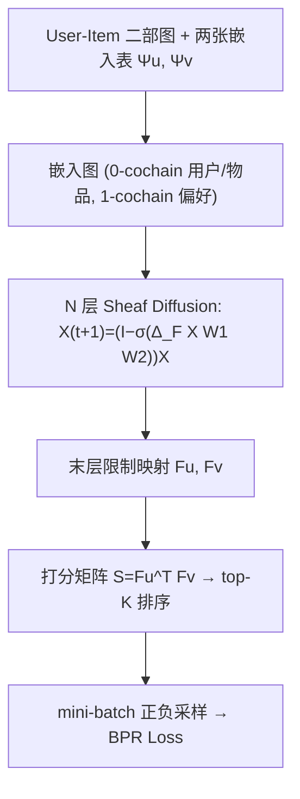

# Sheaf4Rec: Sheaf Neural Networks for Graph-based Recommender Systems (面向图推荐系统的层神经网络)

- **会议/期刊**: TORS (ACM Transactions on Recommender Systems, accepted manuscript)
- **作者与机构**: Antonio Purificato, Giulia Cassarà, Federico Siciliano, Pietro Liò, Fabrizio Silvestri — Sapienza University of Rome & University of Cambridge
- **推荐链路定位**: 召回 / 全库排序
- **研究方向**: 图神经网络与知识图谱推荐 / 协同过滤
- **论文原文**: [https://arxiv.org/abs/2304.09097v3](https://arxiv.org/abs/2304.09097v3)
- **开源代码**: [https://github.com/antoniopurificato/Sheaf4Rec](https://github.com/antoniopurificato/Sheaf4Rec)

## TL;DR (1分钟核心速览)

现有 GNN 推荐把每个用户/物品压缩为**单个静态向量**,无法刻画用户在不同上下文下的多面偏好。Sheaf4Rec 引入范畴论中的**细胞层 (Cellular Sheaf)**：每节点/边各挂一个向量空间 (stalk)，用限制映射 (restriction map) 刻画局部语义对齐，并以 Sheaf 拉普拉斯驱动的**动态扩散**替代 NGCF/LightGCN 的静态聚合；训练端仍用 BPR。在 80/10/10 随机划分的 ML-1M/Yahoo!Movies/Facebook Books 上，NDCG@10 相对 NGCF 最高提升 **11.29%**、F1@10 提升 **8.53%**，同时生成 top-100 推荐耗时最短 (0.586s)。

## Background & Motivation (背景与核心矛盾)

- **主流范式**: NGCF/LightGCN/UltraGCN 在 user-item 二部图上做邻域聚合，每个节点输出**单一 $d$ 维嵌入**，靠堆叠层数传播协同信号。
- **前人局限**: (i) 单一向量把用户在不同物品上的偏好"平均化"，无法区分同一用户对物品的差异化语义；(ii) 深堆叠 GCN 必然遭遇过平滑，LightGCN/UltraGCN 需靠对称归一化或截断来抑制。
- **核心洞察 (Key Insight)**: 层理论用**向量空间**替代向量，限制映射 $\mathcal{F}_{v\triangleright e}$显式建模"节点 v 的语义在边 e 上如何表现"，因此表达能力天然高于固定内积；且 Sheaf 拉普拉斯$\Delta_{\mathcal{F}}$ 的谱隙更大，能**抑制过平滑**。
- **本文切入点**: 将 0/1-cochain 分别绑定用户/物品嵌入与偏好分数，在二部图上跑 Sheaf 扩散，末端用 $S=F_u^{\top}F_v$ 打分，从而实现"多面表征 + 协同过滤"的融合。

## Method (核心方法设计)

### 1. 整体框架 (Overall Architecture)

输入 user-item 二部图 $\mathcal{G}=(\mathcal{V},\mathcal{E})$，两张嵌入表$\Psi_u,\Psi_v$将节点 id 映射为初始 stalk 向量，得到"嵌入图"；随后堆叠$N$个 Sheaf 层，每层用**时变限制映射**$\mathcal{F}^{(t)}$构造归一化 Sheaf 拉普拉斯$\Delta_{\mathcal{F}(t)}$，再做带权欧拉离散扩散更新；末层输出$F_u,F_v$，以矩阵乘法得全库打分矩阵$S=(F_u)^{\top}F_v$，按行排序生成推荐。训练端从$S$ 抽正负样本对，最小化 mini-batch BPR。

### 2. 关键设计拆解 (Key Designs)

1. **Cellular Sheaf 建模范式 (多面表征)**：传统 GCN 用 $H^{(l)}=h(\tilde{A}H^{(l-1)}W)$强行平滑，等价于假设节点语义在任何邻居上都一致。Sheaf 改为在每条边$e=(u,v)$上配一个 stalk$\mathcal{F}(e)$，并用共边界映射度量两端语义的"撕裂"：
$$\delta(x)_e=\mathcal{F}_{v\triangleright e}x_v-\mathcal{F}_{u\triangleright e}x_u, \quad L_{\mathcal{F}}=\delta^{\top}\delta$$
直觉：$L_{\mathcal{F}}$ 在限制映射对齐处梯度小、在语义冲突处梯度大，故能**差异化**地聚合用户/物品的交互,而不是笼统均摊。

2. **动态 Sheaf 扩散 (抗过平滑)**：借鉴 Bodnar 等的 Neural Sheaf Diffusion，限制映射 $\mathcal{F}^{(t)}$与权重$W_1^t,W_2^t$ **随层学习变化**，归一化后做离散欧拉步：
$$X^{(t+1)}=X^{(t)}-\sigma\!\left(\Delta_{\mathcal{F}^{(t)}}\big(I_n\otimes W_1^{t}\big)X^{t}W_2^{t}\right)$$
由于每层都可重新"改写"边上的限制映射，模型不会像静态 GCN 那样在深堆叠时把嵌入收敛到低秩子空间——论文实验证实堆到 5 层仍持续涨点，这是相对 NGCF/LightGCN 的关键结构优势。

3. **训练目标与推理效率**：全库打分后按用户抽正样本 $s_{pos}$与随机负样本$s_{neg}$，损失为$\mathcal{L}_{BPR}=-\ln\sigma(s_{pos}-s_{neg})$（mini-batch 估计,而非求和版全 BPR）。负采样采用**均匀随机**，无 hard-negative 机制。由于限制映射与嵌入在层间共享参数、且 Sheaf 核计算可利用稀疏 Laplacian，推理阶段生成 top-100 反而比 NGCF/GAT 更快（0.586s vs 0.607s，FB Books）。

## Experimental Setup & Evaluation Protocol (实验设置与评估协议)

- **数据集与预处理**:

| 数据集 | #Users | #Items | #Interactions | 密度 | 说明 |
| :--- | :---: | :---: | :---: | :---: | :--- |
| Facebook Books | 1,398 | 2,933 | 1,878 | 0.025% | 极稀疏书籍评论 |
| Yahoo! Movies | 4,000 | 2,626 | 69,846 | 0.664% | 1–5 星显式评分 |
| MovieLens 1M | 6,040 | 3,900 | 1,000,000 | 4.24% | 每用户 $\geq$20 次评分 |

- **数据划分与防穿越 (Splitting Strategy)**: `比例划分` — **每用户**独立随机 80%/10%/10% 训练/测试/验证，属于用户内随机切分 (与 LightGCN 原文一致)，**未做全局时间戳切分**，因此存在轻微未来交互泄露风险。
- **排名评测协议 (Ranking Protocol)**: 报告 F1@$\{10,20\}$、NDCG@$\{10,20\}$、MRR@$\{10,20\}$，并统计 top-100 生成耗时；未明示 Full-Ranking 还是 Sampled，但正文称从$S$ 排序打分，属**全库未交互排序 + 随机负样本训练**混合设置。
- **对比基线与超参设置**: 基线含 GAT、NGCF、LightGCN、UltraGCN、KGTORe；通过 Bayesian 6 轮调参，最终 $l=64$、$N=5$层、lr$10^{-3}$、batch 1024、weight decay$10^{-4}$、100 epochs；显著性用 **paired Wilcoxon + Bonferroni ($p<0.01$)** 检验。

## Key Experimental Results (实验关键数据)

### 1. 主实验对比 (Main Results)

| Model | FB N@10 | FB N@20 | Yahoo N@10 | Yahoo N@20 | ML-1M N@10 | ML-1M N@20 |
| :--- | :---: | :---: | :---: | :---: | :---: | :---: |
| GAT | 0.036† | 0.051† | 0.119† | 0.142† | 0.143† | 0.156† |
| NGCF | 0.062 | 0.078† | 0.129† | 0.155 | 0.169† | 0.182† |
| LightGCN | 0.001† | 0.003† | 0.120† | 0.070† | 0.004† | 0.005† |
| UltraGCN | 0.061† | 0.066† | 0.101† | 0.117† | 0.147 | 0.155† |
| KGTORe | 0.035† | 0.044† | 0.137† | 0.159† | 0.125† | 0.130† |
| **Sheaf4Rec** | **0.066** | **0.081** | **0.147** | **0.162** | **0.182** | **0.197** |
| **Improv.%** | +11.29 | +3.85 | +7.30 | +1.82 | +7.69 | +8.24 |

### 2. 消融实验 (Ablation Study)

| 维度 | 设置 | F1@10 | NDCG@10 | 备注 |
| :--- | :--- | :---: | :---: | :--- |
| Loss (5 层) | BPR / RMSE / BCE | **0.140** / 0.118 / 0.101 | — | BPR 训练耗时最低 (210min) |
| Stalk 尺寸 | $(N,N)$sheaf /$(N,1)$GCN /$(1,N)$ GAT | **0.051** / 0.045 / 0.048 | **0.105** / 0.093 / 0.093 | 等参数量对比 |
| 层数 $N$ | 2 / 3 / 4 / 5 | — | 5 层最优 | 无过平滑 |
| 隐维 $l$ | 8 / 16 / 32 / **64** / 128 / 256 | — | 64 最优 | 更大涨时耗 |

### 3. 关键实验发现 (Key Findings)

1. **F1 涨幅胜过 NDCG 涨幅的原因**: 在 FB Books 上 F1@10 提升 7.41%、NDCG@10 提升 11.29%、MRR@10 提升 7.32%——说明 Sheaf 表征既改善了召回覆盖率 (Recall@10 从 NGCF 0.097→0.104)，也在排序头端保持较高 hit 率，**打破了 UltraGCN 类模型"高精低召回"、KGTORe 类"高召回低精"的权衡僵局**。
2. **stalk 尺寸消融直接证明 Sheaf 表达力**: 在等参数量条件下，$(N,N)$的 F1@10 达 0.051，显著优于 GAT 等价$(1,N)$的 0.048 和 GCN 等价$(N,1)$的 0.045；$\Delta$NDCG@20$(0.117\to 0.129)$ 说明**双端向量空间**是增益来源，而非参数堆叠。
3. **BPR 与 Sheaf 结构天然契合**: 同层数下 BPR 的 F1@10 (0.140) 显著高于 RMSE (0.118) 和 BCE (0.101)，且训练时间从 283/198 min 降到 210/163 min——因为 BPR 只看分数差，Sheaf 打分矩阵 $S=F_u^{\top}F_v$ 的绝对值不被约束，正好匹配限制映射的**相对对齐**语义。

## Highlights & Limitations (亮点、对比与审稿批判)

- **与代表作对比 (vs. Prior Work)**: 相比 NGCF/LightGCN 的固定邻域平滑，Sheaf4Rec 保留了"节点-边"双层结构，让同一用户的嵌入在不同物品上下文中**自发分化**；相比 KGTORe 依赖知识图谱外部 side info，Sheaf4Rec 仅用二部图的交互信号，冷启动友好但缺少语义先验。
- **可迁移亮点**: (i) "节点/边各挂一个向量空间 + 时变限制映射"这一范式可平移到 POI 推荐、群组推荐等需要刻画**非对称关系**的场景；(ii) Stalk 尺寸 $(1,N)/(N,1)/(N,N)$ 的等参数量消融，提供了判断"是否真的需要 Sheaf"的标准实验协议。
- **审稿级局限批判**: (i) 训练用随机均匀负采样 + 用户内随机划分，既缺少 hard-negative（BPR 竞争力可能被低估），又**未做全局时间戳切分**，实际线上冷启动与序列场景的泛化性未验证；(ii) Sheaf 限制映射引入 $O(|E|d^2)$参数与矩阵核，虽推理略快但训练开销未报告，且在更稀疏的 FB Books 上优势 (N@20 仅 +3.85%) 收窄，超参$N=5$、$l=64$ 的鲁棒区间偏窄。

## Rating (四维评分)

- **方法创新性 (Novelty)**: ⭐⭐⭐⭐⭐ （首次将范畴论 Sheaf 扩散引入推荐，节点/边向量空间 + 时变限制映射是其相较 GCN 的实质增量，而非简单替换邻接矩阵）
- **评估协议与实验扎实度 (Protocol & Experiments)**: ⭐⭐⭐⭐ （3 数据集、5 基线、paired Wilcoxon + Bonferroni $p<0.01$、stalk/loss/层数/隐维四组消融齐全；不足在于无时间切分与 hard-negative）
- **写作与数学规范度 (Clarity & Rigor)**: ⭐⭐⭐⭐ （Sheaf 拉普拉斯与扩散公式定义清晰，但公式符号 $L_{\mathcal{F}}$、$L_{\mathcal{F}}$ 在正文以未排版形式出现，BPR 求和版与 mini-batch 版的区别也略显模糊）
- **工业落地与复现价值 (Industrial & Practical Value)**: ⭐⭐⭐⭐ （代码已开源，推理耗时在 FB/Yahoo 最快 0.586s/1.309s、标准方差最低，二部图构建成本与 NGCF 相当，适合中大规模在线召回；但 Sheaf 核在亿级图上需专门稀疏优化）

