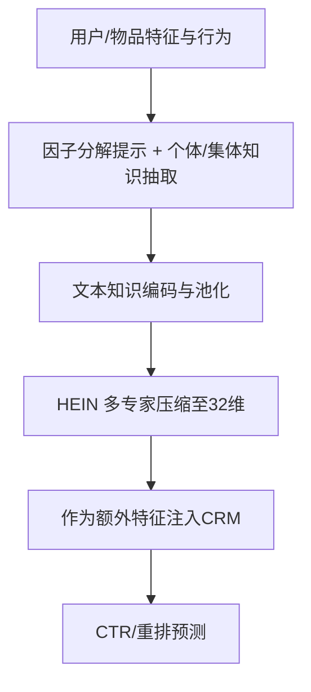
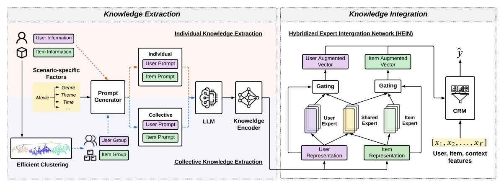

# Efficient and Deployable Knowledge Infusion for Open-World Recommendations via Large Language Models (基于大语言模型的高效可部署开放世界推荐知识注入)

- **会议/期刊**: TORS 2026
- **作者与机构**: Yunjia Xi, Weiwen Liu, Jianghao Lin 等；上海交通大学、华为诺亚方舟实验室、华为消费者BG
- **推荐链路定位**: 精排/重排知识增强（兼容CTR与列表重排）
- **研究方向**: 大语言模型推荐 / CTR预估与特征交叉
- **论文原文**: [arXiv:2408.10520v1](https://arxiv.org/abs/2408.10520v1)
- **开源代码**: [YunjiaXi/REKI](https://github.com/YunjiaXi/REKI)

## TL;DR (1分钟核心速览)

针对LLM直接做推荐在线延迟高、离线微调昂贵，REKI将用户偏好与物品事实知识离线抽取为文本，经HEIN压缩成32维增广向量注入任意CRM。在MovieLens-1M/Amazon-Books的CTR与重排任务上，AUC普遍提升约1%–1.5%，华为新闻/音乐A/B提升7%/1.99%。

## Background & Motivation (背景与核心矛盾)

- **主流范式**: 工业推荐仍以闭环CRM为主；LLM4Rec多走提示式推荐或在推荐数据上微调LLM。
- **前人局限**: 直接部署LLM难以满足100ms级在线延迟；持续微调消耗大量GPU与时间，且分布漂移后易失效。KG/CDR只补物品事实，难以刻画动态用户偏好推理。
- **核心洞察 (Key Insight)**: LLM不应替代推荐模型，而应作为离线“知识提供者”；用户偏好需分解为多个因素推理，避免组合推理鸿沟。
- **本文切入点**: 两阶段“知识抽取+知识整合”，将开放世界知识预存为低维向量，主干模型零LLM在线推理。

## Method (核心方法设计)

### 1. 整体框架 (Overall Architecture)

REKI先做知识抽取：用场景因子构造用户/物品提示，小规模逐用户逐物品生成个体知识，大规模先聚类再生成集体知识；文本经BERT/ChatGLM编码与平均池化得语义向量。知识整合阶段用HEIN将高维语义向量压缩到32维推荐空间，作为额外特征字段注入CRM，并与主干端到端联合训练；推理时预存增广向量，主干复杂度几乎不变。

<figure class="paper-figure" markdown="span">
  <figcaption>图1. REKI的整体框架包括知识抽取阶段和知识整合阶段。知识抽取阶段利用我们设计的因子分解提示以及两种知识抽取方法，从LLMs中有效抽取用户和物品知识。知识整合阶段将开放世界知识转换为适合推荐的紧凑用户和物品表示。用户/物品表示和用户/物品增强向量可预存储以用于快速推理。接下来，用户和物品增强向量被整合</figcaption>
</figure>

### 2. 关键设计拆解 (Key Designs)

1. **因子分解提示与双粒度知识抽取**：直接让LLM“推荐物品”易触发组合推理鸿沟，且物品事实可能与用户偏好错位。REKI先由LLM+专家确定场景因子（如电影的类型、导演、情绪、口碑），用户提示要求按因子解释偏好，物品提示补齐因子事实。大规模场景先聚类，用户簇用共同点击物品表示：$N_k=\sum_{u_j\in c_i^u}\mathbb{I}_{h_j}(a_k),\quad \hat{c}_i^u=\{a_k:\mathrm{Rank}(a_k)\le d\}$，再对簇生成共享知识，把亿级逐实体调用降为逐簇调用。

2. **HEIN：多专家知识压缩与去噪**：LLM文本向量维度高（如4096）、处于语义空间，且含幻觉噪声，直接拼接易训练不稳定。HEIN设共享专家与用户/物品专属专家，门控加权后输出低维向量：$\hat{r}_{u_i}=\sum_{e\in\mathcal{S}_s}\alpha_{u_i,e}e(r_{u_i})+\sum_{e\in\mathcal{S}_u}\alpha_{u_i,e}e(r_{u_i})$。共享专家抽取共性，专属专家保留个体差异，多专家集成提升对噪声知识的鲁棒性。

3. **训练目标、负采样与推理效率**：总损失沿用主干原损失 $\mathcal{L}_{CRM}$，HEIN与CRM端到端联合优化；知识抽取离线完成，无额外负采样，CTR使用原始正负样本，重排使用既有候选列表。推理可预存32维$\hat{r}$，复杂度为$O(f(n+2,m))=O(f(n,m))$；新用户/物品先用默认向量，再离线补知识入库。

## Experimental Setup & Evaluation Protocol (实验设置与评估协议)

- **数据集与预处理**:

| 数据集 | #Users | #Items | #Interactions | 密度 | 特征/场景说明 |
| :--- | :---: | :---: | :---: | :---: | :--- |
| MovieLens-1M | 6,000 | 4,000 | 1,000,209 | 4.17% | 评分4/5为正；用户年龄/性别/职业，物品ID/类别 |
| Amazon-Books | 11,906 | 17,332 | 1,406,582 | 0.682% | 过滤低频用户/物品；评分5为正；无用户侧特征 |

- **数据划分与防穿越 (Splitting Strategy)**: 按user ID做9:1训练/测试划分，非全局时间戳切分；测试用户与训练用户不重叠，存在一定冷启风险。
- **排名评测协议 (Ranking Protocol)**: CTR用全样本二分类AUC/LogLoss，并非全库Full-Ranking；重排用候选列表MAP@3/7、NDCG@3/7，属top-K列表评估，无采样负例排序。
- **对比基线与超参设置**: CTR主干含DIN/DIEN/DCNv2/DeepFM/FiBiNet/AutoInt等9个；重排主干含DLCM/PRM/SetRank/MIR；PLM基线含P5、UniSRec、VQRec、TALLRec、LLM2DIN。Embedding $d=32$，HEIN隐层[128,32]，共享/专属专家各1–5/1–6个；REKI-I用ChatGLM-6B编码，REKI-C用BERT；显著性$p<0.05$。

## Key Experimental Results (实验关键数据)

### 1. 主实验对比 (Main Results)

| Backbone | ML AUC base | ML AUC +REKI-I | AUC Improv. | ML LogLoss base | ML LogLoss +REKI-I | Amazon AUC base | Amazon AUC +REKI-I | AUC Improv. |
| :--- | :---: | :---: | :---: | :---: | :---: | :---: | :---: | :---: |
| DIN | 0.7863 | **0.7961** | 1.25% | 0.5486 | **0.5370** | 0.8304 | **0.8418** | 1.37% |
| DIEN | 0.7853 | 0.7953 | 1.27% | 0.5494 | 0.5394 | 0.8307 | 0.8391 | 1.01% |
| DCNv2 | 0.7830 | 0.7935 | 1.34% | 0.5516 | 0.5410 | 0.8269 | 0.8350 | 0.98% |
| DeepFM | 0.7824 | 0.7919 | 1.21% | 0.5518 | 0.5432 | 0.8269 | 0.8347 | 0.94% |
| FiBiNet | 0.7820 | 0.7938 | 1.51% | 0.5531 | 0.5405 | 0.8269 | 0.8351 | 0.99% |
| AutoInt | 0.7821 | 0.7935 | 1.46% | 0.5520 | 0.5405 | 0.8262 | 0.8357 | 1.15% |

所有+REKI-I相对base的提升均通过t-test，$p<0.05$。

### 2. 消融实验 (Ablation Study)

原文截取部分未给 `w/o HEIN`、`w/o 用户知识` 等逐组件数值；下表用REKI-C/I知识粒度变体作可核查的操作性消融：

| 变体 | FiBiNet ML AUC | FiBiNet ML LogLoss | DIN Amazon AUC | DIN Amazon LogLoss | PRM Amazon MAP@7 | PRM Amazon NDCG@7 |
| :--- | :---: | :---: | :---: | :---: | :---: | :---: |
| base | 0.7820 | 0.5531 | 0.8304 | 0.4937 | 0.6359 | 0.6983 |
| REKI-C | 0.7925 | 0.5422 | 0.8396 | 0.4808 | 0.6583 | 0.7201 |
| REKI-I | **0.7938** | **0.5405** | **0.8418** | **0.4801** | **0.6722** | **0.7312** |

### 3. 关键实验发现 (Key Findings)

- **模型无关增益明确**：FiBiNet在MovieLens上AUC从0.7820升至0.7938（+1.51%），LogLoss下降2.28%；DIN在Amazon上AUC从0.8304升至0.8418（+1.37%），LogLoss下降2.76%，说明知识向量对特征交叉和行为建模主干均有效。
- **重排增益更大、特征交叉受益更明显**：PRM在Amazon上MAP@7从0.6359升至0.6722（+5.71%），NDCG@7提升4.71%；CTR中FiBiNet提升1.49%，高于DIN的1.24%，因知识以额外特征字段参与显式交叉。
- **粒度与效率可权衡**：REKI-C较REKI-I在CTR AUC上仅低约0.1%–0.2%（DIN Amazon：0.8396 vs. 0.8418），但把逐用户/物品知识生成降为逐簇生成；线上华为新闻/音乐A/B分别提升7%与1.99%。

## Highlights & Limitations (亮点、对比与审稿批判)

- **与代表作对比 (vs. Prior Work)**: P5/TALLRec倾向于把LLM当推荐器或微调LLM，推理与迭代成本高；UniSRec/VQRec侧重文本编码或量化；LLM2DIN用LLM嵌入初始化DIN。REKI不微调LLM，而是抽取“可解释偏好/事实”并压缩注入CRM，部署边界更清晰。
- **可迁移亮点**: 因子分解提示可迁移到新闻、电商、短视频等场景；预存32维增广向量+流式层次聚类，是把LLM知识用于大规模推荐的通用工程范式。
- **审稿级局限批判**: 知识抽取依赖外部LLM API与人工确认场景因子，跨域迁移和成本可控性仍受限；用户知识基于长期历史，实时性弱，REKI-C聚类会损失个体信息。评估仅两个公开数据集，CTR非全库排序，且缺少显式逐组件消融。

## Rating (四维评分)

- **方法创新性 (Novelty)**: ⭐⭐⭐⭐ （将LLM定位为离线知识提供者，因子分解提示+HEIN压缩注入，工程新颖但理论突破有限）
- **评估协议与实验扎实度 (Protocol & Experiments)**: ⭐⭐⭐⭐ （9个CTR主干、4个重排主干、双数据集与线上A/B，$p<0.05$；但缺显式组件消融，CTR非Full-Ranking）
- **写作与数学规范度 (Clarity & Rigor)**: ⭐⭐⭐⭐ （两阶段框架与核心公式清晰，符号简洁；部分训练损失与实现细节展开不足）
- **工业落地与复现价值 (Industrial & Practical Value)**: ⭐⭐⭐⭐⭐ （32维预存、推理复杂度等价主干，华为双场景上线，代码与知识开源）

