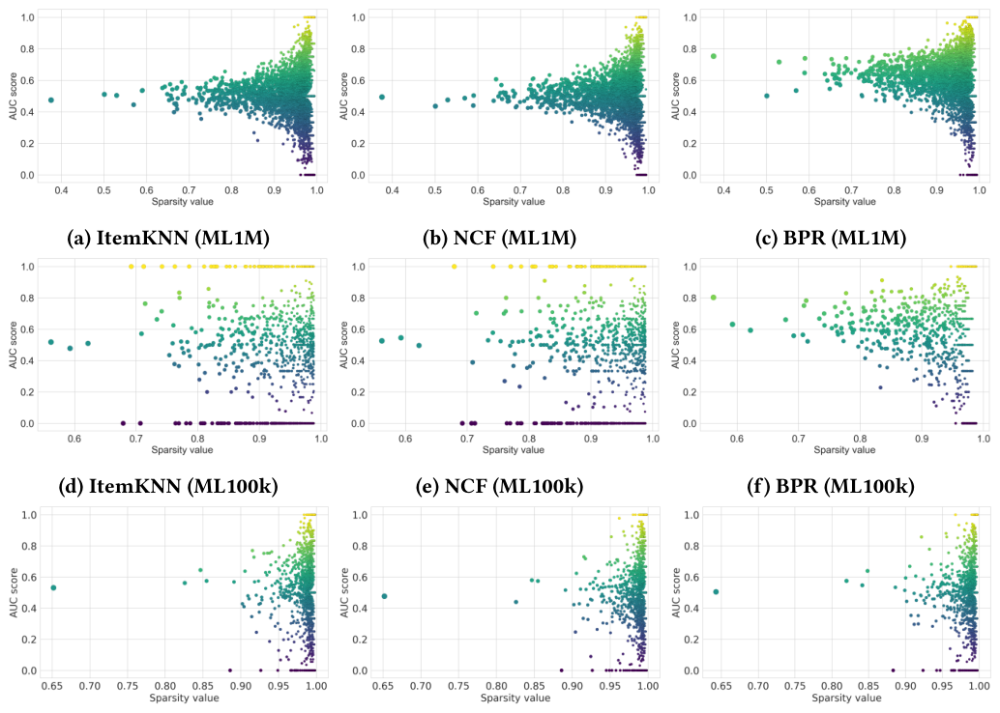
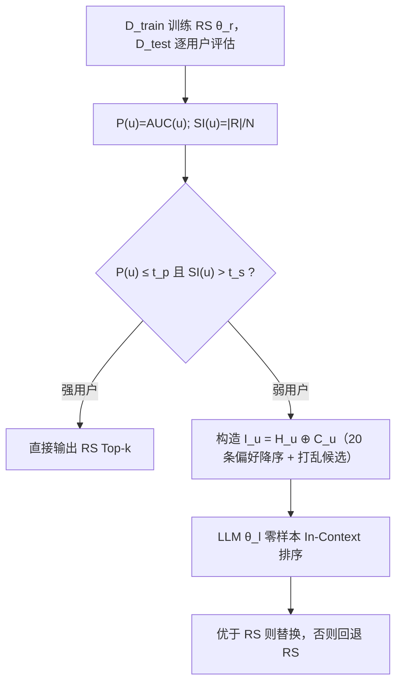

# Efficient and Responsible Adaptation of Large Language Models for Robust Top-k Recommendations (面向鲁棒 Top-k 推荐的大模型高效且负责任的适配)

- **会议/期刊**: TORS 2026
- **作者与机构**: Kirandeep Kaur, Chirag Shah（University of Washington）
- **推荐链路定位**: 重排（LLM 条件重排 + 级联任务分配）
- **研究方向**: 大语言模型推荐 (LLM4Rec) / 去偏公平与可信推荐
- **论文原文**: [https://arxiv.org/abs/2405.00824v1](https://arxiv.org/abs/2405.00824v1)
- **开源代码**: [匿名仓库](https://anonymous.4open.science/r/resp-llmsRS/)（匿名评审版）

## TL;DR (1分钟核心速览)

传统 RS 在 ERM 下对所有样本均匀优化，导致稀疏用户子群体排名质量塌陷；而把百万级用户全量交给 LLM 重排又会因长 prompt 推高成本与延迟。本文提出**混合任务分配框架**：用「稀疏度指数 $SI(u)$+ 实例级 AUC$P(u)$」双阈值筛出弱用户，只对这些用户构造 In-Context 排序指令交给 LLM，强用户仍走 RS。在 ML-1M/ML-100k/Book-Crossing 三数据集上，弱用户 AUC 相对提升最高达 202%，弱用户数量下降约 85–99%，ML-100k 上 LLM 调用开销由 7,544 s 降至 2,640 s（约省 65%）。

## Background & Motivation (背景与核心矛盾)

- **主流范式**: 用 LLM 作为 zero-shot/few-shot 重排器（recency-focused prompting、ProLLM4Rec 等），由传统 RS 检索候选、LLM 冻结参数重排。
- **前人局限 1（成本侧）**: 每个用户的历史都塞进 prompt，单次查询延迟 8–11 s，百万级用户不可行；因此已有工作只能**随机采样少量用户**评估，结论泛化性存疑。
- **前人局限 2（鲁棒侧）**: 以往只按活跃度粗粒度分组（active vs inactive），或做后处理重排去偏；但后处理会牺牲头部用户效用，且"inactive"并不等于"被模型服务失败"。
- **核心洞察 (Key Insight)**: AUC 对子采样保持一致（$k$ 缩小时所有 top-k 指标退化为 AUC），故适合做实例级"难度"判据；散点图（图 3）显示**并非所有稀疏用户都表现差**——只有"高稀疏 ∧ 低 AUC"这一交集才是真正需要干预的弱用户。
- **本文切入点**: 不做"是否使用 LLM"的全局二选一，而做**任务分配**——把 LLM 算力当作稀缺资源，按实例投放到 RS 失效处。

<figure class="paper-figure" markdown="span">
  <figcaption>图 3：AUC 与稀疏性的散点图，用于展示所有用户在 ML1M、ML100k 和 Book-Crossing（B-C）数据集上，于三种不同算法下的性能（以 AUC 度量，x 轴）。</figcaption>
</figure>

## Method (核心方法设计)

### 1. 整体框架 (Overall Architecture)

系统为两阶段级联：先用基座 RS（ItemKNN / NCF / BPR）在全库打分，并用测试集计算每个用户的 AUC 型表现 $P(u)$与稀疏度$SI(u)$；满足$P(u)\le t_p \wedge SI(u)>t_s$者进入弱用户池。随后只为弱用户生成指令：把训练期交互按评分降序写成偏好条件$H_u$，把候选集$C_u$ 打乱后拼接，交给冻结的 LLM 做零样本列表排序；若 LLM 排序质量优于 RS 则采纳，否则回退。全程无任何微调，RS 与 LLM 各自承担擅长的子任务。

### 2. 关键设计拆解 (Key Designs)

1. **实例级难度度量 $P(u)$（用 AUC 代替 NDCG 做"体检"）**：top-k 指标依赖$k$ 且丢弃尾部，无法在不同用户间公平比较；本文对每个用户计算正负物品对的全覆盖配对准确率
$P(u)=\frac{1}{|R|(N-|R|)}\sum_{r\in R}\sum_{r'\in\{1,\dots,N\}\setminus R}\mathbb{I}(r<r')$
其采样一致性保证"用户级难易"判据在小样本评测下不漂移，是任务分配可复现的前提。

2. **双阈值弱用户定义（先分群、再筛实例）**：先用 $SI(u)=|R|/N$与$t_s=\text{avg}(SI(\mathcal{D}))$划出稀疏子群，再用$P(u)\le t_p$ 在其中挑出真正被服务失败的实例：
$u\in\mathcal{U}_{weak}\ \Leftrightarrow\ P(u)\le t_p\ \wedge\ SI(u)>t_s$
直觉是"稀疏"只是必要非充分条件——若稀疏用户与活跃用户高度相似，RS 仍能借协同信号排序，盲目干预纯属浪费预算。

3. **偏好降序 + 候选打乱的指令构造与回退机制**：$I_u=H_u\oplus C_u$，$H_u$按显式评分降序表述（"most preferred"），$C_u$ 故意 shuffle 以检验 LLM 是否真在排序而非抄顺序，并强约束"只能从候选集输出"。最终交付前做质量门控（LLM 结果优于 RS 才采纳），把幻觉风险隔离在弱用户局部。

4. **训练目标与推理开销**：无新增损失函数，基座模型沿用 BPR/交叉熵原目标训练；负采样沿用各模型默认策略（BPR 采样负例、NCF 全softmax 类实现）。推理端为"1 次 RS 全库打分 + 仅弱用户 1 次 LLM 调用"，单查询延迟 GPT-3.5-turbo ≈8 s、Mixtral-8×7b ≈11 s。

## Experimental Setup & Evaluation Protocol (实验设置与评估协议)

- **数据集与预处理**:

| 数据集 | #Users | #Items | #Interactions | 稀疏度/密度 | 特征/场景说明 |
| :--- | :---: | :---: | :---: | :---: | :--- |
| ML-1M | 6,041 | 3,952 | 1,000,209 | 95.81% / 4.19% | 电影，显式 1–5 分，每人 ≥20 条免过滤 |
| ML-100k | 943 | 1,682 | 100,000 | 93.7% / 6.3% | 电影，同上，最稠密数据集 |
| Book-Crossing | 6,810 | 9,135 | 114,426 | 99.82% / 0.18% | 图书，0–10 分，剔除 <20 条评分用户 |

- **数据划分与防穿越**: **随机比例划分 80%/10%/10%**（train/val/test），非 Leave-One-Out、非时间戳切分——存在轻度未来信息穿越风险。
- **排名评测协议**: RS 侧 $P(u)$在全部$N$ 物品上计算（**Full-Ranking 无偏**）；LLM 侧候选集取**测试正样本集合**（原文："select items which served as test items as candidate items"），属于小候选集排序，两侧任务难度不等。指标同时报告 AUC 与 `NDCG@10`。
- **对比基线与超参**: 基座 RS 三类（ItemKNN、NCF、BPR，均基于 RECBOLE 实现），LLM 两个（GPT-3.5-turbo 闭源、Mixtral-8×7b-instruct 开源），prompt 统一采样 20 条历史；BPR 学习率搜索 $[5e^{-5},7e^{-3}]$，NCF$[5e^{-7},1e^{-3}]$，MLP 隐层$[64,32,16]$，dropout$\in\{0,0.1,0.3\}$；ItemKNN 的$k\in[10,400]$、shrink$\in[0,2]$。**未报告显著性检验**。

## Key Experimental Results (实验关键数据)

### 1. 主实验对比 (Main Results)

| 数据集 | 基座模型 | AUC (RS) | +GPT-3.5 | +Mixtral | AUC_weak (RS) | +GPT_weak | +Mixtral_weak |
| :--- | :--- | :---: | :---: | :---: | :---: | :---: | :---: |
| ML-1M | ItemKNN | 0.4703 | **0.5814** | 0.5604 | 0.2378 | **0.5178** | 0.5171 |
| ML-1M | NCF | 0.4781 | **0.5894** | 0.5721 | 0.2295 | **0.5212** | 0.5210 |
| ML-1M | BPR | 0.5796 | **0.6540** | 0.6417 | 0.3782 | **0.5200** | 0.5197 |
| ML-100k | ItemKNN | 0.4562 | 0.5978 | **0.5997** | 0.2478 | 0.5195 | **0.5233** |
| ML-100k | NCF | 0.4831 | 0.6083 | **0.6117** | 0.2518 | 0.5090 | **0.5090** |
| ML-100k | BPR | 0.5163 | 0.6387 | **0.6491** | 0.1702 | 0.5144 | **0.5214** |
| B-C | ItemKNN | 0.4331 | **0.6163** | 0.5520 | 0.2591 | **0.4971** | 0.4722 |
| B-C | NCF | 0.5185 | **0.6195** | 0.5990 | 0.2900 | **0.5051** | 0.4990 |
| B-C | BPR | 0.5331 | **0.6215** | 0.6163 | 0.2443 | **0.5100** | 0.5008 |

代表性提升幅度（AUC，+GPT-3.5）：ML-1M ItemKNN `+23.6%`、BPR `+12.8%`；ML-100k ItemKNN `+31.0%`；Book-Crossing ItemKNN `+42.3%`、BPR `+16.6%`。弱用户侧：ML-100k BPR 弱用户 AUC `+202%`（0.1702→0.5144），ML-1M ItemKNN `+117.8%`，Book-Crossing BPR `+108.8%`。`NDCG@10` 同样全面上升，ML-1M BPR 的弱用户 NDCG@10 由 0.7400 升至 0.8212（`+11.0%`）。

### 2. 消融实验 (Ablation Study)

原文未做严格组件消融，以下为其实验中可提取的变体/成本对照：

| 设置 | ML-1M | ML-100k | Book-Crossing | 额外推理开销 |
| :--- | :---: | :---: | :---: | :--- |
| w/o LLM（纯 RS） | 弱用户 100% 保留 | 同 | 同 | 0 s |
| + GPT-3.5（仅弱用户） | 弱用户 **−87%** | **−88%** | **−87%** | ≈8 s/query；ML-100k 最多 330 次 ≈2,640 s |
| + Mixtral（仅弱用户） | −85% | **−99%** | −85% | ≈11 s/query |
| LLM 服务全体用户（假想） | — | — | — | 943 次 ≈7,544 s（≈3× 于分配方案） |

### 3. 关键实验发现 (Key Findings)

1. **收益集中在尾部而非头部**：ML-1M 上 BPR+GPT 的整体 AUC 仅 `+12.8%`，但弱用户 AUC 提升 `+37.5%`；而强用户完全走 RS、其推荐列表未被动过，整体 NDCG@10 仍从 0.8883 升至 0.9010——说明增益来自补齐长尾而非重排头部，符合"负责任适配"的设计意图。
2. **开源模型并非全面落后，选型应由数据密度决定**：ML-100k（密度 6.3%）上 Mixtral 反超 GPT-3.5（AUC 0.5997 vs 0.5978，弱用户数降幅 99% vs 88%）；但 Book-Crossing（密度 0.18%）上 GPT-3.5 领先 6.4 个 AUC 点（0.6163 vs 0.5520）。稠密小数据用开源、极端稀疏用闭源是更省的组合。
3. **阈值筛选带来的成本节约是量级性的**：ML-100k 仅 943 用户中最多 330 个被判为弱用户（ItemKNN 最差情形），LLM 调用开销 2,640 s 对比全量 7,544 s，节省约 65%，同时弱用户数下降 88%——证明"少调用但调对人"可同时改善鲁棒性与经济性。

## Highlights & Limitations (亮点、对比与审稿批判)

- **与代表作对比 (vs. Prior Work)**: 与 Hou et al. 的 recency-focused prompting、ProLLM4Rec 相比，本文不改进 prompt 本身（明确声明任何 prompting 策略都可嵌入），而是新增**实例级选择器**这一被忽视的环节；与 Li et al. 的后处理再排序去偏相比，本文不改动强用户列表，避免"以头部效用换公平"的权衡。
- **可迁移亮点**: (1) 用 AUC 的采样一致性作为"实例难度"判据，可迁移到 any 召回-精排级联的难例挖掘；(2) "+LLM 结果优于基线才采纳"的门控回退机制，是所有级联式 LLM 重排的低风险落地范式。
- **审稿级局限批判**: (1) **候选集不对称**——RS 的 $P(u)$在全部$N$物品上计算，而 LLM 只在测试正样本内排序，两侧任务难度不可比，`+LLM` 的绝对增益很可能被高估；(2) **实验规范瑕疵**——无显著性检验、无真正组件消融，且表 2 中 ML-1M 与 ML-100k 的基线 `NDCG@10` 列数值完全重复（0.66792/0.58226 等），疑似制表错误；(3) 阈值符号不一致：定义 3.1 写$SI(u)>t_s$表示"更稀疏/inactive"，算法 1 与 3.4 节文字却写成"falls below$t_s$"；(4) 每用户 20 条历史 + 8–11 s 延迟，虽经筛选，百万级用户场景仍需批处理或小模型蒸馏才能落地。

## Rating (四维评分)

- **方法创新性 (Novelty)**: ⭐⭐⭐ （创新在"任务分配策略"而非模型结构，AUC 作为实例级判据的论证扎实，但无新学习算法或理论分析）
- **评估协议与实验扎实度 (Protocol & Experiments)**: ⭐⭐⭐ （三数据集、3 基座 × 2 LLM 的组合较全面，但随机划分、无显著性检验、缺组件消融，且 LLM/RS 候选空间不一致削弱说服力）
- **写作与数学规范度 (Clarity & Rigor)**: ⭐⭐⭐ （定义-算法-正文三处阈值方向表述冲突，表 2 数值重复，公式本身简洁清晰）
- **工业落地与复现价值 (Industrial & Practical Value)**: ⭐⭐⭐⭐ （即插即用于任何 RS 级联，含明确时延/成本核算与回退门控，匿名代码可复现，工程价值突出）

