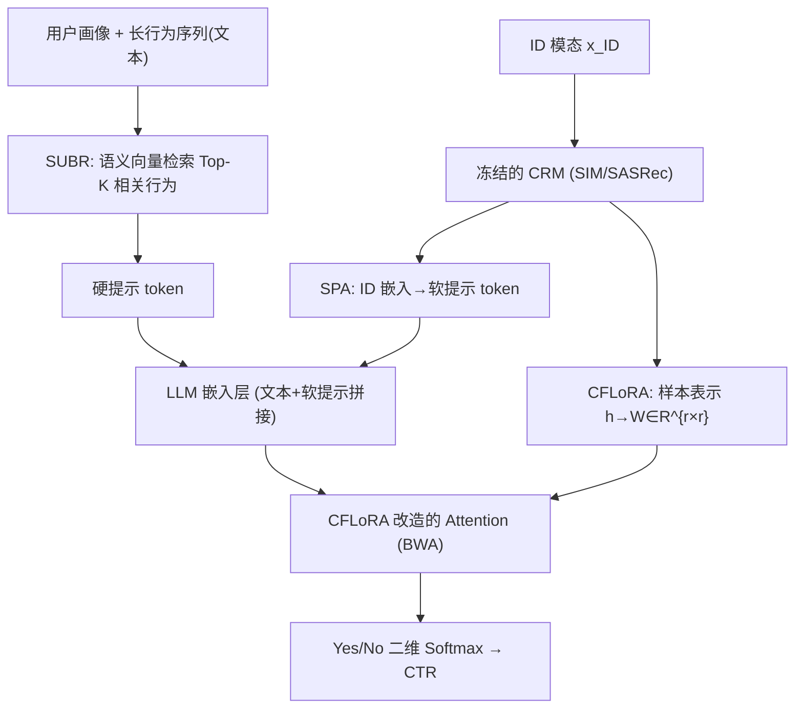

# Full-Stack Optimized Large Language Models for Lifelong Sequential Behavior Comprehension in Recommendation (面向终身序列行为理解的全栈优化大语言模型推荐)

- **会议/期刊**: TORS 2026（arXiv 2501.13344，J. ACM 排版稿件，Under Review）
- **作者与机构**: Rong Shan, Jiachen Zhu, Jianghao Lin, Yong Yu, Weinan Zhang（上海交通大学）；Chenxu Zhu, Bo Chen, Ruiming Tang（华为诺亚方舟实验室）
- **推荐链路定位**: 精排（点式 CTR 打分）
- **研究方向**: 大语言模型推荐 (LLM4Rec) / CTR 预估与特征交叉
- **论文原文**: [https://arxiv.org/abs/2501.13344v1](https://arxiv.org/abs/2501.13344v1)
- **开源代码**: [https://github.com/LaVieEnRose365/ReLLaX](https://github.com/LaVieEnRose365/ReLLaX)

## TL;DR (1分钟核心速览)

本文首次形式化 LLM 在推荐中的“终身序列行为不理解”问题：即使用户行为序列的 token 数远未触及上下文窗口，LLM 的性能仍在序列长度 $K\approx15$ 处见顶后下降，而传统 SIM 持续受益。为此提出 ReLLaX，在数据层用语义行为检索 (SUBR) 降低序列异质性、提示层用软提示增强 (SPA) 注入协同知识、参数层用全交互 LoRA (CFLoRA) 提升表达力。在三套真实数据上以 8:1 全局时间戳切分、AUC/LogLoss 评估，MovieLens-1M AUC 达 0.8091（较最强基线 iLoRA 相对提升 0.72%），MovieLens-25M 达 0.8544（+0.79%）。

## Background & Motivation (背景与核心矛盾)

- **主流范式**: LLM4Rec 主流做法是把用户画像 + 交互历史 + 目标物品序列化为文本提示，用 pointwise 打分（截取 "Yes"/"No" 两词 logits 做二维 softmax）或列表生成完成推荐，并以 LoRA 做指令微调。
- **前人局限**: ①序列建模范式错位——传统 CRM（如 SIM）随 $K$增长单调变好，LLM 却在$K>15$ 后掉点（图 1），且此时 token 数（约 700）远低于 Vicuna-13B 的 2048 窗口，说明并非“窗口不够”，而是**领域内的序列推理能力缺失**；②现有 LoRA 方案（CoLLM 只加软提示、ReLLa 只做检索、iLoRA 只做多 LoRA 集加权）各自只覆盖单一层面，且 LoRA 原子成分之间交互不足，参数表达力难以承载长序列信息。
- **核心洞察 (Key Insight)**: 序列的“异质性”（不同题材/类目混杂程度）是理解失败的直接诱因。作者用 MovieLens 上“唯一题材数”作为异质性度量，发现最近 $K=30$ 条序列异质性为 6.90，而语义检索后的 top-30 仅 5.32；但检索序列随长度增长异质性仍会抬升（top-60 达 6.96 ≈ 最近行为的 top-30），故检索只是必要非充分。
- **本文切入点**: 把“让 LLM 读懂长序列”拆成数据质量、提示信息量、参数容量三条可正交叠加的杠杆，并统一由 CRM 提供协同知识。

## Method (核心方法设计)

### 1. 整体框架 (Overall Architecture)

ReLLaX 对同一训练样本维护双模态输入：文本模态 $\tilde{x}_{text}$（经 SUBR 检索重排后的硬提示）与 ID 模态$x_{ID}$（送入预训练 CRM）。CRM 冻结后产出两类副产物：物品 ID 嵌入（经两层 MLP 投影为软提示 token，拼接到对应物品文本 token 之后）与样本级终层表示$h$（经投影 + reshape 生成$r\times r$交互矩阵$W$，插入 LoRA 的$A,B$ 之间）。训练时仅更新两个 projector 与 LoRA 矩阵，目标仍为因果语言建模；推理时同样融合双模态取 "Yes"/"No" 二维 softmax 得 CTR。三层增强依次降低“序列异质性—语义鸿沟—参数瓶颈”。

### 2. 关键设计拆解 (Key Designs)

1. **SUBR（语义用户行为检索，数据层）**：痛点是最近 $K$条行为题材混杂、噪声点击多。做法是用 LLM 对每个物品的描述文本取末层隐状态均值得$z_t\in\mathbb{R}^{d_z}$，经 PCA 降到$d_q=512$得$q_t$；对目标物品按余弦相似度取 top-$K$替换原最近$K$ 条。直觉：保长度不变的前提下把序列“同质化”，让有限上下文聚焦与目标相关的证据，而非被时间近但无关的点击稀释。
2. **SPA（软提示增强，提示层）**：痛点纯文本 token 与推荐协同空间存在模态鸿沟，LLM 无法感知共现结构。做法是取 CRM 的 ID 嵌入 $E^{ID}_{u,i_c}=[e_{i_1},\dots,e_{i_L},e_{i_c}]$，用两层 MLP 投影为软 token$\hat{E}_{u,i_c}$，插到每个物品文本 token 末尾：$\tilde{E}=[v_1,\dots,v_{n_1},v_{i_1},\dots,v_{n_L},v_{i_L},v_{n_L+1},v_{i_c}]$。这样同一物品同时具备语义与协同两路表征，等价于给 LLM 一个“推荐域内的物品坐标”。
3. **CFLoRA（全交互 LoRA，参数层）**: 将 $B=[B_1,\dots,B_r]$、$A^T=[A_1^T,\dots,A_r^T]$拆为原子向量后，原版 LoRA 仅$\Delta\Theta_1=\sum_j B_jA_j$（即$BIA$），个性化 LoRA 仅$\Delta\Theta_2=\sum_j \alpha_{j//N}B_jA_j$（即$BW_2A$，$W_2$ 为分块对角）。本文放开为全交互并保持矩阵形式：

$$\Delta\Theta_{\text{CFLoRA}}=\sum_{i=1}^{r}\sum_{j=1}^{r}w_{ij}B_iA_j=BWA,\quad W=\mathrm{Reshape}(\mathrm{MLP}(h))\in\mathbb{R}^{r\times r}$$

   即前人是 $W$被约束为单位阵/分块对角阵的退化特例。直觉：跨原子成分的$w_{ij}$让“降维方向”与“升维方向”自由配对，在同等秩$r$ 下把可表达的更新子空间从对角扩张到全空间，从而承载更多长序列信息。
4. **训练目标与开销**：损失为融合双模态的因果 LM 目标 $\max_{\Delta\Theta}\sum_j \log P_{\Theta+\Delta\Theta}(y^{text}_j\mid x_{ID},\tilde{x}_{text},y^{text}_{<j})$，BCE/对比负采样均不涉及（pointwise 二分类 + Yes/No 概率）。可训练参数仅为 SPA projector、CFLoRA projector 与 LoRA 的$A,B$（$r=8$、$\alpha=16$、dropout 0.05，施加于 attention 的 query/value 投影），骨干与 CRM 全冻结，V100 上 8-bit 量化。

## Experimental Setup & Evaluation Protocol (实验设置与评估协议)

- **数据集与预处理**（过滤序列长度 < 5 的样本）：

| 数据集 | #Users | #Items | #Samples | #Fields/#Features | 正负标签定义 |
| :--- | :---: | :---: | :---: | :---: | :--- |
| BookCrossing | 278,858 | 271,375 | 17,714 | 10 / 912,279 | rating > 5 为正 |
| MovieLens-1M | 6,040 | 3,706 | 970,009 | 10 / 16,944 | rating ∈ {4,5} 为正 |
| MovieLens-25M | 162,541 | 59,047 | 25,000,095 | 6 / 280,576 | rating > 3.0 为正 |

- **数据划分与防穿越**: MovieLens-1M / 25M 采用**全局时间戳 8:1 切分**；BookCrossing 无时间戳，按**用户随机 9:1 切分**。CRM 仅在全训练集上预训练，LLM 侧只用 few-shot 采样子集（2048 / 65536 / 65536）。
- **评估协议**: CTR 点式预测，全测试集逐样本计算 **AUC / Log Loss / ACC**（非 Top-N 采样排序）；文本序列长度固定 $K=60/30/30$，CRM 的 ID 序列长度$L=60$。AUC 提升 0.001 即视为显著，显著性用$p<0.001$。
- **对比基线**: ID 侧 DeepFM、AutoInt、DCNv2、GRU4Rec、Caser、SASRec、DIN、SIM（full-shot 全量训练）；LM 侧 CTR-BERT、PTab、P5、TALLRec、CoLLM、iLoRA、ReLLa。

## Key Experimental Results (实验关键数据)

### 1. 主实验对比 (Main Results)

| 模型 | BookCrossing AUC | ML-1M AUC | ML-1M LogLoss | ML-25M AUC | ML-25M LogLoss |
| :--- | :---: | :---: | :---: | :---: | :---: |
| DeepFM | 0.7496 | 0.7915 | 0.5484 | 0.8189 | 0.4867 |
| SASRec | 0.7482 | 0.7934 | 0.5460 | 0.8187 | 0.4956 |
| DIN | 0.7477 | 0.7962 | 0.5425 | 0.8190 | 0.4906 |
| SIM (full-shot) | 0.7541 | 0.7992 | 0.5387 | 0.8344 | 0.4724 |
| TALLRec | 0.7472 | 0.7899 | 0.5473 | 0.8395 | 0.4540 |
| CoLLM | 0.7482 | 0.7948 | 0.5454 | 0.8471 | 0.4453 |
| iLoRA | 0.7514 | 0.8022 | 0.5354 | 0.8435 | 0.4499 |
| ReLLa | 0.7575 | 0.8033 | 0.5362 | 0.8477 | 0.4524 |
| **ReLLaX** | **0.7608** | **0.8091** | **0.5301** | **0.8544** | **0.4369** |
| Improv. (vs 最优基线) | +0.44% | +0.72% | — | +0.79% | — |

### 2. 消融实验 (Ablation Study)

| 变体（ML-1M / ML-25M，8192 shots） | ML-1M AUC | ML-1M LogLoss | ML-25M AUC | ML-25M LogLoss |
| :--- | :---: | :---: | :---: | :---: |
| ReLLaX (full) | **0.7978** | **0.5423** | **0.8343** | **0.4724** |
| w/o SUBR | 0.7963 | 0.5467 | 0.8335 | 0.4759 |
| w/o SPA | 0.7932 | 0.5586 | 0.8298 | 0.4766 |
| w/o CFLoRA | 0.7925 | 0.5515 | 0.8288 | 0.4771 |
| ReLLa（无 SPA+CFLoRA） | 0.7849 | 0.5693 | 0.8192 | 0.4904 |
| ReLLa w/o 指令微调（zero-shot） | 0.7013 | 0.6250 | 0.7324 | 0.5858 |
| ReLLa w/o 微调 & SUBR | 0.6993 | 0.6291 | 0.7503 | 0.6308 |

### 3. 关键实验发现 (Key Findings)

1. **三层增强并非冗余，且“协同知识注入”贡献最大**：ML-1M 上去掉 SUBR 仅掉 0.15pt AUC，而去掉 SPA 掉 0.46pt、去掉 CFLoRA 掉 0.53pt，说明纯文本层面的检索收益已被长序列异质性天花板封住（top-60 检索序列异质性 6.96 反超 top-30 最近行为的 6.90），必须靠 ID 侧的协同知识补位。
2. **数据效率极不对称**：ReLLaX 仅用 <10% 训练样本微调，却在三个数据集上全面超过用全量训练的 SIM（ML-25M 0.8544 vs 0.8344，+2.4% 相对），说明软提示与 CFLoRA 把 CRM 的协同信号蒸馏进了 LLM 打分头，显著降低了 LLM 对标注量的依赖。
3. **“不理解”被真正缓解而非规避**：zero-shot Vicuna-13B 在 ML-1M/25M 的 AUC 峰值出现在 $K=15$后下滑，而 ReLLa 在$K\le30$内单调上升；进一步固定$K=30$、把 ID 序列从$L=30$拉到$L=90$，ReLLaX 的 AUC 与 LogLoss 持续改善（图 7），案例注意力可视化也显示高权重从无关片（Warrior、Kick-Ass 2）收敛到同系列超英片（图 8）。

## Highlights & Limitations (亮点、对比与审稿批判)

- **与代表作对比**: 相比 CoLLM（只用 CRM 生成软提示、忽略数据质量）与 ReLLa（只做检索、不显式注入协同知识），ReLLaX 把两者与参数层打通；相比 iLoRA（多 LoRA 集 + 标量权重），CFLoRA 用满秩 $W$ 取代分块对角约束，理论上严格更一般（前人方案均为其受约束退化）。
- **可迁移亮点**: ①以“异质性分数”作为长序列可读性的可量化诊断指标，可低成本用于任何 LLM4Rec 数据管线；②将冻结 CRM 的样本级表示 $h$ 映射为 LoRA 内部交互矩阵，是一种不增加推理 token 的“参数级知识注入”范式，可迁移到多任务/多场景精排。
- **审稿级局限批判**: ①依赖冻结 CRM 与双模态输入，CRM 质量成为性能上界，且每条样本需额外一次 CRM 前向与投影，推理延迟明显高于 ID 模型（作者自承仅适合可容忍延迟的对话式场景），缺少与 SIM 的时延-收益定量对比；②主实验只报 AUC/LogLoss/ACC 的点式指标，未给出 Top-N 排序或校准分析，且 LLM 基线均为 few-shot 采样（样本量不同），与全量训练的 ID 基线并非完全同预算对比；③LoRA 秩固定为 8，$W$的参数量$r^2$与$r$ 的敏感度、以及 projector 冷启动行为均未展开。

## Rating (四维评分)

- **方法创新性 (Novelty)**: ⭐⭐⭐⭐ （首次形式化“终身序列不理解”问题，并用复合/分解双视角把现有 LoRA4Rec 统一为 CFLoRA 的受约束特例，理论归约干净）
- **评估协议与实验扎实度 (Protocol & Experiments)**: ⭐⭐⭐⭐ （三数据集、时间戳切分、$p<0.001$ 显著性、含 zero-shot 与序列长度扫描的多角度消融，但 LLM 基线与 ID 基线训练预算不对等）
- **写作与数学规范度 (Clarity & Rigor)**: ⭐⭐⭐⭐ （三层增强结构清晰，$BWA$的矩阵-原子双视角推导简洁；个别符号如$r_1$、$\alpha_{j//N}$ 交代略仓促）
- **工业落地与复现价值 (Industrial & Practical Value)**: ⭐⭐⭐ （代码开源、8-bit + LoRA 可在 V100 复现，但双模态推理延迟与 CRM 依赖限制了高 QPS 精排场景的直接部署）

