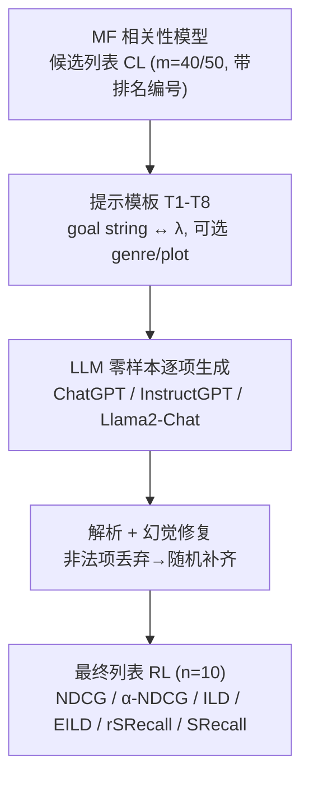
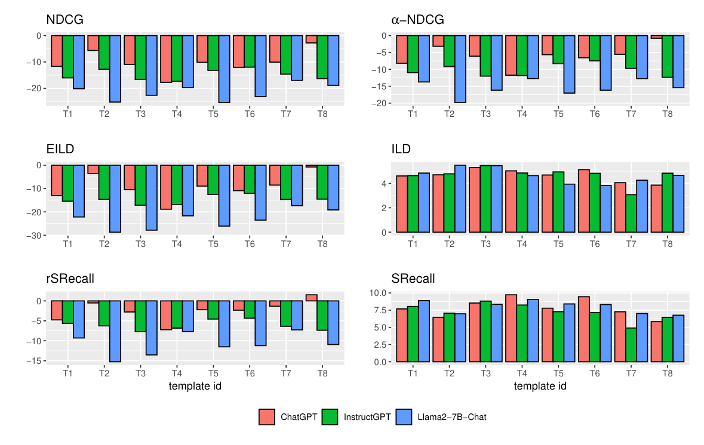

# Enhancing Recommendation Diversity by Re-ranking with Large Language Models（基于大语言模型重排提升推荐多样性）

- **会议/期刊**: ACM Transactions on Recommender Systems (TORS)
- **作者与机构**: Diego Carraro, Derek Bridge（Insight Centre for Data Analytics, University College Cork）
- **推荐链路定位**: 重排（Post-processing Re-ranking）
- **研究方向**: 多任务学习与列表级重排 / 大语言模型推荐
- **论文原文**: [https://arxiv.org/abs/2401.11506v2](https://arxiv.org/abs/2401.11506v2)
- **开源代码**: [https://github.com/cdiego89phd/chat-reranking](https://github.com/cdiego89phd/chat-reranking)

## TL;DR (1分钟核心速览)

现有 LLM4Rec 工作几乎全部围绕"相关性"打磨，而多样性等 beyond-accuracy 目标在 LLM 管线中几乎空白。本文把多样性重排完全表述为零样本文本生成任务：将贪心重排目标 $f_{obj}(i,RL)=\lambda\cdot rel(i)+(1-\lambda)\cdot div(i,RL)$中的$\lambda$隐式编码进提示词（balance/maximize + genre/plot 特征），用 8 个模板驱动 ChatGPT/InstructGPT/Llama2-Chat 从$m=40/50$的 MF 候选列表中产出$n=10$ 的最终列表。在 Anime 与 Goodreads（500 测试用户、NDCG/α-NDCG/ILD/EILD/rSRecall/SRecall）上，LLM 重排显著优于随机重排（随机 NDCG 掉 58.8%/66.3%），但整体仍逊于 MMR/xQuAD，单用户重排耗时高约 3 个数量级。

## Background & Motivation (背景与核心矛盾)

- **主流范式**: 多样性提升主要靠"后处理重排"——由相关性模型产出候选 $CL$，再用 MMR、xQuAD、RxQuAD 等贪心策略逐条挑选，显式优化$rel$与$div$ 的线性折中。
- **前人局限**: ① 贪心方法强依赖显式物品特征（如 genre）与用户画像，特征缺失或跨域时失效；② 现有 LLM 重排工作（Dai、Li、Hou、Sun 等）只优化相关性，且候选集仅 $m=5\sim20$、普遍忽略 LLM 幻觉导致的非法推荐，评估口径不可比。
- **核心洞察 (Key Insight)**: LLM 在预训练中已内化"物品属性/类型"知识，前期非正式实验显示 ChatGPT 能完成字母序/热度/发行日期重排（RBO 0.35–0.8），并能自发以"genre 覆盖数"定义并比较两列表的多样性——即多样性概念可被提示词直接唤起，无需微调。
- **本文切入点**: 既然自回归 LLM 逐项生成列表的过程天然等价于贪心逐条选择，就用提示词替代 $f_{obj}$ 的算子实现，把重排变成一个零样本生成问题。

## Method (核心方法设计)

### 1. 整体框架 (Overall Architecture)

管线三步闭环：① 用 RankSys 的 MF 在训练集上训练相关性模型，对每个测试用户生成只含未交互物品的候选列表 $CL$（$m=40$Anime /$50$Goodreads，按相关性降序并编号）；② 将$CL$实例化进统一提示模板——`<Instructions>` 段给出目标字符串（balance / maximize、general diversity / genre-based diversity），`<Output format>` 段强制 `1-> item name` 的编号列表格式以便解析，`<CL>` 段用三重反引号包裹候选列表，T5–T8 额外附加 genre 列表或 ChatGPT 生成的剧情摘要；③ LLM 逐项自回归吐出$n=10$的最终列表$RL$，解析后计算 6 项指标。全程零样本、无梯度更新。

### 2. 关键设计拆解 (Key Designs)

1. **λ 的提示词化映射（把目标函数翻译成自然语言指令）**：贪心重排的瓶颈是 $\lambda$需人工调参且$div$需可微距离函数；本文不去建模$f_{obj}$，而是令 T1/T4–T7 使用 "balance relevance and diversity"（对应$\lambda=0.5$）、T2/T3/T8 使用 "maximize the items' diversity"（对应$\lambda=0$），并用 "genre-based" 一词把$div$ 具体化为类型覆盖度。有效性直觉：指令微调后的模型对 "balance/maximize" 这类程度副词敏感，可在生成过程中隐式执行加权折中。

2. **特征感知模板（Feature-aware Prompting ≈ 预取式 RAG）**：痛点是无特征的纯标题提示让 LLM 只能靠参数记忆推断物品属性，在长尾/新物品上必然失准；T5–T6 注入数据集 genre、T7–T8 注入一句话剧情摘要并附加 "Guidelines to perform the re-ranking"，等价于把检索到的上下文静态前置（与标准 RAG 的唯一差别是离线一次性取全量特征）。直觉上这既补足了幻觉，又让 LLM 的多样性判断从"记忆"转向"证据"。

3. **幻觉处理与推理开销**：定义两类非法输出——多余前后缀（可正则/近似字符串匹配修复）与 $CL$中不存在的物品或标题错配（如 "Naruto" vs "Naruto: Shippuden"，不可修复）。对后者直接丢弃，并从$CL$随机补齐至$|RL|=n$，从而把"非法率"量化为主指标之一，而非静默忽略。训练目标：无（零样本）；推理成本：OpenAI 侧约 500 用户$161.05，其中 InstructGPT 占 75%；Llama2 自托管无 API 费用。

## Experimental Setup & Evaluation Protocol (实验设置与评估协议)

- **数据集与预处理**: 剔除 genre 缺失物品；Anime 额外剔除非罗马字母标题与 2021 年后上映作品（保证 LLM 预训练覆盖）；评分映射到 1–5 星，过滤评分数不在 $[70,300]$ 的用户。

| 数据集 | #Users | #Items | #Interactions | 稀疏度 | 特征/场景说明 |
| :--- | :---: | :---: | :---: | :---: | :--- |
| Anime (MyAnimeList) | 118k | 2.6k | 17M | 94.50% | 40 类 genre，平均每用户 143 条评分 |
| Goodreads | 166k | 8k | 8M | 99.40% | 16 类 genre，平均每用户 50 条评分 |

- **数据划分与防穿越**: 用户级随机 80/20 训练-测试划分；超参用训练集内 20% 验证集调 $k$（Anime$k=20$、Goodreads$k=50$，以 NDCG@10 选择），从测试集随机抽 500 名用户评测。候选$CL$ 仅含训练集中未出现的物品，严格避免正样本泄漏。
- **排名评测协议**: 属于**候选列表级重排评估**（非全库 Full-Ranking）——在 MF 给出的 $m=40/50$有偏候选上重排取 top-$n=10$，指标全部截断于 10。相关性 NDCG@10（Precision/Recall 结论一致故省略）；多样性 ILD（genre 上 Jaccard 相似度补集的平均成对距离）、SRecall（genre 覆盖率）、EILD/rSRecall（仅对相关子集计算）、α-NDCG（$\alpha=0.5$）。冲突区间按 95% 置信区间报告，未做$p$ 值检验。
- **对比基线与超参**: Random（同库随机采样）、MMR、xQuAD、RxQuAD（后两者额外使用训练集估计 aspect 概率）；LLM 侧 ChatGPT (`gpt-3.5-turbo-0613`)、InstructGPT (`gpt-3.5-turbo-instruct`)、Llama2-7B/13B-Chat（2×A40 48GB）。

## Key Experimental Results (实验关键数据)

### 1. 主实验对比 (Main Results)

下表为相对 MF 基线的百分比变化（正=提升，负=下降），粗体为各列最优。

| Anime (MF: NDCG 0.316 / α-NDCG 0.325 / EILD 0.221 / ILD 0.776 / rSRecall 0.234 / SRecall 0.473) | NDCG | α-NDCG | EILD | ILD | rSRecall | SRecall |
| :--- | :---: | :---: | :---: | :---: | :---: | :---: |
| Random | -58.8 | -52.6 | -57.3 | +4.5 | -38.0 | +5.6 |
| MMR | **-5.4** | -3.4 | **+0.4** | **+12.6** | +1.5 | **+15.0** |
| xQuAD | -4.6 | **+7.9** | -4.2 | +0.5 | **+7.5** | +14.0 |
| RxQuAD | -6.5 | +4.1 | -6.4 | -0.8 | +4.3 | +7.0 |
| ChatGPT | -10.1 | -6.0 | -9.4 | +4.7 | -2.5 | +7.8 |
| InstructGPT | -14.9 | -10.2 | -14.7 | +4.7 | -6.1 | +7.2 |
| Llama2-7B-Chat | -21.5 | -15.5 | -23.3 | +4.6 | -10.8 | +8.0 |
| Llama2-13B-Chat | -26.0 | -21.6 | -25.1 | +4.4 | -14.7 | +4.7 |

| Goodreads (MF: NDCG 0.249 / α-NDCG 0.271 / EILD 0.092 / ILD 0.689 / rSRecall 0.355 / SRecall 0.871) | NDCG | α-NDCG | EILD | ILD | rSRecall | SRecall |
| :--- | :---: | :---: | :---: | :---: | :---: | :---: |
| Random | -66.3 | -59.6 | -71.3 | +2.0 | -43.8 | +2.1 |
| MMR | **-4.7** | -6.6 | **-2.5** | **+17.7** | -5.3 | +7.2 |
| xQuAD | -7.8 | **+13.7** | -9.3 | -8.2 | **+8.8** | **+10.0** |
| RxQuAD | -8.1 | +11.9 | -8.6 | -7.7 | +7.4 | +8.6 |
| ChatGPT | -33.4 | -19.3 | -46.0 | -4.8 | -20.0 | +1.8 |
| InstructGPT | -53.5 | -36.6 | -66.5 | -4.7 | -35.0 | +1.4 |
| Llama2-7B-Chat | -59.5 | -50.4 | -70.0 | -1.1 | -43.7 | +1.1 |
| Llama2-13B-Chat | -61.3 | -48.4 | -71.9 | -2.2 | -41.8 | +1.5 |

### 2. 消融实验 (Ablation Study)

以"模板族"为消融单元（3 个 LLM 平均，相对 MF 的百分比变化；非法率=非 $CL$ 物品被随机补齐的比例）：

| 模板族（消融项） | Anime NDCG | Anime α-NDCG | Anime ILD | Anime SRecall | Goodreads NDCG | Goodreads α-NDCG | 非法/补齐率 |
| :--- | :---: | :---: | :---: | :---: | :---: | :---: | :---: |
| T1–T4（纯标题、无特征） | -16.4 | -11.3 | +4.98 | +8.15 | -48.7 | -35.1 | 5.2% |
| T5–T6（+genre） | -16.0 | -10.2 | +4.55 | +8.05 | -44.4 | -30.6 | 9.1% |
| T7–T8（+plot 摘要 & 指南） | **-13.3** | **-9.4** | +4.15 | +6.35 | -53.5 | -40.8 | 20.2% |

另有两项非性能侧拆解：LLM 平均抽取的最低候选排名（MMR 19.5/22.6 vs ChatGPT 22.6/31.9 vs Llama2-13B 28.9/43.1，Anime/Goodreads），以及单用户重排耗时（MMR 0.05/0.08s、xQuAD 0.1/0.13s、RxQuAD 0.12/0.18s vs Llama2-7B 12.6/16.1s、Llama2-13B 23.7/31.6s、OpenAI ≥25s 上界）。

### 3. 关键实验发现 (Key Findings)

1. **LLM 重排"确有智能"但仍打不过贪心**：所有智能重排器大幅超越随机（随机在 Anime/Goodreads 上 NDCG 分别崩 58.8%/66.3%），证明 LLM 确实理解重排任务；但最佳 ChatGPT 平均仍掉 10.1%/33.4% NDCG，仅在 ILD 上优于 xQuAD/RxQuAD，且只有在最佳模板下 Anime 上 NDCG 仅降 2.8% 时才追平传统方法。
2. **性能差距的三条可归因机制**：LLM 更爱从候选列表深处取物品（Goodreads 上平均拉到第 31.9 位，MMR 仅 22.6 位）→ 相关性天然受损；幻觉补齐率在 Goodreads 高达 13.1%（Anime 仅 2.3%），随机补入物进一步污染相关性；xQuAD/RxQuAD 额外使用用户画像估计 aspect 分布，信息面更宽。
3. **特征注入是双刃剑**：注入 plot 摘要的 T7–T8 在 Anime 上把 NDCG 损失从 T1–T4 的 -16.4% 收窄到 -13.3%、α-NDCG 从 -11.3% 收窄到 -9.4%，但代价是补齐率从 5.2% 飙到 20.2%；在 Goodreads 上特征注入反而因长提示与大量非法项让 NDCG 掉到 -53.5%，说明模板收益强依赖领域与模型，不存在普适最优模板。

<figure class="paper-figure" markdown="span">
  <figcaption>图1. Anime数据集上基于LLM的重排序器在不同提示模板下的比较。对于每个指标，我们绘制相对于基线MF得分的百分比差异。</figcaption>
</figure>

## Highlights & Limitations (亮点、对比与审稿批判)

- **与代表作对比 (vs. Prior Work)**: 相比 Dai/Li/Hou/Sun 等 LLM 重排工作，本文首次把目标从相关性切换到 beyond-accuracy（多样性），且候选规模（$m=40/50$）远大于前人的$m=5/20$、更贴近线上真实重排预算；相比 MMR/xQuAD/RxQuAD，本文不依赖显式特征工程与用户画像，理论上可直接借用 LLM 的跨域隐式知识，但代价是性能、可控性与延迟三重劣势。
- **可迁移亮点**: ① "非法输出率+随机补齐"这一量化口径可直接复用到任何 LLM 生成式重排/生成式召回的评测中，避免刷分；② 用 goal string 隐式编码 $\lambda$ 的思路，可迁移为多目标（相关性/新颖性/公平性）重排的统一提示接口。
- **审稿级局限批判**: ① 仅 500 名测试用户，置信区间宽（除 ILD/SRecall 外多数重叠），无 $p$ 值检验，结论稳健性偏弱；② 多样性仅以 genre 定义，忽略时间多样性、用户感知多样性，且实验模型停留在 GPT-3.5/Llama2 时代，OpenAI 侧延迟因 25s 睡眠只能给上界、成本分析不可复现；③ 候选列表级评估无法反映全库排序下的真实多样性收益。

## Rating (四维评分)

- **方法创新性 (Novelty)**: ⭐⭐⭐ （把贪心重排目标函数"翻译"为提示词并系统化 8 模板，思路清晰但本质是提示工程，缺少新的可学习机制）
- **评估协议与实验扎实度 (Protocol & Experiments)**: ⭐⭐⭐ （双域、4 基线、6 指标、含非法率与成本分析，较前人更严谨；但仅 500 用户、无显著性检验、多样性口径单一）
- **写作与数学规范度 (Clarity & Rigor)**: ⭐⭐⭐⭐ （$f_{obj}$ 与模板映射表、提示词模板、指标定义交代清楚，附录给出全部置信区间）
- **工业落地与复现价值 (Industrial & Practical Value)**: ⭐⭐ （代码与数据集全开源，但单用户 12–25s 延迟与 $161/500 用户成本距线上重排要求尚有 3 个数量级差距，短期更适合离线/异步场景）

