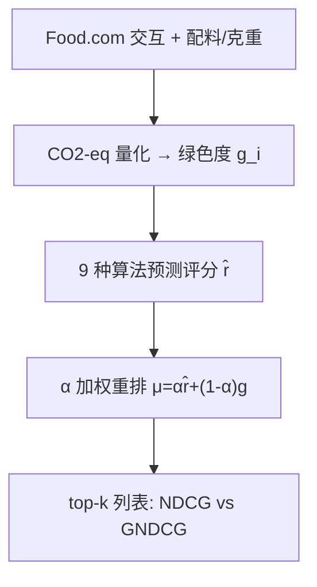
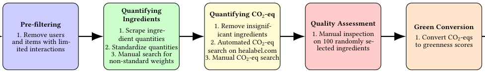

# Towards Carbon Footprint-Aware Recommender Systems for Greener Item Recommendation (面向碳足迹感知的绿色商品推荐)

- **会议/期刊**: TORS (ACM Transactions on Recommender Systems, 目标)
- **作者与机构**: Raoul Kalisvaart, Masoud Mansoury, Alan Hanjalic, Elvin Isufi（代尔夫特理工大学）
- **推荐链路定位**: 重排 (Re-ranking，模型无关后处理)
- **研究方向**: 多任务学习与列表级重排 / 去偏公平可信推荐
- **论文原文**: [arXiv:2503.17201v1](https://arxiv.org/abs/2503.17201v1)
- **开源代码**: [green-recommender-systems](https://github.com/RaoulKalisvaart/green-recommender-systems)

## TL;DR (1分钟核心速览)

电商推荐的环境影响鲜被研究，核心瓶颈是**缺少带碳足迹标注的数据集**。本文首先从 Food.com 挖掘出首个含每道食谱 CO2-eq 的 RecSys 数据集 RecipeEmission（32,090 用户 / 5,595 食谱，稀疏度 99.86%），并定义归一化绿色 DCG 指标 GNDCG@k；随后基准测试 9 种传统算法，发现精度优化型推荐**普遍忽视绿色度**（GNDCG 全部徘徊于 0.5）、列表越长越绿但越不精准。最后提出模型无关的 α 加权重排 $\mu_{u,i}=\alpha\hat{r}_{u,i}+(1-\alpha)g_i$，在精度仅 -2.7%（SVD, α=0.6）时把绿色度拉高 +72.6%，全局最优可达 +89.1% 绿色度增益而精度最坏损失约 11%。

## Background & Motivation (背景与核心矛盾)

- **主流范式**: 推荐系统把碳排放视为"算力成本"问题（训练/推理能耗），而非"推荐物品本身是否环保"的问题；且所有研究都缺少含物品碳足迹的数据。
- **前人局限**: ① 电商/外卖等平台对可持续物品的偏好无法量化评估，因为标准 RecSys 数据集不含 CO2-eq 特征；② 已有绿色推荐工作（模糊逻辑、绿色营销架构）缺乏与主流的可比基准与精度-绿色权衡分析。
- **核心洞察**: 用户给出评分时**并未考虑物品绿色度**（图 3d 显示评分与绿色度无分布偏移），因此"高精度"与"高绿色度"是两个近乎正交的目标——这正是做多目标重排的天然土壤。
- **本文切入点**: 先造数据，再做基准，最后用一个极简、即插即用的后处理重排在不改模型内部、不重训的前提下重新平衡双目标。

## Method (核心方法设计)

### 1. 整体框架 (Overall Architecture)

本文的"框架"是一条三段式流水线而非单一网络：**数据挖掘**（Food.com → 抓取配料/克重 → healabel.com 查 CO2-eq → 转绿色度）→ **双目标基准**（9 种算法对每个用户预测评分，按评分排序，用 NDCG 量精度、GNDCG 量绿色）→ **α 重排**（把预测评分与物品绿色度线性融合后重排 top-k）。整条链路模型无关，重排层可直接插入任意已训练模型之上。

<figure class="paper-figure" markdown="span">
  <figcaption>图 4. 构建数据集步骤概览。首先进行预过滤，随后进行成分和 CO2-eq 量化。最后将 CO2-eq 值转换为绿色度标度。</figcaption>
</figure>

### 2. 关键设计拆解 (Key Designs)

1. **数据集构建与绿色度量化**：CO2-eq 量纲跨度极大、风格化单位混杂 → 先做 5 步过滤（保留 ≥20 评分食谱、剔除配比缺失项）再用**对数压缩 + 逆值 + 投影**统一到 $[0,5]$：$g_i=\mathcal{Q}[\log(1+1/c_i)]$，其中$c_i$ 为食谱 CO2-eq。逆值保证低碳=高绿、对数抑制指数衰减、与评分同尺度便于后续线性融合；质量抽检 92% 准确率。

2. **绿色度列表指标 GDCG@k**：传统 NDCG 无法度量"列表有多绿" → 沿用 DCG 折损思路但把相关性换成绿色度：$GDCG@k=\frac{1}{|U|}\sum_u\sum_{i\in I_u,v_i\le k}\frac{2^{g_i}-1}{\log_2(v_i+1)}$，再除以理想绿色排序得$GNDCG@k\in[0,1]$。指数项$2^{g_i}$ 使"高位置且高绿"获得超额奖励，从而单值刻画全列表绿色性。

3. **α 加权精度-绿色重排**：多目标权衡缺乏可控旋钮 → 定义效用 $\mu_{u,i}=\alpha\hat{r}_{u,i}+(1-\alpha)g_i$原地重排，$\alpha\to1$退回精度、$\alpha\to0$偏绿。无需负采样、无需重训；推理开销仅为一次$O(k\log k)$ 排序。论文未给出端到端损失，因重排为**免训练**算子。

## Experimental Setup & Evaluation Protocol (实验设置与评估协议)

- **数据集与预处理**: 基于 Food.com，经 5 级过滤（食谱≥20 评分、剔除配料不可全查项、剔除孤立用户等），并保持长尾与 >99.8% 稀疏以对齐常规基准。

| 数据集 | #Users | #Items | #Interactions | 稀疏度 | 平均评分(±std) | 特征/场景 |
| :--- | :---: | :---: | :---: | :---: | :---: | :--- |
| **RecipeEmission** | 32,090 | 5,595 | 247,219 | 99.86% | 4.57 (±1.05) | 含 CO2-eq + 绿色度 |
| Food.com (原始) | 226,570 | 231,637 | 1,132,367 | 99.998% | 4.41 (±1.26) | 无碳足迹 |
| MovieLens-1M | 6,040 | 3,706 | 1,000,209 | 95.53% | 3.58 (±1.12) | 对照稀疏度 |
| Book-Crossing | 105,283 | 340,556 | 1,149,780 | 99.997% | 2.87 (±3.85) | 对照长尾 |

- **数据划分与防穿越**: 比例划分 6/2/2（训练 148,512 / 验证 49,444 / 测试 49,444），采用**带约束的随机移除**（仅当用户与物品在训练集中各出现 ≥2 次才可移入测试），保证测试集物品在训练集至少出现一次，规避严格冷启动；重复生成 5 个随机划分取平均。
- **排名评测协议**: 因数据集 77% 测试样本评分为 5，整集 NDCG 恒接近 1 难以区分算法 → **将测试集切成 100 样本一批、批内分别排序评估再平均**；属采样式排序（非全库 Full-Ranking），未交互项不参与候选。
- **对比基线与超参**: 9 种算法——Random、Global Mean、ItemNN/UserNN（邻居数 {20,40,60}）、SVD（因子 {20,50,100,150}）、SVD++、CoClustering（簇 {3,6,12,24}）、Slim（β,λ∈{0.005,0.05,0.5}）、GNN（lr {0.01,0.05,1}，dropout {0.3,0.5,0.7}）。均仅按精度调优，不含绿色度输入。

## Key Experimental Results (实验关键数据)

### 1. 主实验对比 (Main Results)

| 算法 | NDCG@10 | NDCG@20 | NDCG@50 | GNDCG@10 | GNDCG@20 | GNDCG@50 |
| :--- | :---: | :---: | :---: | :---: | :---: | :---: |
| Random | 0.86 | 0.86 | 0.86 | 0.47 | 0.51 | 0.61 |
| Global Mean | 0.87 | 0.86 | 0.86 | 0.46 | 0.51 | 0.62 |
| ItemNN | 0.92 | 0.91 | 0.91 | 0.47 | 0.51 | 0.61 |
| SVD | **0.97** | **0.95** | **0.93** | 0.49 | **0.53** | **0.63** |
| SVD++ | 0.96 | **0.95** | **0.93** | 0.49 | 0.52 | 0.62 |
| CoClustering | 0.95 | 0.94 | 0.92 | 0.48 | **0.53** | 0.62 |
| Slim | 0.95 | 0.94 | 0.92 | 0.49 | **0.53** | 0.62 |
| GNN | 0.96 | **0.95** | 0.92 | 0.49 | 0.52 | **0.63** |

（精度排序：SVD 最优；绿色度各算法 GNDCG≈0.47–0.63，无明显赢家；标准差约 $2\text{–}5\times10^{-3}$，`*` 处为$10^{-2}$。）

### 2. 消融实验 (α 重排权衡，SVD@20)

| 设置 | NDCG@20 | GNDCG@20 | ΔNDCG | ΔGNDCG |
| :--- | :---: | :---: | :---: | :---: |
| SVD 基线 (α=1) | 0.95 | 0.53 | — | — |
| SVD + 重排 (α=0.6) | ≈0.924 | ≈0.915 | **-2.7%** | **+72.6%** |
| 全体最优 (最极端 α) | — | — | 最差约 -11% | 最好 **+89.1%** |

### 3. 关键实验发现 (Key Findings)

1. **精度优化天然"色盲"**：所有 9 种算法 GNDCG 全部聚集在 0.5 中性值附近（图 3 显示绿色度中心在 3、评分与 CO2-eq 无相关），证明按评分排序不会自发偏向绿色，绿色推荐必须显式引入机制。
2. **列表长度即隐式权衡**：随 $k$ 从 10→50，GNDCG 从 ~0.49 升至 ~0.63，而 NDCG 从 ~0.97 降至 ~0.93——列表变长纳入更多绿色物品但精度被高评分偏置稀释（图 6 显示长列表 5 星占比下降）。
3. **`α` 是高效旋钮，模型族差异明显**：分解类（SVD/CoClustering）在 α≥0.5 区段实现最陡的"高绿-低损"前沿；邻居类因评分估计误差大，当绿色度权重上升反而"纠偏"精度，说明低精度模型更受益于重排；短列表权衡优于长列表。

## Highlights & Limitations (亮点、对比与审稿批判)

- **与代表作对比 (vs. Prior Work)**: 相较 GreenRec/模糊逻辑等缺乏可复现基准的绿色推荐设想，本文首次提供带 CO2-eq 的公开数据集 + 双目标基准 + 可插拔重排；相较公平性/校准重排（Steck 的 calibrated rec），本文把"公平维度"替换为"环境维度"并复用 NG 系列加权范式，方法同源但目标全新。
- **可迁移亮点**: ① 对数逆值投影 $g_i=\mathcal{Q}[\log(1+1/c_i)]$ 是把任意长尾成本/稀缺度压缩到评分同量纲、便于线性多目标融合的通用技巧；② "批内排序 + 100 样本评估"可缓解高偏置数据集的评估饱和。
- **审稿级局限批判**: ① 权衡仅由单标量 α 控制，α 随算法/用户/场景漂移，缺乏自动多目标优化（Pareto/可学习权重），线上部署需频繁调参；② 数据集对"高评分 + 低 CO2-eq"双重偏置，使"提绿"在此场景过于容易，结论未必外推至其他域；③ 全程离线、候选为采样集而非全库 Full-Ranking，且只研究精度-绿色二维权衡，未纳入多样性/新颖性/价格等更贴近用户满意度的维度。

## Rating (四维评分)

- **方法创新性 (Novelty)**: ⭐⭐⭐ （重排算子本质是成熟的加权多目标范式迁移，创新主要在"问题定义 + 首个碳足迹数据集"，机制本身朴素）
- **评估协议与实验扎实度 (Protocol & Experiments)**: ⭐⭐⭐ （5 随机划分 + 9 基线 + 专设 GNDCG 指标较规范，但为采样排序、缺全库评测与显著性检验、无在线 A/B）
- **写作与数学规范度 (Clarity & Rigor)**: ⭐⭐⭐⭐ （GDCG 指标定义清晰、符号自洽，但权衡前沿多为图示、缺 α 全扫描数值表，理论分析为零）
- **工业落地与复现价值 (Industrial & Practical Value)**: ⭐⭐⭐⭐ （重排即插即用、免重训、成本极低，代码与数据集开源，落地门槛低，唯 CO2-eq 数据获取在真实工业场景仍昂贵）

