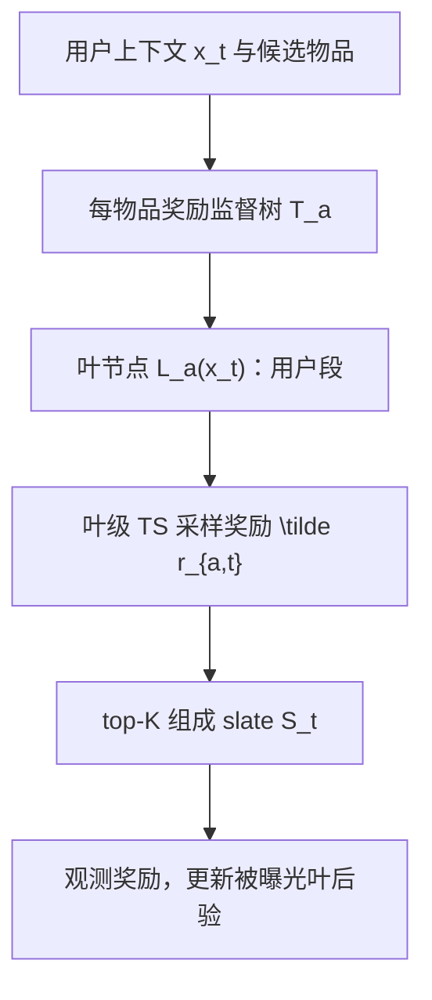
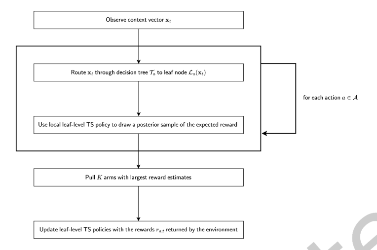

# A Reward-Informed Semi-Personalized Bandit Approach for Enhancing Accuracy and Serendipity in Online Slate Recommendations (奖励感知的半个性化 Bandit 在线列表推荐)

- **会议/期刊**: ACM Transactions on Recommender Systems (TORS)
- **作者与机构**: Lukas De Kerpel, Dries Benoit；Ghent University / FlandersMake@UGent
- **推荐链路定位**: 在线列表推荐（重排与探索）
- **研究方向**: 强化学习与动态探索推荐 / 多任务学习与列表级重排
- **论文原文**: [论文原文链接](https://biblio.ugent.be/publication/01K9F3ZHWJS4MKH7JXKGNWHGQN/file/01K9P9XVAT4YVR7JJZ996043EC.pdf)
- **开源代码**: 暂未开源

## TL;DR (1分钟核心速览)

针对个性化 bandit 只优化准确率、易导致列表同质化，且稀疏反馈下长尾奖励估计不稳的问题，本文提出 TreeTS：为每个物品学习奖励监督决策树，将用户划入同质细分，并在叶级运行 Thompson Sampling 生成 top-K slate；同时给出 LinTS-DPP 作为多样性重排对照。三域在线模拟中，TreeTS 将平均即时 regret 较最佳基线降低约 3.5%–39.0%，ZOZOTOWN 上 Serendipity 相对 ClustersTS 提升 21.3%。

## Background & Motivation (背景与核心矛盾)

- **主流范式**: 以 LinTS 为代表的 contextual bandit 在用户个体层面建模上下文与奖励，在线平衡探索与利用；TreeBootstrap、BanditForest 等非参方法进一步拟合非线性奖励。
- **前人局限**: 个体级优化易过拟合历史偏好，产生 overspecialization 与同质列表；同时长尾物品在单用户历史中反馈极少，奖励估计方差大。
- **核心洞察**: 相同人口统计特征的用户可能对同一内容有截然不同的奖励响应；仅按上下文相似度聚类会忽略这种“决策相关异质性”，而按奖励模式监督分割能把行为同质用户池化。
- **本文切入点**: 用“每物品一棵奖励监督决策树 + 叶级 TS”做半个性化建模，以用户段级探索替代个体级探索，并用 DPP 重排作为显式多样性对照。

## Method (核心方法设计)

### 1. 整体框架 (Overall Architecture)

TreeTS 对每个候选物品维护一棵决策树，将用户上下文路由到叶节点；每个叶节点代表一个奖励同质用户段，并拥有独立的 TS 后验。在线到达时，对全部物品在对应叶采样奖励，取 top-K 组成 slate；反馈只更新被曝光物品的对应叶后验，树周期性重训。LinTS-DPP 则保留全局线性 TS，在 top-M 候选上用 DPP 重排以提升列表内多样性。

图1给出 TreeTS 的路由与叶级 TS 流程，适合与上述两阶段设计对照。

<figure class="paper-figure" markdown="span">
  <figcaption>图 1. TreeTS 算法流程图。对于每个动作，上下文向量通过决策树路由到叶节点，在叶节点处由局部 Thompson Sampling 策略估计奖励。</figcaption>
</figure>

### 2. 关键设计拆解 (Key Designs)

1. **奖励监督的物品级用户分割**：痛点是个体级数据稀疏且上下文聚类不等价于奖励同质。对动作 $a$，树$T_a$以叶内奖励同质性为目标递归分裂，分裂增益可写为$\Delta=\mathrm{Imp}(D)-\sum_{c\in\{L,R\}}\frac{|D_c|}{|D|}\mathrm{Imp}(D_c)$；$x_t$落入叶$L_a(x_t)$后维护$\mathrm{Beta}(\alpha_{a,L},\beta_{a,L})$，并采样$\tilde r_{a,t}\sim\mathrm{Beta}(\alpha_{a,L},\beta_{a,L})$。这样叶内共享奖励证据，长尾物品也能获得更稳估计。
2. **叶级 TS 与列表生成**：直接在段内做探索，避免个体级 TS 反复试错。slate 为 $S_t=\arg\max_{S\subset\mathcal{A},|S|=K}\sum_{a\in S}\tilde r_{a,t}$；只更新被曝光动作的对应叶，实现跨用户池化。段级探索会扩大候选内容，因而在稀疏场景下更容易产生“相关但意外”的推荐。
3. **LinTS-DPP 多样性重排与训练/推理**：先由 LinTS 取 top-M 候选特征矩阵 $X$，构造核$L=XX^\top+\gamma I$，再以$P(S)\propto\det(L_S)$用 k-DPP 采样$K$个物品。模型无全局损失，采用贝叶斯后验在线更新；树路由约$O(\text{depth})$，DPP 在$M=20$时约$O(M^3)$，主要开销来自每物品一树的维护与周期性重训。

## Experimental Setup & Evaluation Protocol (实验设置与评估协议)

- **数据集与预处理**: 论文未用 5-core，而是随机抽样用户并保留物品子集；MovieLens 评分 $\ge 4$ 记正奖励，其余为二元点击/opt-in/点击奖励。

| 数据集 | #Users | #Items/Actions | #Interactions | 动作空间密度 | 特征/场景说明 |
| :--- | :---: | :---: | :---: | :---: | :--- |
| MovieLens 1M | 750 | 1,000 | 35,799 | 4.77% | 用户人口统计 one-hot；电影类型 multi-hot；评分二值化 |
| FinancialNews | 500 | 66 | 27,909 | 84.57% | 订阅者与金融教育文章；点击/opt-in 奖励；文章 51 维嵌入 |
| ZOZOTOWN | 1,500 | 80 | 25,107 | 20.92% | 时尚电商随机策略 ALL campaign；点击奖励；价格/品牌/品类特征 |

- **数据划分与防穿越**: 按用户随机 70%/30% 划分，重复 5 次；测试阶段仅可推荐训练集中出现过的物品，避免物品冷启动。
- **排名评测协议**: 在线 slate 模拟，对全动作集按后验采样打分并取 top-K，非采样负例排序；$K=5$（MovieLens），$K=3$（FinancialNews、ZOZOTOWN）。指标为平均即时 pseudo-regret、Div、Ser、Nov。
- **对比基线与超参**: LinTS 的 $\alpha\in\{0.1,1,10\}$；LinTS-DPP 用 DPPy，jitter$=10^{-6}$，候选池$M=20$，ridge$=1.0$；ClustersTS 的$n\_clusters\in\{4,6,8,10\}$，每 500 轮重聚类；TreeTS 的 min_weight_fraction_leaf$\in\{0,0.001,0.01,0.1\}$，每物品每 10 条新观测重训。显著性用 paired t-test + Holm-Bonferroni。

## Key Experimental Results (实验关键数据)

### 1. 主实验对比 (Main Results)

| 模型 | ML Reg↓ | ML Ser↑ | ML Div↑ | ML Nov↑ | FN Reg↓ | FN Ser↑ | FN Div↑ | FN Nov↑ | ZOZO Reg↓ | ZOZO Ser↑ | ZOZO Div↑ | ZOZO Nov↑ |
| :--- | :---: | :---: | :---: | :---: | :---: | :---: | :---: | :---: | :---: | :---: | :---: | :---: |
| LinTS | 1.5047 | 0.6470 | 0.8328 | 0.7134 | 0.1176 | 0.0694 | 0.1424 | 0.2187 | 0.0967 | 0.2519 | 0.4537 | **0.3717** |
| LinTS-DPP | 1.4949 | 0.6454 | **0.9230** | 0.7038 | 0.1239 | **0.0725** | **0.1557** | **0.2188** | 0.0956 | 0.2689 | **0.4869** | 0.3714 |
| ClustersTS | 1.7166 | **0.7376** | 0.8152 | **0.7209** | 0.1208 | 0.0444 | 0.0919 | **0.2188** | 0.0949 | 0.2723 | 0.4482 | 0.3714 |
| TreeTS | **1.4429** | 0.6551 | 0.7799 | 0.6713 | **0.0717** | 0.0568 | 0.0948 | 0.2147 | **0.0851** | **0.3303** | 0.4564 | 0.3695 |

TreeTS 的 regret 相对最佳基线：MovieLens 降低 3.48%，FinancialNews 降低 39.03%，ZOZOTOWN 降低 10.33%；ZOZOTOWN 的 Ser 相对 ClustersTS 提升 21.3%。

### 2. 消融实验 (Ablation Study)

原文未设标准 `w/o` 模块表，以下用同源机制对照与超参分析替代：

| 对照/变体 | ML Reg↓ | FN Reg↓ | ZOZO Reg↓ | 归因 |
| :--- | :---: | :---: | :---: | :--- |
| TreeTS | **1.4429** | **0.0717** | **0.0851** | 奖励监督分割 + 叶级 TS |
| ClustersTS（去奖励监督分割） | 1.7166 | 0.1208 | 0.0949 | 仅按上下文聚类，忽略奖励模式 |
| LinTS（去分段，全局线性） | 1.5047 | 0.1176 | 0.0967 | 个体级线性探索，稀疏时方差大 |
| LinTS-DPP（DPP 重排对照） | 1.4949 | 0.1239 | 0.0956 | Div 最高，但 Regret 非最优 |

超参分析显示：MovieLens 在 min_weight_fraction_leaf=0.1 时 regret 最低；FinancialNews 与 ZOZOTOWN 在更小值处更优，说明物品多/用户少时需更强池化，物品少/用户多时可细分。

### 3. 关键实验发现 (Key Findings)

1. **奖励监督分割稳定降低 regret**：TreeTS 在三域均最优；相对 ClustersTS 分别降低 15.9%、40.6%、10.3%，说明“按奖励模式分群”比“按上下文相似度分群”更贴近决策边界。
2. **Serendipity 收益依赖数据密度**：ZOZOTOWN 上 TreeTS 的 Ser 达 0.3303，较 ClustersTS 的 0.2723 提升 21.3%；但 MovieLens 表2显示 ClustersTS 的 0.7376 高于 TreeTS 的 0.6551，与正文“TreeTS 在 ML 最佳”的表述不一致。
3. **显式多样性重排与段级探索互补**：LinTS-DPP 在三域 Div 均最高（0.9230/0.1557/0.4869），而 TreeTS 的 Div 与 Nov 并不占优，说明奖励池化提升相关意外性，但会抑制对无奖励证据稀有物品的高方差探索。

## Highlights & Limitations (亮点、对比与审稿批判)

- **与代表作对比**: 相比 LinTS，TreeTS 用用户段池化替代个体级线性探索；相比 ClustersTS，其分割由奖励监督而非仅上下文相似度驱动；相比 LinTS-DPP，TreeTS 不显式优化列表内多样性，而用段级探索间接提升 serendipity，两者可组合。
- **可迁移亮点**: 可用“奖励监督树分割”缓解长尾/冷启动场景的奖励稀疏；DPP 后置重排可直接挂在任意 bandit 打分器后，以较小改动换列表多样性。
- **审稿级局限批判**: 每物品一棵树在 1,000 物品规模下维护与重训开销不低，且缺少 regret 理论界；实验仅用抽样用户、测试仅见训练物品，未验证物品冷启动与长期留存，且正文与表2在 MovieLens Ser 最佳模型上存在不一致，需澄清。

## Rating (四维评分)

- **方法创新性 (Novelty)**: ⭐⭐⭐⭐ （奖励监督分割 + 叶级 TS 的组合简单但切中半个性化 bandit 的奖励异质性痛点）
- **评估协议与实验扎实度 (Protocol & Experiments)**: ⭐⭐⭐ （三域、5 次重复与显著性检验较规范，但抽样规模小、无物品冷启动、表格与正文存在不一致）
- **写作与数学规范度 (Clarity & Rigor)**: ⭐⭐⭐ （算法与指标定义清楚，但缺少理论分析，部分实验表述与数值表冲突）
- **工业落地与复现价值 (Industrial & Practical Value)**: ⭐⭐ （思路易落地、树路径可解释，但无开源代码，每物品一树与高频重训的工程成本偏高）

