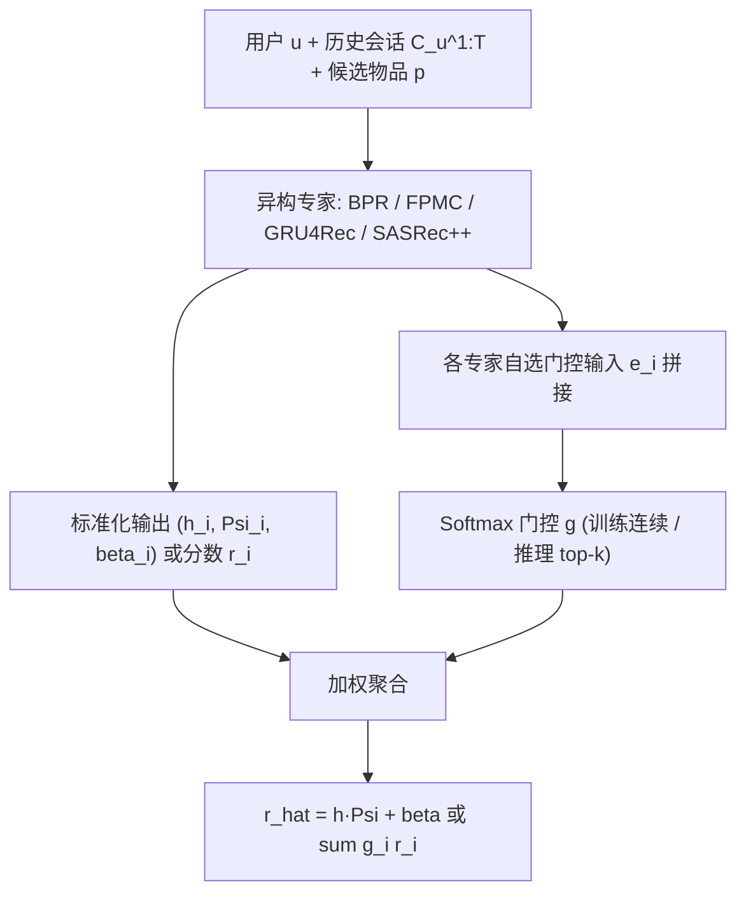
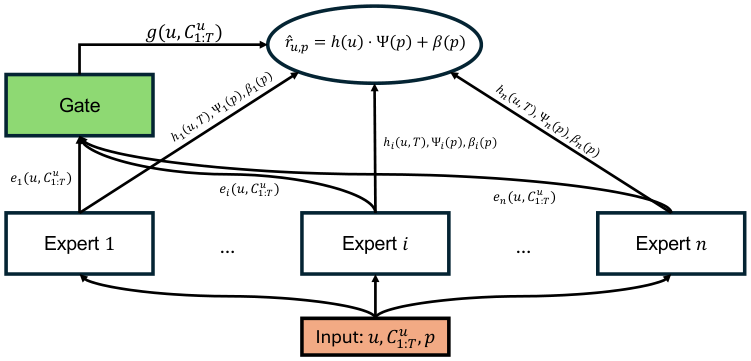
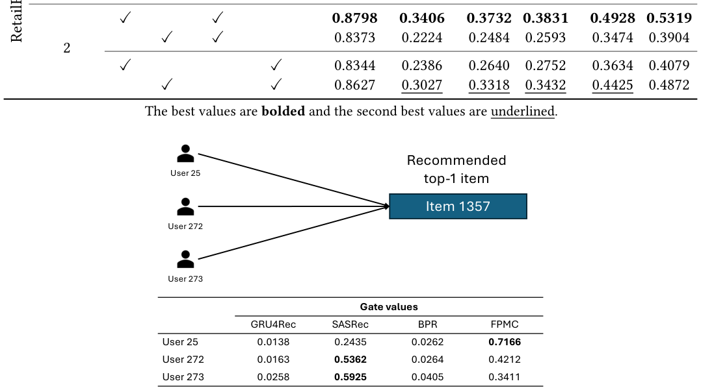

# Compositions of Variant Experts for Integrating Short-Term and Long-Term Preferences (短长期偏好异构专家组合 CoVE)

- **会议/期刊**: ACM Transactions on Recommender Systems (TORS) 2026
- **作者与机构**: Jaime Hieu Do, Trung-Hoang Le, Hady W. Lauw — 新加坡管理大学 (SMU)、越南国立大学胡志明市
- **推荐链路定位**: 精排打分（会话感知全库排序）
- **研究方向**: 序列与会话推荐 / 协同过滤
- **论文原文**: [arXiv:2506.23170v2](https://arxiv.org/abs/2506.23170v2)
- **开源代码**: [PreferredAI/CoVE](https://github.com/PreferredAI/CoVE)

## TL;DR (1分钟核心速览)

会话感知推荐需要在"当前会话的瞬时兴趣"与"跨会话的稳定画像"之间做权衡，而现有模型要么只能建模其一，要么用固定层次结构硬性拼接。本文先以 BPR 与 GRU4Rec 的排序位次差异量化出两类偏好共存且**用户异质**（长期偏好占比均值仅 0.39/0.38），进而提出 CoVE：把 BPR、FPMC、GRU4Rec、SASRec++ 等**异构推荐模型**当作专家，用可学习门控在隐层（CoVE$_h$）或分数层（CoVE$_s$）动态加权。在三个会话数据集的无偏 Full-Ranking 协议下，MRR 相对最强基线最高提升 38.03%（Diginetica）。

## Background & Motivation (背景与核心矛盾)

- **主流范式**: 会话推荐分两支——session-based（GRU4Rec、SASRec）只看当前会话；session-aware（HGRU4Rec、FPMC）把历史会话作为附加输入或用户表示。
- **前人局限**: ① 单一模型无法同时胜任两类信号，实验显示层次式 HGRU4Rec 在三个数据集上全面弱于单会话的 GRU4Rec（Diginetica MRR 0.1188 vs 0.2979）；② 已有 MoE 推荐多为同构 FFN 专家 + 多任务共享底层，专家输入格式一致、视角同质，无法表达"CF 看用户-物品矩阵、序列模型看物品顺序"的差异。
- **核心洞察 (Key Insight)**: 作者用逐样本的排序位次定义 long-term bit（BPR 排得更高记 1，GRU4Rec 更高记 0），统计出 Diginetica/RetailRocket 的平均值仅 0.39/0.38，且分布两端都存在极端用户（恒为 0 或恒为 1）——偏好主导权既非全局统一，也非数据集固定，必须**按用户-上下文路由**。
- **本文切入点**: 形式化区分"短期偏好模型"（单会话性 + 用户无关性）与"长期偏好模型"，再把两类模型当作异构专家交由门控自适应组合。

## Method (核心方法设计)

### 1. 整体框架 (Overall Architecture)

输入为用户 $u$、其按时间排序的会话集合$C_u^{1:T}$与候选物品$p$。每个专家$f_i$（BPR、FPMC、GRU4Rec、SASRec++ 之一）按自己的方式读取同一批原始数据，输出被标准化为三元组$(h_i,\Psi_i,\beta_i)$或直接给出分数向量$\hat{r}_i$；各专家自选门控输入$e_i$拼接后经 softmax 得到权重。训练阶段使用连续门控让所有专家共同优化（保证各专家都具备泛化能力），推理阶段切换为 top-$k$ 稀疏门控以降低开销，最终在全库物品上打分排序。

<figure class="paper-figure" markdown="span">
  <figcaption>图 4. CoVEℎ变体的整体流程。所有专家均接收用户身份𝑢及其历史交互𝐶𝑢。</figcaption>
</figure>

### 2. 关键设计拆解 (Key Designs)

1. **隐层融合 CoVE$_h$（异构输出的标准化）**：不同专家的输出语义与维度本不可比（BPR 输出用户向量，GRU4Rec 输出会话状态）。作者强制所有专家对齐到同一$d$维空间，并统一产出隐上下文、物品嵌入与物品偏置三件套，再分别加权：$h(u)=\sum_{i} g_i h_i(u,T)$，$\Psi(p)=\sum_i g_i\Psi_i(p)$，$\beta(p)=\sum_i g_i\beta_i(p)$，打分$\hat{r}_{u,p}=h(u)\cdot\Psi(p)+\beta(p)$；门控为$g=\mathrm{Softmax}(W_g[e_1\|\cdots\|e_n])$。让长期画像与会话状态在**同一个打分空间**内融合，而非在输入侧拼接。
2. **分数级融合 CoVE$_s$（更强可插拔性）**：$\hat{r}=\sum_{i} g_i \hat{r}_i$，只要求专家能对物品集打分，不要求隐层同维，等价于"权重可学习的动态集成"。代价是不建模专家间的隐层交互，但换来可容纳任意维度/任意架构的专家。
3. **训练目标、负采样与推理效率**：采用 BPR-max 损失，用 softmax 归一化对难负样本加权、抑制长尾"易负样本"：$\ell=-\log\sum_{i}\sum_{j=1}^{N_I} s_j\,\sigma(\hat{r}_i-\hat{r}_j)$，其中$s_j=e^{\hat{r}_j}/\sum_k e^{\hat{r}_k}$；负样本为标准均匀采样。推理时仅激活 top-$k$ 专家，可用预训练专家初始化以缩短收敛时间。

## Experimental Setup & Evaluation Protocol (实验设置与评估协议)

- **数据集与预处理**: 仅保留 ≥3 个会话的用户与 ≥5 次交互的物品（`3-session / 5-core` 式过滤）：

| 数据集 | #Users | #Items | #Interactions | #Sessions | 稀疏度 |
| :--- | :---: | :---: | :---: | :---: | :---: |
| Diginetica | 571 | 6,008 | 12,146 | 2,670 | 0.354% |
| RetailRocket | 4,249 | 36,658 | 230,817 | 24,732 | 0.148% |
| Cosmetics | 17,268 | 42,367 | 2,533,262 | 172,242 | 0.346% |

- **数据划分与防穿越**: 每个用户最后两个会话留作验证/测试（随机分配二者角色），其余会话按时间训练，严格避免未来会话泄漏。
- **排名评测协议**: 无偏 `Full-Ranking`（对整个物品库未交互项打分排序），明确拒绝测试期候选负采样；指标为 AUC、MRR、NDCG@10/20、Recall@10/20，采用单尾配对 t 检验（$p<0.05$）。
- **对比基线与超参**: 8 个基线覆盖 CF（BPR、LightGCN）、序列（GRU4Rec、SASRec、BERT4Rec）、会话感知（FPMC、HGRU4Rec）与 LLM-ID（OpenP5）；专家含 GRU4Rec、SASRec++（BPR-max 版）、BPR、FPMC。网格搜索 lr $\in[0.005,0.1]$、batch$\in[32,512]$，BPR-max 适配小 batch（32–128）。

## Key Experimental Results (实验关键数据)

### 1. 主实验对比 (Main Results)

| 模型 | Dig. MRR | Dig. NDCG@10 | Dig. R@20 | RR. MRR | RR. NDCG@10 | RR. R@20 | Cos. MRR | Cos. NDCG@10 | Cos. R@20 |
| :--- | :---: | :---: | :---: | :---: | :---: | :---: | :---: | :---: | :---: |
| GRU4Rec | .2979 | .3171 | .4133 | .2687 | .3035 | .4909 | .1568 | .1842 | .3857 |
| SASRec | .2943 | .3301 | .4641 | .0962 | .1334 | .2892 | .1568 | .1823 | .3661 |
| BERT4Rec | .3426 | .3560 | .4063 | .2278 | .2551 | .3653 | .1499 | .1737 | .3471 |
| FPMC | .0945 | .1107 | .2189 | .2437 | .2744 | .4290 | .0985 | .1152 | .2684 |
| LightGCN | .2120 | .2488 | .4273 | .1065 | .1238 | .2346 | .0037 | .0032 | .0111 |
| HGRU4Rec | .1188 | .1333 | .2130 | .2327 | .2612 | .4203 | .0764 | .0878 | .2113 |
| OpenP5 | .0027 | .0040 | .0105 | .0018 | .0023 | .0055 | .0086 | .0194 | .0112 |
| CoVE$_s$ | **.4112** | **.4379** | **.5394** | .3365 | .3675 | .5239 | .1643 | .1937 | .4007 |
| CoVE$_h$ | .3756 | .4003 | .5096 | **.3406** | **.3732** | **.5319** | **.1647** | **.1940** | **.4016** |
| **Improv.%** | +38.03% | +32.66% | +16.22% | +26.76% | +22.97% | +8.35% | +5.04% | +5.32% | +4.12% |

### 2. 消融实验 (Ablation Study)

| 消融配置 (Diginetica 为主) | MRR | NDCG@10 | 结论指向 |
| :--- | :---: | :---: | :--- |
| CoVE$_h$ 均匀门控 (=平均) | .3694 | .3939 | 去掉可学习路由 |
| CoVE$_h$ 可学习门控 | **.3756** | **.4003** | 门控有效 |
| CoVE$_s$ 均匀门控 | .3860 | .4071 | 去掉可学习路由 |
| CoVE$_s$ 可学习门控 | **.4112** | **.4379** | 门控增益更大 |
| CoVE$_h$ 双短期专家 (GRU+SAS) | .1569 | .1785 | 同类型专家失效 |
| CoVE$_h$ 双长期专家 (BPR+FPMC) | .2368 | .2730 | 同类型专家失效 |
| CoVE$_h$ 3 专家 / 4 专家 | .3355 / .3291 | .3620 / .3541 | 隐层融合忌堆专家 |

### 3. 关键实验发现 (Key Findings)

1. **门控不是装饰，且数据越稀疏越关键**：Cosmetics 上去掉学习门控使 CoVE$_h$的 MRR 从 .1647 崩至 .0823（−50.0%），而 Diginetica 仅 −1.6%（.3756→.3694）；同一消融在 CoVE$_s$ 上对应 −15.4%（RetailRocket）。说明专家分歧大、样本稀疏时，按用户路由的权重是主要收益来源。
2. **必须"异构"而非"多"**：Diginetica 上双短期（.1569）、双长期（.2368）专家均低于单专家 GRU4Rec（.2979），而 GRU+FPMC 异构组合达 .3756（对 GRU4Rec +26.1%）；CoVE$_h$增至 3/4 专家反而退化到 .3355/.3291，分数级 CoVE$_s$ 则能稳定容纳 4 专家（.4112）。
3. **路由确实按用户差异化，但成本可控**：同一物品 1357 被正确推荐给三位用户时，门控权重分别为 FPMC 0.7166 / SASRec 0.5362 / SASRec 0.5925，呈现"长期主导 vs 短期主导"两种解释；训练开销为四专家串行之和（2977 s）的 1.57×（CoVE$_h$）与 1.27×（CoVE$_s$），可用预训练专家摊薄。另外用 ChatGPT-4o 充当门控时退化为算术平均，未带来收益。

<figure class="paper-figure" markdown="span">
  <figcaption>图 6. 动态门控机制：三个被推荐同一物品（物品 1357）的用户具有不同的专家权重。门控机制会适应每个用户独特的偏好模式。</figcaption>
</figure>

## Highlights & Limitations (亮点、对比与审稿批判)

- **与代表作对比 (vs. Prior Work)**: HGRU4Rec 用层次 GRU 把历史会话压成固定附加向量，属"结构硬融合"且实测不如 GRU4Rec；FPMC 本质是 MF+FMC 的等权相加，可视为无门控的两专家 CoVE，因此本文的增量正是"可学习、按上下文的路由"；相较 MMoE/PLE 类同构 FFN 专家，CoVE 的专家读取不同输入格式、输出经标准化后才可融合。
- **可迁移亮点**: ① $(h_i,\Psi_i,\beta_i)$三元组标准化接口，可把任意 CF/序列模型即插即用地并入 MoE；② 训练用连续门控、推理用 top-$k$ 稀疏门控的解耦范式；③ 坚持 Full-Ranking + 简单强基线（BPR-max GRU4Rec）作为 sanity check 的评测习惯。
- **审稿级局限批判**: ① 训练时全部专家激活，时间/显存随专家数线性增长，CoVE$_h$ 还强制各专家隐层同维，限制了单专家最优超参；② 各专家收敛速度不同导致的单专家过拟合未被处理，专家池仅 4 个浅层模型，缺少与深层同构 MoE 的对照；③ 数据集规模偏小（Diginetica 仅 571 用户）且无线上 A/B 与推理延迟报告，"30%+ 提升"的外推性需谨慎。

## Rating (四维评分)

- **方法创新性 (Novelty)**: ⭐⭐⭐ （短/长期偏好的形式化定义与隐层-分数层两种融合层级有辨析价值，但 MoE + 异构集成本身是组合式增量）
- **评估协议与实验扎实度 (Protocol & Experiments)**: ⭐⭐⭐⭐ （三尺度数据集 + 全库排序 + t 检验，门控/专家组态/图专家/LLM 门控多维消融完整，惟数据规模偏小、缺线上验证）
- **写作与数学规范度 (Clarity & Rigor)**: ⭐⭐⭐⭐ （符号体系与两个性质定义清晰，公式简洁；但训练/推理门控切换缺乏收敛性讨论）
- **工业落地与复现价值 (Industrial & Practical Value)**: ⭐⭐⭐ （代码与数据开源、专家可预训练插拔，但训练开销 1.3–1.6 倍且 CoVE$_h$ 同维约束增加工程改造成本）

