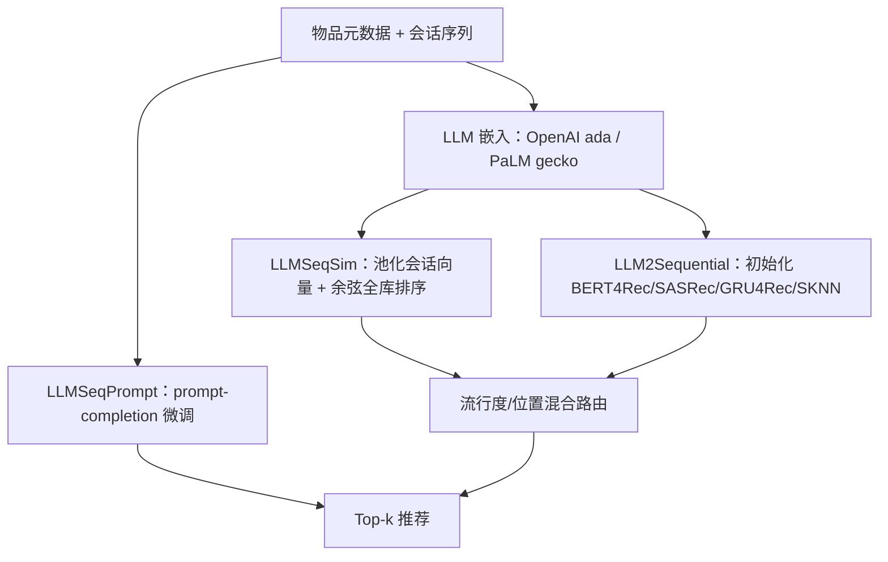

# Improving Sequential Recommendations with LLMs (用大语言模型改进序列推荐)

- **会议/期刊**: TORS 2026
- **作者与机构**: Artun Boz, Wouter Zorgdrager, Zoe Kotti, Jesse Harte, Panos Louridas, Vassilios Karakoidas, Dietmar Jannach, Marios Fragkoulis；Delft University of Technology、AUEB、Delivery Hero、University of Klagenfurt 等
- **推荐链路定位**: 召回 / 精排 / 生成式端到端（序列 next-item）
- **研究方向**: 序列与会话推荐 / 大语言模型推荐
- **论文原文**: [https://arxiv.org/abs/2402.01339v2](https://arxiv.org/abs/2402.01339v2)
- **开源代码**: [https://github.com/dh-r/LLM-Sequential-Recommendation](https://github.com/dh-r/LLM-Sequential-Recommendation)

## TL;DR (1分钟核心速览)

本文针对 ID 序列模型忽视物品语义、LLM 零样本/微调效果不稳的痛点，提出 LLMSeqSim、LLMSeqPrompt、LLM2Sequential 三条正交路线及流行度混合路由。在 Beauty、Delivery Hero、Steam 上采用时间切分 + Leave-One-Out、全库排序评估，LLM 嵌入初始化使 NDCG@20 平均提升 45%/9%，微调平均提升 16%。

## Background & Motivation (背景与核心矛盾)

- **主流范式**: GRU4Rec、SASRec、BERT4Rec 等 ID-based 序列模型从交互共现中学习物品转移，强依赖充足训练信号。
- **前人局限**: 稀疏/长尾物品缺少交互，纯 ID 表示无法利用物品语义；LLM 零样本与微调在序列推荐上结论混杂，且存在幻觉、领域鸿沟与评估口径不统一问题。
- **核心洞察 (Key Insight)**: LLM 嵌入已编码物品名、类别、标签等语义关系，可作为 ID 模型的语义先验；微调则能把领域概念注入生成式推荐。
- **本文切入点**: 在统一测试床上系统拆解三条 LLM 使用路线，并设计流行度混合路由兼顾头部与长尾。

## Method (核心方法设计)

### 1. 整体框架 (Overall Architecture)

输入为物品元数据与会话序列。LLMSeqSim 将物品名/标签送入 OpenAI/PaLM 取嵌入，可选降维后池化得到会话向量，与全库物品余弦相似度排序；LLMSeqPrompt 用 prompt-completion 微调 LLM，支持生成单物品、生成列表、分类与重排四种子任务，并把幻觉词映射回目录；LLM2Sequential 用 LLM 嵌入初始化 BERT4Rec/SASRec/GRU4Rec 的嵌入层，或改造 SKNN 的会话相似度；最后按末位物品流行度在语义模型与序列模型间路由。

### 2. 关键设计拆解 (Key Designs)

1. **LLMSeqSim：语义会话检索**：痛点是指标模型只认 ID，冷门物品无共现。做法是取 LLM 物品嵌入 $\mathbf{e}_i$，按位置权重$w_i$池化会话，再与全库物品算余弦：$\mathbf{e}_S=\frac{\sum_{i\in S}w_i\mathbf{e}_i}{\sum_{i\in S}w_i}$，$\hat{i}=\arg\max_{j\in\mathcal{I}}\cos(\mathbf{e}_S,\mathbf{e}_j)$。直觉是语义近邻可绕过交互稀疏，且对物品流行度不敏感。

2. **LLMSeqPrompt：四类微调任务**：痛点是零样本 LLM 易幻觉、领域知识不足。用 prompt-completion 做自回归微调 $\mathcal{L}_{\text{FT}}=-\sum_t\log p_\theta(y_t\mid y_{<t},x)$；生成单物品时重复$k=20$次按频次排序，生成列表时用 LLMSeqSim 产出候选，分类任务用 K-means 聚 200 类代表物品，重排任务打乱候选后让模型排序。幻觉词按$\hat{j}=\arg\max_{j\in\mathcal{I}}\cos(\mathbf{e}_{\tilde{i}},\mathbf{e}_j)$ 映射回目录。

3. **LLM2Sequential：嵌入初始化与 SKNNEmb**：痛点是在 ID 嵌入层从零学习语义代价高。将 LLM 嵌入降维后写入嵌入矩阵 $\mathbf{E}_{i,:}\leftarrow \mathrm{Reduce}(\mathbf{e}^{\text{LLM}}_i)$，训练时仍可微调；SKNNEmb 用会话嵌入替代共现相似度：$\text{score}(i,S)=\sum_{S'\in N_S}\text{sim}(\mathbf{e}_{S'},\mathbf{e}_S)\mathbb{I}(i\in S')$。神经模型按原论文全 softmax/掩码预测训练，未额外引入负采样；LLM 微调为 teacher-forcing 监督。

## Experimental Setup & Evaluation Protocol (实验设置与评估协议)

- **数据集与预处理**: Beauty、Steam 做 `5-core` 过滤；Delivery Hero 为真实 QCommerce 会话，仅去单交互会话。

| 数据集 | #Sessions | #Items | #Interactions | 平均长度 | 密度 |
| :--- | :---: | :---: | :---: | :---: | :---: |
| Beauty 5-core | 22,363 | 12,101 | 198,502 | 8.9 | 0.073% |
| Delivery Hero | 258,710 | 38,246 | 1,474,658 | 5.7 | 0.015% |
| Steam 5-core | 279,290 | 11,784 | 3,456,395 | 12.4 | 0.105% |

- **数据划分与防穿越**: 先按全局时间戳切分会话，保证测试会话晚于训练；测试集内再 `Leave-One-Out`，末位为 ground truth。
- **排名评测协议**: `Full-Ranking` 全库未交互排序，top-k 从完整 item catalog 取；报告 NDCG@10/20、MRR@10/20、HitRate@10/20，并评估 coverage、serendipity、novelty。
- **对比基线与超参设置**: MostPopular、SKNN、GRU4Rec、SASRec、BERT4Rec、S3-Rec、TALLRec、LlamaSeqPrompt 等；神经模型典型嵌入维 $d=64$，LLM 维 768/1536 先降至 128/512 或$d$。原文未明确报告显著性检验。

## Key Experimental Results (实验关键数据)

### 1. 主实验对比 (Main Results)

> 摘录未含原表全部绝对值，下表汇总原文可核验的相对结果；“—”表示摘录未给出，避免编造。

| 模型 | 评估口径 | Beauty | Delivery Hero | Steam | 备注 |
| :--- | :---: | :---: | :---: | :---: | :--- |
| MostPopular | NDCG@20 | — | — | — | 流行度基线 |
| GRU4Rec | NDCG@20 | — | — | — | RNN 序列 |
| SASRec | NDCG@20 | 基线 | 基线 | 基线 | ID-only |
| BERT4Rec | NDCG@20 | — | — | — | ID-only SOTA |
| S3-Rec | NDCG@20 | — | — | — | 自监督预训练 |
| TALLRec | NDCG@20 | — | — | — | LLM 指令微调 |
| LLMSeqSim | NDCG@20/MRR | 第 3 / 最佳 MRR | — | — | 语义相似 |
| LLMSeqPrompt (GPT-3.5) | NDCG@20 | 超 GRU4Rec/SASRec | — | — | 微调生成 |
| LLM2SASRec / LLM2BERT4Rec | NDCG@20 | **+45%** | **+9%** | — | 覆盖≈2×，serendipity +21% |

### 2. 消融实验 (Ablation Study)

| 变体 | 关键改动 | 指标变化 | 结论 |
| :--- | :--- | :--- | :--- |
| LLM2SASRec | 完整 | **Beauty +45%, DH +9% vs SASRec** | 语义初始化最强 |
| w/o LLM init | 回退 ID 嵌入 | 相对完整模型约 -31% / -8% | 增益来自 LLM 语义 |
| w/o 降维 | 直接用 1536/768 维 | 低于 128/512 | 降维去噪并对齐模型维 |
| LLMSeqPrompt w/o 微调 | zero/few-shot | 相对微调约 -14% | 域适应必要 |
| w/o 幻觉映射 | 保留生成词 | 命中率下降 | OOV 映射有效 |
| Hybrid w/o 流行度路由 | 单一模型 | 长尾覆盖下降 | 路由兼顾头部/长尾 |

### 3. 关键实验发现 (Key Findings)

1. **LLM 嵌入初始化是最高性价比路线**：LLM2SASRec/LLM2BERT4Rec 在 Beauty 与 Delivery Hero 上平均提升 NDCG@20 45%/9%，且相对 SASRec 覆盖近 2 倍、serendipity +21%，说明语义先验能补足 ID 共现。
2. **微调有效但强依赖模型与任务**：微调模型较基座平均 NDCG@20 提升 16%，幻觉数可减半；GPT-3.5 turbo 比 PaLM 2 bison 平均高 78% 以上，闭源模型差异显著。
3. **流行度路由有明确依据**：LLM2BERT4Rec/SKNNEmb 在末位热门物品上更强，LLMSeqSim 跨流行度稳定；末位物品对下一项影响最大，故按末位流行度切换模型可兼顾头部精度与长尾覆盖。

## Highlights & Limitations (亮点、对比与审稿批判)

- **与代表作对比 (vs. Prior Work)**: 相较 VQ-Rec 的跨域表示、TALLRec 的指令微调、P5 的 prompt 推荐，本文不追求单一新架构，而是在同一测试床系统拆解“嵌入初始化 / 微调 / 混合”三条路线，结论更具工程参考性。
- **可迁移亮点**: LLM 嵌入初始化可直接迁移到任意 ID-based 序列模型；幻觉词用目录嵌入最近邻回映；按末位流行度做模型路由，可低成本兼顾长尾。
- **审稿级局限批判**: LLMSeqPrompt 依赖闭源 API，单物品生成需重复 $k=20$ 次，线上延迟与成本高；部分微调任务仅在 Beauty 完成，且未报告显著性检验，Delivery Hero 为专有数据，结论外推需谨慎。

## Rating (四维评分)

- **方法创新性 (Novelty)**: ⭐⭐⭐ （系统性正交框架与混合路由有价值，但单点模型创新有限）
- **评估协议与实验扎实度 (Protocol & Experiments)**: ⭐⭐⭐⭐ （三域、时间切分 + LOO、全库排序，并覆盖 accuracy/coverage/serendipity/novelty）
- **写作与数学规范度 (Clarity & Rigor)**: ⭐⭐⭐⭐ （路线拆解清晰，公式简洁；但主表绝对值在摘录中不完整）
- **工业落地与复现价值 (Industrial & Practical Value)**: ⭐⭐⭐ （代码开源、嵌入初始化易落地；LLM 微调成本与专有数据限制复现）

