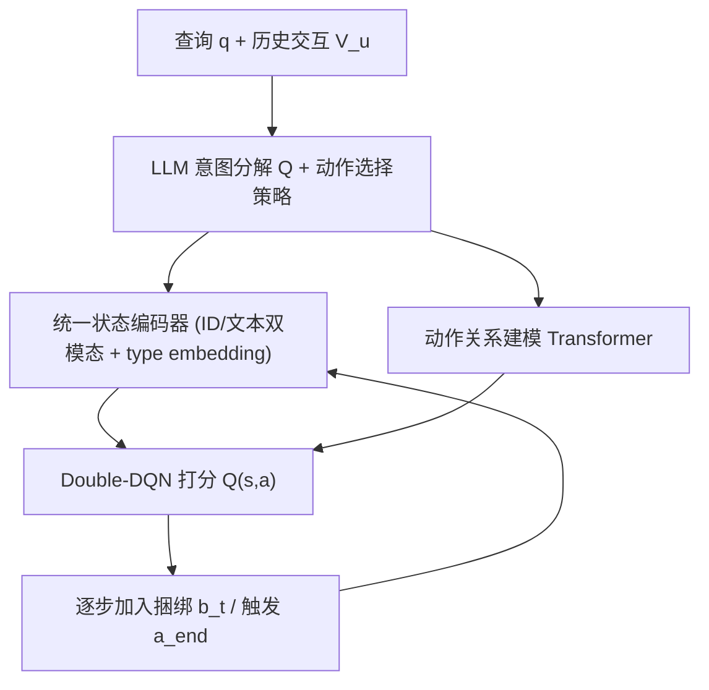
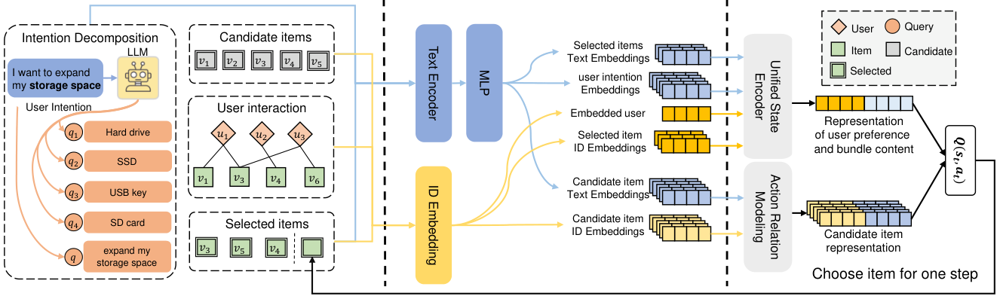

# Text2Bundle: Towards Personalized Query-based Bundle Generation (面向个性化查询驱动捆绑生成的 Text2Bundle)

- **会议/期刊**: TORS 2026（ACM Transactions on Recommender Systems）
- **作者与机构**: Shixuan Zhu, Chuan Cui, JunTong Hu, Qi Shen, Yu Ji, Zhihua Wei（同济大学）
- **推荐链路定位**: 端到端生成式（组合优化式多步解码）
- **研究方向**: 序列与会话推荐 / 大语言模型推荐
- **论文原文**: [论文原文链接](https://arxiv.org/abs/2310.18004v1)
- **开源代码**: 暂未开源

## TL;DR (1分钟核心速览)

本文提出"查询驱动捆绑生成 (QBG)"新场景：用户用自然语言主动描述需求，系统需同时融合**查询蕴含的短期意图**与**历史交互刻画的长期偏好**，产出互补且个性化的物品集合。方法 Text2Bundle 用 LLM 把查询拆成细粒度意图实例、用统一的 Transformer 状态编码器融合 ID 与文本双模态、用 Transformer 建模候选动作间的互斥/互补关系，再以 Double-DQN 逐步加购并以四路奖励塑形。在 Bundle Intent 三个域上，集合级 Precision 由最强基线 BYOB† 的 61.8–65.1% 提升到 80.7–81.8%（相对提升 25.7–31.6%），F1 提升 9.3–14.9%。

## Background & Motivation (背景与核心矛盾)

- **主流范式**: 捆绑推荐长期分为"排序预定义捆绑"（DAM、BGCN、CrossCBR）与"生成个性化捆绑"（BGN 用 DPP、BGGN 用图生成、BYOB 用策略梯度 RL）两条线，后者把选品视为候选集上的组合优化。
- **前人局限**: 其一，纯交互驱动无法感知用户**当前意图漂移**，也无法受控地指定场景与约束（如"海滩度假穿搭"仍会推西装皮鞋）；其二，检索范式虽响应查询，但返回的是同质化单品列表，需用户自行挑选，且缺乏集合级互补性保障。
- **核心洞察 (Key Insight)**: 查询文本天然携带细粒度意图锚点（如 storage space → 硬盘/SSD/U 盘/SD 卡），而历史交互携带风格品牌等偏好；二者是**互补而非替代**的信息源，缺一则生成结果要么跑偏意图、要么脱离画像。
- **本文切入点**: 把 QBG 形式化为候选池上的 MDP，用 LLM 做意图分解提供短期锚点，用预训练 LightGCN + RoBERTa 双模态状态编码承载长期偏好，用 RL 奖励显式约束互补性与意图覆盖度。

## Method (核心方法设计)

### 1. 整体框架 (Overall Architecture)

给定用户 $u$、历史$\mathcal{V}_u$与查询$q$，系统首先由 LLM 将$q$分解为意图实例集合$\mathcal{Q}=\{q_1,\dots,q_m\}$（并保留原句以防分解次优），再以文本相似度阈值$T_{sim}=0.3$做语义召回、以 FM 模型取回 top-$R=50$组成候选池$p_0$。随后进入多步决策：每步状态$s_t=\{u,\mathcal{V}_u,p_t,b_t\}$经统一状态编码器压缩为$e_{state}$，候选动作经 Action Relation Modeling 得到互相关联的表示$E_{act}$，二者内积给出$Q(s_t,a_t)$，选出物品加入$b_t$并从$p_t$移除，直至触发可学习的$a_{end}$或达到最大长度$L=5$。训练先用 BPR 在半合成数据上对状态编码器做推荐预训练，再与策略网络联合用 Double-DQN 优化。

<figure class="paper-figure" markdown="span">
  <figcaption>图2：Text2Bundle 概览。我们框架的核心思路是：根据由用户偏好和捆绑内容组成的当前状态，将合适的下一物品加入捆绑，然后更新状态以进行下一物品预测。它首先通过 LLM 将意图查询分解为多个意图实例，并通过简单的 Action Selection Strategy 构建候选物品池。随后在每一步中，它采用 Unified State Encoder 从多种信息中蒸馏状态表示，并利用 Action Relation Modeling 获取候选动作表示。最后，……</figcaption>
</figure>

### 2. 关键设计拆解 (Key Designs)

1. **LLM 意图分解 + 动作关系建模（解两个"看不全"的问题）**：单句编码会把查询压成笼统的 "beach outfits"，丢失"墨镜"这类隐含细粒度需求；同时 BYOB 只建模"动作 vs 已选物品"的兼容性，忽略**候选动作之间**的互斥（连体泳衣与沙滩裤二选一）。本文对候选集整体过一层 Transformer 后再与已选集合拼接：
$$E_{act} = \mathrm{TRM}_{act}\big(\mathrm{Concat}(E^{ID}_{cand},\ \mathrm{MLP}(E^{text}_{cand}))\big)\cup\{e_{a_{end}}\}$$
即动作表示在决策前就"看见"彼此，从而在 softmax 竞争中被联合抑制，物理直觉是让策略在集合层面而非单品层面做规划。

2. **统一状态编码器（跨模态对齐是状态建模的前提）**：ID 交互极稀疏，从零学嵌入不可行；文本语义又落在与 ID 不同的空间。作者用共享 MLP 把历史物品、意图实例、已选物品的文本嵌入投影到 ID 空间，拼接六类输入并叠加 **type embedding** 区分模态/来源，经单层双头 Transformer 后分别对文本组与 ID 组做均值池化再拼接：
$$e_{state} = \mathrm{Concat}\big(e^{text\prime}_{state},\ e^{ID}_{state}\big)\in\mathbb{R}^{2d}$$
这样状态同时承载"用户长期偏好 + 查询短期意图 + 当前捆绑内容"，消融中去掉该模块后 Precision 从 81.8% 腰斩到 45.6%，说明跨空间对齐本身而非 Transformer 层数是收益来源。

3. **训练目标、奖励塑形与推理效率**：预训练用 BPR 把状态拉近目标捆绑内未选物品 $v^+$、推远集外物品$v^-$：
$$\mathcal{L}_{p}=\sum_{(u,q,b_t,v^+,v^-)}-\ln\sigma\big(\cos(e_{state},e_{v^+})-\cos(e_{state},e_{v^-})\big)$$
RL 阶段精匹配奖励极稀疏，故设计四路奖励 $r=\omega\,r_{main}+r_{per}+r_{comp}+r_{cover}$，其中$r_{per}$取 LightGCN 用户-物品内积作偏好分，$r_{comp}$取已选物品与动作的文本嵌入均值内积作互补分，$r_{cover}$ 为意图分布熵
$$r_{cover}(b_t,\mathcal{Q})=-\sum_{q_j\in\mathcal{Q}}p(C(q_j)|b_t)\log p(C(q_j)|b_t)$$
以鼓励覆盖全部细粒度意图。推理时每步只需一次候选 Transformer 前向与一次内积打分，候选池被限制在 50，长度上限 5，开销近似常数级；无需负采样（DQN 目标隐式处理）。

## Experimental Setup & Evaluation Protocol (实验设置与评估协议)

- **数据集与预处理**: 采用 Bundle Intent 数据集（Amazon 三域，含众包标注的捆绑及其意图文本），ID 嵌入由**全量 Amazon** 预训练 LightGCN 得到后抽取子集：

| 数据集 | #Users | #Items | #Bundles | #Intents | #Interactions | 平均捆绑长度 |
| :--- | :---: | :---: | :---: | :---: | :---: | :---: |
| Clothing | 965 | 4,487 | 1,910 | 1,466 | 6,326 | 3.31 |
| Electronic | 888 | 3,499 | 1,750 | 1,422 | 6,165 | 3.52 |
| Food | 879 | 3,767 | 1,784 | 1,156 | 6,395 | 3.58 |

- **数据划分与防穿越**: 随机 **8:1:1** 比例划分（非常规 Leave-One-Out / 时间切分），测试集样本的捆绑不参与训练；LightGCN 预训练使用独立的全量 Amazon 交互，避免目标捆绑泄漏。
- **排名评测协议**: 不是 Full-Ranking，也非采样排序；捆绑是无序集合，NDCG/MRR 位置敏感不适用，改用**生成-目标集合匹配**的 Precision / Recall / F1。基线统一固定生成 $K=5$，本文用$a_{end}$自适应长度，二者在同一$L=5$ 上界下对齐。
- **对比基线与超参**: BPR、BGN†（取生成列表首个捆绑）、Bunt†（融合查询文本嵌入、取首轮结果）、BYOB†（状态加文本嵌入 + 查询-标题相似度辅助奖励）、LLM4B（GPT-3.5 列表选择式基线）；$d=320$、$d_t=384$、$\omega=3.0$、$\gamma=0.99$、回放池 20,000、batch 256、lr$5e^{-5}$，ChatGLM 负责意图分解，三次随机种子取均值，$p<0.01$ 配对 t 检验。

## Key Experimental Results (实验关键数据)

### 1. 主实验对比 (Main Results)

| 模型 | Clothing (Pre/Rec/F1) | Electronic (Pre/Rec/F1) | Food (Pre/Rec/F1) |
| :--- | :---: | :---: | :---: |
| BPR | 35.6 / 18.3 / 24.1 | 32.2 / 18.1 / 23.2 | 37.2 / 19.2 / 25.3 |
| BGN† | 47.3 / 17.1 / 25.1 | 46.9 / 18.4 / 26.4 | 48.0 / 18.9 / 27.1 |
| Bunt† | 48.9 / 18.8 / 27.1 | 53.1 / 17.1 / 25.9 | 49.5 / 19.8 / 28.2 |
| BYOB† | 65.1 / 19.5 / 30.0 | 61.8 / 19.7 / 29.9 | 62.9 / 17.9 / 27.9 |
| LLM4B | 43.6 / 18.4 / 25.8 | 41.9 / 16.9 / 24.0 | 44.1 / 18.1 / 25.7 |
| **Text2Bundle** | **81.8 / 20.5 / 32.8** | **81.3 / 21.1 / 33.5** | **80.7 / 20.3 / 32.4** |
| Improv. (vs 最优基线) | +25.7% / +5.1% / +9.3% | +31.6% / +7.1% / +12.0% | +28.3% / +2.5% / +14.9% |

### 2. 消融实验 (Ablation Study)

| 变体 | Clothing (Pre/Rec/F1) | Electronic (Pre/Rec/F1) |
| :--- | :---: | :---: |
| − Generative LLM（直接用原句） | 76.7 / 18.1 / 31.9 | 76.0 / 19.4 / 30.9 |
| − Unified State Encoder（换 MLP） | 45.6 / 17.5 / 27.3 | 39.0 / 19.0 / 27.3 |
| − Action Relation Modeling | 66.9 / 18.4 / 31.3 | 68.6 / 19.7 / 30.6 |
| Only Text | 40.1 / 18.3 / 27.0 | 49.0 / 18.7 / 29.1 |
| Only ID | 52.9 / 18.8 / 29.9 | 59.9 / 19.7 / 31.9 |
| Text2Bundle（完整） | 81.8 / 20.5 / 32.8 | 81.3 / 21.1 / 33.5 |

### 3. 关键实验发现 (Key Findings)

1. **统一状态编码器是绝对命门**：移除后 Precision 从 81.8%/81.3% 跌至 45.6%/39.0%（−44%/−52%），甚至低于 Only-ID 的 52.9%/59.9% 与 Only-Text 的 40.1%/49.0%，说明单纯的 MLP 聚合破坏而非保留了双模态空间的结构，**跨语义空间对齐**才是状态建模的收益来源；同时单模态最优也仅 59.9%，验证两模态确为互补。
2. **意图分解与动作关系建模构成两次"集合级"增益，且量级不同**：去掉 LLM 分解仅损失 5.1–5.3 个点（81.8→76.7），但 F1 掉到 31.9（−0.9），说明分解主要提升"选对"而非"选全"；去掉动作关系建模损失 14.9–12.7 个点，其作用更接近集合规划，二者叠加才能从 66.9 走到 81.8。
3. **自动指标低估了 LLM 基线的真实质量**：人工评测（12 名志愿者 × 40 样本 × 3 人复核，1–5 分）中 LLM4B 的互补性/查询一致性（Clothing 3.86/3.93）反超 BYOB†（3.50/3.42），但自动 Precision 仅 43.6 < 65.1；本文三项全胜（Clothing 4.25/4.37/3.51、Electronic 4.18/4.24/3.64），揭示**集合级 F1 对"合理替代品"系统性惩罚**，这也是本文评估协议最大的隐忧。

## Highlights & Limitations (亮点、对比与审稿批判)

- **与代表作对比 (vs. Prior Work)**: 相对 BYOB（固定捆绑长度、mean-pooling 建模用户-已选关系、无文本意图），本文引入自适应 $a_{end}$、Transformer 状态融合与动作间关系建模；相对 BGN（DPP + 序列化建模）、BGGN（图生成），本文在生成阶段显式引入自然语言查询这一"可控旋钮"，把捆绑从"猜你喜欢"变为"按你说的配"；相对 LLM4B（纯提示词选品），本文用 RL 奖励替代不可控的 in-context 生成。
- **可迁移亮点**: (1) 熵式覆盖奖励 $r_{cover}$ 可迁移到任何"多子意图列表生成"任务（如旅行行程、搭配套餐），只需一个意图-物品 argmax 归属判定；(2) 用 LLM 做**离线一次性的意图分解**、把结果当锚点喂给轻量 RL 策略，避免了训练期调用大模型的高延迟，是"LLM 做特征工程而非做推理"的实用范式。
- **审稿级局限批判**: 其一，8:1:1 随机划分在同一用户的历史与目标捆绑间存在时间穿越风险，且候选池由 FM 从全库召回，若测试样本曾出现在召回训练中会放大 Precision；缺少时间戳切分与冷启动划分的鲁棒性验证。其二，评测严重依赖与唯一 ground-truth 捆绑的集合重合，人工评测已证实这会系统性低估"合理替代品"（LLM4B 案例）；同时意图分解使用 ChatGLM 而基线用 GPT-3.5，模型不对等可能污染 LLM4B 的对比公平性。其三，RL 训练需 BPR 半合成预训练 + 双网络 + 20,000 回放池，且 $\omega$、$T_{sim}$、$R$ 三个超参耦合敏感，线上每步需重跑候选 Transformer，扩大候选池后延迟将线性增长。

## Rating (四维评分)

- **方法创新性 (Novelty)**: ⭐⭐⭐⭐ （QBG 场景定义新颖，意图分解 + 动作关系建模 + 熵覆盖奖励三者组合自洽，但各模块单看均为 Transformer/RL 的成熟迁移，缺少理论刻画）
- **评估协议与实验扎实度 (Protocol & Experiments)**: ⭐⭐⭐ （三域 + 五类基线 + 消融 + 人工评测齐全且有 $p<0.01$ 检验，但随机划分隐患、集合重合指标偏窄、LLM 基线模型不对等三项削弱说服力）
- **写作与数学规范度 (Clarity & Rigor)**: ⭐⭐⭐⭐ （MDP 五元组与奖励逐项定义清晰、公式简洁可复现，但 MDP 中 $p_t$ 与候选池更新符号略含糊，缺复杂度分析）
- **工业落地与复现价值 (Industrial & Practical Value)**: ⭐⭐⭐⭐ （意图分解离线化、候选池限定 50、步数上限 5，工程部署门槛低；但未开源、依赖 LightGCN 全量预训练与 RL 调参成本是主要复现障碍）

