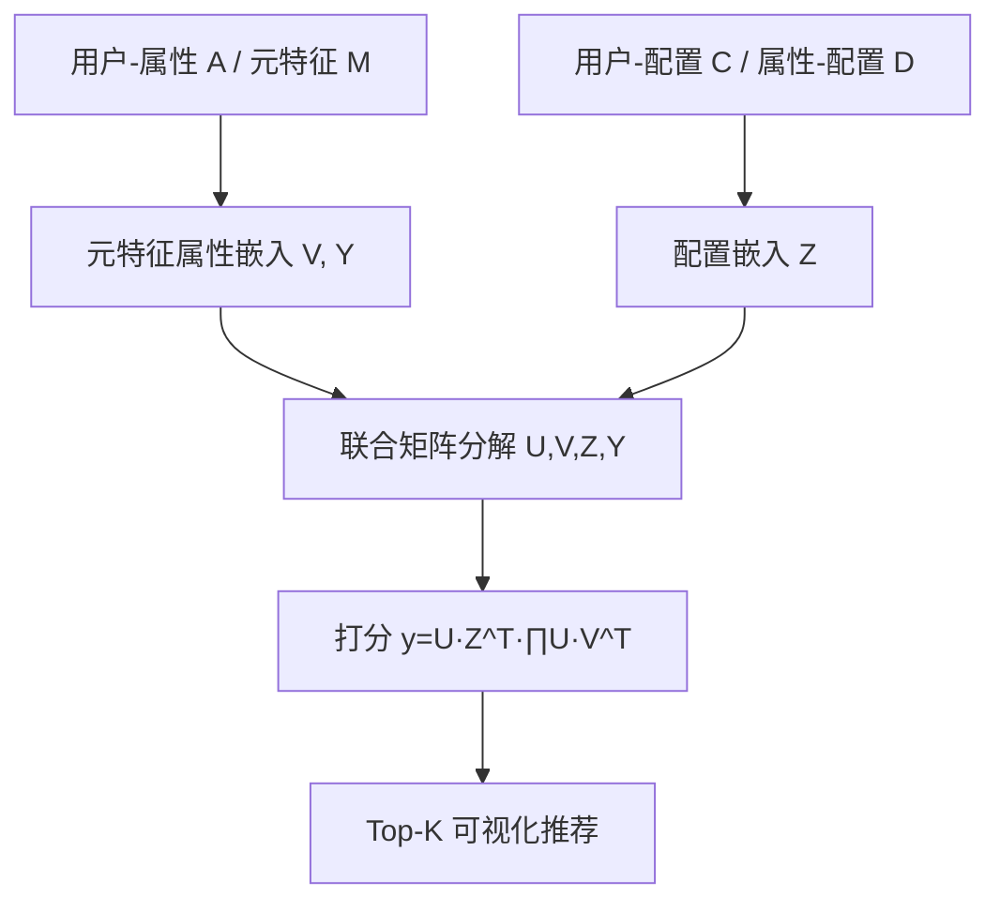
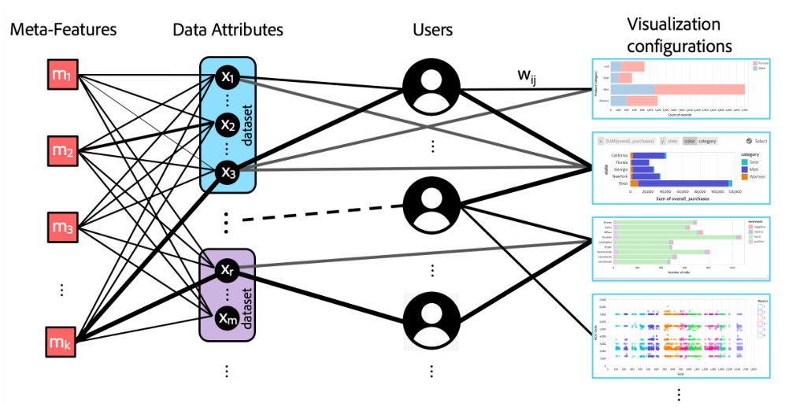
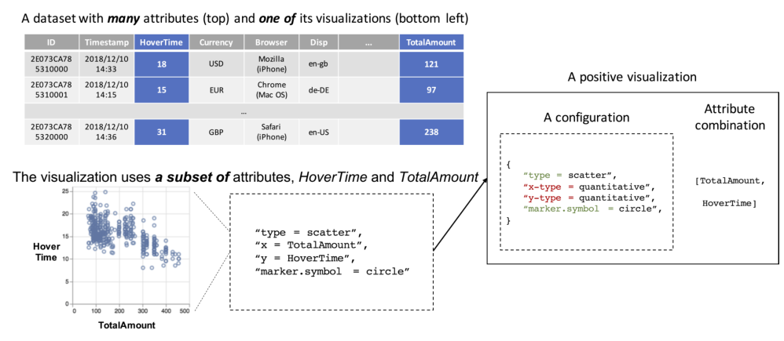

# Personalized Visualization Recommendation (个性化可视化推荐)

- **会议/期刊**: ACM Transactions on the Web (TWEB) / arXiv 2021
- **作者与机构**: Xin Qian (UMD)；Ryan A. Rossi, Fan Du, Sungchul Kim, Eunyee Koh, Sana Malik, Tak Yeon Lee (Adobe Research)；Nesreen K. Ahmed (Intel Labs)
- **推荐链路定位**: 召回（为用户在其任意数据集上生成个性化可视化候选）
- **研究方向**: 协同过滤与双塔召回 / 跨域与多场景推荐
- **论文原文**: [论文原文链接](https://arxiv.org/abs/2102.06343v1)
- **开源代码**: 暂未开源（但发布了 17.4k 用户 / 2.3M 属性的用户级可视化语料）

## TL;DR (1分钟核心速览)

传统可视化推荐只按数据集打视觉规则分，对所有人推荐同一结果。本文首次形式化"个性化可视化推荐"问题：每个用户拥有**互不重叠**的数据集与可视化，因而他人的反馈无法直接复用。作者用**元特征函数**把任意属性映射到共享 K 维空间实现跨数据集属性可比，并用**数据无关的"可视化配置"**抽象视觉设计选择，构建用户-属性-配置-元特征四部图做联合矩阵分解（PVisRec）。在 17.4k 用户、2.3M 属性语料上，Full-Ranking 下 HIT@5 与 NDCG@5 相对 SOTA 分别提升 29.8% 和 64.9%。

## Background & Motivation (背景与核心矛盾)

- **主流范式**: 现有可视化推荐为规则驱动（Voyager/CompassQL）或 ML 驱动（分类/排序设计选择），均以数据集为中心，对所有用户输出相同榜单。
- **前人局限**: ① 可视化天然绑定具体数据集，不同数据集属性无交集，`ξ(Σ(X),C)∩ξ(Σ(Y),C)=∅`，无法跨用户/跨数据集迁移反馈；② 每用户独立数据集导致反馈极度稀疏，而单数据集可视化空间呈指数级膨胀。
- **核心洞察 (Key Insight)**: 数据集虽不同，但**属性的统计特征可跨域比较**，**视觉设计选择可抽象为数据无关的配置**——这两点把"用户独有物品"问题转化为可共享表征的协同过滤问题。
- **本文切入点**: 双嵌入空间（元特征属性空间 + 可视化配置空间）替代原始可视化，使跨数据集、跨用户的偏好迁移成为可能。

## Method (核心方法设计)

### 1. 整体框架 (Overall Architecture)

输入侧构造四个矩阵：用户-属性偏好 `A`（隐/显式点击、悬停、生成）、元特征-属性 `M`（K 维稠密）、用户-可视化配置 `C`、属性-可视化配置 `D`。模型学习用户 `U`、属性 `V`、配置 `Z`、元特征 `Y` 四组 d 维嵌入，联合分解上述矩阵；打分时把用户-配置亲和度与用户-属性亲和度相乘得到可视化分数。训练用 ALS 闭式迭代，推理对候选可视化打分排序输出 Top-K。深度变体在嵌入拼接后接 L 层 MLP 学习非线性交互。

<figure class="paper-figure" markdown="span">
  <figcaption>图 2. 所提出的个性化可视化推荐图模型概览。元特征与数据属性之间的连接表示第 3.1 节中的元特征矩阵 M，而用户与其偏好的数据属性之间的连接表示 A（第 3.2 节）。二者都捕获跨不同数据集的用户级数据偏好。用户与其可视化配置之间的连接表示 A，并捕获用户级视觉偏好。最后，可视化配置与数据属性之间的连接表示 D。注意所有连接均带权。</figcaption>
</figure>

### 2. 关键设计拆解 (Key Designs)

1. **元特征空间 $\Psi(x)$（跨数据集属性对齐）**：属性长度/类型各异无法直接比。做法：对属性$x$施加$\ell$个表示函数$g_h$（归一化、分箱等），每种再经$k$个分区$\Pi$后套统计/信息论元特征$\psi$，拼接为固定 K 维$\Psi(x)=[\psi(g_1(x))\cdots\psi(\Pi_k(g_\ell(x)))]$。新属性元特征向量$\hat{m}$用低秩投影$\hat{q}=\Sigma^{-1}H^\top\hat{m}$ 降噪压缩（2.3M 属性 1006 维 → 10 维，18.5GB→200MB）。直觉：属性"统计指纹"相似即偏好可迁移。

2. **可视化配置 $C$（数据无关视觉抽象）**：把可视化中绑定的具体属性替换为通用类型$T:x\to P$（quantitative/nominal/ordinal/temporal），使$C$ 独立于数据集，可被不同数据集用户共享。这一步把"指数级可视化空间"压成"有限配置空间"，是跨用户视觉偏好迁移的前提。

<figure class="paper-figure" markdown="span">
  <figcaption>图 3. 从可视化到数据无关的可视化配置。可视化由数据及一组设计选择组成，因此依赖于数据集。在本工作中，我们提出可视化配置的概念，它消除可视化的数据依赖性，同时捕获视觉设计选择。值得注意的是，由于可视化配置独立于数据集，因而可自然地跨数据集泛化；因此，与可视化不同，可视化配置可在使用完全不同数据集的用户之间共享。上述玩具示例中展示的可视化</figcaption>
</figure>

3. **四部图联合分解与训练目标**：总损失 $\mathcal{L}=\|A-UV^\top\|^2+\|M-YV^\top\|^2+\|C-UZ^\top\|^2+\|D-VZ^\top\|^2$，ALS 优化；单可视化打分$\hat{y}(V)=U_{i,:}Z_{t,:}^\top\prod_{x_j\in X^{(k)}}U_{i,:}V_{j,:}^\top$。负采样采用非相关可视化（$V^\star_{ij}\setminus V_{ij}$），推理为 O(d·|C|) 内积打分，无额外延迟。

## Experimental Setup & Evaluation Protocol (实验设置与评估协议)

- **数据集与预处理**: 新发布用户级可视化语料（Vega-Lite 编码），每用户保留其交互可视化作为正样本。

| 数据集 | #Users | #Datasets | #Attributes | #Visualizations |
| :--- | :---: | :---: | :---: | :---: |
| PVisCorpus | 17.4k | 94k | 2.3M | 32k |

- **数据划分与防穿越**: 按用户级划分，每用户留出部分相关可视化作测试（held-out），训练集仅用其余反馈。
- **排名评测协议**: 对每个测试可视化构造相关/非相关候选打分排序（含规则生成候选），报告 HIT@K 与 NDCG@K（K=1..10）。
- **对比基线与超参**: 对比规则法（CompassQL/Voyager）、ML 排序法（Qian et al. 2020）、全局/流行度基线；嵌入维 $d\in\{20,\dots,210\}$、元特征维$k=1..10$ 做敏感性分析。

## Key Experimental Results (实验关键数据)

### 1. 主实验对比 (Main Results)

原文主表以相对提升为主（详细逐基线数值见原文 §6）。核心汇报：PVisRec 相对 SOTA 平均 **HIT@5 +29.8%、NDCG@5 +64.9%**；深度个性化模型进一步优于线性模型。

| 模型 | HIT@5 | NDCG@5 | 备注 |
| :--- | :---: | :---: | :--- |
| Rule-based (CompassQL) | 基线 | 基线 | 用户无关 |
| ML-based (Qian'20) | 基线 | 基线 | 数据集中心 |
| Popularity/Global MF | 低 | 低 | 无法跨域 |
| **PVisRec (full)** | **最优(线性类)** | **最优(线性类)** | 四部图全用 |
| **Neural PVisRec-CMF** | **最优** | **最优** | 融合非线性 |

### 2. 消融实验 (Ablation Study)

| 变体 | 移除组件 | 性能趋势 |
| :--- | :--- | :---: |
| PVisRec (A,C,M) | 去 D | 下降 |
| PVisRec (A,C,D) | 去 M（元特征） | 明显下降 |
| **PVisRec (full)** | 无 | 最优（线性） |
| Neural PVisRec | MLP 非线性 | 优于线性 |
| Neural PVisRec-CMF | α 融合 | 最优 |

### 3. 关键实验发现 (Key Findings)

1. **元特征矩阵 M 是最关键组件**：去掉 M（PVisRec A,C,D）后性能下降幅度最大，印证"跨数据集属性对齐"是解决用户数据集互不重叠的核心。
2. **配置抽象 C/D 提供跨用户视觉迁移**：仅用 A,M 无法建模视觉偏好，加入 C,D 后用户即使无共同数据集也能学到他人设计偏好。
3. **深度非线性进一步增益**：Neural PVisRec 及 α 加权 CMF 融合优于纯线性分解，说明用户-配置-属性交互存在非线性结构；图 5/图 6 显示 $d\approx100$、$k\approx5$ 附近趋于饱和。

## Highlights & Limitations (亮点、对比与审稿批判)

- **与代表作对比**: 相较 CompassQL/Voyager（纯规则、用户无关）与 Qian'20（数据集中心 ML 排序），本文本质区别在于**把"用户"引入可视化推荐**，且通过元特征与配置抽象绕开"数据集不共享"这一 CF 前提失效问题——相当于给矩阵分解设计了跨域可共享的"虚拟物品"。
- **可迁移亮点**: ① 用统计元特征指纹做异构属性对齐，可迁移到跨域冷启动物品表征；② "数据无关抽象配置"思路可迁移到任意带结构化设计的推荐（如报表/看板/页面布局推荐）。
- **审稿级局限批判**: ① 逐基线数值在语料/配置划分高度依赖场景，泛化性需更多工业验证；② 元特征向量高维且需低秩投影，属性规模再增时存储/计算成本仍是瓶颈；③ 仅离线 Full-Ranking 评估，缺乏线上 A/B 与真实用户满意度验证。

## Rating (四维评分)

- **方法创新性 (Novelty)**: ⭐⭐⭐⭐ （首次形式化个性化可视化推荐问题，元特征空间+数据无关配置抽象构思新颖，但本质仍是多关系矩阵分解）
- **评估协议与实验扎实度 (Protocol & Experiments)**: ⭐⭐⭐⭐ （新语料 17.4k 用户规模可观，消融与维度敏感性完整，缺线上验证与显著性检验细节）
- **写作与数学规范度 (Clarity & Rigor)**: ⭐⭐⭐⭐ （定义与符号体系严谨，四部图目标清晰，部分元特征函数冗余、篇幅偏长）
- **工业落地与复现价值 (Industrial & Practical Value)**: ⭐⭐⭐⭐ （ALS 训练与内积打分可工程化，语料公开，但未开源代码且元特征管道较重）

