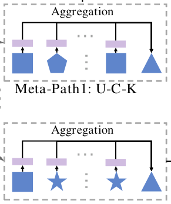

# Reinforced MOOCs Concept Recommendation in Heterogeneous Information Networks (异质信息网络中基于强化学习的 MOOC 概念推荐)

- **会议/期刊**: ACM TWEB (Transactions on the Web)
- **作者与机构**: Jibing Gong、Xuewen Li、Yi Zhao 等（燕山大学）；Yao Wan、Jie Tang（华中科技大学 / 清华大学）；Ye Liu（Salesforce Research）等
- **推荐链路定位**: 召回（细粒度知识概念 Top-K 列表）
- **研究方向**: 图神经网络与知识图谱推荐 / 强化学习与动态探索推荐
- **论文原文**: [https://arxiv.org/abs/2203.11011v3](https://arxiv.org/abs/2203.11011v3)
- **开源代码**: 暂未开源

## TL;DR (1分钟核心速览)

MOOC 平台只做“课程级”推荐，忽略了学习者知识水平差异；同时用户-概念交互极度长尾稀疏，且用户兴趣随学习过程动态漂移。本文提出 HinCRec-RL：把用户、课程、视频、概念构造成异质信息网络（HIN），用 4 条元路径 + 层次注意力编码语义用户向量；再把概念推荐建模为 MDP，用 REINFORCE + 熵正则做序列决策，推荐命中即向图中加边并重算 embedding。在 XuetangX 真实数据（1:99 采样排序）上 HR@5 达 66.21%、NDCG@5 达 46.21%，较最优 CF 基线提升 9.74%–27.54%。

## Background & Motivation (背景与核心矛盾)

- **主流范式**: 课程推荐以 CF / 内容 / 混合模型（BPR、FISM、NAIS、NASR）为主，把用户-物品交互视作静态打分矩阵，并依赖历史点击最大化即时收益。
- **前人局限**: (1) **动态环境失配**：静态贪心策略无法刻画用户知识水平随学习演化的过程，而概念点击序列长度集中在 10–30，长依赖远超电商场景；(2) **数据稀疏与长尾**：概念点击呈典型长尾分布，且用户/概念几乎无属性特征，传统 CF 难以学到可靠表征。
- **核心洞察 (Key Insight)**: 作者统计发现“点击概念数”与“学习进度”“学习速度”正相关（图 1b/1c），说明细粒度概念推荐确有增益；且概念虽稀疏，却可通过“课程/视频共现”建立语义桥梁（同一课程含同一概念、同一视频讲多个概念），从而把间接关系转成用户表征的补充信号。
- **本文切入点**: 用 HIN 补齐稀疏交互的语义上下文，用 RL 建模动态交互，把“表征学习”与“序列决策”耦合进同一端到端框架。

## Method (核心方法设计)

### 1. 整体框架 (Overall Architecture)

输入为 XuetangX 的四类实体（用户 U、课程 C、视频 V、概念 K）与四类边（learn / has / watch / click）构成的 HIN。第一阶段按 4 条手工元路径做随机游走采样（深度优先定路径长度 $l$，宽度优先并行$N$次），得到每用户$|\mathrm{MP}|\times N$条路径；第二阶段用层次注意力把节点级邻居聚合为“元路径特定用户向量”，再经路径级注意力加权求和得到最终$\mathbf{u}_i$；第三阶段将该向量作为 MDP 状态，策略网络$\pi_\theta(c|\mathbf{u}_t)$逐步输出概念，命中则$r=+1$并向 HIN 加边、重算$\mathbf{u}_{t+1}$，未命中则$r=-1$ 且状态不变、回合终止，最终用策略梯度更新。

```mermaid
flowchart TD
    A["XuetangX 异质图: 用户-课程-视频-概念"] --> B["元路径随机游走采样 MP1~MP4"]
    B --> C["节点级自注意力 + 路径级注意力 → 用户嵌入 u_t"]
    C --> D["策略 π_θ(c|u_t) + ε-greedy 选概念"]
    D -->|命中 r=+1: 加边并重算 u_{t+1}| A
    D -->|未命中 r=-1: 回合终止| E["Top-K 概念列表"]
```

<figure class="paper-figure" markdown="span">
  <figcaption>图5. 所提方法概览。(a) MOOCs的HIN中的元路径采样。(b) 基于元路径的用户嵌入与层次注意力网络。(c) 强化概念推荐。</figcaption>
</figure>

### 2. 关键设计拆解 (Key Designs)

1. **元路径层次注意力用户编码（把稀疏交互变成多跳语义）**：CF 之所以失效在于用户-概念边太少；本文先按类型投影 $\mathbf{h}'_i = \mathbf{M}_{\phi_i}\mathbf{h}_i$对齐异质特征空间，再在元路径邻居集$\mathcal{N}_i^{\Phi}$上做自注意力，替代 ACKRec 中固定的对称归一化系数$1/\sqrt{|\mathcal{N}_i||\mathcal{N}_j|}$：

$$\alpha_{ij}^{\Phi}=\frac{\exp\big(\sigma(\mathbf{a}_\Phi^{\top}[\mathbf{h}'_i\|\mathbf{h}'_j])\big)}{\sum_{k\in\mathcal{N}_i^{\Phi}}\exp\big(\sigma(\mathbf{a}_\Phi^{\top}[\mathbf{h}'_i\|\mathbf{h}'_k])\big)},\quad \mathbf{u}_i^{\Phi}=\Big\|_{l=1}^{L}\sigma\Big(\sum_{j\in\mathcal{N}_i^{\Phi}}\alpha_{ij}^{\Phi}\mathbf{h}'_j\Big)$$

   路径级再用 $\beta_{\Phi_k}=\mathrm{softmax}\big(\frac{1}{|\mathcal{P}|}\sum_p \mathbf{q}^{\top}\tanh(\mathbf{W}\mathbf{u}_i^{\Phi_k}+\mathbf{b})\big)$加权得$\mathbf{u}_i=\sum_k \beta_{\Phi_k}\mathbf{u}_i^{\Phi_k}$。直觉：不同元路径表达“共点概念”“共修课程”“共看视频”三种同质偏好，注意力让模型按用户自适应选择语义通道，且对节点度不均衡更鲁棒。

2. **概念推荐建模为 MDP + REINFORCE（让图随反馈演化）**：动作空间 $\mathcal{A}=\mathcal{K}$且排除已推荐项（$a_t\notin\{a_{<t}\}$），状态即当前 HIN 中的用户嵌入，奖励$R=+1/-1$。由于推荐失败时$s_{t+1}=s_t$、目标 Q 与预测 Q 相同，Q-learning 退化不可用，故改用策略梯度：

$$\nabla_\theta \mathcal{L}_{rl}(\theta)=\sum_{t=1}^{T}\nabla_\theta\log\pi_\theta(c_t|\mathbf{u}_t)\,R(c_t|\mathbf{u}_t)$$

   并加熵正则避免策略塌缩到次优确定解：$\mathcal{J}=\mathbb{E}_{c\sim\pi_\theta}\mathcal{L}_{rl}(\theta)+\lambda H[\pi_\theta(c|\mathbf{u})]$。

3. **训练目标、负采样与推理效率**：先以交叉熵预训练 10000 episodes（lr=1e-3，batch=8），再切换策略梯度（lr=1e-4，Adam），$d=64$、$\lambda=0.08$、$\epsilon=0.18$；RL 阶段无显式负采样，探索由$\epsilon$-greedy + 熵项承担。每回合仅采样 1 个用户并迭代重算其嵌入，复杂度对节点数与元路径邻居对数量线性，单卡 GTX1080Ti 可训练。

## Experimental Setup & Evaluation Protocol (实验设置与评估协议)

- **数据集与预处理**: 来自学堂在线（XuetangX）真实日志，同一概念的重复点击记录被序列化合并为一条。

| 数据集 | #Users | #Items(概念) | #Interactions | 稀疏度 | 特征/场景说明 |
| :--- | :---: | :---: | :---: | :---: | :--- |
| XuetangX | 3,111,637 | 2,527 | 140,096,904 | 极稀疏（含 7,327 课程 / 62,191 视频） | 用户-课程-视频-概念四类实体，click/learn/watch/has 四类边 |

- **数据划分与防穿越 (Splitting Strategy)**: **全局时间戳切分**——训练集 2016-10-01 至 2017-12-30，测试集 2018-01-01 至 2018-03-31；并按 80%/20% 比例组织实例。测试目标概念取测试期所修课程涉及的概念，历史概念取训练期同用户记录。
- **排名评测协议 (Ranking Protocol)**: **Sampled Ranking**——每个正例随机配 99 个负例（1:99），非全库 Full-Ranking，故 HR/AUC 绝对值偏高、需谨慎跨文比较。
- **对比基线与超参设置**: 基线含 BPR、MLP、FM、FISM、NAIS、NASR，以及消融版 HinCRec-SL（仅 HIN，无 RL）；指标 HR@{5,10,20}、NDCG@{5,10,20}、MRR、AUC；嵌入维度 $d=64$，注意力头$L$ 在 2–12 间分析。

## Key Experimental Results (实验关键数据)

### 1. 主实验对比 (Main Results)

| Model | HR@5 | HR@10 | HR@20 | NDCG@5 | NDCG@10 | MRR | AUC |
| :--- | :---: | :---: | :---: | :---: | :---: | :---: | :---: |
| BPR | 41.50 | 56.28 | 72.12 | 28.95 | 33.74 | 28.68 | 84.34 |
| FM | 36.03 | 54.40 | 72.39 | 23.99 | 29.89 | 24.46 | 83.20 |
| FISM | 36.41 | 54.31 | 70.79 | 20.15 | 27.73 | 21.65 | 84.24 |
| NAIS | 36.47 | 57.92 | 77.99 | 21.93 | 28.10 | 22.15 | 86.76 |
| NASR | 38.67 | 53.21 | 67.13 | 21.19 | 27.84 | 19.69 | 79.90 |
| HinCRec-SL | 60.73 | 78.41 | **90.04** | 40.89 | 46.62 | 37.85 | **92.10** |
| **HinCRec-RL** | **66.21** | **81.53** | 88.74 | **46.21** | **51.35** | **42.82** | 89.64 |
| Improv. vs best baseline | +9.74% | +9.74% | +12.05% | +12.98% | +10.14% | +13.14% | — |

### 2. 消融实验 (Ablation Study)

| 配置 | HR@5 | HR@10 | NDCG@5 | MRR | 说明 |
| :--- | :---: | :---: | :---: | :---: | :--- |
| w/o RL (HinCRec-SL) | 60.73 | 78.41 | 40.89 | 37.85 | 去掉策略梯度 |
| 仅 MP1 (U-K-U) | 63.51 | 75.23 | 43.08 | 39.24 | 单条共点概念路径最强 |
| 仅 MP2 (U-K-U-K-U) | 45.33 | 61.68 | 29.59 | 28.44 | 二跳概念噪声大 |
| 仅 MP3 (U-C-K-C-U) | 46.15 | 67.42 | 30.37 | 29.76 | 课程-概念桥 |
| 仅 MP4 (U-C-V-C-U) | 50.68 | 69.86 | 34.32 | 33.01 | 视频-课程桥 |
| MP2&MP3&MP4 (去 MP1) | 38.01 | 60.18 | 23.87 | 24.00 | 去核心路径后崩塌 |
| 全 4 条 (完整模型) | **66.21** | **81.53** | **46.21** | **42.82** | 语义互补最优 |

### 3. 关键实验发现 (Key Findings)

1. **RL 增益集中在头部而非尾部**：相比 HinCRec-SL，HR@5 从 60.73 升至 66.21（+5.48 绝对点，约 +9.0% 相对），NDCG@5 从 40.89 升至 46.21（+13.0% 相对），但 HR@20 反降 1.30 点（90.04→88.74），说明策略梯度+熵探索主要优化高置信度前几位排序与多样性，对长尾召回覆盖略有牺牲。
2. **HIN 才是主要贡献源，MP1 是不可替代的骨架**：所有 CF/序列基线 HR@20 上限 77.99（NAIS），而仅靠 HIN 的 HinCRec-SL 即达 90.04（+12.05 绝对点）；元路径消融中剔除 MP1 后 HR@5 从 66.21 暴跌至 38.01，单条 MP1 也优于任何其他单路径（63.51 vs 45.33/46.15/50.68），证明“共点概念”是最强同质信号，而课程/视频路径起互补增强作用。
3. **超参存在明确窄峰**：$\lambda$从 1e-2 增至 1e-1 时指标上升、继续增大即下降，最优约 0.08；探索率$\epsilon\approx0.18$最优（0→0.2 上升、0.2→1 下降），$d=64$优于 32/96/128，$L$ 增大仅带来轻微提升但训练时间上升，说明熵正则与探索强度需与动作空间规模匹配。

## Highlights & Limitations (亮点、对比与审稿批判)

- **与代表作对比 (vs. Prior Work)**: 相较本文前作 ACKRec（HIN + 注意力 GCN + 扩展矩阵分解的静态离线打分），本文把节点级聚合从固定归一化 GCN 换成自注意力，并把 MF 换成 REINFORCE，使其支持在线增量更新；相较 HAN 等 HIN 表征工作，本文的图是随用户反馈动态加边演化的；相较 NAIS/FISM 等序列 CF，本文引入了课程/视频两类桥接实体，直接缓解概念侧长尾。
- **可迁移亮点**: (1) “推荐命中即加边、重算 embedding”的在线图增量更新范式，可低成本移植到任何图召回系统；(2) 用多组元路径组合作为语义数据增广，实验证明路径数越多越稳（全 4 条 > 任意子集）。
- **审稿级局限批判**: (1) 评估采用 1:99 采样排序，负例极易区分，AUC≈90 与 HR@5>60% 存在明显乐观偏差，缺少 Full-Ranking 与冷启动分桶验证；(2) 元路径为人工指定且仅 4 条，未做元路径自动学习，跨平台迁移需重新设计模式；RL 部分每回合仅更新单用户嵌入、$\epsilon$与$\lambda$ 敏感，且缺少与真实线上 A/B 或推理延迟的量化对比。

## Rating (四维评分)

- **方法创新性 (Novelty)**: ⭐⭐⭐⭐ （首次把 HIN 元路径层次注意力与 REINFORCE 端到端耦合，动态加边机制有新意，但两模块本身均为成熟组件的组合）
- **评估协议与实验扎实度 (Protocol & Experiments)**: ⭐⭐⭐ （数据集规模真实、时间切分规范、元路径消融充分，但 1:99 采样排序与单一数据集削弱结论强度）
- **写作与数学规范度 (Clarity & Rigor)**: ⭐⭐⭐⭐ （MDP 五元组、注意力与策略梯度公式定义清晰，含复杂度分析；但学习率等超参在正文与敏感性分析中数值不一致）
- **工业落地与复现价值 (Industrial & Practical Value)**: ⭐⭐⭐ （复杂度对节点数线性、单卡可训，适合学堂在线类场景；但代码未开源、依赖手工元路径与在线图更新工程改造）

