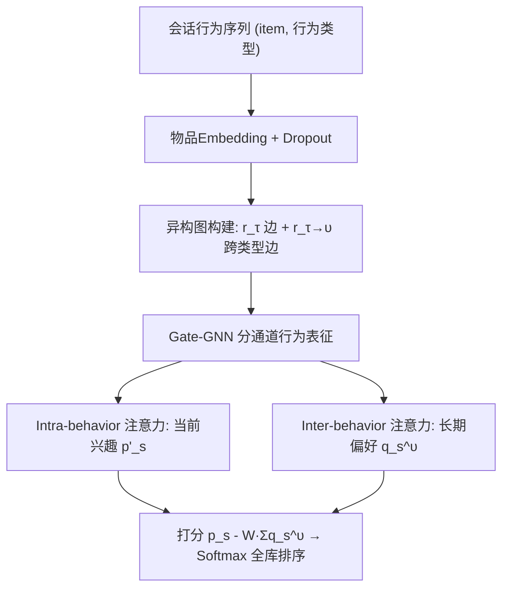
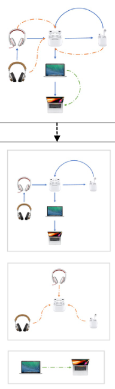

# Heterogeneous Information Crossing on Graphs for Session-based Recommender Systems (会话推荐中的图异构信息交叉)

- **会议/期刊**: ACM Transactions on the Web (TWEB)
- **作者与机构**: Xiaolin Zheng, Rui Wu, Zhongxuan Han, Chaochao Chen, Linxun Chen, Bing Han（浙江大学 / 蚂蚁集团 MYbank）
- **推荐链路定位**: 召回（会话级 Next-Item 预测）
- **研究方向**: 序列与会话推荐 / 自监督对比学习
- **论文原文**: [论文原文链接](https://arxiv.org/abs/2210.12940v1)
- **开源代码**: 暂未开源

## TL;DR (1分钟核心速览)

现有会话推荐（SBRS）几乎都把会话内交互视为单一类型行为（如统一按 click），无法刻画“浏览→加购→购买→转向新品类”的兴趣漂移。本文提出 HICG：把会话建模为按行为类型分边的异构图，用**跨类型边**（$r_{\tau\to\upsilon}$）显式连接受目标行为“触发”的历史物品，再以 intra/inter 双层注意力把当前兴趣与已被满足的长期需求交叉，并在打分函数中**减去**已满足需求。增强版 HICG-CL 借 batch 内 union 图做物品级 InfoNCE。三个真实数据集全库排序（Full-Ranking）下，Yoochoose HR@20 73.06（vs SR-GNN 70.57，+3.5%），Diginetica MRR@20 19.77（+12.4%）。

## Background & Motivation (背景与核心矛盾)

- **主流范式**: 会话推荐从 Markov 链、GRU4Rec/NARM/STAMP 的 RNN+注意力，演进到 SR-GNN/GC-SAN 用会话内物品有向图做 GNN 聚合，均已相当成熟。
- **前人局限 1**: 上述方法只建模**单一行为类型**。电商会话中“买完 AirPods 后转向 MacBook”的信号被抹平，模型会因未见“已满足”证据而反复推耳机类目。
- **前人局限 2**: 少数多行为工作（MCPRN 多通道路由、MGNN-SPred 多关系图）要么各行为独立预测再加和，要么直接拼接表征，**未建模行为类型之间“谁触发谁”的潜在关系**。
- **核心洞察 (Key Insight)**: 购买/长停留这类非目标行为本质是“上一段浏览需求已被满足”的显式反馈；它既携带长期偏好，也应作为**负向证据**压低下一次推荐同类物品的概率。
- **本文切入点**: 在会话级异构图里用跨类型边把 $\tau$型（view/click）历史物品与后续$\upsilon$ 型行为物品相连，再用分层注意力交叉两类信息，并在打分函数中显式扣除满足项。

## Method (核心方法设计)

### 1. 整体框架 (Overall Architecture)

会话 $s=\langle b_1,\dots,b_{|s|}\rangle$（每项含物品$i_t$与行为类型$\upsilon_t$）先经 Embedding 层映射为$d=100$ 向量并 dropout；随后为每个会话按行为类型分通道构建异构物品图，跨类型边负责连接“被满足的历史物品—触发行为物品”；各通道子图送入 Gate-GNN（GRU 门控聚合）得到行为级表征；HICG 用 intra-behavior 注意力在目标类型序列上聚合出候选当前兴趣，再用 inter-behavior 注意力把其他行为通道的长期偏好融合进来；最终以带“满足项扣除”的双线性打分经 softmax 在全物品集上做交叉熵训练，推理时取 top-K。

<figure class="paper-figure" markdown="span">
  <figcaption>图 2. HICG 模型架构。HICG 包含五个主要组件：(1) 物品嵌入学习，(2) 异构图构建，(3) 行为表示学习，(4) 异构信息交叉，以及 (5) 下一物品预测。</figcaption>
</figure>

### 2. 关键设计拆解 (Key Designs)

1. **跨行为类型的异构图构造（本文最核心的增量）**：前人做法是各行为独立建边（$r_{view}$与$r_{others}$互不相交），信息在通道间被割裂；本文令$\upsilon$型行为$b_t$向前回溯到最近一次非$\tau$行为的位置$u=\max(0,\arg\max_{t'}\mathbb{I}\{\upsilon_{t'}\neq\tau \wedge t'<t\})$，并把$i_t$与区间内所有物品$\{i_{t'}\}_{u<t'<t}$用边型$r_{\tau\to\upsilon}$ 相连。直觉：加购/购买是对“刚才那串浏览”的收束，该边把因果链显式写进图结构，使 GNN 能沿边传播“需求已完成”这一语义。

<figure class="paper-figure" markdown="span">
  <figcaption>图 4. 不同方法构建的异构图。(a) 展示了由“Extend the graph without crossing behavior type”方法构建的异构图。(a) 中有两种边，即蓝色链接为 𝑟𝑣𝑖𝑒𝑤-type 边，连接用户 𝑟𝑣𝑖𝑒𝑤-type 行为中连续交互的两个物品，而黄色链接为 𝑟𝑜𝑡ℎ𝑒𝑟𝑠-type 边，连接其他类型行为中连续交互的两个物品。(b) 由“Extend the graph with crossing behavior type”构建，包含三种类型的边。蓝色链接具有相同的 meani</figcaption>
</figure>

2. **双层注意力交叉 + 满足项扣除打分**：单行为建模无法解释兴趣漂移，故先在每个行为类型内部做双线性注意力 $\alpha_t=\mathrm{softmax}(\boldsymbol{e}_{s_T}^\top \boldsymbol{W}_\upsilon \boldsymbol{h}_t)$，聚合得候选当前兴趣$\boldsymbol{p}'_s$与各类型长期偏好$\boldsymbol{q}_s^\upsilon$；再用 inter 注意力$\alpha_\upsilon=\mathrm{softmax}(\boldsymbol{v}^\top(\boldsymbol{W}_\tau\boldsymbol{p}'_s+\boldsymbol{W}_\upsilon\boldsymbol{q}_s^\upsilon+\boldsymbol{b}))$融合得$\boldsymbol{p}_s=\boldsymbol{p}'_s+\sum_\upsilon \alpha_\upsilon \boldsymbol{q}_s^\upsilon$。关键打分改为带负项的$\hat{y}'_{s,i}=\boldsymbol{e}_i^\top\boldsymbol{p}_s-\boldsymbol{e}_i^\top\boldsymbol{W}\sum_\upsilon \boldsymbol{q}_s^\upsilon$：第二项按“已满足程度”直接压低候选分，比单纯加权融合更能抑制重复推荐。

3. **训练目标、负采样与推理效率**：主任务为全物品 softmax 交叉熵 $\mathcal{L}_{HICG}$（**不做训练负采样**）。HICG-CL 将 batch 内所有会话图合并为 union 图，同一连通分量为正样本对，按比例$\beta$从其他分量采负样本，用 InfoNCE 做物品级（而非会话级）对比以复用跨会话共现关系；总损失$\mathcal{L}=\mathcal{L}_{HICG}+\lambda_{CL}\mathcal{L}_{CL}$，$\lambda_{CL}=0.1$、$\beta=0.1\!\sim\!0.2$，Adam、lr$3\times10^{-4}$、batch 100。推理为单会话图前向 + 全库内积排序。

## Experimental Setup & Evaluation Protocol (实验设置与评估协议)

- **数据集与预处理**: 物品过滤为“被浏览 ≥5 次”（近似 item 5-core），保留交互数 ≥2 的会话；Yoochoose 仅取最近 1/64 训练片段。

| 数据集 | #Train Sessions | #Test Sessions | #Items | 平均 view 长 | 说明 |
| :--- | :---: | :---: | :---: | :---: | :--- |
| Yoochoose | 369,859 | 55,898 | 16,766 | 6.16 | 电商点击流，click 为 $\tau$ |
| Diginetica | 719,470 | 43,097 | 60,858 | 5.12 | 转化行为极稀疏（均长 0.19） |
| Retailrocket | 749,947 | 28,445 | 48,989 | 6.82 | 30 分钟切会话，转化较丰富（0.51） |

- **数据划分与防穿越 (Splitting Strategy)**: 全局时间切分——Yoochoose 取最后一天、其余取最近一周作测试集；训练样本用**前缀序列切分**（$s_T-1$ 个子序列对应下一行为标签），无标签穿越。
- **排名评测协议 (Ranking Protocol)**: 无偏 **Full-Ranking**，在所有物品全集上按预测分排序取 top-K，报告 HR@20/MRR@20（另附 K=5 结果），无采样负例。
- **对比基线与超参设置**: 单行为基线 S-POP/IKNN/BPR-MF/GRU4Rec/NARM/STAMP/SR-GNN；多行为基线 MCPRN/MGNN-SPred；$d=100$、dropout 0.2，所有基线网格搜索调参。

## Key Experimental Results (实验关键数据)

### 1. 主实验对比 (Main Results)

| 数据集 | 方法 | HR@20 | MRR@20 |
| :--- | :--- | :---: | :---: |
| Yoochoose | SR-GNN (最强单行为) | 70.57 | 30.94 |
| | MGNN-SPred (最强多行为) | 69.36 | 29.48 |
| | NARM | 68.32 | 28.63 |
| | GRU4Rec | 60.64 | 22.89 |
| | **HICG** | **73.06** | **31.59** |
| | HICG-CL | 73.19 | 31.27 |
| | Improv. | +3.53% | +2.10% |
| Diginetica | SR-GNN | 50.73 | 17.59 |
| | MGNN-SPred | 50.91 | 18.27 |
| | NARM | 49.70 | 16.17 |
| | MCPRN | 46.35 | 16.04 |
| | GRU4Rec | 29.45 | 8.33 |
| | **HICG** | 51.03 | 19.77 |
| | **HICG-CL** | **51.21** | **20.51** |
| | Improv. | +0.59% | +12.26% |
| Retailrocket | STAMP | 50.96 | 25.17 |
| | MGNN-SPred | 50.94 | 28.45 |
| | SR-GNN | 50.32 | 26.57 |
| | NARM | 50.22 | 25.38 |
| | **HICG** | 52.87 | 29.15 |
| | **HICG-CL** | **52.92** | **29.30** |
| | Improv. | +3.85% | +2.99% |

### 2. 消融实验 (Ablation Study)

| 变体 | Yoochoose HR@20 / MRR@20 | Diginetica HR@20 / MRR@20 |
| :--- | :---: | :---: |
| HICG-none（无注意力交叉） | 62.51 / 24.04 | 62.51 / 18.56 |
| HICG-intra（仅行为内注意力） | 70.79 / 29.42 | 51.13 / 20.24 |
| HICG-inter（仅行为间注意力） | 68.95 / 27.65 | 50.24 / 19.77 |
| **HICG（完整）** | **73.19 / 31.27** | **51.21 / 20.51** |

### 3. 关键实验发现 (Key Findings)

1. **跨类型边是主要收益来源，而非“多行为”本身**：同为多行为方法，MGNN-SPred 在 Yoochoose 反而低于 SR-GNN（69.36 vs 70.57），而 HICG 达 73.06；在转化信号最稀疏的 Diginetica 上 HR@20 仅 +0.2%，但 MRR@20 从 18.27 升到 19.77（+8.2%）——说明跨类型边主要改善**排序位置质量**，且效益随非目标行为密度增长（Retailrocket 转化均长 0.51 时 MRR 提升 2.5%）。
2. **intra 与 inter 两路注意力缺一不可且量级相当**：Yoochoose 上单独保留 intra 为 70.79、单独保留 inter 为 68.95，完整模型 73.19，两者叠加带来约 +2.4～+4.2 的 HR@20 增益，证实“当前兴趣”与“跨行为长期偏好”是互补信号。
3. **对比学习是“锦上添花”且对超参敏感**：HICG-CL 在 Diginetica 上把 MRR@20 从 19.77 推到 20.51（+3.7%），但 Yoochoose 上 MRR 反而从 31.59 微降到 31.27；$\lambda_{CL}$从 0.1 升到 0.3 时 HR@20 从 73.19 崩至 60.71，$\beta=100\%$ 时训练时间从 853s 涨到 3158s，实用取值应保守。另：序列长度 >15 的会话约 70% 含购买行为，HICG 的 HR@20 随长度明显下滑。

## Highlights & Limitations (亮点、对比与审稿批判)

- **与代表作对比 (vs. Prior Work)**: 相比 SR-GNN 仅用会话内同类型有向边，本文把“行为类型”提升为边语义并引入跨类型因果边；相比 MGNN-SPred 的多关系图独立建边后拼接，本文用 inter 注意力做软交叉并在打分中做**减法扣除**；相比 DHCN/COTREC 用 CL 增强会话表征，本文 CL 落在 union 图内的**物品级**共现，可跨会话迁移。
- **可迁移亮点**: (1) “已满足需求作为负项从打分中扣除”这一显式抑制机制，可直接移植到电商复购抑制与短视频去重；(2) batch 内 union 图构造连通分量做物品级正样本，成本低且不需数据增广。
- **审稿级局限批判**: 其一，HR@20 绝对增益有限（Diginetica 仅 +0.12），且 Yoochoose 只用 1/64 数据，跨域泛化说服力偏弱；对比学习收益不稳定、$\lambda_{CL}$极敏感，消融表中 HICG-none 的 HR 数值（Yoochoose/Diginetica 同为 62.51）存在可疑之处。其二，跨类型边构造强依赖“目标行为类型$\tau$”的先验与行为序列顺序，在隐式行为（停留时长、滑窗曝光）上难以定义；相对 SR-GNN，训练时间 ×1.17、显存 ×1.01～×1.53，且推理需在线构图，工程延迟压力仍在。

## Rating (四维评分)

- **方法创新性 (Novelty)**: ⭐⭐⭐⭐ （跨行为类型边 + 满足项扣除打分是该子方向少见的显式因果式建模，但整体仍是 GNN+分层注意力的组合式创新）
- **评估协议与实验扎实度 (Protocol & Experiments)**: ⭐⭐⭐ （采用无偏全库排序与 HR/MRR 双指标、覆盖三个跨域数据集，但缺显著性检验、Yoochoose 仅用 1/64、部分表格数值存疑）
- **写作与数学规范度 (Clarity & Rigor)**: ⭐⭐⭐⭐ （图构造与两层注意力公式定义清晰、动机例子直观，但符号 $\mathcal{I}_s^\upsilon$与负项$\boldsymbol{W}\sum_\upsilon q_s^\upsilon$ 的设计理由仅作定性解释）
- **工业落地与复现价值 (Industrial & Practical Value)**: ⭐⭐⭐ （仅需会话内行为即可构件，训练成本约为 MGNN-SPred 的 1/3，但未开源、在线构图与推理延迟仍需蒸馏优化）

