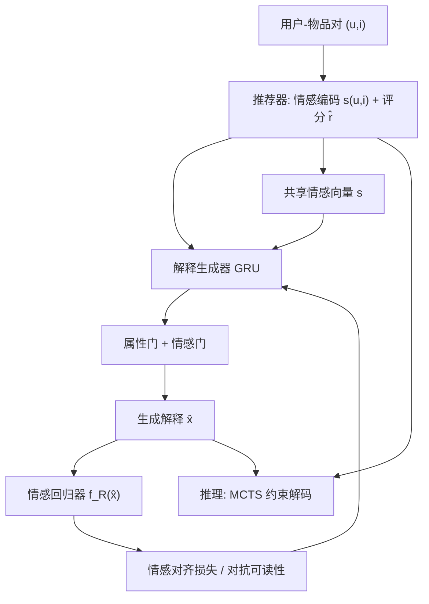
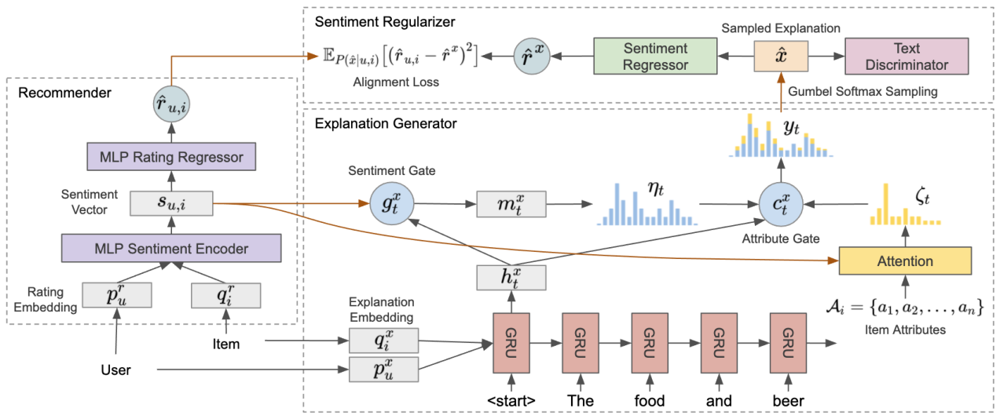

# Explanation as a Defense of Recommendation (解释作为推荐的辩护)

- **会议/期刊**: WSDM 2021
- **作者与机构**: Aobo Yang, Nan Wang, Hongbo Deng, Hongning Wang；University of Virginia, Alibaba Group
- **推荐链路定位**: 推荐解释生成 / 端到端联合建模
- **研究方向**: 对话推荐与智能体仿真（可解释推荐理由生成）
- **论文原文**: [https://arxiv.org/abs/2101.09656v1](https://arxiv.org/abs/2101.09656v1)
- **开源代码**: 暂未开源

## TL;DR (1分钟核心速览)

本文指出可解释推荐的通病：解释文本与推荐打分“各自学习、松散耦合”，生成的解释虽流畅却未必能辩护推荐决策。作者提出 SAER，以推荐器编码的共享情感向量驱动解释生成，并通过属性门、情感门、Gumbel-Softmax 情感正则和推理期 MCTS 约束解码，强制“解释情感≈推荐评分”。在 Yelp/Ratebeer 上，SAER 的 BLEU-4 较 NRT 提升约 15.8%/30.0%，情感 RMSE 降低约 17.6%/31.7%，用户研究也显示其解释更能帮助用户辨别推荐差异。

## Background & Motivation (背景与核心矛盾)

- **主流范式**: 以用户评论为解释代理，NARRE 从评论中抽取解释，NRT 将评分预测与文本生成做多任务学习，DualPC 用对偶正则约束两个任务的一致性。
- **前人局限**: 解释学习常退化为评论重构/记忆，推荐损失与解释损失目标分离；推理时解释生成又 largely independent，导致解释情感与推荐分数错位。DualPC 虽引入一致性，但约束缺乏用户可感知的语义，且推理需 ad-hoc 解耦近似。
- **核心洞察 (Key Insight)**: 眼动研究表明，带属性级观点的解释能促使用户比较候选并理解推荐理由；因此解释携带的情感应显式反映系统为何给某物品更高分。
- **本文切入点**: 将“情感对齐”同时落实到词级生成、序列级训练目标和推理期解码，把解释变成推荐的 defense，而非独立文本任务。

## Method (核心方法设计)

### 1. 整体框架 (Overall Architecture)

SAER 由三部分组成：NCF 式推荐器先将 $(u,i)$编码为情感向量$\mathbf{s}_{u,i}$并回归评分$\hat{r}_{u,i}$；GRU 解释生成器以$\mathbf{s}_{u,i}$通过属性门和情感门影响每个位置的词选择；预训练情感回归器$f_R(\hat{x})$对生成解释打分，并与$\hat{r}_{u,i}$ 做对齐。训练采用五阶段：预训练情感回归器→预训练推荐器→单独训练生成器→联合训练→冻结推荐器后启用情感正则与对抗训练。推理时在情感门高激活位置执行 MCTS+top-k 约束解码，其余位置直接 top-k 采样。

<figure class="paper-figure" markdown="span">
  <figcaption>图 1：SAER 的模型架构。情感对齐通过三个通道显式实现。第一，SAER 使用共享情感向量，通过情感门和属性门连接推荐器与解释生成器。第二，情感正则化器使用 Gumbel softmax 对生成的解释进行采样，并要求其携带的情感（由预训练情感回归器计算）与推荐器的输出分数匹配。第三，在推理时执行约束解码，以确保生成解释中的对齐。SAER 还使用对抗</figcaption>
</figure>

### 2. 关键设计拆解 (Key Designs)

1. **共享情感向量 + 双软门（词级对齐）**：NRT 仅把预测评分塞入 RNN 初始状态，影响弱且粗粒度。SAER 让每个解码位置可查询情感向量：属性门用指针/复制机制计算属性词分布 $\zeta_t=\mathrm{softmax}([\mathbf{h}^x_t,\mathbf{s}_{u,i}]^\top W^x_z\mathbf{v}_{a_k})$；情感门用$g^x_t=\sigma(W^x_g\mathbf{h}^x_t+b^x_g)$控制情感注入强度，$\mathbf{m}^x_t=\tanh(\mathbf{h}^x_t+g^x_t(W^x_m\mathbf{s}_{u,i}+b^x_m))$，并对$g^x_t$ 加 L1 稀疏约束。直觉是“只在需要表达情感的词上开门”，避免全句被情感向量污染。

2. **Gumbel 情感正则 + 对抗可读性（序列级对齐）**：词级 NLL 无法保证整句情感与推荐一致，且解释生成器可能以不同于推荐器的方式使用 $\mathbf{s}_{u,i}$。作者固定预训练情感回归器$f_R$，加入$\mathcal{L}_a=\sum_{u,i}\mathbb{E}_{P(\hat{x}|u,i)}[(\hat{r}_{u,i}-f_R(\hat{x}))^2]$；因离散采样不可导，采用 Straight-Through Gumbel-Softmax。为防止“good good good”式高情感但不可读文本，再加文本判别器$f_D$与对抗损失$\mathcal{L}_c=-\sum_{u,i}\mathbb{E}_{P(\hat{x}|u,i)}[\log f_D(\hat{x})]$。

3. **推理期 MCTS 约束解码与训练目标**：训练对齐不等于推理对齐。SAER 将解释生成视为序贯决策，回报为 $Q(\hat{x};\hat{r}_{u,i})=[\hat{r}_{u,i}-f_R(\hat{x})]^2$，用生成器 roll-out 估计动作价值并选最小化回报的词；为降开销，仅在情感门值超阈值的位置执行 MCTS。总目标为$\mathcal{J}=\min_\Theta \lambda_r\mathcal{L}_r+\lambda_x\mathcal{L}_x+\lambda_a\mathcal{L}_a+\lambda_c\mathcal{L}_c+\lambda_n\|\Theta\|^2$。推荐损失使用 MSE + pairwise hinge（而非 BPR，避免评分被推向极端）；负采样策略为观测评分对构造的个性化物品对$\mathcal{B}_u=\{(i,j)|r_{u,i}>r_{u,j}\}$，无额外负采样。

## Experimental Setup & Evaluation Protocol (实验设置与评估协议)

- **数据集与预处理**: 解释限定为含属性词的评论句；用 Sentires 抽取属性并人工过滤；词表取 20k 高频词；按 [37] 递归过滤稀疏用户/物品。

| 数据集 | #Users | #Items | #Reviews | 稀疏度/密度 | 特征/场景说明 |
| :--- | :---: | :---: | :---: | :---: | :--- |
| Yelp | 15,642 | 21,525 | 1,108,971 | 未报告 | 餐厅评论，498 个属性 |
| Ratebeer | 3,895 | 6,993 | 1,073,762 | 未报告 | 啤酒评论，333 个属性 |

- **数据划分与防穿越 (Splitting Strategy)**: 原文未明示训练/验证/测试比例与是否时间切分，亦未说明冷启动划分；这是复现与严谨性上的明显缺口。
- **排名评测协议 (Ranking Protocol)**: 报告 RMSE/MAE 与 NDCG@3/5/10；但未说明 NDCG 候选集构造、负采样比例或是否 Full-Ranking，因此只能视为“未充分披露的排序评测”。
- **对比基线与超参设置**: 推荐基线含 NMF、SVD、NCF、NARRE、NRT；解释基线为 NARRE、NRT。正文未给出 $d_r,d_x$ 与损失权重等完整超参；离线未报告显著性检验，用户研究使用 paired t-test。

## Key Experimental Results (实验关键数据)

### 1. 主实验对比 (Main Results)

| Model | Yelp RMSE↓ | Yelp NDCG@5↑ | Ratebeer RMSE↓ | Ratebeer NDCG@5↑ |
| :--- | :---: | :---: | :---: | :---: |
| NMF | 1.1034 | 0.5067 | 2.2228 | 0.6334 |
| SVD | 1.0286 | 0.5246 | 2.2942 | 0.6120 |
| NCF | 1.0532 | 0.5150 | 2.0857 | 0.6621 |
| NARRE | 1.0275 | 0.5230 | 2.0714 | 0.6641 |
| NRT | 1.0254 | 0.5262 | 2.0743 | 0.6620 |
| **SAER** | **1.0190** | **0.5278** | **2.0628** | **0.6648** |

RMSE 相对最优基线改善：Yelp 0.62%、Ratebeer 0.42%；NDCG@5 改善：Yelp 0.30%、Ratebeer 0.11%。推荐增益不大，符合论文“重点在解释”的定位。

### 2. 消融实验 (Ablation Study)

| 数据集/模型 | BLEU-4↑ | 属性 Recall↑ | 情感 PD↓ |
| :--- | :---: | :---: | :---: |
| Yelp NARRE | 2.12 | 0.1906 | 1.0932 |
| Yelp NRT | 2.97 | 0.1997 | 0.6676 |
| Yelp SAER (top-k) | 3.18 | 0.2297 | 0.6908 |
| Yelp SAER (reg+top-k) | 3.37 | 0.2319 | 0.6242 |
| **Yelp SAER** | **3.44** | **0.2391** | **0.5505** |
| Ratebeer NARRE | 3.27 | 0.2245 | 2.0996 |
| Ratebeer NRT | 5.63 | 0.1720 | 2.3302 |
| Ratebeer SAER (top-k) | 6.56 | 0.2554 | 2.1727 |
| Ratebeer SAER (reg+top-k) | 7.02 | 0.2614 | 1.6985 |
| **Ratebeer SAER** | **7.32** | **0.2677** | **1.5911** |

### 3. 关键实验发现 (Key Findings)

1. **双门控先带来主要解释增益，正则与解码继续加码**：仅 SAER(top-k) 已把 Yelp BLEU-4 从 NRT 的 2.97 提到 3.18、属性 Recall 从 0.1997 提到 0.2297；加入训练期正则后 PD 从 0.6908 降至 0.6242，再加推理约束降至 0.5505，说明序列级与推理期对齐缺一不可。
2. **解释情感对齐显著优于 NRT，且文本质量不只靠流畅度**：SAER 相对 NRT 的 BLEU-4 提升 Yelp 15.8%、Ratebeer 30.0%，情感 PD 降低 17.6%/31.7%；这与 NRT 只把评分用于初始状态形成对比。
3. **用户可感知差异，但负向解释受数据偏置拖累**：评分差 ≤0.5 时，SAER 与用户选择一致率 61.90%，高于 NRT 的 52.62%；正向推荐 up-vote 率 57.58% 高于 NRT 50.69%。但负向推荐 SAER 仅 41.76%，低于 NARRE 42.86% 与 GT 46.76%，反映 Yelp 正评论偏多导致负向解释训练不足。

## Highlights & Limitations (亮点、对比与审稿批判)

- **与代表作对比 (vs. Prior Work)**: NARRE 是抽取式、解释受限于已有评论且非个性化；NRT 虽生成式，但仅用预测评分初始化生成器；DualPC 用对偶概率约束但缺乏可感知语义且推理需近似解耦。SAER 的差异是把“情感”作为可感知、可约束的中间语义，并在推理期继续约束。
- **可迁移亮点**: 共享情感向量 + 门控注入可迁移到“评分/排序分数驱动的理由生成”；Gumbel+对抗可迁移到不可导文本级业务约束；MCTS 只在关键门控位置执行，是降低约束解码开销的实用技巧。
- **审稿级局限批判**: 离线推荐增益很小且未披露划分/候选集/负采样协议；MCTS 与多次 roll-out 带来推理延迟，线上成本不低；解释负向推荐受正评论偏置影响，且无开源代码，复现与工业落地证据不足。

## Rating (四维评分)

- **方法创新性 (Novelty)**: ⭐⭐⭐⭐ （以情感对齐贯通词级门控、序列正则与推理约束，机制清晰且有用户可感知语义支撑）
- **评估协议与实验扎实度 (Protocol & Experiments)**: ⭐⭐⭐ （有离线多指标与用户研究，但划分、候选集与显著性披露不足，推荐增益偏小）
- **写作与数学规范度 (Clarity & Rigor)**: ⭐⭐⭐⭐ （模块职责与公式定义清楚，五阶段训练与推理约束交代充分）
- **工业落地与复现价值 (Industrial & Practical Value)**: ⭐⭐⭐ （解释生成与对齐思路可落地，但MCTS推理开销大、无开源代码，负向场景需额外纠偏）

