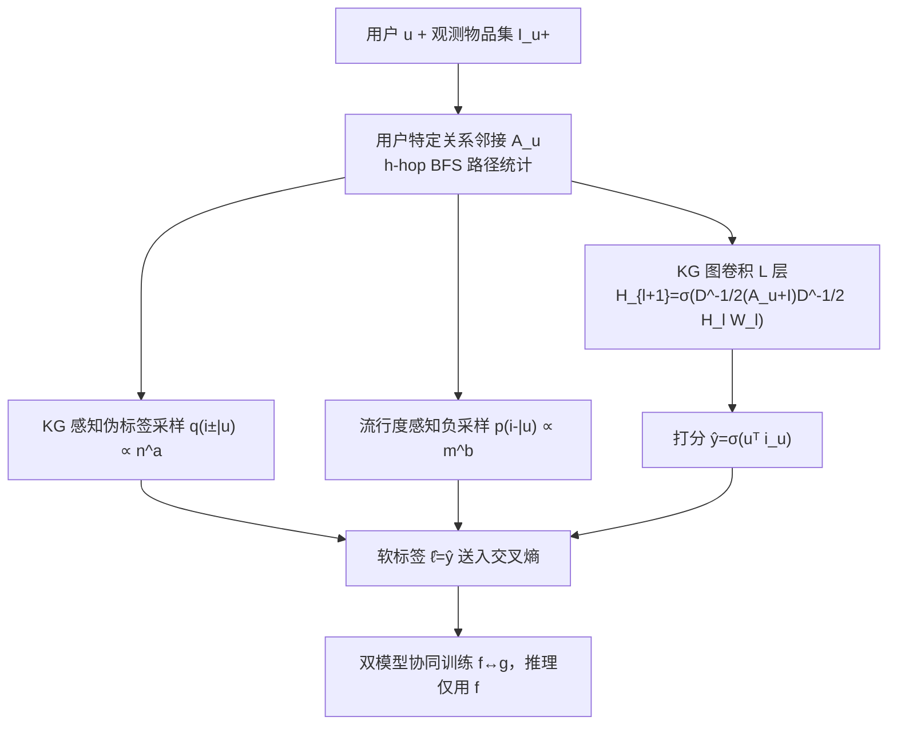
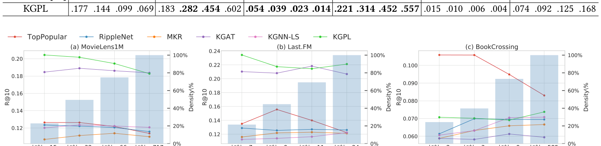

# Alleviating Cold-Start Problems in Recommendation through Pseudo-Labelling over Knowledge Graph (通过知识图谱伪标签缓解推荐冷启动问题)

- **会议/期刊**: WSDM 2021
- **作者与机构**: Riku Togashi, Mayu Otani, Shin'ichi Satoh（CyberAgent, Inc. / NII）
- **推荐链路定位**: 召回（KG-aware 打分）
- **研究方向**: 冷启动与长尾推荐 / 图神经网络与知识图谱推荐
- **论文原文**: [https://arxiv.org/abs/2011.05061v1](https://arxiv.org/abs/2011.05061v1)
- **开源代码**: 暂未开源

## TL;DR (1分钟核心速览)

针对隐式反馈下"未观测样本一律当负例"导致新物品被系统性打压的冷启动痛点，本文提出 KGPL：把 KG 上从用户已交互物品 h-hop 可达的未观测物品伪标签为**弱正例**，并用频率感知负采样抑制流行度偏差、用双模型协同训练抵抗伪标签噪声。在 MovieLens1M / Last.FM / BookCrossing 三套 6:2:2 划分数据上，Last.FM R@10 由 KGAT 的 0.186 提升到 0.221（+18.8%），相对同架构 KGNN-LS 提升 81.1%。

## Background & Motivation (背景与核心矛盾)

- **主流范式**: KG-aware 推荐（RippleNet / MKR / KGAT / KGNN-LS）借知识图谱作为物品侧信息，用 GNN 端到端传播实体表示，训练时把未观测 $(u,i)$ 对按 point-wise 或 pairwise 损失当作**负例**，负采样多为均匀分布。
- **前人局限一（正负号错配）**: 冷启动物品在绝大多数用户处都是"未观测"，因此被均匀负采样高频抽中为负例，模型学到"新物品 = 负"，优化结果系统性偏向热门物品——这恰恰是冷启动最需要解决的偏差。
- **前人局限二（半监督未用足）**: KGNN-LS 用 label-smoothness 正则做隐式标签传播，但其 leave-one-out 只保留**已观测**样本，未观测正样本仍未被显式纳入损失；伪标签方法又因 $|U\times I|$ 达十亿级而无法穷举标注。
- **核心洞察 (Key Insight)**: KG 中存在从用户正例物品出发 $h$-hop 可达、共享实体（导演/流派/作者）的未观测物品，它们大概率是真阳性的可靠候选，可赋软伪标签而非硬 0。
- **本文切入点**: 用图结构做**候选筛选**（而非全库标注）的采样式伪标签框架，配合负采样纠偏与协同训练。

## Method (核心方法设计)

### 1. 整体框架 (Overall Architecture)

给定用户 $u$，先用可学习的关系打分构造用户特定邻接矩阵，在 KG 上做$L$层图卷积得到实体表示$\mathbf{H}_L$，用户嵌入与目标物品表示内积得$\hat{y}_{u,i}$。训练阶段按用户构造 mini-batch：为其采 1 个已观测正例、1 个频率感知负例、1 个 KG 可达的伪标签候选，并**强制三类样本 1:1:1 保证类内平衡**；伪标签由另一个同伴模型在线给出。两个模型互喂对方生成的伪标签 loss，推理时只保留$f$。

### 2. 关键设计拆解 (Key Designs)

1. **用户特定关系加权图卷积（伪标签的语义底座）**：痛点在于同一 KG 关系对不同用户重要性不同，全局邻接会让"共同演员"与"共同流派"同权。改为按用户嵌入与关系嵌入内积做边权：$(A_u)_{jk}=\exp(\mathbf{u}^\top\mathbf{r}_{e_j,e_k})$，传播$H_{l+1}=\sigma_l\left(D_u^{-1/2}(A_u+I)D_u^{-1/2}H_lW_l\right)$，打分$\hat{y}_{u,i}=\sigma(\mathbf{u}^\top\mathbf{i}_u)$。直觉：边权即"该关系对该用户的可信度"，为后续伪标签提供个性化而非全局的语义邻域。

2. **伪标签软损失 + KG 路径采样（把未观测变弱正例）**：标签函数
   $\hat{l}_u(i)=\begin{cases}1, & i\in I_u^+\\ \hat{y}_{u,i}, & i\in I_u^\pm\\ 0, & i\in I_u^-\end{cases}$，
   总损失 $\mathcal{L}=\sum_u\big[\sum_{i\in I_u^+}\ell(1,\hat{y})+\sum_{i\in I_u^\pm}\alpha_{u,i}\ell(\hat{l}_u(i),\hat{y})+\sum_{i\in I_u^-}\beta_{u,i}\ell(0,\hat{y})\big]$。在交叉熵下伪标签项恰等于对未知标签的期望损失$\mathbb{E}_y[\ell(y,\hat{y}_{u,i})]$，即"软标签保留不确定性"，避免硬 0/1 的过度自信。候选不穷举，而按$h$-hop BFS 路径数采样：$q(i^\pm|u)=n_{u,i^\pm}^{a}/\sum_{i\in I\setminus I_u^+}n_{u,i}^{a}$，其中$n_{u,i^\pm}=\sum_{i^+\in I_u^+}|T_{i^+i^\pm}|$，不可达物品置$n=0.5$以保覆盖；$a$ 小则趋近均匀（探索），大则聚焦高可信候选（利用）。

3. **频率感知负采样 + 双模型协同训练**：负采样改为 $p(i^-|u)=m_{u,i^-}^{b}/\sum_{i}m_{u,i}^{b}$（$m$为物品观测交互数），$b>0$使热门物品更易被抽为负例，从源头压制"新物品当负例"的偏差。伪标签噪声则用 co-training 抑制：$f$在$g$打标签的 batch 上更新、$g$反之，$\mathcal{L}^{(f)}_{\mathcal{B}}=\sum_{(u,i,l^{(g)}_{u,i})\in\mathcal{B}_g}\ell(l^{(g)}_{u,i},\hat{y}^{(f)}_{u,i})$。**训练开销**：额外成本为 h-hop BFS 路径统计（可离线缓存）与双模型 2× 训练；**推理开销与 KGNN-LS 同级**（单模型、无采样）。

## Experimental Setup & Evaluation Protocol (实验设置与评估协议)

| 数据集 | #Users | #Items | #Interactions | 稀疏度 | KG 实体/关系/三元组 |
| :--- | :---: | :---: | :---: | :---: | :--- |
| MovieLens1M | 6,036 | 2,347 | 376,886 | 2.66% | 102,569 / 32 / 499,474 |
| Last.FM | 1,872 | 3,846 | 21,173 | 0.294% | 9,366 / 60 / 15,518 |
| BookCrossing | 17,860 | 14,967 | 69,873 | 0.026% | 77,903 / 25 / 151,500 |

- **数据划分与防穿越**: 三套数据均按 **6:2:2 随机比例划分**（非全局时间戳切分，存在轻度信息穿越风险），保留全部观测交互为隐式正反馈。
- **排名评测协议**: 属于 **Sampled Ranking**——作者为验证/测试集**另行构造负例**并保证其在**全库中未观测**，但原文未披露正负比，属复现风险点；训练负例仅保证在 train/val 未观测，因此可能落在 test 正例上。
- **对比基线与超参**: TopPopular、RippleNet、MKR、KGAT、KGNN-LS；$d_l=64$，$L\in\{1,2\}$，采样邻居数 32/32/8，BFS 深度$h$=5/6/6，dropout 0.1–0.8，$a,b\in\{10^{-3},\dots,1.0\}$；显著性用 paired **Tukey HSD（95% CI）** 并报告 Hedge's$g$ 效应量，模型选择基于验证集 R@10。

## Key Experimental Results (实验关键数据)

### 1. 主实验对比 (Main Results)

| 模型 | MovieLens1M P@10 / R@10 / R@20 | Last.FM P@10 / R@10 / R@20 | BookCrossing P@10 / R@10 / R@20 |
| :--- | :---: | :---: | :---: |
| TopPopular | .125 / .113 / .186 | .029 / .122 / .194 | **.017** / **.083** / **.101** |
| RippleNet | .125 / .113 / .183 | .030 / .125 / .195 | .014 / .069 / .086 |
| MKR | .123 / .110 / .182 | .029 / .121 / .181 | .013 / .067 / .080 |
| KGAT | **.188** / **.184** / .280 | .046 / .186 / .272 | .008 / .044 / .059 |
| KGNN-LS | .139 / .121 / .195 | .029 / .122 / .182 | .015 / .072 / .090 |
| KGPL (本文) | .177 / .183 / **.282** | **.054** / **.221** / **.314** | .015 / .074 / .092 |
| Improv. (vs 最强基线) | −5.9% / −0.5% | **+17.4% / +18.8%** | −10.8% (vs TopPopular) |

### 2. 消融实验 (Ablation Study)

Last.FM 上逐组件拆解（$nopl$=无伪标签，$rand$=随机采样伪标签，$kapl$=KG 感知采样，$cot$=协同训练）：

| 变体 | P@10 | P@20 | R@10 | R@20 |
| :--- | :---: | :---: | :---: | :---: |
| KGPL$_{nopl}$ | .048 | .033 | .209 | .304 |
| KGPL$_{rand,self}$ | .050 | .037 | .204 | .298 |
| KGPL$_{kapl,self}$ | .051 | .037 | .208 | .303 |
| KGPL$_{rand,cot}$ | .052 | .036 | .216 | .317 |
| KGPL$_{kapl,cot}$ (完整) | **.054** | **.039** | **.221** | **.314** |

### 3. 关键实验发现 (Key Findings)

1. **增益来自训练目标而非网络容量**：KGPL 与 KGNN-LS 骨架几乎相同，仅替换损失与采样，MovieLens1M R@10 从 .121→.183（+51.2%）、Last.FM .122→.221（+81.1%），且 $p\le2\text{e-}16$、Hedge's$g$=0.343/0.354 属大效应量——干净地隔离出伪标签的贡献。
2. **KG 采样与协同训练强耦合，单独使用甚至有害**：$rand,self$的 R@10 (.204) 反低于完全不用伪标签 (.209)，$kapl,self$ 也仅 .208；只有 co-training 在场时 KG 采样才兑现收益（.216→.221）。说明噪声软标签必须配"同伴监督"才可用。
3. **冷启动分桶收益集中且存在下限**：MovieLens1M 在最稀疏两组（$|I_u^+|<15$、$<32$）KGPL 反超整体更优的 KGAT；但 BookCrossing（稀疏度 0.026%）上 TopPopular 全面最强、KGPL 仅 .074，说明伪标签需要最低数量的观测锚点才能产出可靠候选；同时 KGPL 排序列表中唯一物品数与相关物品覆盖均高于基线、中位物品热度更低，确实把长尾/新品拉进了曝光位。

<figure class="paper-figure" markdown="span">
  <figcaption>图 1：(a) MovieLens1M、(b) Last.FM 和 (c) BookCrossing 中四个不同稀疏程度用户组的 R@10。</figcaption>
</figure>

## Highlights & Limitations (亮点、对比与审稿批判)

- **与代表作对比 (vs. Prior Work)**: 相较 KGNN-LS，本文把 label propagation 的"只传播已观测标签"改为"显式给未观测样本赋软标签"；相较 KGAT/MKR 的纯负例 + 均匀负采样，本文同时利用未观测样本的正、负两侧信号；相较经典 self-training 伪标签，本文用 KG 可达性把候选从十亿级压到可控规模，规避了穷举标注。
- **可迁移亮点**: (1) **负采样分布按物品频次幂律纠偏** $p\propto m^{b}$，可零成本插入任意隐式反馈召回模型缓解新品打压；(2) **双模型互打标签的 co-training** 是低成本的噪声标签稳定器，可迁移到 LLM 蒸馏伪标签、跨域软标签等场景。
- **审稿级局限批判**: (1) 评估依赖作者自造的采样负例且未披露正负比，缺失无偏 Full-Ranking 结果，BookCrossing 上甚至被 TopPopular 全面压制，结论的普适性被削弱；(2) h-hop BFS + 双模型的训练开销在大规模 KG 上未做复杂度/时延实测，$b$ 增大即显著掉点（图 5）显示对负采样强度敏感，工业调参成本不低。

## Rating (四维评分)

- **方法创新性 (Novelty)**: ⭐⭐⭐⭐ （把"未观测即负例"翻转为"KG 可达即弱正例"，并用采样+co-training 使软伪标签可落地，思路简洁但非全新范式）
- **评估协议与实验扎实度 (Protocol & Experiments)**: ⭐⭐⭐ （三数据集+显著性检验+用户/物品双侧细粒度分析很扎实，但采样排序协议未披露负例比、无 Full-Ranking 与时间切分）
- **写作与数学规范度 (Clarity & Rigor)**: ⭐⭐⭐⭐ （损失与采样分布推导清晰，伪标签项等价于期望损失的说明尤佳；算法伪码与复杂度分析略简）
- **工业落地与复现价值 (Industrial & Practical Value)**: ⭐⭐⭐⭐ （推理零额外开销、负采样纠偏即插即用；但未开源、BFS 与双模型训练成本在大规模场景需实测）

