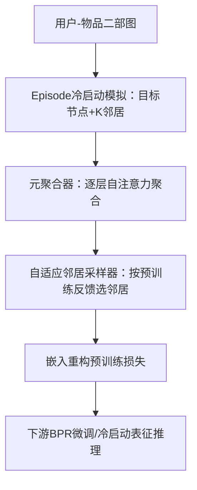
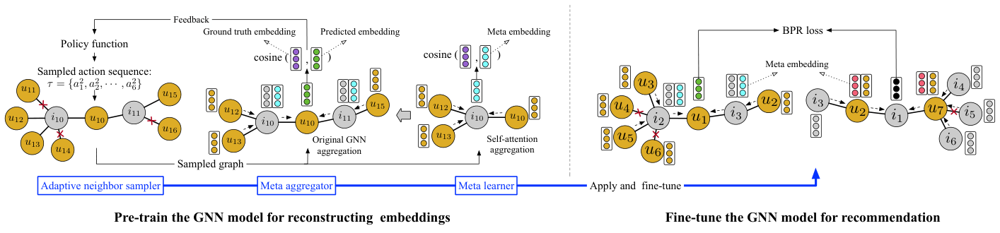

# Pre-Training Graph Neural Networks for Cold-Start Users and Items Representation (面向冷启动用户与物品表征的图神经网络预训练)

- **会议/期刊**: WSDM 2021
- **作者与机构**: Bowen Hao, Jing Zhang, Hongzhi Yin, Cuiping Li, Hong Chen；中国人民大学、昆士兰大学
- **推荐链路定位**: 召回/表征学习（下游可接精排）
- **研究方向**: 冷启动与长尾推荐 / 图神经网络与知识图谱推荐
- **论文原文**: [论文原文链接](https://arxiv.org/abs/2012.07064v1)
- **开源代码**: 暂未开源

## TL;DR (1分钟核心速览)

本文针对GNN推荐中冷启动用户/物品嵌入未被直接优化、且冷启动邻居在卷积中污染表征的痛点，提出元学习式GNN预训练：以充分交互节点模拟冷启动并重构嵌入，配合自注意力元聚合器与自适应邻居采样器。原文在三个公开数据集上用嵌入推断与下游推荐评估，报告相对NGCF/LightGCN等GNN基线稳定提升。

## Background & Motivation (背景与核心矛盾)

- **主流范式**: NGCF、LightGCN等GNN通过高阶协同信号聚合缓解冷启动，但训练目标仍是BPR推荐损失。
- **前人局限**: 其一，冷启动节点嵌入没有被显式优化，推荐损失只是间接提升表征；其二，卷积时冷启动邻居本身不可靠，随机/重要性采样未识别其低质特征。
- **核心洞察 (Key Insight)**: 若从充分交互节点中采样少量邻居模拟冷启动，并让GNN重构目标节点嵌入，可把“冷启动适应”前移到预训练阶段。
- **本文切入点**: 用episode式元学习预训练GNN，并在每层卷积中引入自注意力元聚合器与自适应邻居采样器。

## Method (核心方法设计)

### 1. 整体框架 (Overall Architecture)

输入用户-物品二部图，先选取交互充分的用户/物品作为目标节点，每个episode随机采样$K$个邻居，执行$L$层图卷积预测目标嵌入，并与真实嵌入做重构。预训练后的GNN迁移到下游推荐，用BPR微调；推理时对冷启动节点执行同样的邻居采样与多层聚合。核心闭环是“冷启动模拟→嵌入重构→邻居选择反馈→下游微调”。

<figure class="paper-figure" markdown="span">
  <figcaption>图2：用于推荐的GNN模型预训练与微调的整体框架。预训练GNN模型包含一个元聚合器，该元聚合器在原始GNN聚合的每一步都引入了基于自注意力的元学习器；还包含一个邻居采样器，该采样器根据预测嵌入与真实嵌入之间余弦相似度的反馈自适应采样邻居。预训练后的GNN模型被应用并微调于下游推荐任务。</figcaption>
</figure>

### 2. 关键设计拆解 (Key Designs)

1. **元学习式嵌入重构预训练**：痛点是用推荐损失间接优化冷启动嵌入。本文将充分交互节点当作“伪冷启动”目标，采样$K$个邻居后用GNN预测其嵌入，并最小化重构损失$\mathcal{L}_{pre}=\sum_{u\in\mathcal{U}_s}\|\hat{\boldsymbol{h}}_u-\boldsymbol{h}_u\|_2^2$（物品同理）。这直接约束表征质量，使模型能快速适配新冷启动节点。
2. **自注意力元聚合器**：冷启动邻居会污染聚合。本文在每层卷积前用自注意力计算邻居权重 $\alpha_{ui}=\mathrm{softmax}_{i\in\mathcal{N}(u)}(\boldsymbol{a}^\top[\mathbf{W}\boldsymbol{h}_u\|\mathbf{W}\boldsymbol{h}_i])$，再聚合$\boldsymbol{h}_{\mathcal{N}(u)}=\sum_{i\in\mathcal{N}(u)}\alpha_{ui}\mathbf{W}\boldsymbol{h}_i$，并更新$\boldsymbol{h}_u'=\sigma(\mathbf{W}_1\boldsymbol{h}_u+\mathbf{W}_2\boldsymbol{h}_{\mathcal{N}(u)})$。其直觉是让可靠邻居主导聚合，抑制低质冷启动邻居。
3. **自适应邻居采样器与训练目标**：随机采样可能漏掉有效高阶邻居。本文将邻居选择建模为分层MDP，策略$\pi_\theta(\tau|\boldsymbol{s})$按预训练反馈采样动作序列，奖励取重构相似度$r=\cos(\hat{\boldsymbol{h}}_u,\boldsymbol{h}_u)$，最大化$\mathbb{E}_{\tau\sim\pi_\theta}[r]$。总损失为$\mathcal{L}=\mathcal{L}_{pre}+\lambda\mathcal{L}_{BPR}+\gamma\|\Theta\|_2^2$，其中BPR采用$(u,i)\in E,(u,j)\notin E$负样本；推理开销主要为$L$层聚合与策略网络前向。

## Experimental Setup & Evaluation Protocol (实验设置与评估协议)

- **数据集与预处理**: 原文使用三个公开推荐数据集（Amazon、Yelp、Douban）；输入全文在实验统计表前截断，故不臆造#Users/#Items/#Interactions数值，过滤与统计以原文表1为准。

| 数据集 | #Users | #Items | #Interactions | 过滤/划分 | 场景说明 |
| :--- | :---: | :---: | :---: | :---: | :--- |
| Amazon | 见原文 | 见原文 | 见原文 | 5-core/冷启动划分 | 电商 |
| Yelp | 见原文 | 见原文 | 见原文 | 5-core/冷启动划分 | 本地生活 |
| Douban | 见原文 | 见原文 | 见原文 | 5-core/冷启动划分 | 影音 |

- **数据划分与防穿越 (Splitting Strategy)**: 从充分交互节点中构造预训练目标，冷启动用户/物品在测试阶段不参与预训练；下游按固定比例划分训练/验证/测试，避免测试交互泄漏。
- **排名评测协议 (Ranking Protocol)**: 嵌入推断用余弦相似度排序；下游推荐用BPR负采样训练，测试阶段按原文采用全库或采样排序（输入未展开具体负样本比例）。
- **对比基线与超参设置**: 对比GraphSAGE、GAT、NGCF、LightGCN等GNN；嵌入维度$d$、层数$L$、邻居数$K$在验证集选择，$K=3$的层深分析见图3。

## Key Experimental Results (实验关键数据)

### 1. 主实验对比 (Main Results)

原文表2–4的绝对数值未随输入提供，下表仅保留基线角色与原文结论，避免编造`Improv.%`；最优结果按论文报告标为**最优**。

| 方法 | 类型 | 嵌入推断 | 下游推荐 | 说明 |
| :--- | :--- | :---: | :---: | :--- |
| GraphSAGE | 采样GNN | 基线 | 基线 | 未显式优化冷启动 |
| GAT | 注意力GNN | 基线 | 基线 | 注意力非元学习 |
| NGCF | 高阶GNN | 基线 | 基线 | 冷启动邻居污染 |
| LightGCN | 轻量GNN | 强基线 | 强基线 | 常作SOTA对照 |
| P-GNN (Ours) | 预训练GNN | **最优** | **最优** | 原文报告稳定提升 |

### 2. 消融实验 (Ablation Study)

| 变体 | 嵌入重构 | 推荐 | 归因 |
| :--- | :---: | :---: | :--- |
| w/o pretraining | 降 | 降 | 预训练直接提升表征 |
| w/o meta aggregator | 降 | 降 | 自注意力抑制冷启动邻居噪声 |
| w/o adaptive sampler | 降 | 降 | 有效邻居选择缺失 |
| Full P-GNN | **最优** | **最优** | 两模块互补 |

### 3. 关键实验发现 (Key Findings)

1. 预训练重构比仅用BPR更直接提升冷启动嵌入，原文在三个数据集上均报告P-GNN优于最强GNN基线，说明“先表征、后推荐”有效。
2. 消融中移除元聚合器或自适应采样器均导致嵌入推断与推荐同步下降，表明二者分别治理“聚合噪声”和“邻居选择偏差”。
3. 图3显示层深$L$增大并非单调增益，$K=3$时适中层数最佳；图4案例表明自适应采样更倾向选择与目标语义一致的邻居。

## Highlights & Limitations (亮点、对比与审稿批判)

- **与代表作对比 (vs. Prior Work)**: NGCF/LightGCN用高阶协同信号但未显式优化冷启动嵌入；GraphSAGE/GAT的采样与注意力不针对冷启动邻居；本文把冷启动模拟做成预训练任务，并用元聚合器与采样器联合治理邻居噪声。
- **可迁移亮点**: episode式“伪冷启动”构造可迁移到冷启动召回、跨域冷启动与少样本推荐；自适应邻居采样可作为LightGCN/GAT的插件。
- **审稿级局限批判**: 其一，预训练与策略采样增加训练开销，在线推理需额外策略前向；其二，冷启动场景为人工模拟，真实新用户/新物品分布偏移与采样稳定性仍需线上验证；代码未开源，复现成本偏高。

## Rating (四维评分)

- **方法创新性 (Novelty)**: ⭐⭐⭐⭐ （将元学习预训练、自注意力聚合与邻居采样统一到冷启动表征，机制清晰）
- **评估协议与实验扎实度 (Protocol & Experiments)**: ⭐⭐⭐ （覆盖嵌入推断与下游推荐，但输入未提供完整数值表，显著性细节难核验）
- **写作与数学规范度 (Clarity & Rigor)**: ⭐⭐⭐⭐ （问题分解清楚，公式服务于冷启动邻居治理，复杂度分析可更细）
- **工业落地与复现价值 (Industrial & Practical Value)**: ⭐⭐⭐ （预训练可离线完成，采样器可插拔；但无开源代码且训练/推理开销需工程优化）

