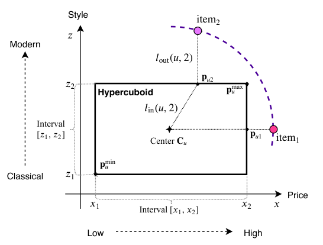
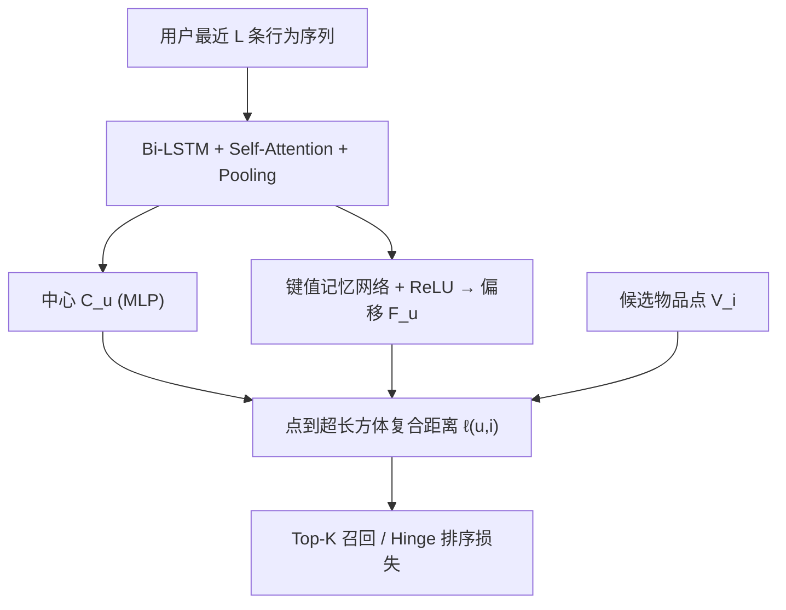
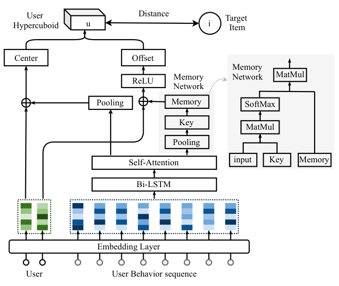

# Learning User Representations with Hypercuboids for Recommender Systems (面向推荐系统的超长方体用户表示学习)

- **会议/期刊**: WSDM 2021
- **作者与机构**: Shuai Zhang、Ce Zhang (ETH Zurich)；Huoyu Liu、Yue Hu、Yumeng Li、Tanchao Zhu、Shaojian He、Wenwu Ou (阿里巴巴)；Aston Zhang (UIUC)
- **推荐链路定位**: 召回（用户表示与 Top-K 检索）
- **研究方向**: 协同过滤与双塔召回 / 序列与会话推荐
- **论文原文**: [https://arxiv.org/abs/2011.05742v1](https://arxiv.org/abs/2011.05742v1)
- **开源代码**: 暂未开源

## TL;DR (1分钟核心速览)

现有 CF 把用户压成向量空间中的**一个点**，无法表达"价格可接受区间""风格容忍度"这类**范围型偏好**，且同一球面上距离相等的两个物品无法区分。本文提出将用户建模为**超长方体**（中心 $\mathbf{C}_u$与非负偏移$\mathbf{F}_u$），用「外部距离 + γ·内部距离 + 内外分界附加距离」的复合度量打分，并提供同心/独立多长方体两种变体。在 4 个公开集与 2 个阿里巴巴线上集上，按时间切分、全库排序评测，单长方体即超越 HGN/SASRec/Caser，Alibaba V1 的 Recall@50 相对最优基线提升 **14.3%**。

## Background & Motivation (背景与核心矛盾)

- **主流范式**: 以 BPRMF、TransRec 为代表的点嵌入模型把用户与物品都映射为 $\mathbb{R}^d$ 中的单点，用内积或欧氏距离衡量偏好；序列侧则用 GRU4Rec/Caser/SASRec/HGN 从行为序列学出该点向量。
- **前人局限一（表达能力）**: 把跨品类、跨域的多峰兴趣压缩进单点，信息必然被平均；而用户对"价格""风格"等因子的偏好天然是**区间**，单值嵌入无法表达。
- **前人局限二（几何不灵活）**: 纯欧氏距离下，用户向量球面上任意两点等距，模型被迫认为用户对两者兴趣相同，无法体现"风格不匹配但价格合适"这类**维度非对称**的取舍。
- **核心洞察 (Key Insight)**: 一个超长方体内部包含无穷多物品点，可"包住"任意多正样本而不产生相互拉扯（缓解点嵌入的 congestive 问题）；其边长天然对应各维度的**偏好容忍范围**。
- **本文切入点**: 保留物品为点、把用户升级为子空间，并重新设计「点到超长方体」的复合距离使内外物品可被严格分层排序。

<figure class="paper-figure" markdown="span">
  <figcaption>图2：点嵌入的局限性：当用户为点时，𝑖𝑡𝑒𝑚1 与 𝑖𝑡𝑒𝑚2 无法区分。将用户表示为超长方体可有效解决此问题。</figcaption>
</figure>

## Method (核心方法设计)

### 1. 整体框架 (Overall Architecture)

输入为用户最近 $L$条行为序列，经物品嵌入表得到序列矩阵后，先由 Bi-LSTM 建模双向转移，再经缩放点积自注意力加权、池化得到定长向量$\mathbf{s}_u^{(t)}$；该向量一方面经 MLP 生成长方体中心$\mathbf{C}_u$，另一方面作为 query 进入键值记忆网络检索"区间知识"，经 ReLU 保证非负后输出偏移$\mathbf{F}_u$；最后用复合距离对候选物品打分，并以成对 hinge 损失端到端训练，推理时对全库物品按该距离升序返回 Top-K。

<figure class="paper-figure" markdown="span">
  <figcaption>图4：所提模型架构，每个用户对应一个超长方体。</figcaption>
</figure>

### 2. 关键设计拆解 (Key Designs)

1. **超长方体表示与复合距离 (Hypercuboid & Compositional Distance)**：点嵌入无法编码区间偏好。定义为 $\text{Hypercuboid} \equiv \{\mathbf{p} \in \mathbb{R}^d: \mathbf{C}_u-\mathbf{F}_u \preceq \mathbf{p} \preceq \mathbf{C}_u+\mathbf{F}_u\}$；先求物品在长方体表面上的最近点$\mathbf{p}_{ui} = \min(\mathbf{p}_u^{\max}, \max(\mathbf{p}_u^{\min}, \mathbf{V}_i))$（逐维截断），再组合$\ell(u,i) = \underbrace{\lVert \mathbf{p}_{ui}-\mathbf{V}_i\rVert_2^2}_{\ell_{\text{out}}} + \gamma\underbrace{\lVert \mathbf{p}_{ui}-\mathbf{C}_u\rVert_2^2}_{\ell_{\text{in}}}$。物品在体内时$\ell_{\text{out}}=0$，仅由内部距离区分；体外时外部距离主导。$\gamma$ 越小则"入体即正例"，越大则体内仍需按离心距离排序——这一项正是打破"同心球等距"几何僵局的算子。
2. **内外分层附加距离 (Additional Distance)**：仅靠连续距离可能出现体内物品排到体外之后的错序。作者追加 $\ell_{\text{add}}(u,i) = 2\big(\sigma(\alpha\lVert \mathbf{p}_{ui}-\mathbf{V}_i\rVert_2^2)-\tfrac{1}{2}\big)\lVert \mathbf{F}_u\rVert_2^2$，$\alpha>100$：体内时该项≈0，体外时≈长方体最大对角线的量级，从而在度量层面硬性保证"体内优先于体外"。
3. **两种多长方体变体与训练/推理**：单长方体难以覆盖多峰兴趣。**同心变体**共享中心、叠加 $M$个偏移，$\ell(u,i)=\sum_j \ell^j_{\text{out}}+\gamma\min_j \ell^j_{\text{in}}$（外部求和=任一视角不匹配即惩罚，内部取最小=只要贴合某一兴趣即可）；**独立变体**则为$\ell(u,i)=\min_j \ell^j(u,i)$并对外部附加距离取最大，等价于"最近子空间命中即推荐"。训练采用成对 hinge 损失$\mathcal{L}=\sum_{(u,i)\in\mathcal{T}^+}\sum_{(u,j)\in\mathcal{T}^-}\max(0, \ell(u,i)+\lambda-\ell(u,j))$，$\lambda=0.5$，负采样沿用 HGN 策略（非均匀采样），全流程无 softmax、无需负采样近似即可全库打分，推理开销为$O(|\mathcal{I}|d)$ 距计算 + 记忆网络一次前向。

## Experimental Setup & Evaluation Protocol (实验设置与评估协议)

- **数据集与预处理**: 亚马逊三集评分 $\ge 4$视为正反馈；统一丢弃交互数$<10$的用户与$<5$ 的物品（即 user-10 / item-5 core 过滤）。

| 数据集 | #Users | #Items | #Interactions | 密度 | 说明 |
| :--- | :---: | :---: | :---: | :---: | :--- |
| Amazon-Books | 52,406 | 41,264 | 1,856,747 | 0.086% | 公开，图书 |
| Amazon-CDs | 17,052 | 35,118 | 475,265 | 0.079% | 公开，音乐 |
| Amazon-Movies&TVs | 23,337 | 33,582 | 694,970 | 0.089% | 公开，影视 |
| E-commerce | 104,929 | 69,563 | 5,560,954 | 0.076% | 公开，四周日志 |
| Alibaba V1 | 145,057 | 92,364 | 28,926,924 | 0.216% | 线上，用户 100–500 交互 |
| Alibaba V2 | 131,692 | 109,670 | 8,558,837 | 0.059% | 线上，用户 50–100 交互 |

- **数据划分与防穿越 (Splitting Strategy)**: **全局时间戳切分**——按交互时序取前 70% 训练、次 10% 验证、后 20% 测试，任务为 next-item 预测；验证集参与推理阶段（同 HGN 设定），严格避免未来穿越。
- **排名评测协议 (Ranking Protocol)**: **Full-Ranking（全库未交互物品排序）**，排除用户已交互项后取 Top-$k$，$k\in\{5,10,20,30,50\}$，指标为 Recall@k、NDCG@k、MAP@k（正文报告中低$k$ 为主，公开集曲线见原文图 5）。
- **对比基线与超参设置**: 非神经基线 BPRMF、TransRec；神经基线 YouTubeDNN、GRU4Rec、Caser、SASRec、HGN。统一 $d=100$，序列长度$L=5$、目标长度$T=3$，Adagrad（lr=0.05），batch=4096，$\ell_2\in\{0.1,\dots,10^{-6}\}$，$\gamma\in\{0.1,\dots,0.9\}$，记忆容量$N\in\{10,\dots,50\}$，平均池化为默认；每组实验重复 5 次取均值。

## Key Experimental Results (实验关键数据)

### 1. 主实验对比 (Main Results)

| 数据集 | 方法 | Recall@10 | Recall@50 | NDCG@10 | MAP@10 |
| :--- | :--- | :---: | :---: | :---: | :---: |
| Alibaba V1 | BPRMF | 0.0156 | 0.0459 | 0.0665 | 0.0284 |
| | TransRec | 0.0192 | 0.0608 | 0.0789 | 0.0300 |
| | YouTubeDNN | 0.0251 | 0.0776 | 0.1041 | 0.0487 |
| | GRU4Rec | 0.0196 | 0.0631 | 0.0808 | 0.0367 |
| | Caser | 0.0227 | 0.0683 | 0.0952 | 0.0451 |
| | SASRec | 0.0233 | 0.0692 | 0.0989 | 0.0466 |
| | HGN (2nd) | 0.0271 | 0.0774 | 0.1141 | 0.0558 |
| | **Ours (1 cuboid)** | **0.0299** | **0.0885** | **0.1255** | **0.0610** |
| | Improv.% vs 2nd | +10.3% | +14.3% | +10.0% | +9.3% |
| Alibaba V2 | BPRMF | 0.0370 | 0.0997 | 0.0536 | 0.0223 |
| | YouTubeDNN | 0.0622 | 0.1655 | 0.0881 | 0.0396 |
| | Caser | 0.0639 | 0.1664 | 0.0913 | 0.0415 |
| | SASRec | 0.0619 | 0.1568 | 0.0897 | 0.0413 |
| | HGN (2nd) | 0.0649 | 0.1626 | 0.0930 | 0.0425 |
| | **Ours (1 cuboid)** | **0.0667** | **0.1764** | **0.0947** | **0.0431** |
| | Improv.% vs 2nd | +2.8% | +6.0% | +1.8% | +1.4% |

### 2. 消融实验 (Ablation Study)

**表 A 去除全部神经结构（仅保留平均池化 + 长方体距离），Measure@10：**

| 数据集 | 指标 | Remove NNs | Δ vs 完整模型 | Δ vs 次优基线 |
| :--- | :--- | :---: | :---: | :---: |
| Books | Recall | 0.0558 | -6.84% | +16.25% |
| Books | NDCG | 0.0360 | -6.01% | +1.41% |
| Books | MAP | 0.0264 | -8.97% | +10.00% |
| E-commerce | Recall | 0.1384 | -0.75% | +4.86% |
| E-commerce | NDCG | 0.1277 | -1.00% | +10.10% |
| Alibaba V1 | Recall | 0.0281 | -6.02% | +3.54% |
| Alibaba V1 | MAP | 0.0563 | -7.70% | +0.90% |
| Alibaba V2 | Recall | 0.0644 | -3.45% | -0.77% |
| Alibaba V2 | MAP | 0.0414 | -3.94% | -2.59% |

**表 B 长方体数量 $M$ 的影响（Recall@10 / NDCG@10 / MAP@10）：**

| $M$ | E-commerce 同心 | E-commerce 独立 | Alibaba V2 同心 | Alibaba V2 独立 |
| :---: | :---: | :---: | :---: | :---: |
| 2 | 0.1396 / 0.1300 / 0.0802 | 0.1476 / 0.1336 / 0.0830 | 0.0722 / 0.1032 / 0.0480 | 0.0766 / 0.1119 / 0.0534 |
| 4 | 0.1529 / 0.1415 / **0.0885** | 0.1525 / 0.1374 / 0.0859 | 0.0760 / 0.1095 / 0.0519 | 0.0779 / 0.1136 / 0.0544 |
| 6 | 0.1436 / 0.1334 / 0.0827 | **0.1530** / **0.1381** / 0.0866 | 0.0763 / 0.1100 / 0.0522 | **0.0785** / **0.1148** / **0.0552** |

### 3. 关键实验发现 (Key Findings)

1. **收益主要来自"距离函数"而非"序列编码器"**：表 A 中把 Bi-LSTM + 自注意力全部换成平均池化，E-commerce 的 Recall@10 仅下降 0.75%，却仍比次优基线高 4.86%、NDCG 高 10.10%；Books 上更是比次优基线 Recall 高 16.25%——说明长方体几何本身的表达力贡献了绝大部分增益，神经序列模块属于"锦上添花"。
2. **多长方体显著优于单长方体，且独立变体更稳**：Alibaba V2 从 $M=2$到$M=4$，独立变体 NDCG@10 由 0.1119 升至 0.1136（较表 2 单长方体 0.0947 提升约 20%），说明单点/单体假设严重低估了用户兴趣多样性；但$M$增至 8/10 反而退化，$M\in[4,6]$是稳定甜点，同心变体在 E-commerce 上$M=6$ 出现明显回落（0.1529→0.1436），参数共享带来的视角同质化是主因。
3. **线上稀疏人群增益更可观，稠密人群更依赖序列**：Alibaba V1（用户 100–500 交互）相对 HGN 的 Recall@50 提升 14.3%，而 V2（50–100 交互）仅 6.0%；但 V2 上"去神经"版本反而低于次优基线 0.77%，说明交互越稀疏、行为序列提供的信息边际价值越高，两类模块存在互补而非替代关系。

## Highlights & Limitations (亮点、对比与审稿批判)

- **与代表作对比 (vs. Prior Work)**: 相比 BPRMF/TransRec 的"点-点内积/欧氏"，本文用"点到子空间"把几何自由度从 $d$提升到$2d$（中心 + 非负偏移）；相比 SASRec/HGN 仅在**编码器侧**堆叠注意力与门控，本文改造的是**打分几何本身**，因此可与任意序列编码器正交组合（表 A 已验证）；与 KG 中的 box embedding（Query2Box 系）思路同源，但首次迁移到用户兴趣建模并给出"体内优先"的附加距离约束。
- **可迁移亮点**: (1) $\ell_{\text{add}}$这种"用$\sigma(\alpha\cdot)$ 近似 0/1 指示、再乘尺度因子"的软硬序约束，可直接用于任何需要"子空间内样本严格优先"的检索任务（如地理围栏 POI、价格带电商）；(2) 用键值记忆网络专门承载"偏移（区间知识）"、MLP 承载"中心"，把"偏好均值"与"偏好宽度"解耦学习，对长尾商品的价格带估计尤其有用。
- **审稿级局限批判**: 其一，公开数据集（Books/CDs/Movies/E-commerce）的主结果仅以折线图（原文图 5）呈现，未给数值表，横向复现与显著性检验（未报 $p$值、未报置信区间）难以核对；其二，打分需对全库做逐维截断 + 平方距离，偏移维数翻倍，线上召回需依赖近似最近邻结构（文中未讨论量化/ANN 适配与延迟），且$\gamma$、$\alpha$、$M$、记忆容量$N$ 四个超参耦合，调参成本较高。

## Rating (四维评分)

- **方法创新性 (Novelty)**: ⭐⭐⭐⭐ （把用户从点升级为超长方体并重新定义内外复合距离，几何视角清晰、公式极简，但 box embedding 思想在 KG 领域已有先例，迁移创新大于原理创新）
- **评估协议与实验扎实度 (Protocol & Experiments)**: ⭐⭐⭐⭐ （6 数据集含 2 个线上集、全库排序、时间切分规范、7 个强基线且重复 5 次取均值；扣分在于公开集结果只给曲线、缺显著性检验与方差报告）
- **写作与数学规范度 (Clarity & Rigor)**: ⭐⭐⭐⭐ （复合距离与两种变体的定义紧凑直观，$\gamma=0$的退化分析有说服力；但$\ell_{\text{add}}$的$\alpha$ 取值与"≈半对角线"的推导仅为定性论证，未给误差界）
- **工业落地与复现价值 (Industrial & Practical Value)**: ⭐⭐⭐⭐ （已在阿里巴巴线上数据验证，打分器可与任意编码器解耦、参数增量远小于加宽 embedding；但无开源代码，且偏移带来的全库检索延迟未量化，落地需自建 ANN 方案）

