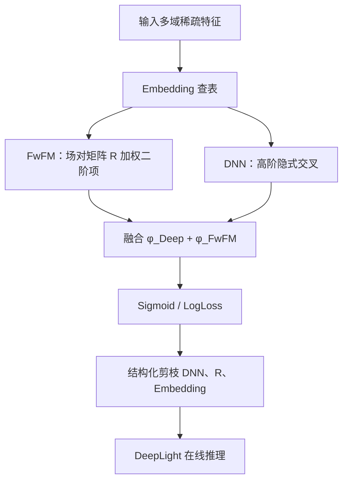

# DeepLight: Deep Lightweight Feature Interactions for Accelerating CTR Predictions in Ad Serving (DeepLight：用于加速广告点击率预估的深度轻量特征交叉)

- **会议/期刊**: WSDM 2021
- **作者与机构**: Wei Deng, Junwei Pan, Tian Zhou, Deguang Kong, Aaron Flores, Guang Lin；Purdue University / Yahoo Research
- **推荐链路定位**: 精排（CTR 预估与在线广告服务）
- **研究方向**: CTR/CVR 预估与特征交叉 / 工业级架构与系统加速
- **论文原文**: [https://arxiv.org/abs/2002.06987v3](https://arxiv.org/abs/2002.06987v3)
- **开源代码**: [https://github.com/WayneDW/DeepLight_Deep-Lightweight-Feature-Interactions](https://github.com/WayneDW/DeepLight_Deep-Lightweight-Feature-Interactions)

## TL;DR (1分钟核心速览)

针对 CTR 深度模型在线服务延迟高、参数多的问题，本文先提出 DeepFwFM：用场对重要性矩阵 $\boldsymbol{R}$加强二阶交叉并保持近 DeepFM 复杂度；再对 DNN、$\boldsymbol{R}$ 与嵌入做结构化幅度剪枝，得到 DeepLight。Criteo/Avazu 随机划分、LogLoss/AUC 评估下，Criteo 46×、Avazu 27× 推理加速且 AUC 不降（Criteo 高精度版 AUC 0.8123，Avazu 0.7897）。

## Background & Motivation (背景与核心矛盾)

- **主流范式**: Embedding + 浅层显式交叉 + DNN 隐式高阶交叉，DeepFM、NFM、xDeepFM、AutoInt 等不断提升 AUC。
- **前人局限**: xDeepFM 的 CIN 复杂度 $O(nkh^2cl)$，Criteo 上推理 40.85 ms，远高于 DeepFwFM 的 4.271 ms；DeepFM 的低阶 FM 对所有场对共享内积，缺少场对权重适配局部几何，矩阵分解也更易病态。
- **核心洞察 (Key Insight)**: DeepFwFM 的 DNN、场对矩阵 $\boldsymbol{R}$ 和嵌入向量在训练后均呈近似稀疏结构；剪枝后的过参数网络优于直接训练的小网络，且嵌入剪枝主要换内存。
- **本文切入点**: 用场对矩阵作为二阶交叉的“预条件器”，再对三个组件分别做结构化剪枝，同时满足高精度、低延迟、低内存（C1–C3）。

## Method (核心方法设计)

### 1. 整体框架 (Overall Architecture)

DeepFwFM 将多域稀疏特征查表为嵌入，浅层用 FwFM 学习二阶场对交叉，深层用 MLP 学习高阶隐式交叉，二者相加后经 Sigmoid 输出 CTR。训练完成后，DeepLight 按幅度对 DNN 权重、场对矩阵 $\boldsymbol{R}$与嵌入向量分阶段剪枝，并在稀疏结构上用 CRS 推理；DNN 剪枝先消除主要延迟，$\boldsymbol{R}$ 剪枝继续压缩浅层，嵌入剪枝主要降内存。整体不改变模型形式，只改变推理时结构。

### 2. 关键设计拆解 (Key Designs)

1. **DeepFwFM 场对加权二阶交叉**：针对 DeepFM 的 FM 对所有场对共享内积、无法适配局部几何的问题，引入场对权重 $R_{F(i),F(j)}$，将二阶项改为
   $\phi_{\text{FwFM}}(\boldsymbol{v},\boldsymbol{e},\boldsymbol{R})=w_0+\sum_i x_i\langle\boldsymbol{e}_i,\boldsymbol{v}_{F(i)}\rangle+\sum_{i<j}x_ix_j\langle\boldsymbol{e}_i,\boldsymbol{e}_j\rangle R_{F(i),F(j)}$。
   直觉上它像对交互矩阵分解做预条件，增强数值稳定性，同时浅层复杂度仅 $O(n^2k)$，远低于 CIN。

2. **三组件结构化剪枝**：痛点在线服务中 DNN 是延迟瓶颈、嵌入是内存瓶颈。DeepLight 分别剪 DNN 权重（不含 bias）、场对矩阵 $\boldsymbol{R}$和嵌入元素；每轮按幅度剪底部$s_X\%$，并自适应提高稀疏率
   $s_X \leftarrow S_X(1-\mathcal{D}^{k/\Omega})$。
   其中剪 $\boldsymbol{R}$ 等价于场对选择，剪嵌入等价于去掉噪声估计并省内存。

3. **训练目标、负采样与推理效率**：CTR 采用 pointwise 二分类，损失为
   $\mathcal{L}=-\frac{1}{|\mathcal{D}|}\sum_{(y,\boldsymbol{x})\in\mathcal{D}}[y\log\hat{y}+(1-y)\log(1-\hat{y})]+\lambda\|\boldsymbol{\Theta}\|_2^2$。
   训练免负采样，使用 Adam；推理时稀疏 DNN 接近 $1/(1-S_{\text{dnn}})$加速，但$S_{\text{dnn}}>95\%$后受 bias 与 CRS 开销限制；$\boldsymbol{R}$ 剪枝在 DNN 剪枝后成为进一步加速关键。

## Experimental Setup & Evaluation Protocol (实验设置与评估协议)

- **数据集与预处理**: CTR 日志无 5-core 过滤；类别特征低频统一置 UNK。

| 数据集 | #训练样本 | #Fields | #数值特征 | #特征数 | 过滤/划分 |
| :--- | :---: | :---: | :---: | :---: | :--- |
| Criteo | 41.3M | 39 | 13 | 1.33M | 频次 <8 置 UNK；90%/10% 随机划分 |
| Avazu | 32.3M | 23 | 0 | 1.54M | 频次 <5 置 UNK；80%/20% 随机划分 |

- **数据划分与防穿越 (Splitting Strategy)**: 采用随机比例划分，**非**全局时间戳切分或冷启动划分；因此存在一定时间泄漏风险。
- **排名评测协议 (Ranking Protocol)**: CTR 二分类 pointwise 评估，非 Top-K Full-Ranking 或 Sampled Ranking；AUC 在全样本上计算，训练未使用负采样，无正负采样比。
- **对比基线与超参设置**: 基线为 LR、FM、FwFM、DeepFM、NFM、xDeepFM；Criteo 嵌入维度 $d=10$、Avazu$d=20$，DNN 分别 400×400×400 与 300×300×300，Adam，batch 2048，L2 为 3e-7/6e-7。原文未报告显著性检验。

## Key Experimental Results (实验关键数据)

### 1. 主实验对比 (Main Results)

| 模型 | Criteo LogLoss | Criteo AUC | Criteo 延迟/ms | Avazu LogLoss | Avazu AUC | Avazu 延迟/ms |
| :--- | :---: | :---: | :---: | :---: | :---: | :---: |
| LR | 0.4615 | 0.7881 | **0.001** | 0.3904 | 0.7617 | **0.001** |
| FM | 0.4565 | 0.7949 | 0.005 | 0.3816 | 0.7782 | 0.009 |
| FwFM | 0.4466 | 0.8049 | 0.145 | 0.3764 | 0.7866 | 0.105 |
| DeepFM | 0.4495 | 0.8036 | 4.181 | 0.3780 | 0.7852 | 2.719 |
| NFM | 0.4497 | 0.8030 | 4.091 | 0.3777 | 0.7854 | 2.704 |
| xDeepFM | 0.4420 | 0.8102 | 40.85 | **0.3749** | **0.7894** | 7.129 |
| DeepFwFM | **0.4403** | **0.8116** | 4.271 | 0.3751 | 0.7893 | 2.824 |

相对提升：Criteo 上 DeepFwFM 较 xDeepFM AUC **+0.14%**、LogLoss **−0.38%**；Avazu 上 AUC **−0.01%**、LogLoss **+0.05%**（基本持平），但延迟为 xDeepFM 的约 1/2.5。相对 LR，AUC 分别提升 **+2.98%** 与 **+3.62%**。

### 2. 消融实验 (Ablation Study)

下表以 D/R/Emb 表示 DNN、场对矩阵、嵌入的稀疏率：

| 数据集/设置 | D/R/Emb | LogLoss | AUC | #Params | 延迟/ms |
| :--- | :---: | :---: | :---: | :---: | :---: |
| Criteo 不剪枝 | 0/0/0 | 0.4403 | 0.8116 | 13.74M | 4.271 |
| Criteo 高精度 | 90/90/40 | **0.4395** | **0.8123** | 8.01M | 0.469 |
| Criteo 低内存 | 90/90/90 | 0.4404 | 0.8114 | 1.38M | 0.472 |
| Criteo 低延迟 | 99/95/40 | 0.4405 | 0.8114 | 7.41M | **0.093** |
| Avazu 不剪枝 | 0/0/0 | 0.3751 | 0.7893 | 31.21M | 2.824 |
| Avazu 高精度 | 90/90/20 | **0.3748** | **0.7897** | 24.81M | 0.422 |
| Avazu 低内存 | 90/90/60 | 0.3753 | 0.7892 | 9.32M | 0.318 |
| Avazu 低延迟 | 98/90/0 | 0.3753 | 0.7894 | 30.86M | **0.104** |

### 3. 关键实验发现 (Key Findings)

- **DNN 剪枝反而略升精度**：Criteo 在 90%–95% 稀疏率下 AUC 达 0.8120，高于 dense 的 0.8115，并获约 7×–11× 加速；对应小网络 N-15 仅 0.8078，说明“过参数+剪枝”优于直接小模型。
- **$\boldsymbol{R}$剪枝是第二加速杠杆**：DNN 已 99% 稀疏后，Criteo 再将$\boldsymbol{R}$ 剪至 95% 可达 46×（0.093 ms），AUC 0.8114；Avazu 在 98%/90% 下达 27×（0.104 ms），AUC 0.7894。
- **嵌入剪枝主要换内存**：Criteo 80% 嵌入稀疏仍保持 AUC 0.8114，低内存版参数从 13.74M 降至 1.38M；Avazu 在 60% 后开始明显掉点，说明嵌入稀疏率需按数据集敏感度调。

## Highlights & Limitations (亮点、对比与审稿批判)

- **与代表作对比 (vs. Prior Work)**: 相比 xDeepFM 用 CIN 堆高阶交叉，DeepFwFM 用场对矩阵低成本增强二阶项，精度相当但快约 10×；相比 DeepFM，它补充场对权重；相比 FwFM，它保留 DNN 高阶能力并可整体剪枝。
- **可迁移亮点**: “场对矩阵作为预条件器”可迁移到其他 FM 类精排；组件级稀疏率调度与 CRS 推理适合在线低延迟部署。
- **审稿级局限批判**: 随机划分而非时间切分，离线延迟与线上 QPS/超时未验证；高稀疏率对数据集较敏感，且原文未给显著性检验，部分正文 AUC 数字与表格存在不一致（如 0.8223 vs 0.8123）。

## Rating (四维评分)

- **方法创新性 (Novelty)**: ⭐⭐⭐⭐ （首次系统地将结构化剪枝用于 embedding-based CTR 的 DNN、场矩阵与嵌入三组件，FwFM 本身非全新但组合与加速视角有新意）
- **评估协议与实验扎实度 (Protocol & Experiments)**: ⭐⭐⭐ （两大数据集、延迟/内存/参数齐全，但随机划分、无时间切分/显著性/线上 A/B）
- **写作与数学规范度 (Clarity & Rigor)**: ⭐⭐⭐⭐ （复杂度、剪枝算法与公式清楚，但个别表格与正文数值不一致）
- **工业落地与复现价值 (Industrial & Practical Value)**: ⭐⭐⭐⭐⭐ （开源完整，Criteo 46×/Avazu 27× 且 AUC 基本不降，直接契合广告精排低延迟低内存需求）

