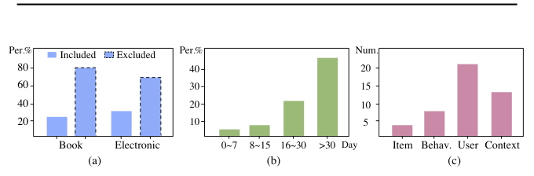
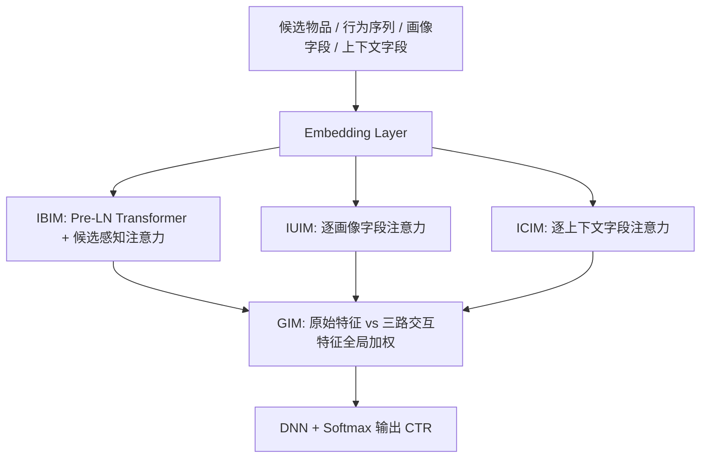
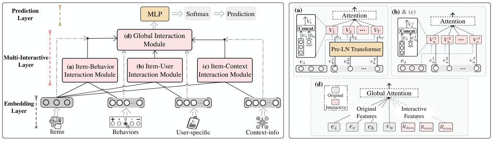

# Multi-Interactive Attention Network for Fine-grained Feature Learning in CTR Prediction（面向细粒度特征学习的多交互注意力网络）

- **会议/期刊**: WSDM 2021
- **作者与机构**: Kai Zhang, Hao Qian, Qing Cui, Qi Liu 等，中国科学技术大学 + 蚂蚁集团
- **推荐链路定位**: 精排（CTR 预估）
- **研究方向**: CTR/CVR 预估与特征交叉 / 序列与会话推荐
- **论文原文**: [https://arxiv.org/abs/2012.06968v3](https://arxiv.org/abs/2012.06968v3)
- **开源代码**: [DeepCTR-Torch](https://github.com/shenweichen/DeepCTR-Torch)（基线实现库，MIAN 本体未单独开源）

## TL;DR (1分钟核心速览)

针对 DIN/DIEN 类序列模型"只看行为、不看属性"的三处失效（候选物品与历史行为无关、用户近期不活跃、行为表征在不同特征子空间下被压成单一向量），MIAN 用单个 Pre-LN Transformer 编码行为序列，并把候选物品分别与**每一条**用户属性字段、**每一条**上下文字段做局部注意力交互，最后由全局注意力权衡低阶原始特征与三路高阶交互表征。在 Amazon Book/Electro 与支付宝商业数据上 AUC 相对最优基线提升 0.61%/0.87%/0.37%，Logloss 下降 2.0%–7.3%，线上 10 天 A/B 的 CTR +0.41%、成本 -0.27%。

## Background & Motivation (背景与核心矛盾)

- **主流范式**: CTR 侧以 Wide&Deep / DCN / xDeepFM 做显式高阶交叉，序列侧以 DIN 的候选感知注意力和 DIEN 的 GRU 兴趣演化建模用户历史行为。
- **前人局限**: ① DIN/DIEN 把所有非行为特征（画像、上下文）压成一个向量并联进 MLP，丢失了"机械键盘 ↔ 程序员职业"这类字段级关联；② 序列注意力假设候选物品与历史行为存在相关性，但电商中大量候选物品从未出现在用户历史里（图 3(a)），注意力在空集上退化为噪声；③ 用单一子空间表征历史行为，忽略了"T 恤"在夏天与冬天应被激活为不同表征。
- **核心洞察 (Key Insight)**: 真实系统中细粒度画像/上下文信息量远大于稀疏行为（图 3(c) 商业数据仅有 41 个物品但属性极多，且 >50% 行为发生在 30 天前），**当行为缺失或过时时，字段级属性-候选交互是更可靠的兴趣证据**。
- **本文切入点**: 不做"行为 vs 属性"的二选一，而是并行构造三路局部交互 + 一路全局加权，让模型在行为充分时依赖 IBIM、在行为稀疏时自动转向 IUIM/ICIM。

<figure class="paper-figure" markdown="span">
  <figcaption>图3：(a) 候选物品包含在先前行为中的概率。(b) 在Amazon数据集中，用户历史行为的数量分布。(c) 商业数据集不同特征组中细粒度属性的数量。</figcaption>
</figure>

## Method (核心方法设计)

### 1. 整体框架 (Overall Architecture)

四组特征（候选物品 $e_i$、行为序列$e_b=[e^1_b,\dots,e^T_b]$、画像字段$e_u=[e^1_u,\dots,e^J_u]$、上下文字段$e_c=[e^1_c,\dots,e^K_c]$）经 Embedding 层投影后进入 Multi-Interactive Layer：IBIM 用 Pre-LN Transformer 得到每步隐状态再与候选物品拼接做注意力汇聚；IUIM/ICIM 把候选物品分别与每个画像/上下文字段拼接后逐字段打分加权；GIM 将 4 个原始表征与 3 个池化后的交互表征共 7 个向量做全局注意力重加权；最后 DNN + softmax 输出点击概率，交叉熵端到端训练。

<figure class="paper-figure" markdown="span">
  <figcaption>图2：MIAN的架构。总体自底向上可分为三层：1. Embedding Layer，将稀疏异构特征投影为低维向量。2. Multi-Interactive Layer，包含三个局部模块，即(a)、(b)、(c)，以及一个全局模块，即(d)，用于学习多种细粒度特征交互。3. Prediction Layer，包含DNN进行CTR预测。</figcaption>
</figure>

### 2. 关键设计拆解 (Key Designs)

1. **IBIM：Pre-LN Transformer + 逐步候选交互汇聚**：RNN 难以并行且无法建模行为间长程依赖 $\to$将层归一化前置于多头自注意力与 FFN（Pre-LN）以稳定深层训练，再把每步隐状态与候选物品拼接后打分：$\alpha_t=\frac{\exp(\tanh(V_t W_t+b_t))}{\sum_{t'}\exp(\tanh(V_{t'}W_t+b_t))}$，其中$V_t=[e_i;h_t]$，输出$R_{ibim}=\sum_{t}\alpha_t V_t$。直觉：自注意力在$h$ 个头上天然切出多个子空间表征，恰好回应"T 恤在不同季节被激活为不同向量"的需求。
2. **IUIM / ICIM：字段级细粒度交互**：把画像/上下文从"一个拼接大向量"拆成 $J$/$K$个字段，逐个与候选物品拼接后单独打分：$R_{iuim}=\sum_{j}\alpha_j V^j_u,\ \alpha_j=\mathrm{softmax}_j(\tanh([e_i;e^j_u]W^j_u+b^j_u))$，ICIM 同理得$R_{icim}$。这不是把 concat 换个写法——它为每个字段保留独立的打分函数，使模型能显式判断"哪个属性与当前候选相关"，从而在行为为空时仍有可解释的兴趣证据。
3. **GIM 与训练目标**：低阶原始特征与高阶交互特征的重要性不 fixed $\to$拼接$r_g=[e_i;e_c;e_b;e_u;P(R_{ibim});P(R_{iuim});P(R_{icim})]$（$P$为池化）后用全局注意力$R_g=\sum_l \beta_l r_l,\ \beta_l=\mathrm{softmax}_l(\tanh(r_l W_l+b_l))$加权。损失为常规交叉熵$\mathcal{L}=-y\log\hat{y}-(1-y)\log(1-\hat{y})$，无显式负采样（CTR 用曝光日志天然构成负样本）。推理时仅多一个 Transformer block 与 3 组轻量注意力打分，单 epoch 耗时 3700s（DIN 3143s、DIEN 4073s），介于两者之间。

## Experimental Setup & Evaluation Protocol (实验设置与评估协议)

- **数据集与预处理**: 过滤掉历史行为过少的用户与物品以缓解稀疏（论文未给出具体阈值，属复现风险点）。

| 数据集 | #Users | #Items | #Interactions | 特征/场景说明 |
| :--- | :---: | :---: | :---: | :--- |
| Amazon Book | 603,668 | 367,982 | 8,900,038 | 评论按 log time 排序作行为序列，含丰富文本元数据 |
| Amazon Electro | 192,403 | 63,001 | 1,689,188 | 同上，电子品类 |
| Commercial (Alipay) | 2,163,147 | 41 | 36,096,332 | 30 天点击日志，41 类候选物品，画像/上下文字段极多 |

- **数据划分与防穿越**: Amazon 采用 `Leave-Last-Out`（前 $T-1$次行为预测第$T$ 次是否发生）；商业数据为 `全局时间戳切分`（前 29 天行为 → 预测第 30 天是否点击），严格无穿越。
- **排名评测协议**: 非排序评测，采用 CTR 领域标准的逐曝光二分类指标 **AUC** 与 **Logloss**（未做 Full-Ranking，也未报告 GAUC/采样负例比）。
- **对比基线与超参**: LR / Wide&Deep / DCN / DeepFM / xDeepFM / DIN / DIEN 共 7 个基线，均基于 DeepCTR-Torch 按原文调参复现。MIAN 用 Adam（lr=0.001, $\beta_1$=0.9,$\beta_2$=0.999），序列长度 30，MLP 维度 32/8，Transformer 头数 8，batch 128，dropout 0.2，$l_2$=0.001，截断正态初始化 std=0.02。

## Key Experimental Results (实验关键数据)

### 1. 主实验对比 (Main Results)

| 模型 | Book AUC | Book Logloss | Electro AUC | Electro Logloss | Commercial AUC | Commercial Logloss |
| :--- | :---: | :---: | :---: | :---: | :---: | :---: |
| LR | 0.7876 | 0.4401 | 0.8214 | 0.2116 | 0.7584 | 0.3334 |
| Wide&Deep | 0.7932 | 0.4228 | 0.8385 | 0.2033 | 0.7611 | 0.3299 |
| DCN | 0.7995 | 0.4236 | 0.8540 | 0.1824 | 0.7646 | 0.3197 |
| DeepFM | 0.8067 | 0.4188 | 0.8636 | 0.1708 | 0.7609 | 0.3297 |
| xDeepFM | 0.8089 | 0.4174 | 0.8683 | 0.1662 | 0.7610 | 0.3301 |
| DIN | 0.8145 | 0.4113 | 0.8807 | 0.1273 | 0.7612 | 0.3205 |
| DIEN | 0.8159 | 0.4100 | 0.8836 | 0.1225 | 0.7634 | 0.3151 |
| **MIAN** | **0.8209** | **0.4018** | **0.8913** | **0.1136** | **0.7674** | **0.3097** |
| Improv. | +0.61% | -2.0% | +0.87% | -7.3% | +0.37% | -1.7% |

### 2. 消融实验 (Ablation Study)

| 变体 | Book AUC | Book Logloss | Electro AUC | Electro Logloss |
| :--- | :---: | :---: | :---: | :---: |
| MIAN (full) | **0.8209** | **0.4018** | **0.8913** | **0.1136** |
| w/o IBIM | 0.8154 | 0.4104 | 0.8843 | 0.1214 |
| w/o IUIM | 0.8187 | 0.4066 | 0.8875 | 0.1197 |
| w/o ICIM | 0.8194 | 0.4058 | 0.8902 | 0.1141 |
| w/o GIM | 0.8189 | 0.4060 | 0.8872 | 0.1186 |
| w/o IUIM & ICIM | 0.8166 | 0.4079 | 0.8846 | 0.1220 |
| DIEN（最优基线） | 0.8159 | 0.4100 | 0.8836 | 0.1225 |

### 3. 关键实验发现 (Key Findings)

1. **序列内子空间编码是主增益来源**：去掉 IBIM 使 Book AUC 从 0.8209 掉到 0.8154（-0.55pt），是所有单模块移除中损失最大的，甚至超过同时移除 IUIM+ICIM 的 -0.43pt；即便如此，"w/o IUIM&ICIM" 仍达 0.8166 > DIEN 0.8159，说明 Pre-LN Transformer 本身对行为的表征就优于 GRU + 候选注意力。
2. **细粒度属性在行为稀疏场景补位最明显**：Electro 上 w/o IUIM 使 AUC 下滑 0.38pt 且 Logloss 从 0.1136 恶化到 0.1197（-5.4%），远超 Book 上同设置的 0.22pt；而商业数据集（仅 41 个物品、行为稀疏）中 MIAN 相对 DCN 取得 +0.37% AUC，与"行为不足时属性接管"的动机一致。
3. **Pre-LN 是效率与效果双赢的工程细节**：商业数据上 Pre-LN 相比原版 Transformer AUC 0.7674 vs 0.7662、Logloss 0.3097 vs 0.3103，且收敛曲线更平滑；训练耗时 3700s/epoch 低于 DIEN 的 4073s（GRU 难以并行），高于 DIN 的 3143s。线上 10 天 A/B 相对 DCN 稳定取得 CTR +0.41%、成本 -0.27%。

## Highlights & Limitations (亮点、对比与审稿批判)

- **与代表作对比 (vs. Prior Work)**: 与 DCN/xDeepFM 相比，MIAN 多了完整的序列建模通路；与 DIN/DIEN 相比，核心差异不是换序列编码器，而是**把画像与上下文从"一个大向量"拆成字段级集合**并逐条与候选物品交互——这正是 DIEN 之后被后续 Fi-GNN/AutoInt 一类工作继承的思路。
- **可迁移亮点**: ① 逐字段注意力打分器（$O(J+K)$ 个轻量 MLP）可低成本嵌入任何 CTR 模型的特征侧；② GIM 显式对"原始低阶 vs 各交互模块高阶"做加权而非直接 concat，天然具备线上 bad-case 归因能力（图 6 的可视化即为此用途）。
- **审稿级局限批判**: ① 序列长度硬截断为 30，而论文自述 >50% 行为发生在 30 天前，却未引入时间间隔 embedding，**时效性痛点其实并未被真正解决**；② 评测仅有 AUC/Logloss，无 Full-Ranking、无 GAUC、无多次运行的方差与显著性检验（线上仅称 "statistically significant"），且正文把商业集提升误写为 "3.7% of AUC"，与表格 0.37% 矛盾；③ GIM 的注意力只作用于 7 个向量，且三路局部模块参数随字段数线性膨胀，在字段数百级的真实系统中在线延迟需重新评估。

## Rating (四维评分)

- **方法创新性 (Novelty)**: ⭐⭐⭐ （把"逐字段注意力交互 + 序列 Transformer + 全局加权"组合得干净有效，但每个组件单独看均非首创，属系统性工程创新）
- **评估协议与实验扎实度 (Protocol & Experiments)**: ⭐⭐⭐⭐ （三数据集 + 真实线上 A/B + 完整消融与效率对比，但缺显著性检验与排序类指标，数据过滤阈值未披露）
- **写作与数学规范度 (Clarity & Rigor)**: ⭐⭐⭐ （公式与符号定义清晰、图示充分，但商业集提升数字前后矛盾，且多处公式排版存在 OCR 级噪声）
- **工业落地与复现价值 (Industrial & Practical Value)**: ⭐⭐⭐⭐ （蚂蚁真实系统部署验证、开源基线库可直接复现、开销介于 DIN 与 DIEN 之间，迁移成本低）

