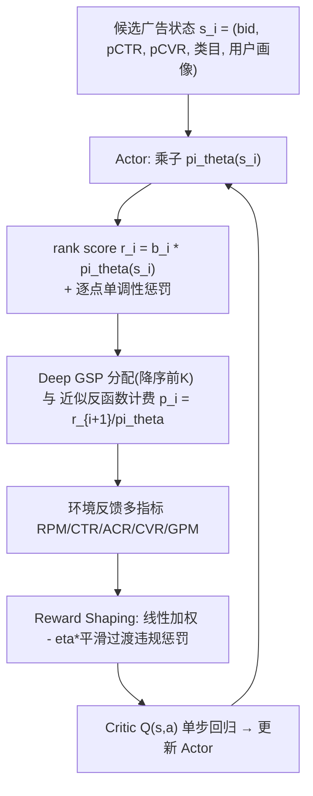
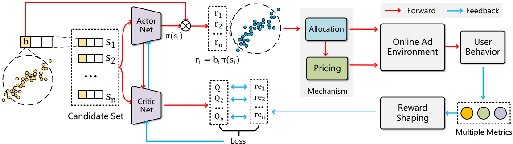

# Optimizing Multiple Performance Metrics with Deep GSP Auctions for E-commerce Advertising (电商广告中基于 Deep GSP 拍卖的多性能指标联合优化)

- **会议/期刊**: WSDM 2021 (ACM International Conference on Web Search and Data Mining)
- **作者与机构**: Zhilin Zhang, Xiangyu Liu, Zhenzhe Zheng, Chenrui Zhang, Miao Xu, Junwei Pan, Chuan Yu, Fan Wu, Jian Xu, Kun Gai（阿里巴巴、上海交通大学、北京大学、Yahoo Research）
- **推荐链路定位**: 精排（拍卖机制内的排序与计费模块）
- **研究方向**: CTR预估与特征交叉 / 强化学习与动态探索推荐
- **论文原文**: [https://arxiv.org/abs/2012.02930v2](https://arxiv.org/abs/2012.02930v2)
- **开源代码**: 暂未开源

## TL;DR (1分钟核心速览)

电商广告需要同时优化 RPM、CTR、CVR、GPM 等多个互相冲突、且难以解析预估的指标，而 GSP 的静态 rank score（$bid\times pCTR^{\sigma}$）只能针对单一目标调参。本文提出 Deep GSP：用深度网络构造新 rank score$r_i=b_i\cdot\pi_\theta(b_i,\mathbf{x}_i)$，通过逐点单调性惩罚保证出价单调分配、通过$\epsilon$-平滑过渡约束控制机制切换时广告主效用波动，并把机制学习建模为单步 RL，用 DDPG 训练。淘宝离线仿真中 Pareto 前沿全面优于 GSP/uGSP，线上 1% A/B 六组配置下 RPM 与转化类指标实现"低成本共赢"（如 RPM&GPM 组 GPM +38.7%、CTR +3.3%，RPM 仅 +0.2%）。

## Background & Motivation (背景与核心矛盾)

- **主流范式**: 广告平台普遍使用 GSP 及其变体，以 $r_i = bid_i \times pCTR_i^{\sigma}$或$r_i=\lambda_1 b_i pCTR_i + \lambda_2 pCTR_i + \lambda_3 pCVR_i$（uGSP）作为排序分，按临界出价计费。
- **前人局限**: 其一，rank score 形式过于静态、线性，用户"曝光→点击→加购→下单"的长链条指标（如 GPM、RPM）在 rank score 中无法显式建模，仅调 $\sigma$或$\lambda$ 无法刻画特征间的复杂交互；其二，基于 Myerson 理论的可信拍卖（如 Bachrach 等）依赖对每个指标的精确预测，而 RPM/GMV 这类指标只能靠曝光后的真实反馈评估，预测误差会直接破坏最优性。
- **核心洞察 (Key Insight)**: 机制学习与 RL 的探索过程天然同构——机制即策略，曝光后的真实指标即 reward；只要能保证 rank score 对出价单调，Myerson 定理所要求的激励相容性（单坑）与多坑下的对称纳什均衡（SNE）性质依然成立，因此深度网络可以"安全地"嵌入 GSP 框架。
- **本文切入点**: 以"单调网络 rank score + 近似反函数计费 + $\epsilon$ 平滑过渡"三件套替换 GSP 排序分，并用 DDPG 直接从真实反馈中优化多指标加权目标。

## Method (核心方法设计)

### 1. 整体框架 (Overall Architecture)

给定候选广告集合，每个广告 $i$的状态$s_i=(b_i,\mathbf{x}_i)$包含出价、$pCTR/pACR/pCVR$、类目、价格、预算、用户画像等特征。Actor 网络输出乘子$\pi_\theta(s_i)$并与出价相乘得到 rank score$r_i$，随后按$r_i$降序分配前$K$ 个坑位，按近似临界出价计费；同时把分配/计费结果投入仿真或线上环境，观察 RPM/CTR/ACR/CVR/GPM 的真实实现值，经 reward shaping（含平滑过渡惩罚）后送入 Critic 网络更新 Actor。训练为单步决策，无需建模状态转移，每 15 分钟在线增量更新一次。

<figure class="paper-figure" markdown="span">
  <figcaption>图2：基于强化学习实现 Deep GSP 拍卖的框架。Actor 网络接收状态 {𝑠𝑖}𝑛</figcaption>
</figure>

### 2. 关键设计拆解 (Key Designs)

1. **带单调性惩罚的深度 rank score（可微约束替代架构约束）**：前人用非负权重约束或特殊网络结构（如 lattice/单调 MLP）保证单调，训练复杂度高、难与已部署模型兼容。本文直接在损失中加入逐点梯度惩罚，并在 $r_i=b_i\pi_\theta$ 分解下改写为：
$$\mathcal{L}_{mono}=\sum_{i=1}^{N}\max\!\left(0,-\left(\pi_\theta(b_i,\mathbf{x}_i)+b_i\nabla_{b}\pi_\theta(b_i,\mathbf{x}_i)\right)\right)$$
它只约束"排序分对出价不降"这一必要性质，与网络结构解耦，因此可复用任意 DNN；物理直觉是"出价更高不应更容易输"，这正是 Myerson 单坑 IC 与多坑 SNE 成立的充分条件。

2. **近似反函数计费（免二分、免矩阵求逆）**：精确计费需对 $R_\theta(\cdot,\mathbf{x}_i)$求逆或二分搜索重建网络，线上十毫秒级预算不可接受。作者观察到乘子$\pi_\theta$ 对出价不敏感（实验验证），故在计费时视其为常数：
$$p_i=\frac{r_{i+1}}{\pi_\theta(b_i,\mathbf{x}_i)}$$
即"用下一名排序分除以自己的质量乘子"回推出价，把 GSP 的 second-price 逻辑推广到非线性打分；代价是 IC 仅在近似意义下成立（实测 i-SIC≈0.98–0.99，PER≈1.0）。

3. **平滑过渡约束与单步 DDPG 训练**：业务目标随时切换（日常偏 RPM、大促偏 CVR/GMV），若新旧机制差异过大广告主效用会剧烈震荡。作者设基准机制 $\mathcal{M}_0$并要求$u_i(\mathcal{M})\ge(1-\epsilon)\bar{u}_i(\mathcal{M}_0)$，以$\eta$ 惩罚系数写入 reward：
$$re_i=F(\mathbf{b};\mathcal{M})-\eta\max\!\left(0,(1-\epsilon)\bar{u}_i(\mathcal{M}_0)-u_i(\mathcal{M})\right)$$
由于是单步问题，Critic 目标退化为 $y_i=re_i$（无 bootstrap），可先用日志数据回归预训练 Critic 大幅提升样本效率；Actor 损失$\mathcal{L}(R_\theta)=\frac{1}{N}\sum_i(-Q_\theta(s_i,R_\theta(s_i))+\gamma\mathcal{L}_{mono})$。无负采样概念，全库候选参与同一次拍卖。

## Experimental Setup & Evaluation Protocol (实验设置与评估协议)

- **数据集与预处理**: 淘宝真实广告日志，训练集为 2020-07-04 的 5,000k 条记录，测试集为 2020-07-05 的 870k 条记录，含出价、$pCTR/pACR/pCVR$ 预估值、广告类目与价格、用户画像、流量来源等；因预估值与真实指标存在 gap，另建带预测模块的离线拍卖仿真器生成反馈。

| 数据集 | #Users | #Items(Ads) | #Interactions(日志) | 特征/场景说明 |
| :--- | :---: | :---: | :---: | :--- |
| Taobao-Train | 用户画像匿名 | 广告候选集 | 5,000k | 出价+多任务预估值+类目/价格/预算 |
| Taobao-Test | 同上 | 同上 | 870k | 次日日志，用于仿真与 i-SIC 评估 |

- **数据划分与防穿越 (Splitting Strategy)**: 按**自然日切分**（7/4 训练、7/5 测试），严格时间前后不交叉，避免同请求跨集泄漏。
- **排名评测协议 (Ranking Protocol)**: 非传统 top-N 排序评测，而是**全候选集参与的真实拍卖仿真**（每次请求全部合格广告参与竞价，无负采样），指标可加总口径为 RPM、CTR、ACR、CVR、GPM，另加经济性质指标 $T_m$（Spearman 单调性，用均匀生成出价扰动测试）、PER（与二分精确解之比）、i-SIC（扰动$\pm\alpha$ 的个体阶段 IC）。
- **对比基线与超参设置**: 基线为 GSP（$\sigma\in[0.5,2.0]$网格调优）与 uGSP（$\lambda$线性组合）；Deep GSP 目标权重$\lambda$在$[0,1]$上均匀取值以画 Pareto 曲线，$d$、层宽等未在正文给出，$\gamma$ 调控单调性约束强度；报告误差棒体现稳定性。

## Key Experimental Results (实验关键数据)

### 1. 主实验对比 (Main Results)

**线上 A/B（2020-08-01，1% 全站流量，基线 GSP，相对提升）**：

| Exp | 目标权重配置 | RPM | CTR | ACR | CVR | GPM |
| :--- | :--- | :---: | :---: | :---: | :---: | :---: |
| 1 | 纯 RPM | **+5.2%** | +3.1% | −1.5% | +0.8% | −2.0% |
| 2 | RPM&CTR | −0.3% | **+12.8%** | +5.6% | **+20.0%** | +7.5% |
| 3 | RPM&ACR | +0.7% | +1.5% | **+6.6%** | +6.8% | +8.1% |
| 4 | RPM&CVR | +0.0% | +1.4% | +3.6% | +7.5% | **+31.0%** |
| 5 | RPM&GPM | +0.2% | +3.3% | +2.4% | +3.6% | **+38.7%** |
| 6 | 全指标 | +1.8% | +6.2% | +1.4% | +5.9% | +3.7% |

**离线经济性质验证（表 2，六种权重配置）**：

| Exp | 权重元组 | 单调性 $T_m$ ↑ | 计费误差 PER →1 | i-SIC ↑ |
| :--- | :--- | :---: | :---: | :---: |
| 1 | (1,0,0,0,0) | **0.991** | 1.009 | 0.9878 |
| 2 | (0.5,0.5,0,0,0) | 0.960 | 0.994 | 0.9910 |
| 3 | (0.5,0,0.5,0,0) | 0.978 | 0.988 | 0.9903 |
| 4 | (0.5,0,0,0.5,0) | 0.972 | 0.995 | 0.9817 |
| 5 | (0.5,0,0,0,0.5) | 0.982 | 0.999 | 0.9856 |
| 6 | (0.6,.1,.1,.1,.1) | 0.975 | 0.995 | **0.9941** |

离线 Pareto 曲线（图 3 四个子图，CTR/ACR/CVR/GPM 分别对 RPM）中，Deep GSP 曲线"绝大部分位于 GSP 与 uGSP 上方"，即在同等 RPM 水平下取得更高转化类指标；GSP 在 ACR/CVR/GPM 维度表现最差（因其 rank score 未显式建模这些量）。

### 2. 消融实验 (Ablation Study)

平滑过渡约束的开关即 $\epsilon$ 扫描（表 3，机制从 RPM 目标切换到 CTR 目标）：

| 设置 | $\epsilon$=0.0 | 0.1 | 0.2 | 0.3 | 0.4 | 无 ST 约束 |
| :--- | :---: | :---: | :---: | :---: | :---: | :---: |
| 广告主效用 Adv | **99.92%** | 91.71% | 82.03% | 69.41% | 64.78% | 63.95% |
| 平台目标 Plat | 72.71% | 78.56% | 84.36% | 89.70% | 96.14% | **100%** |

组件级消融（正文定性描述）：去掉逐点单调性惩罚则 $T_m$ 与 IC 无法保证；去掉近似反函数而用二分精确计费，精度不变但单请求需反复前向，无法满足 10ms 约束。

### 3. 关键实验发现 (Key Findings)

1. **多指标可为"帕累托改良"而非零和**：Exp 2 与 Exp 6 显示 CTR +12.8%、CVR +20.0%、GPM +7.5% 时 RPM 仅 −0.3%，全指标组更同时拿到 RPM +1.8%、CTR +6.2%、CVR +5.9%——说明 GSP 的线性 rank score 本身即为性能瓶颈，而非指标之间天然冲突。
2. **单调性约束几乎无损地保住了博弈性质**：$T_m\ge0.96$、PER 稳定在 0.988–1.009、i-SIC≈0.98–0.99，证明"梯度惩罚 + 乘子近似"这一工程化改造在真实数据分布下未破坏 IC；图 4 还显示少数非单调区段均远离真实上报出价，风险可控。
3. **$\epsilon$提供了可量化的效用-收益旋钮**：$\epsilon$ 从 0 增至 0.4 时广告主效用由 99.92% 降至 64.78%，平台目标从 72.71% 升至 96.14%；超过 0.4 后双方变化趋平（广告主自身调价策略对冲），说明存在一个"再压榨也无效"的饱和点。

## Highlights & Limitations (亮点、对比与审稿批判)

- **与代表作对比 (vs. Prior Work)**: 相比 Bachrach 等的可信拍卖（线性组合 rank score + 依赖精确预测），本文把 rank score 换成非线性 DNN 且不要求指标可精确预估；相比 Duetting 等的自动化机制设计（约束优化、无真实反馈、多为单目标），本文直接用曝光后反馈做策略优化；相比 GSP/uGSP，仅增加一个前向网络即可覆盖任意指标组合。
- **可迁移亮点**: ①"梯度惩罚式单调约束"可迁移到任何需要保证"出价/价格/预算单调影响排序"的定价或混排系统（如电商混排、直播打赏排序）；②"单步 RL + Critic 可先用日志回归预训练"的思路适用于无需状态转移的排序策略优化，样本效率远高于常规 DDPG。
- **审稿级局限批判**: ①评估仅有 GSP/uGSP 两个基线，缺少 VCG、深度自动化机制设计（RegretNet 类）等对照，且无量级上的显著性与多次随机种子统计（仅给误差棒）；②近似反函数依赖"$\pi_\theta$对出价不敏感"的经验观察，缺乏该假设的理论误差界；训练用 DDPG 对超参$\gamma,\eta,\epsilon$ 敏感，线上每 15 分钟更新带来的策略抖动与广告主博弈均衡的长期稳定性亦未展开。

## Rating (四维评分)

- **方法创新性 (Novelty)**: ⭐⭐⭐⭐ （把 GSP 排序分升级为受单调性约束的深度网络，并给出 IC/SNE 性质衔接与近似计费，机制设计 × 深度学习的结合点新颖且有理有据）
- **评估协议与实验扎实度 (Protocol & Experiments)**: ⭐⭐⭐ （有真实线上 1% A/B 与仿真器双重验证、经济性质指标设计巧妙，但基线仅 2 个、缺显著性检验与公开数据）
- **写作与数学规范度 (Clarity & Rigor)**: ⭐⭐⭐⭐ （问题形式化、定理引用与算法流程清晰，近似计费的误差分析偏经验、缺上界推导）
- **工业落地与复现价值 (Industrial & Practical Value)**: ⭐⭐⭐⭐⭐ （已在淘宝数万 QPS、单请求 5ms、15 分钟热更新落地，工程细节完整；可惜未开源代码，复现需自建仿真器）

