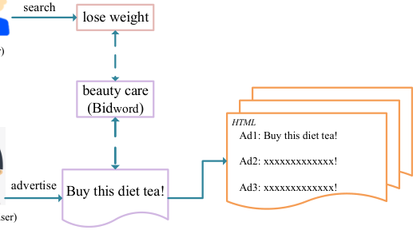
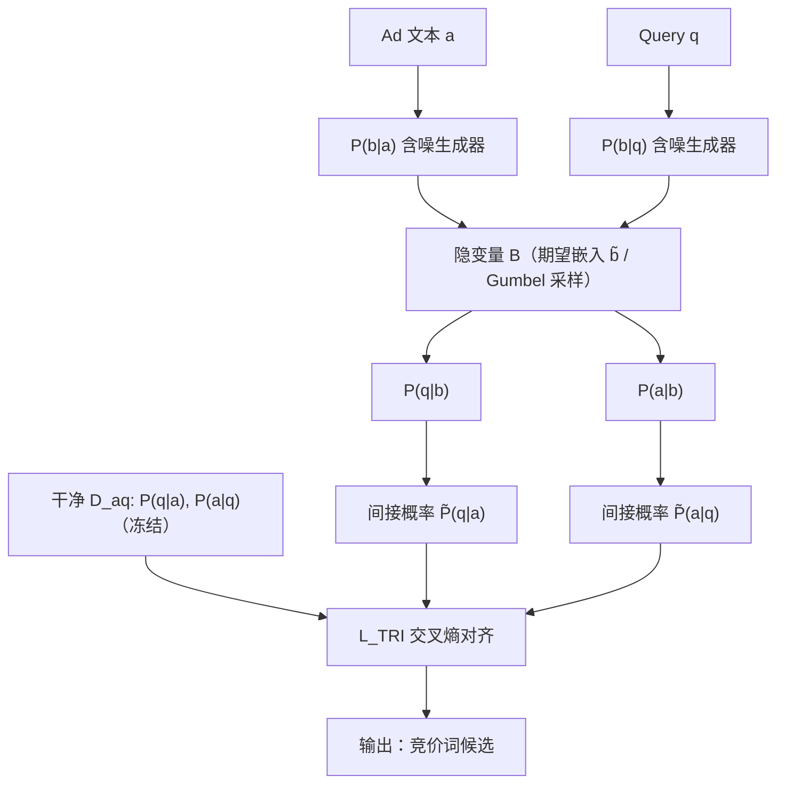
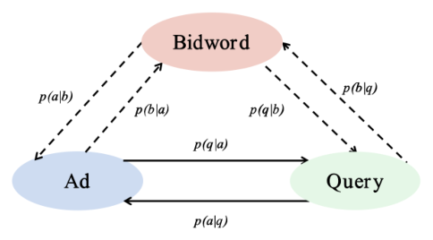

# Triangular Bidword Generation for Sponsored Search Auction (面向赞助搜索拍卖的三角竞价词生成)

- **会议/期刊**: WSDM 2021 (Virtual Event, Israel)
- **作者与机构**: Zhenqiao Song, Jiaze Chen, Hao Zhou, Lei Li（字节跳动 AI Lab）
- **推荐链路定位**: 召回（竞价词/关键词扩展供给，决定广告可被触发的候选池）
- **研究方向**: CTR/CVR 预估与特征交叉（广告检索侧） / 生成式推荐
- **论文原文**: [https://arxiv.org/abs/2101.11349v1](https://arxiv.org/abs/2101.11349v1)
- **开源代码**: 暂未开源

## TL;DR (1分钟核心速览)

赞助搜索拍卖依赖"竞价词"桥接 query 与广告，而 `<query, bidword>`、`<ad, bidword>` 监督对因广告主"蹭热门词"而严重含噪，直接 Seq2Seq 生成质量差。本文提出 TRIDENT：把 bidword 当作 query 与 ad 之间的**隐变量桥**，先用高质量 `<ad, query>` 点击数据训练 $P(q|a)$、$P(a|q)$并冻结，再令$\tilde{P}(q|a)=\sum_b P(q|b)P(b|a)$ 与直连概率对齐（三角互监督）。仅生成式评测下，Ad 侧 Conv-KNRM 由 0.657→0.781（+18.9%），Query 侧 0.801→0.896（+11.9%），线上精确率与 F1 由 0.101→0.150。

## Background & Motivation (背景与核心矛盾)

- **主流范式**: 竞价词供给两条路线——匹配式（TF-IDF / GloVe 池化后余弦检索历史词）与神经式（Transformer Seq2Seq 由 ad 或 query 直接生成，如 MT-A2B、Attn-Q2B）。
- **前人局限**: ①匹配式无法为长尾稀有行业生成新词（query/ad 与已有词库几乎无词重叠），且只能复用历史词；②Seq2Seq 完全依赖训练对，但竞价词对存在"关键词竞价问题"——广告主为提升触发率竞买与商品弱相关的热门词，监督信号系统性偏噪。
- **核心洞察 (Key Insight)**: 噪声只存在于 `<A,B>`、`<Q,B>` 两个方向；而 `<A,Q>` 来自真实点击，量大且干净——是免费的、可用的"干净监督源"。
- **本文切入点**: 借低资源机器翻译中的三角训练思想，令 B 作为 A 与 Q 之间的隐变量，用干净的 $P(q|a)$反向约束含噪的$P(b|a)$，把"学翻译"变成"学概率一致性"。

<figure class="paper-figure" markdown="span">
  <figcaption>图1：赞助搜索拍卖系统示意图。其中“减肥”是用户的搜索查询，“美容护理”是广告主购买的竞价词。</figcaption>
</figure>

## Method (核心方法设计)

### 1. 整体框架 (Overall Architecture)

六个 Transformer-base（6 层编解码、$d=512$）生成器构成一个有向三角形：$A\!\Rightarrow\!Q$、$Q\!\Rightarrow\!A$走干净数据；$A\!\Rightarrow\!B$、$B\!\Rightarrow\!A$、$Q\!\Rightarrow\!B$、$B\!\Rightarrow\!Q$走含噪数据。训练分两阶段：阶段一仅在$D_{aq}$上最大化$A,Q$互信息下界得到$P(q|a;\theta_{aq})$、$P(a|q;\theta_{qa})$并**冻结**；阶段二联合优化$\mathcal{L}=\lambda\mathcal{L}_{\mathrm{MLE}}+(1-\lambda)\mathcal{L}_{\mathrm{TRI}}$，其中$\mathcal{L}_{\mathrm{MLE}}$为含噪四方向的负对数似然，$\mathcal{L}_{\mathrm{TRI}}$用冻结的$P(q|a)$作为"教师分布"去校正经由 B 绕行的间接概率。推理时只在服务端调用$P(b|a)$或$P(b|q)$ 单次解码，三角结构仅存在于训练期，**零额外线上延迟**。

<figure class="paper-figure" markdown="span">
  <figcaption>图2：三角竞价词生成模型（TRIDENT）的架构。实线表示该方向的数据丰富且高质量，虚线表示该方向的数据含有噪声。𝑎、𝑞 和 𝑏 分别表示广告、查询和竞价词。</figcaption>
</figure>

### 2. 关键设计拆解 (Key Designs)

1. **三角间接监督损失 (Triangular Indirect Supervision)**：痛点——$\theta_{ab}$ 只看含噪 `<A,B>` 必然过拟合噪声；做法——用绕行概率约束直连概率
   $\mathcal{L}_{\mathrm{TRI}}=-\sum_{\langle a,q\rangle\in D_{aq}}\big[P(q|a;\theta_{aq})\log\tilde{P}(q|a;\theta_{ab},\theta_{bq})+P(a|q;\theta_{qa})\log\tilde{P}(a|q;\theta_{qb},\theta_{ba})\big],\ \tilde{P}(q|a)=\sum_b P(q|b;\theta_{bq})P(b|a;\theta_{ab})$直觉：$P(q|a)$作为固定教师，要求"经 B 绕行后的$a\!\to\!q$分布"与真实点击分布一致；噪声使$P(b|a)$ 偏向热门泛词，绕行后无法还原具体 query，梯度即迫使 B 收敛到真正能重建 query 的词——等价于对 B 施加了去噪正则。

2. **隐变量的两种可计算化 (TRIDENT-A / TRIDENT-S)**：$\sum_b$对词表指数级不可行。**TRIDENT-A** 用期望词嵌入替代离散枚举：$\tilde{\boldsymbol{b}}_j=\sum_{w\in V}P(w|w_{<j},a;\theta_{ab})\,\mathrm{Emb}(w)$，以$\tilde{P}(q|a)=P(q|\tilde{\boldsymbol{b}})$全可微、无采样方差；**TRIDENT-S** 以$|C|=5$ 采样 + Gumbel-Softmax 近似。A 的"软平均"天然抑制了单点高概率泛词的尖峰，因此更稳。

3. **训练目标、负采样与推理效率**：无负采样（生成式似然训练）；$\lambda\in[0.1,1.0]$网格搜索，取$\lambda=0.6$ 验证困惑度最低——即干净的三角损失权重约 0.4，恰好平衡噪声项与去噪项。推理：**约束式 Beam Search (beam=32)** 强制 32 个候选的**首词互不相同**，首词后转贪心，以低成本换取候选集多样性（广告主可直接挑词）。

## Experimental Setup & Evaluation Protocol (实验设置与评估协议)

- **数据集与预处理**: 自建，来自某商用搜索引擎点击日志，BPE 子词切分；三种数据对统计如下（论文 Table 1）：

| 数据对 | 样本数 | 词表规模 | 平均长度 | 特性说明 |
| :--- | :---: | :---: | :---: | :--- |
| ⟨Ad, Query⟩ A 侧 | 12,998,127 | 119,806 | 16.22 | 干净、来自真实点击 |
| ⟨Ad, Query⟩ Q 侧 | 14,634,482 | 477,684 | 4.67 | 干净、覆盖广 |
| ⟨Ad, Bidword⟩ A 侧 | 188,773 | 28,113 | 18.71 | 含噪（广告主竞买） |
| ⟨Ad, Bidword⟩ B 侧 | 7,338,854 | 188,629 | 4.09 | 含噪 |
| ⟨Query, Bidword⟩ Q 侧 | 11,913,539 | 316,243 | 4.62 | 含噪 |
| ⟨Query, Bidword⟩ B 侧 | 2,540,295 | 103,346 | 2.86 | 含噪 |

- **数据划分与防穿越 (Splitting Strategy)**: 自动评测从每类数据对**随机抽取 5,000 对**作验证/测试；线上模拟实验采用**全局时间戳切分**（2020-01-01 至 07-15 数据，7 月 1 日前训练、之后测试），严格防穿越。
- **排名评测协议 (Ranking Protocol)**: 非检索式排序任务，而是**生成式 Top-32 列表评测**：相关性用 Conv-KNRM（在 `<A,Q>` 点击数据上以 CTR 为相似度标签训练，作为语义相关性代理，避免直接比对含噪金标）；BLEU 衡量与金标词重合；Self-BLEU（↓）与 distinct-3/4（↑）衡量多样性。另有 5 人 3 分制人工评测（50 ad + 50 query，Fleiss' κ = 0.857/0.912/0.803，双尾符号检验 $p<0.05$）。
- **对比基线与超参设置**: 匹配式 TF-IDF / Mean-Pooling / Max-Pooling；神经式 Transformer_base、MT-A2B、Attn-Q2B。Adam、batch 32、lr $1e^{-4}$、4000 步 warmup、100k 步、8×V100-32GB。

## Key Experimental Results (实验关键数据)

### 1. 主实验对比 (Main Results)

| 生成方向 | 模型 | Conv-KNRM↑ (Rel.) | BLEU↑ | Self-BLEU↓ | dist-3↑ | dist-4↑ |
| :--- | :--- | :---: | :---: | :---: | :---: | :---: |
| **Ad→Bid** | TF-IDF | 0.503 | 0.063 | 0.700 | 0.119 | 0.153 |
| | Mean Pooling | 0.548 | 0.098 | 0.679 | 0.147 | 0.209 |
| | Max Pooling | 0.548 | 0.109 | 0.673 | 0.147 | 0.209 |
| | Transformer_base | 0.634 | 0.133 | 0.403 | 0.166 | 0.252 |
| | MT-A2B | 0.657 | 0.149 | 0.483 | 0.153 | 0.236 |
| | TRIDENT-S | 0.753 | 0.151 | 0.362 | 0.168 | 0.279 |
| | **TRIDENT-A** | **0.781** | **0.185** | **0.284** | **0.218** | **0.296** |
| | *Improv.* | *+18.9%* | *+24.2%* | *−41.2%* | *+31.3%* | *+17.5%* |
| **Query→Bid** | TF-IDF | 0.614 | 0.104 | 0.698 | 0.208 | 0.273 |
| | Max Pooling | 0.651 | 0.156 | 0.729 | 0.239 | 0.336 |
| | Transformer_base | 0.783 | 0.186 | 0.404 | 0.258 | 0.387 |
| | Attn-Q2B | 0.801 | 0.209 | 0.517 | 0.243 | 0.358 |
| | TRIDENT-S | 0.853 | 0.205 | 0.352 | 0.286 | 0.397 |
| | **TRIDENT-A** | **0.896** | **0.239** | **0.269** | **0.381** | **0.454** |
| | *Improv.* | *+11.9%* | *+14.4%* | *−48.0%* | *+47.7%* | *+26.8%* |

### 2. 消融实验 (Ablation Study)

| 变体（Query→Bid） | Conv-KNRM↑ | BLEU↑ | Self-BLEU↓ | dist-4↑ |
| :--- | :---: | :---: | :---: | :---: |
| Transformer_base + Beam | 0.800 | 0.175 | 0.639 | 0.211 |
| Transformer_base + Constrained Beam | 0.783 | 0.186 | 0.404 | 0.387 |
| TRIDENT-A + Beam（去 $\mathcal{L}_{\mathrm{TRI}}$） | 0.784 | 0.228 | 0.518 | 0.346 |
| TRIDENT-A + Constrained Beam（完整） | **0.896** | **0.239** | **0.269** | **0.454** |
| w/o 三角损失（= Transformer_base，Ad→Bid） | 0.634 | 0.133 | 0.403 | 0.252 |
| TRIDENT-S（采样替代期望嵌入） | 0.853 | 0.205 | 0.352 | 0.397 |
| 线上硬匹配（<Q,B>）P / R / F1 | 0.214 / 0.115 / **0.150** | — | — | 对照 0.156/0.075/0.101 |

### 3. 关键实验发现 (Key Findings)

1. **三角损失是唯一主增益来源**：去掉 $\mathcal{L}_{\mathrm{TRI}}$ 后 Ad 侧 Conv-KNRM 从 0.781 跌至 0.634（−18.9%），Self-BLEU 由 0.284 升到 0.403；而该跌幅与"是否使用 `<A,Q>` 干净数据"完全同构，说明收益并非来自更大参数量（两者同为 Transformer_base 结构），而是来自干净点击信号的间接正则。
2. **约束 Beam 与前缀多样性是"零成本"增益，但需与三角损失叠加**：单用约束 Beam 时 Transformer_base 的相关性反而从 0.800 降到 0.783；一旦叠加三角训练，同一解码策略把 TRIDENT-A 推至 0.896 且 dist-4 从 0.346→0.454、Self-BLEU 从 0.518→0.269，即"相关性↑与多样性↑"同时达成，证明二者互补而非互斥。
3. **期望嵌入优于采样**：TRIDENT-A 在两方向上一致优于 TRIDENT-S（Ad 侧 +0.028 Conv-KNRM、Query 侧 +0.043），且随 `<A,Q>` 数据量增加单调提升（图 3），说明软平均降方差对含噪监督更稳健；线上硬匹配 F1 0.150 对 0.101（+48.5%）验证生成词确实更贴近广告主真实购买词。

## Highlights & Limitations (亮点、对比与审稿批判)

- **与代表作对比 (vs. Prior Work)**: MT-A2B（多任务学习，ad→bid）与 Attn-Q2B（query→bid 注意力 CTR 模型）都只做**单向、单源**监督，均受同一噪声瓶颈；TRIDENT 首次引入**双向三角**结构，把 `<A,Q>` 从"评测辅助数据"升级为"训练监督源"。相比 Zhou et al. 的 RL 领域约束生成，本文无需人工领域标签与强化学习奖励设计，训练更稳定。
- **可迁移亮点**: ①"干净对↔脏对"三角一致性正则可直接迁移到电商类目预测、短视频标签生成、query-item 类目桥接等场景；②约束式 Beam（首词强制相异 + 后续贪心）是极轻量的列表级多样化技巧，可直接用于生成式召回的多候选输出。
- **审稿级局限批判**: ①TRIDENT-A 每步解码需对全词表 $|V|$（逾 10 万）做加权嵌入求和，训练开销远高于普通 Seq2Seq（8×V100 跑 100k 步），论文未给出收敛时间与显存对比；②评估仍以 BLEU 对比"含噪金标"，与"金标不可信"的核心假设存在逻辑张力，缺乏对噪声鲁棒方法（label smoothing、噪声建模、去偏损失）的对照；③互信息下界推导依赖"$A,Q$ 均匀采样"的假设，与真实 query 频次长尾分布不符，理论上偏松；④数据与代码均不公开，三角框架的可复现性受限。

## Rating (四维评分)

- **方法创新性 (Novelty)**: ⭐⭐⭐⭐ （借用低资源 MT 的三角训练，把 bidword 作为潜变量桥实现干净数据去噪脏数据，思路简洁且首次用于竞价词生成）
- **评估协议与实验扎实度 (Protocol & Experiments)**: ⭐⭐⭐⭐ （自动+人工+线上时间切分三重验证，Fleiss κ 与显著性检验齐全；但缺鲁棒性基线与噪声程度分桶分析）
- **写作与数学规范度 (Clarity & Rigor)**: ⭐⭐⭐⭐ （六生成器与两阶段流程清晰、算法伪代码完整；互信息下界假设偏强，$|V|$ 复杂度分析缺失）
- **工业落地与复现价值 (Industrial & Practical Value)**: ⭐⭐⭐⭐ （三角结构仅存在于训练期、线上单次解码零额外延迟，约束 Beam 低成本；但 8×V100 训练成本与未开源削弱复现价值）

