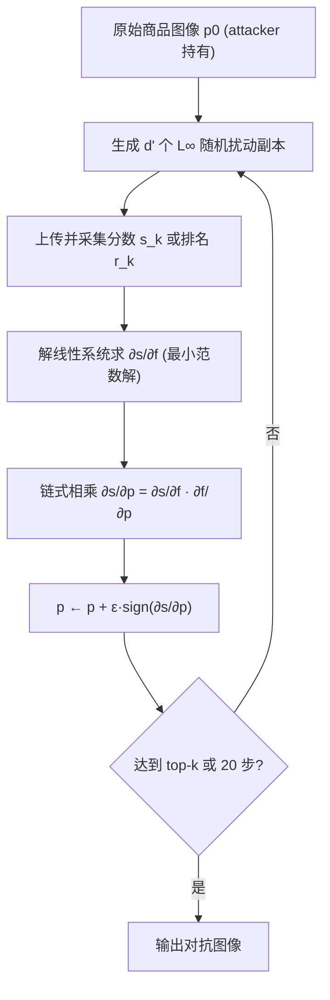

# A Black-Box Attack Model for Visually-Aware Recommender Systems (面向视觉感知推荐系统的黑盒攻击模型)

- **会议/期刊**: WSDM 2021
- **作者与机构**: Rami Cohen (Intuit AI / Bar-Ilan University)、Oren Sar Shalom (Facebook)、Dietmar Jannach (University of Klagenfurt)、Amihood Amir (Bar-Ilan University)
- **推荐链路定位**: 召回打分阶段（物品侧内容评分操纵）
- **研究方向**: 去偏公平、可信隐私与工业架构 / 多模态推荐
- **论文原文**: [https://arxiv.org/abs/2011.02701v1](https://arxiv.org/abs/2011.02701v1)
- **开源代码**: [https://github.com/vis-rs-attack/code](https://github.com/vis-rs-attack/code)

## TL;DR (1分钟核心速览)

视觉感知推荐系统（VBPR/DeepStyle）依赖商家自行上传的商品图片，且图像特征由公开预训练 ResNet 提取——这构成新的攻击面。本文提出**首个纯视觉黑盒推攻击**：将 $\partial s/\partial p$用链式法则分解为可解析的$\partial f/\partial p$与通过随机扰动构造的线性方程组最小范数解估计的$\partial s/\partial f$，并进一步在**仅可见排序、甚至仅见 top-1% 排序**的极端设定下完成攻击。在 Amazon Clothing/Electronics 上，仅 640 次图片上传即可将随机商品推入 53%/27% 用户的 top-20（VBPR, BB-Rank）。

## Background & Motivation (背景与核心矛盾)

- **主流范式**: 视觉感知推荐先用固定预训练的 ImageNet 分类器（ResNet-50）抽取物品图像的 2048 维倒数第二层特征，再由推荐模型学习一个变换矩阵 $E$ 将其注入协同过滤（VBPR 加性融合，DeepStyle 加类别感知映射）。
- **前人局限**: 一是图像由 item provider 通过 API 自行上传，提供商即潜在攻击者；二是已有的推荐攻击几乎全是 shilling（注入虚假画像），而少数视觉攻击工作 [13,50] 假设攻击者可读写模型内部表征或完全掌握模型结构，现实性极低。
- **核心洞察 (Key Insight)**: 图像分类器是**公开且冻结**的，故 $\partial f/\partial p$可解析求出；同时视觉特征维度$d=2048$ 远小于像素维度，因此可在**特征空间**而非像素空间做梯度估计，把黑盒查询量从数万次降到数百次。
- **本文切入点**: 把对抗样本的"输入梯度上升"搬到推荐打分函数上，用线性方程组的**最小 $\ell_2$ 范数解**替代梯度，并给出排序反馈下的分数反演映射。

## Method (核心方法设计)

### 1. 整体框架 (Overall Architecture)

攻击者先对目标商品图像 $p^0$生成$d'$个$L_\infty$球内随机扰动副本并上传，采回各自的个性化分数（或排名），据此解出打分函数对特征向量的梯度估计，再按链式法则右乘图像分类器 Jacobian 得到像素级更新方向，取符号后以步长$\epsilon$迭代修改图像。每一轮迭代重复上述过程，直至商品进入目标用户 top-$k$ 或达到 SSIM 可察觉阈值（实测 20 步 SSIM 降至 0.942，30 步 0.914，故上限设为 20 步）。整个攻击只改推举商品自身图像，故梯度计算在多个 pushed item 间完全解耦。

### 2. 关键设计拆解 (Key Designs)

1. **链式分解的视觉推攻击（White-Box 上界）**：直接对像素求导在工业黑盒下不可行 $\to$利用冻结 IC 模型把梯度拆解为$\frac{\partial s}{\partial p}=\frac{\partial s}{\partial f}\cdot\frac{\partial f}{\partial p}$，其中$\partial f/\partial p$由反向传播精确得到；更新式为$p^{t+1}=p^{t}+\epsilon\cdot\mathrm{sign}(\partial s/\partial p^{t})$。取 sign 的直觉是$L_\infty$ 约束下最大化每步扰动增益，且实验收敛更快。该式给出攻击效果的理论上界。

2. **黑盒梯度估计：随机扰动 $\to$线性方程组（核心创新）**：NES/SPSA 需要高斯采样或对称扰动，在无法控制$f$的场景不可用$\to$作者改为从$p$周围$L_\infty$球均匀采样$d'$个扰动，得到$(\boldsymbol{F},\boldsymbol{s})$，利用线性系统的平移不变性求解$\Delta\boldsymbol{F}^{-1}\Delta\boldsymbol{s}$，即$\partial s/\partial f$。当$d'<d$时方程组欠定，取**最小$\ell_2$范数解**；这不仅降低上传量，更起到正则化作用——$d'=d=2048$的唯一精确解会"过拟合"于单次采样子集，实验证明完全失效；$d'=64$ 时反而效果最佳。

3. **仅排序 / 部分排序反馈下的分数反演**：若只观测排名 $r_k$，则假设扰动分数落在整个分数分布的极小片段内、可用均匀分布近似，得$s_k=1-r_k/N$（平移不变性令$s_{\min}=0$，sign 对缩放不变令$s_{\max}=1$）。若连推送商品都进不了可见列表，引入代理用户$u'$（在原历史中额外加入一件同类别热门商品$i'$），并按线性相关假设反解$\frac{\partial s_{u,i}}{\partial f_i}=\frac{(n+1)\cdot\partial s_{u',i}/\partial f_i-\partial s_{u(i'),i}/\partial f_i}{n}$。

4. **训练目标、查询预算与推理开销**: 攻击本身无需训练；被攻击模型沿用 VBPR/DeepStyle 的 BPR 成对损失与单随机负样本。攻击侧一次迭代需 $d'$次图片上传 + 1 次打分查询，默认$d'=32\sim64$、20 步，总计约 640 次图片更新；对"全体用户"攻击还需每步对$N=200$个 mock 用户并行打分以选出第$p=25\%$ 百分位的活跃目标用户。

## Experimental Setup & Evaluation Protocol (实验设置与评估协议)

- **数据集与预处理**:

| 数据集 | #Users | #Items | #Interactions | 视觉增益 (VBPR vs BPR AUC) |
| :--- | :---: | :---: | :---: | :---: |
| Clothing (Amazon) | 127,055 | 455,412 | 1,042,097 | 23%（0.79 vs 0.64） |
| Electronics (Amazon) | 176,607 | 224,852 | 1,551,960 | 2%（0.85 vs 0.83） |

两个域刻意选取视觉贡献差异极大的组合，用于检验"视觉特征几乎无用"时攻击是否仍成立。

- **数据划分与防穿越**: 随机划分 train/validation 用于超参调优，未做时间戳切分；攻击实验在训练好的固定模型上进行，不存在穿越问题。
- **排名评测协议**: 使用 **Full-Ranking（全库未交互商品排序）** 下的 Hit-Ratio $HR@k=\frac{1}{|S|}\sum_{(u,i)\in S}\mathbb{I}[i\in \text{top-}k(u)]$，$k\in\{1,10,20\}$；"部分排序"设定中攻击者仅可见 top-1%。视觉保真度用 SSIM 控制。
- **对比基线与超参**: 由于是首个视觉推攻击工作，无同类基线，作者构造了两个朴素对抗基线——(a) 直接替换为同类别最热门商品的图像；(b) 混合 $p\leftarrow p+\epsilon\cdot p_{pop}$（$\epsilon\in[0.01,0.1]$）。二者虽能把商品排名提升数千位，但$HR@k$始终接近 0，被证明无效。特征维度$d=2048$（ResNet-50 倒数第二层），步长取最小$\epsilon$（单次像素更新幅度 ≤1）效果最佳。

## Key Experimental Results (实验关键数据)

### 1. 主实验对比 (Main Results)

特定用户攻击（100 个随机 user-item 对，32 扰动 × 20 步 = 640 次图片更新）：

| 数据集 | 模型 | 攻击类型 | HR@1 | HR@10 | HR@20 |
| :--- | :--- | :--- | :---: | :---: | :---: |
| Clothing | VBPR | WB (上界) | **0.79** | **0.89** | **0.91** |
| Clothing | VBPR | BB-Score | 0.43 | 0.54 | 0.58 |
| Clothing | VBPR | BB-Rank | 0.41 | 0.51 | 0.53 |
| Clothing | VBPR | BB-Partial | 0.23 | 0.23 | 0.23 |
| Clothing | VBPR | 图像替换/混合基线 | ≈0 | ≈0 | ≈0 |
| Clothing | DeepStyle | WB | 0.73 | 0.80 | 0.83 |
| Clothing | DeepStyle | BB-Rank | 0.42 | 0.50 | 0.54 |
| Electronics | VBPR | WB | 0.45 | 0.57 | 0.60 |
| Electronics | VBPR | BB-Rank | 0.14 | 0.24 | 0.27 |
| Electronics | DeepStyle | BB-Rank | 0.20 | 0.26 | 0.29 |

### 2. 消融/敏感性实验 (Ablation & Sensitivity)

| 扰动数 $d'$ | 达到 HR@20≈0.5 所需步数 | 总图片上传量 | 说明 |
| :---: | :---: | :---: | :--- |
| 16 | 15 | 240 | 单步增益弱，但总量最省 |
| 64 | 8 | 512 | **默认最优折衷** |
| 256 | — | — | 收敛更快但预算高 |
| 1024+ | — | — | 估计退化，HR 明显下降 |
| 2048 (=$d$) | 失败 | — | 唯一精确解，无泛化性 |

### 3. 关键实验发现 (Key Findings)

1. **视觉贡献极低的域同样可被攻破**：Electronics 上视觉特征仅带来 2% AUC 增益，BB-Rank 仍能在 20 步内把随机商品推入 27% 用户 top-20（WB 上界 60%）——说明"边信息次要"不等于"边信息不可攻击"，只要它进入打分函数就有梯度通道。
2. **知识-效果存在清晰单调阶梯**：Clothing/VBPR 上 HR@20 依次为 WB 0.91 > BB-Score 0.58 ≈ BB-Rank 0.53 > BB-Partial 0.23；排名反演与分数反馈几乎等价（差距 ≤0.05），证明均匀分布假设 $s_k=1-r_k/N$ 的分数反演是可靠且廉价的替代方案。
3. **攻击收敛速度由初始相关度决定但并非门槛**：按攻击前排名分桶，rank 1–1k 的商品收敛最快；即使初始排名在 10 万+ 的完全无关商品，20 步内仍能进入绝大多数目标用户 top 列表；分段攻击效果介于特定用户与全体用户之间，全体用户攻击在部分排序知识下仍覆盖约 1.6% 的用户基数。
4. **正则化优于精确求解（反直觉）**：欠定系统的最小范数解优于 2048 维满秩精确解，证明"梯度估计的方差控制"比"数值精确性"更关键。

## Highlights & Limitations (亮点、对比与审稿批判)

- **与代表作对比 (vs. Prior Work)**: 相比 shilling 攻击需注入大量虚假画像，本文只改**一张图**即可生效，且完全不需要伪造用户行为；相比 [13,50] 的视觉攻击，本文放弃白盒表征访问假设，把查询量从数万次降到数百次（640 次上传），且支持仅排序反馈；相比通用黑盒图像攻击（NES/SPSA），本文在 2048 维特征空间而非百万维像素空间求解，从根本上改变了查询复杂度。
- **可迁移亮点**: (1) "公开冻结编码器 + 未知下游头"的链式分解思路可迁移到音频/视频/文本评论推荐，以及任何使用第三方内容供给的推荐管线；(2) 欠定线性系统的最小范数解作为梯度估计正则化项，可用于其他仅有 API 反馈的黑盒模型探测。
- **审稿级局限批判**: (1) 攻击依赖"特征提取器可被攻击者识别并复现"这一强假设，若平台使用私有微调的 IC 模型或对上传图像做重编码/水印，$\partial f/\partial p$即失效，论文未做鲁棒性验证；(2) 只报告 HR，未给出被攻击商品的曝光位置分布、对正常用户效用（NDCG/Recall）的损害，也没有任何防御实验（如去噪、对抗训练），工业风险量化不足；(3) 部分排序攻击中代理用户$i'$ 的线性反解公式仅由"相关性随历史长度衰减"的直觉给出，缺乏推导或误差界。

## Rating (四维评分)

- **方法创新性 (Novelty)**: ⭐⭐⭐⭐ （首次定义"视觉攻击"威胁面，链式分解 + 欠定最小范数梯度估计是真正的新算子，而非套用现成对抗样本）
- **评估协议与实验扎实度 (Protocol & Experiments)**: ⭐⭐⭐ （Full-Ranking HR 协议与知识分级设计严谨，但仅两个数据集、无同类基线、无防御与显著性检验）
- **写作与数学规范度 (Clarity & Rigor)**: ⭐⭐⭐⭐ （链式法则与线性系统推导清晰、平移不变性论证到位；部分排序反解公式略显启发式）
- **工业落地与复现价值 (Industrial & Practical Value)**: ⭐⭐⭐⭐ （代码数据全开源，攻击成本仅数百次 API 调用，对 UGC 图片/缩略图平台是直接可用的红队工具）

