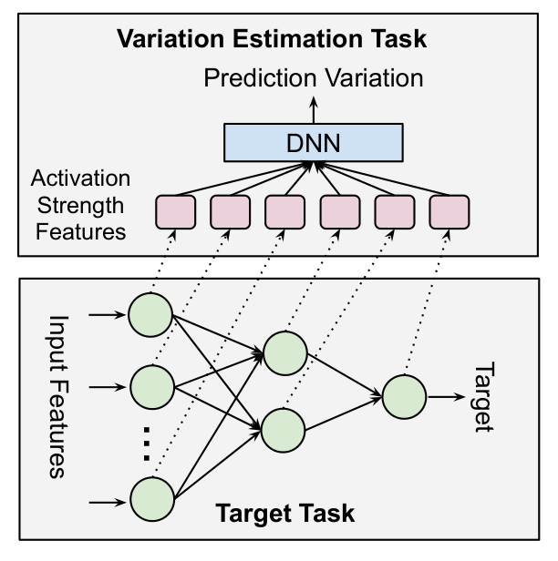

# Beyond Point Estimate: Inferring Ensemble Prediction Variation from Neuron Activation Strength in Recommender Systems (超越点估计：从神经元激活强度推断集成预测方差)

- **会议/期刊**: WSDM 2021
- **作者与机构**: Zhe Chen, Yuyan Wang, Dong Lin, Derek Zhiyuan Cheng, Lichan Hong, Ed H. Chi, Claire Cui (Google)
- **推荐链路定位**: 精排（打分置信度输出，可前置到召回/重排的可靠性筛除）
- **研究方向**: 去偏公平、可信隐私与工业架构 / CTR 预估与特征交叉
- **论文原文**: [https://arxiv.org/abs/2008.07032v1](https://arxiv.org/abs/2008.07032v1)
- **开源代码**: 暂未开源

## TL;DR (1分钟核心速览)

DNN 只输出点估计，工业界用 N 模型集成刻画预测方差，但训练与在线服务成本随 N 线性爆炸。本文实证拆解了集成方差的随机性来源（Shuffle / RandInit / Jackknife），并提出**双任务正交框架**：不动目标任务优化，仅从其 ReLU 层的「二值激活 + 归一化激活值」出发，挂一个廉价辅助头回归/分桶该样本的集成方差。在 MovieLens 与 Criteo 上，随机划分 60/40 与 37M/4.4M 协议下，方差回归平均 $R^2$ 分别达 0.51/0.43/0.78，最低与最高方差桶 AUC 达 0.92/0.89，单次前向即可替代 100 次集成推理。

## Background & Motivation (背景与核心矛盾)

- **主流范式**: Deep Ensembles 是预测不确定性估计的 SOTA 基准——同规格同数据训练 $N$ 份模型，用预测散布度作为模型不确定性的真值。
- **前人局限**: ① 成本不可接受，训练需 $N$份副本、在线需$N$次前向，web-scale 流量下不可行；② 降本方案（MC-Dropout、仅末层贝叶斯）要么改动目标任务优化目标、要么强加分布假设，且实测其方差与集成方差相关性仅 0.25/0.37、$R^2$ 为负，根本对不齐。
- **核心洞察 (Key Insight)**: 类比神经科学的长时程增强（LTP）——被高频强激活的神经元通路即"已记住"的强通路。若输入沿强通路传播，各模型预测趋于一致（低方差）；若走弱通路，模型间分歧大（高方差）。故**激活强度本身携带方差信号**，且它来自单模型、无需重复推理。
- **本文切入点**: 将方差估计解耦为一个与目标任务完全正交的辅助任务，输入只有激活强度特征，监督信号来自离线集成方差——"用一次前向反推 N 次前向的分歧"。

## Method (核心方法设计)

### 1. 整体框架 (Overall Architecture)

框架由两个解耦组件构成（图 1）：**目标任务** $m_t$是标准 MLP+ReLU（MovieLens 层宽$[50,20,10]$，user/item id embedding 维 8、age 3、occupation 5；Criteo 同样收缩到$[50,20,10]$，因原始$[2572,1454,1596]$在 10k 样本上仅约 80 个神经元被激活过）；**方差估计任务**$m_v$在$m_t$推理时抓取各层神经元的激活强度向量$\mathbf{a}(x)$，经$[100,50]$两层 MLP 输出该样本的预测方差估计。离线先用 100 模型集成生成每样本方差标签，把测试集对半切为$D_{e1}$（训$m_v$）与$D_{e2}$（测$m_v$）；线上只需$m_t$一次前向 +$m_v$一次轻量前向，成本与集成规模$N$ 彻底解耦。

<figure class="paper-figure" markdown="span">
  <figcaption>图 1：我们的基于激活强度的预测变化估计框架。</figcaption>
</figure>

### 2. 关键设计拆解 (Key Designs)

1. **双口径方差量化（Value / Distribution PV）**：回归与二分类任务输出标量，方差取集成预测的标准差；多分类输出概率分布，方差取各成员到集成均值的 KL 散度之和。这一步解决了"不同任务类型方差不可比"的问题：
$\mathrm{PV}(x)=\sqrt{\frac{\sum_{m\in\mathcal{M}}(y'_m(x)-\bar{y}(x))^2}{|\mathcal{M}|-1}},\qquad \mathrm{PV}(x)=\sum_{m=1}^{M}\mathrm{KL}\big(p_m(y|x)\,\|\,p_E(y|x)\big)$其中$p_E$为集成平均分布。直觉上前者度量"点位漂移"，后者度量"分布形状分歧"，后者对分类任务的 softmax 温度（本文网格搜索定$T=0.2$）更敏感。

2. **激活强度特征 B+V 与正交估计头**：每个 ReLU 神经元贡献两个特征——二值（输出是否 $>0$）与按训练集均值/方差归一化后的激活值；二者分别刻画"通路是否被点亮"与"点亮得多强"，缺一不可。估计头不向$m_t$ 回传任何梯度，目标函数仅为：
$\mathcal{L}_{var}=\frac{1}{|D_{e1}|}\sum_{x\in D_{e1}}\big(f_v(\mathbf{a}(x))-\mathrm{PV}(x)\big)^2$输出被裁剪到$[0,\ \overline{\mathrm{PV}}+3\sigma_{\mathrm{PV}}]$（保正且覆盖 99.7% 高斯质量）；分桶版本改为 5 个百分位桶 + 交叉熵。

3. **随机性源的显式控制与集成规模标定**：把方差来源拆成 Shuffle(S)、RandInit(R)、Jackknife(J) 三个开关，组合出 R0–R7 八种设置，用来检验估计头在不同"方差强度"下的稳健性。集成规模用 delta ratio $dr_{\mathcal{M}_N}=\delta_{\mathcal{M}_N}/\overline{\mathrm{PV}}_{gt}$标定，其中$\delta_{\mathcal{M}_N}(x)=|\mathrm{PV}_{\mathcal{M}_N}(x)-\mathrm{PV}_{gt}(x)|$；100 模型相对 1000 模型真值的$dr\approx 7\%$，即已捕获 93% 方差，故取$N=100$。注意本任务不涉及负采样与候选排序，推理开销是"1+1 次前向"对比集成的"$N$ 次前向"。

## Experimental Setup & Evaluation Protocol (实验设置与评估协议)

- **数据集与预处理**: 均为全量真实交互，未做 k-core 过滤，MovieLens 只用观测到的评分。

| 数据集 | #Users | #Items | #Interactions | 稀疏度/密度 | 特征/场景说明 |
| :--- | :---: | :---: | :---: | :---: | :--- |
| MovieLens-1M | 6,000 | 4,000 | 1M ratings | ~4.2% | user(id/gender/age/occupation)+movie(id/title/genres) |
| Criteo | — | — | ~40M | — | 13 数值 + 26 类别特征，CTR 二分类 |

- **数据划分与防穿越 (Splitting Strategy)**: 随机划分（非时间戳切分）。MovieLens 60% 训练 / 40% 测试；Criteo 沿用 Rank-1 设置 37M 训练 / 4.4M 测试；方差估计任务再把测试集按 50%/50% 切成 $D_{e1}/D_{e2}$，严格隔离，无标签泄漏。
- **排名评测协议 (Ranking Protocol)**: 本文不做 Top-N 排序，因此**未使用 Full-Ranking 或 Sampled Ranking**；评估为目标任务的 MSE / ACC / AUC，以及方差估计的 MSE / $R^2$ / 分桶 AUC 与混淆矩阵。这是一个需要读者注意的协议差异：结论不能直接迁移到排序指标。
- **对比基线与超参设置**: 消融对照为 R0（全固定、零方差）与 MC-Dropout（推理期保持 20% dropout、重复 100 次）；$m_v$用 Adam、lr=0.001、batch=256、150 epoch 早停、层宽$[100,50]$；目标任务 embedding 维 8。

## Key Experimental Results (实验关键数据)

### 1. 主实验对比 (Main Results)

**方差来源与"准确率–方差"权衡**（每设置 100 模型集成）：

| 随机性设置 | ML-R MSE↓ | ML-C ACC↑ | ML-C PV Mean | Criteo AUC↑ | Criteo PV Mean | Criteo PV Coeff |
| :--- | :---: | :---: | :---: | :---: | :---: | :---: |
| R0 None | 0.7980 | 0.4483 | 0.0000 | 0.7956 | 0.0000 | 0.00% |
| R1 (R) | 0.7569 | 0.4570 | 4.4486 | 0.7991 | 0.0300 | 16.3% |
| R2 (S) | 0.7671 | 0.4473 | 2.7379 | 0.7999 | 0.0359 | 20.7% |
| R3 (R+S) | **0.7479** | 0.4521 | 4.4637 | 0.7999 | 0.0358 | 20.4% |
| R4 (J) | 0.7718 | 0.4464 | 2.7522 | **0.8003** | 0.0394 | 22.9% |
| R5 (R+J) | 0.7489 | 0.4522 | 4.7250 | 0.8002 | 0.0396 | 22.9% |
| R6 (S+J) | 0.7640 | 0.4486 | 3.1739 | 0.8002 | 0.0409 | 23.5% |
| R7 (R+S+J) | **0.7457** | **0.4838** | 4.7332 | 0.8000 | **0.0407** | 23.6% |

**激活强度推断方差（回归口径，$R^2$↑）**：

| 设置 | ML-R | ML-C | Criteo |
| :--- | :---: | :---: | :---: |
| R1 (R) | 0.5416 | 0.4586 | 0.7617 |
| R2 (S) | **0.5636** | 0.4683 | 0.7863 |
| R3 (R+S) | 0.5514 | 0.4569 | **0.8100** |
| R4 (J) | 0.3885 | 0.3386 | 0.7817 |
| R5 (R+J) | 0.5219 | 0.4646 | 0.7868 |
| R6 (S+J) | 0.4938 | 0.4125 | 0.7739 |
| R7 (R+S+J) | 0.5123 | 0.4368 | 0.7761 |
| **平均** | **0.5104** | **0.4338** | **0.7824** |

### 2. 消融实验 (Ablation Study)

| 配置 | ML-R $R^2$↑ | ML-C$R^2$↑ | Criteo$R^2$↑ |
| :--- | :---: | :---: | :---: |
| 仅二值激活 B | 0.4196 | 0.3408 | 0.6210 |
| 完整 B+V | **0.5514** | **0.4569** | **0.8100** |
| MC-Dropout 方差 (ρ / $R^2$) | 0.25 / −0.50 | — | 0.37 / −1.37 |
| 5 次独立重复 $R^2$ 标准差 | 0.0190 | 0.0133 | 0.0098 |

### 3. 关键实验发现 (Key Findings)

1. **"更多随机性 = 更准且更不确定"是稳定规律**：Criteo AUC 从 R0 的 0.7956 单调升至 R4/R7 的 0.8003，MovieLens-R MSE 从 0.7980 降至 0.7457（相对降 6.6%），同时 Criteo 的 PV Coeff 从 0% 攀到 23.6%、ML-C 的 PV Mean 从 0 升到 4.73——集成多样性既带来泛化收益也带来分歧，二者不可分割。
2. **方差来源与任务/数据强耦合**：MovieLens 对 RandInit 最敏感（ML-C PV Mean 在含 R 的设置下约 4.45–4.73，纯 S/J 仅 2.74–3.17），Criteo 反以 Shuffle/Jackknife 主导（PV Coeff 20.7%/22.9% vs 16.3%）；跨设置 Pearson 相关在 MovieLens 最低约 0.70，Criteo 高达 0.92。说明参数量小的 MovieLens 模型方差主要由初始化决定，而 Criteo 更受数据子采样噪声支配。
3. **激活值增量对困难口径贡献最大**：加入归一化激活值后 Criteo $R^2$从 0.6210 跃升至 0.8100（+30.4%），ML-R 从 0.4196 到 0.5514（+31.4%），远超重复实验标准差（$R^2$ 波动 ≤0.019）；分桶检测上，最低桶平均 AUC 0.92、最高桶 0.89，混淆矩阵中错误几乎全部落在相邻桶（Criteo 桶 1 的 86% 被正确识别，误判集中在桶 2），证明"极端高/低方差样本可被单模型可靠筛出"是最具工业价值的性质。

## Highlights & Limitations (亮点、对比与审稿批判)

- **与代表作对比 (vs. Prior Work)**: 与 Deep Ensembles 相比，本文不改目标函数、不复制模型，把 $O(N)$在线成本降到$O(1)$；与 MC-Dropout / 末层贝叶斯相比，本文不作分布假设，却在实证上与集成方差的相关性（0.25/0.37）显著优于 dropout 的口径（其$R^2$ 为负），说明"激活强度"这一信号更贴合集成分歧的真实来源。与 Rank-1 等校准研究相比，本文关注的是成员间分歧而非点预测的校准误差。
- **可迁移亮点**: ① 用 delta ratio 反推最小可用集成规模（$N=100$ 捕获 93%），可复用到任何"以集成为真值"的离线标注流程；② 激活强度特征可零成本挂到任意 MLP 精排模型上，作为置信度/难度信号供课程学习、主动探索或低置信样本人工复审。
- **审稿级局限批判**: ① 实验塔架极其轻量（层宽仅 $[50,20,10]$、仅 ReLU、MovieLens 仅 1M 交互），工业级宽深模型与稀疏 ID 特征下激活模式更复杂，结论外推性存疑；② 监督标签须离线训练 100 份模型，成本只是从在线摊到一次性离线，且每换一个目标任务就要重训$m_v$；③ 全文无 Top-N 排序指标、无线上 A/B、无 OOD 泛化验证，也未分析激活特征维度随层宽增长的存储/延迟开销。

## Rating (四维评分)

- **方法创新性 (Novelty)**: ⭐⭐⭐⭐ （借 LTP 神经科学直觉把"激活强度↔预测分歧"建立为可监督的经验映射，视角新颖且明确区别于贝叶斯路线，但本质仍是辅助任务回归）
- **评估协议与实验扎实度 (Protocol & Experiments)**: ⭐⭐⭐⭐ （三任务×八随机性设置×五桶混淆矩阵×五次重复方差齐全，且与 dropout 直接对照；扣分在无排序指标、无 OOD、数据规模偏小）
- **写作与数学规范度 (Clarity & Rigor)**: ⭐⭐⭐⭐ （方差与 delta ratio 定义清晰、随机性控制实验设计严谨；但缺少方差估计的复杂度/特征维度定量分析，Criteo 特征统计也略欠）
- **工业落地与复现价值 (Industrial & Practical Value)**: ⭐⭐⭐⭐ （在线只需一次廉价辅助前向即可替代百模集成，落地路径极短；无开源代码、且离线需百模标注与逐任务重训，复现与推广有门槛）

