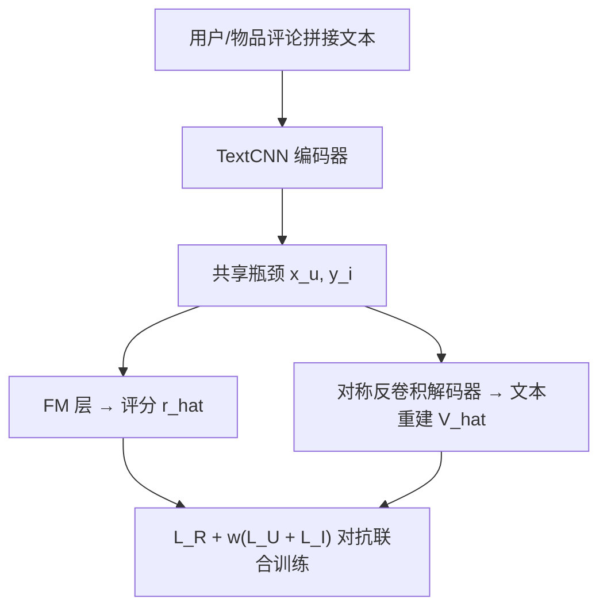
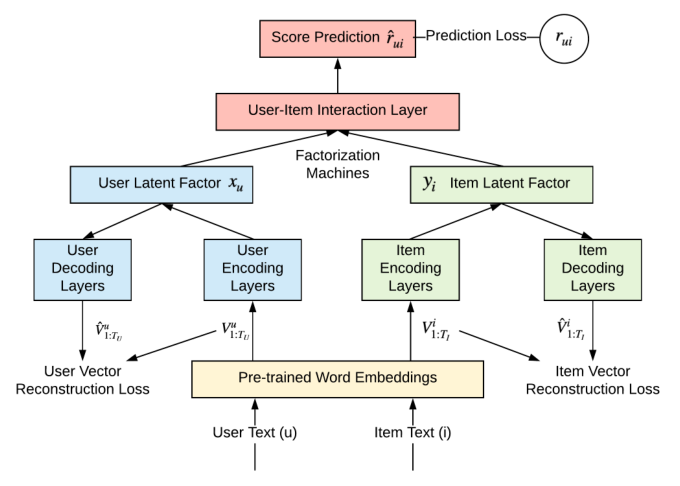

# Leave No User Behind: Towards Improving the Utility of Recommender Systems for Non-mainstream Users (让每位用户都不掉队：提升推荐系统对非主流用户的效用)

- **会议/期刊**: WSDM 2021（9 pages, 6 figures）
- **作者与机构**: Roger Zhe Li, Julián Urbano, Alan Hanjalic（Delft University of Technology）
- **推荐链路定位**: 精排（评分预测范式，非排序）
- **研究方向**: 去偏公平与工业架构 / 多模态推荐（文本内容建模）
- **论文原文**: [https://arxiv.org/abs/2102.01744v1](https://arxiv.org/abs/2102.01744v1)
- **开源代码**: [https://github.com/roger-zhe-li/wsdm21-mainstream](https://github.com/roger-zhe-li/wsdm21-mainstream)

## TL;DR (1分钟核心速览)

本文针对**主流偏置（mainstream bias）**：CF 模型对"口味主流"用户推荐质量系统性高于"灰羊"式非主流用户。作者提出 NAECF，在 DeepCoNN 的 TextCNN 表征瓶颈上并联用户/物品两个卷积自编码器，强制瓶颈能重建各自评论文本向量，把"保留个体独特属性"作为评分误差最小化的**对抗条件**，总损失 $\mathcal{L}=\mathcal{L}_R+w(\mathcal{L}_U+\mathcal{L}_I)$。在 3 个评论数据集、10 次随机划分、per-user RMSE 分箱增益评估下，中部 80% 用户 uRMSE 降低 0.011–0.027（$p<0.05$），整体评分精度与 DeepCoNN 基本持平。

## Background & Motivation (背景与核心矛盾)

- **主流范式**: 以 DeepCoNN 为代表的评论文本建模（TextCNN + FM）已成为评分预测 SOTA，通过在线评论缓解稀疏性并提升整体精度。
- **前人局限**: ① 主流用户海量一致交互主导了用户/物品潜在空间的学习，非主流用户与其"离群"物品被压缩塌陷，难以找到相似邻居；② 已有的主流性去偏方法依赖各自的 mainstreamness 定义，且**按主流性分组分别训练**，牺牲了跨群协同信息。
- **核心洞察 (Key Insight)**: 如果表征真正保留了每个用户/物品的**独特属性**，它就难以被主流梯度抹平；而"能否从瓶颈重建自己的评论"是一个可计算、对所有用户一视同仁的代理指标。
- **本文切入点**: 不切分用户群、不改协同结构，仅以自编码器重建损失作为**对抗正则**约束共享表征空间。

## Method (核心方法设计)

### 1. 整体框架 (Overall Architecture)

输入为元组 $(u,i,r_{ui},c_{ui})$：用户$u$与物品$i$的所有历史评论文本分别拼接、截断至固定长度$T_U/T_I$，经 300 维 Google News 词向量查表后送入 TextCNN 编码器，得到共享潜在因子$\boldsymbol{x}_u$、$\boldsymbol{y}_i$（即 AE 瓶颈）。该瓶颈有两条下游通路：一路拼接成$\hat{z}=(\boldsymbol{x}_u,\boldsymbol{y}_i)$经 FM 层输出评分$\hat{r}_{ui}$；另一路经**与编码器对称的反卷积/反池化解码器**重建原始文本嵌入$\hat{V}_u^{1:T_U}$、$\hat{V}_i^{1:T_I}$。训练分两阶段：前 50 epoch 令$w=0$（退化为 DeepCoNN 预训练），后 50 epoch 打开$w$ 联合优化；推理时只走编码器 + FM，解码器不参与，故在线开销与 DeepCoNN 一致。

<figure class="paper-figure" markdown="span">
  <figcaption>图1：NAECF 的整体架构。</figcaption>
</figure>

### 2. 关键设计拆解 (Key Designs)

1. **双自编码器作为评分优化的对抗条件**：痛点在于联合学习表征时主流交互梯度占主导。本文在瓶颈之外接对称解码器，把"重建自身文本"写进损失 $\mathcal{L}=\mathcal{L}_R+w(\mathcal{L}_U+\mathcal{L}_I)$，其中$\mathcal{L}_U=\frac{1}{N_U}\sum_u loss_U(u)$。直觉：若瓶颈丢失个体特征，解码器无法还原该用户独有的词分布，重建损失即上升——梯度会反向"拽住"瓶颈，阻止其滑向主流均值。
2. **有界归一化余弦重建损失**：若直接用余弦距离或 MSE，$\mathcal{L}_U$与按评分量程归一化的$\mathcal{L}_R$量纲不一致，$w$无法跨数据集迁移。本文取$loss_U(u)=\left(\frac{1-\cos(V_u^{1:T_U},\hat{V}_u^{1:T_U})}{2}\right)^2\in[0,1]$，与$loss_R(u,i)=\left(\frac{r_{ui}-\hat{r}_{ui}}{r_{max}-r_{min}}\right)^2$同尺度；再以$N_R,N_U,N_I$归一使$w$ 与数据集统计无关。
3. **训练目标、负采样与推理效率**：总损失仅含回归项，无负采样、无成对排序项（评分预测范式下不需要）。优化器 Adam，学习率/潜在维度 $d\in\{5,\dots,500\}$、词数$\{128,\dots,2048\}$、卷积核长度$\{2,3,4\}$、dropout、batch 均在验证集网格搜索。关键工程细节是**两阶段预训练**：若一开始就开$w$，重建项会压垮随机初始化的评分头。推理阶段解码器被裁剪，QPS 与 DeepCoNN 相同，训练成本约增加一倍（解码器前向+重建损失）。

## Experimental Setup & Evaluation Protocol (实验设置与评估协议)

- **数据集与预处理**: 三个评论域数据；Amazon 两域沿用"用户至少 5 条交互"过滤，BeerAdvocate 采用相同阈值并随机采样 25% 用户：

| 数据集 | #Users | #Items | #Interactions | 稀疏度 | 特征/场景说明 |
| :--- | :---: | :---: | :---: | :---: | :--- |
| Instant Video | 5,130 | 1,685 | 37,126 | 99.57% | Amazon 短视频，19M 词 |
| Digital Music | 5,541 | 3,568 | 64,706 | 99.67% | Amazon 数字音乐，73M 词 |
| BeerAdvocate | 3,703 | 37,580 | 393,035 | 99.72% | 啤酒点评，198M 词，评分粒度 0.5 |

- **数据划分与防穿越 (Splitting Strategy)**: **随机比例划分 80%/10%/10%**，重复 10 个随机种子（非全局时间戳切分，存在轻量时间穿越风险）；仅评估训练集中交互数 $\ge 3$ 的用户，规避"训练集仅 1 条样本"的不可靠个体。
- **排名评测协议 (Ranking Protocol)**: **不适用**——本文是评分预测（Rating Prediction）范式，仅报告 rRMSE 与 per-user uRMSE，未做 Full-Ranking 或 Sampled Ranking，无 Recall/NDCG 指标；预测值截断至 $[1,5]$。
- **对比基线与超参设置**: 基线仅 MF（纯协同）与 DeepCoNN（文本 SOTA，NAECF 的直接骨架）；显著性用 paired $t$-test，$p<0.05$；$w$的选取**不用整体 rRMSE**，而用分箱加权增益$\Delta=0.1\Delta_1+0.4\Delta_2+0.4\Delta_3+0.1\Delta_4$（按 DeepCoNN 的 uRMSE 十分位/中位/九十分位分 4 个不等宽箱，弱化最好与最差的极端箱）。

## Key Experimental Results (实验关键数据)

### 1. 主实验对比 (Main Results)

整体评分精度（rRMSE，$\downarrow$ 越低越好；10 次划分均值，加粗为最优）：

| 数据集 | MF | DeepCoNN ($w=0$) | NAECF$w=0.1$|$w=0.5$|$w=10$ |
| :--- | :---: | :---: | :---: | :---: | :---: |
| Instant Video | 1.1600* | 0.9744 | **0.9732** (Improv. 0.12%) | 0.9757 | 0.9967* |
| Digital Music | 1.0466* | **0.9078** | 0.9083 (−0.06%) | 0.9104 | 0.9219* |
| BeerAdvocate | 1.0442* | 0.6722 | **0.6692** (Improv. 0.45%) | 0.6756* | 0.7068* |

用户均衡性（相对 DeepCoNN 的 per-user RMSE 增益 $\Delta_b$，**正值=NAECF 更优**；\* 表示统计显著）：

| 数据集 | $\Delta_1$top-10% |$\Delta_2$|$\Delta_3$|$\Delta_4$bottom-10% | 加权$\Delta$ |
| :--- | :---: | :---: | :---: | :---: | :---: |
| Instant Video | −0.0035 | **+0.0256\*** | **+0.0267\*** | −0.0308* | **+0.0175\*** |
| Digital Music | +0.0036 | **+0.0184\*** | **+0.0106\*** | −0.0167* | **+0.0103\*** |
| BeerAdvocate | +0.0119 | **+0.0117\*** | **+0.0063\*** | −0.0115* | **+0.0073\*** |

### 2. 消融实验 (Ablation Study)

本文无"组件移除式"消融，等效消融通过重建权重 $w$扫描与最优$w$ 选取分布完成：

| 配置 | Instant Video | Digital Music | BeerAdvocate | 结论 |
| :--- | :---: | :---: | :---: | :--- |
| $w=0$（=DeepCoNN 重训） | 0.9744 | 0.9078 | 0.6722 | 无去偏能力，$\Delta=0$ |
| $w=0.1$（温和） | **0.9732** | 0.9083 | **0.6692** | 精度几乎不掉，均衡性最优 |
| $w=0.5/1$（中等） | 0.9757/0.9798 | 0.9104/0.9118 | 0.6756/0.6785 | 重建开始挤占评分梯度 |
| $w=5/10$（过强） | 0.9896/0.9967 | 0.9167/0.9219 | 0.6899/0.7068 | 精度显著崩塌 |
| 验证集选出的最优 $w$分布 | 含 2/10 次$w=0$| 含 3/10 次$w=0$| 全非零，83% 的 top-3$\le 0.5$|$w$ 需逐案例调 |
| 去掉文本（MF） | 1.1600 | 1.0466 | 1.0442 | 文本带来 $\Delta$=0.1175/0.1017/0.3282 |

### 3. 关键实验发现 (Key Findings)

1. **增益集中在"中部"而非两端**：三个数据集上 $\Delta_2/\Delta_3$全部显著为正（+0.0063~+0.0267），而 top-10% 用户的$\Delta_1$ 与 0 无显著差异——说明去偏**不以牺牲主流用户为代价**；唯一代价是 bottom-10% 极端用户显著变差（−0.0115~−0.0308），作者认为这是"本就难以被任何 CF 模型服务"的合理取舍。
2. **重建权重需"温和"而非"越大越好"**：BeerAdvocate 上 83% 的 top-3 $w\le0.5$，两个 Amazon 域 85% 的 top-3$w\le2.0$；而最优增益对应的$w$ 在 30 次划分中有 19 次（7/6/6 次）反而使**整体 rRMSE 劣化**，直接证明"整体精度指标与用户间均衡目标相互背离"。
3. **重建难度与主流性单调相关**：图 5/图 6 显示 $loss_U$与 uRMSE 在$w>0$ 时呈正相关（除 Digital Music 末箱），即被主流 CF 服务得越差的用户，其文本越难被瓶颈重建；而 DeepCoNN 中该相关性缺失，正是可改进的空间所在。同时 DeepCoNN 相对 MF 的 uRMSE 增益与 MF 基线 uRMSE 强正相关，印证文本特征的价值主要落在难建模用户身上。

## Highlights & Limitations (亮点、对比与审稿批判)

- **与代表作对比 (vs. Prior Work)**: 与 DeepCoNN 相比，NAECF 不改编码器、不改 FM，只加一条对抗重建支路，属于"零结构侵入"的插件；与 Kowald 等基于音乐文化/记忆的主流性修方法相比，本文**不切分用户群**，避免了分组训练导致的跨群协同信息损失；与流行度去偏（Abdollahpouri 的公平性插件）相比，本文的偏置定义落在**用户侧**而非物品侧。
- **可迁移亮点**: ①"以自编码重建损失作为个性化保留的对抗正则"可作为通用插件挂到任意内容增强召回/精排模型上（多模态、LLM 语义表征均可复用）；②验证阶段用**分箱加权增益**代替整体指标选超参，是任何"均衡性/公平性"任务都值得照搬的调参范式。
- **审稿级局限批判**: ① **评估停留在评分预测**，无 Full-Ranking/NDCG，与当下排序范式脱节，且绝对增益极小（$\Delta\approx0.017$对应 uRMSE 约$0.97$的不到 2% 相对改善）；② 基线仅 MF 与 DeepCoNN，论文自陈可选的 NARRE/MPCN/AugCF 均未比，且**没有分离$\mathcal{L}_U$与$\mathcal{L}_I$的独立消融**（两 AE 共用一个$w$，作者在 future work 中承认）；③ 全流程依赖 TextCNN 编码 + 反卷积解码，训练成本翻倍，且$w$ 需按数据划分逐一调，工程落地门槛高于收益；④ 随机 80/10/10 划分存在时间穿越，长尾物品的冷启动场景未被单独考察。

## Rating (四维评分)

- **方法创新性 (Novelty)**: ⭐⭐⭐⭐ （"以 AE 重建为对抗条件保留个体表征"的视角新颖，且给出量纲归一化使其可调，但机制本身是简单插件式组合）
- **评估协议与实验扎实度 (Protocol & Experiments)**: ⭐⭐⭐ （10 次划分 + paired $t$-test + 分箱增益设计用心，但仅评分预测、基线只有 2 个、缺少组件级消融）
- **写作与数学规范度 (Clarity & Rigor)**: ⭐⭐⭐⭐ （损失设计与归一化推导清晰、符号整洁，$\Delta$ 加权定义交代到位；但缺乏复杂度与收敛性分析）
- **工业落地与复现价值 (Industrial & Practical Value)**: ⭐⭐⭐ （代码数据全开源、推理开销与 DeepCoNN 等同、可直接插拔；但训练开销翻倍且 $w$ 逐划分调参，收益幅度偏小，线上收益需谨慎验证）

