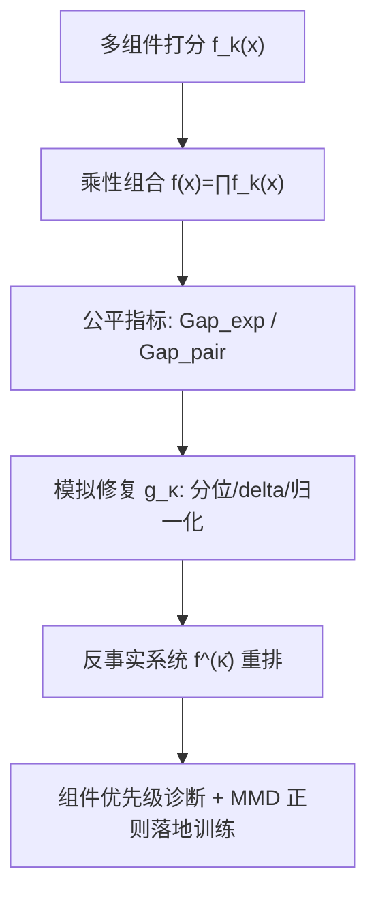

# Practical Compositional Fairness: Understanding Fairness in Multi-Component Recommender Systems (实用组合公平性：理解多组件推荐系统中的公平性)

- **会议/期刊**: WSDM 2021
- **作者与机构**: Xuezhi Wang, Nithum Thain, Anu Sinha, Flavien Prost, Ed H. Chi, Jilin Chen, Alex Beutel (Google Brain)
- **推荐链路定位**: 精排 / 多模型融合排序（重排前的分数合成）
- **研究方向**: 去偏公平、可信隐私与工业架构 / 多任务学习与列表级重排
- **论文原文**: [论文原文链接](https://arxiv.org/abs/1911.01916v4)
- **开源代码**: 暂未开源

## TL;DR (1分钟核心速览)

工业推荐系统的最终排序分常由多团队模型的乘性融合 $f(x)=\prod_k f_k(x)$ 给出，但既有公平性研究几乎都只考虑单一可微模型。本文证明：逐组件公平**不能**自动保证端到端公平（给出曝露公平与成对排序准确率两个指标的反例），并给出使其成立的分布对称性/相关性充分条件；进而提出"反事实 headroom"分析框架，用离线分布匹配模拟"若修复某组件"的收益。在合成数据、German Credit 与大规模产线系统上，全组件修复可把整体 PairAcc gap 从 0.1546 降到 0.0222（-85.6%）。

## Background & Motivation (背景与核心矛盾)

- **主流范式**: 工业推荐把 CTR、满意度等多个模型输出**乘性组合**成最终排序分（或 log 空间加性），各组件由不同团队独立训练与上线。
- **前人局限**: 公平性缓解方法几乎都假设优化对象是单一可微模型；而分类领域已有结论（Dwork & Ilvento）表明"公平分类器的逻辑组合可以不公平"，排序场景下是否同样失效、"何时不失效"均无答案。
- **核心洞察 (Key Insight)**: 组合公平性不是边际性质的函数，而取决于各组件预测分布的**对称性与组件间相关性**——两个各自"曝光均等"的打分相乘后可让某组系统性垫底。
- **本文切入点**: 先用最坏情况反例打破幻想，再用充分条件刻画"何时能组合"，最后用数据驱动方式诊断"修哪个组件最划算"。

## Method (核心方法设计)

### 1. 整体框架 (Overall Architecture)

给定 $K$个组件的打分，系统排序分为$f(x)=\prod_{k=0}^{K-1}f_k(x)$（等价 log 空间加性）。流程为四步闭环：① 用两个排序公平指标（曝露差距$\mathrm{Gap}_{\exp}$、成对排序准确率差距$\mathrm{Gap}_{\mathrm{pair}}$）度量系统现状；② 对任一组件$k$施加"模拟修复"算子$g_\kappa\in\{\tilde f_\kappa,\hat f_\kappa,\bar f_\kappa\}$（分位匹配 / delta 匹配 / 组内归一化），离线替换其打分；③ 用反事实合成系统$f^{(\bar\kappa)}$ 重排，量化"只修该组件"与"全修"的 headroom，定位瓶颈组件；④ 确认可行后，再在真实训练中用 MMD 正则落地。

### 2. 关键设计拆解 (Key Designs)

1. **组合公平反例与对称性充分条件**：反例中两组件各自曝光均等（$\mathrm{Exp}(A|r_0)=\mathrm{Exp}(B|r_0)=e_0+e_1$），但乘积排序后 A 组永远垫底，$\mathrm{Gap}_{\exp}=|e_0-e_1|/(e_0+e_1)$可逼近 1，且与分数幅度$\epsilon$无关。Theorem 1 给出可组合条件：令$X^k_A=\log f_k(x),x\in A$，若$X^0_A,X^0_B,X^1_A,X^1_B$及$X^0_A+X^1_A$、$X^0_B+X^1_B$均对称，则逐组件**中位数**公平 ⇒ 组合后中位数公平。证明链条核心是"对称 ⇒ 中位数=均值"再借期望线性性传播：$\mathrm{median}[X^0_A+X^1_A]=\mathrm{mean}[X^0_A]+\mathrm{mean}[X^1_A]=\mathrm{median}[X^0_B]+\mathrm{median}[X^1_B]$。直观解释：对称性把"中位数公平"升级为"期望公平"，而期望对乘法（log 加性）可组合。Theorem 2 对成对准确率给出类似但更弱的 delta 项可加性条件（式 (4)(5)）。

2. **逐组件零 gap 修复算子**：定义分位映射修复 $\tilde f_k(x)=a^{(k)}_{\phi_{b,k}(x)},\ x\in B$，即把 B 组样本的分数替换为 A 组同分位样本的分数（$a^{(k)},b^{(k)}$为两组经验 CDF），Theorem 3 证明其单组件曝光差距恒为 0——因为两组排名位置一一配对抵消。面向成对指标则改为匹配 delta 分布$\Delta_k(A_1,B_0)=\{f_k(x_i)-f_k(x_j)\mid x_i\in A_1,x_j\in B_0\}$与$\Delta_k(B_1,A_0)$（Theorem 4 保证$\mathrm{Gap}_{\mathrm{pair}}=0$）。工程上更轻的替代是组内标准化$\bar f_k(x)=\frac{f_k(x)-\mu_{x\in G}[f_k(x)]}{\sigma_{x\in G}[f_k(x)]}$，无理论保证但实测有效。

3. **训练目标与推理开销**：落地时每个组件独立优化 $\mathcal{L}=\mathcal{L}_{\text{ranking}}+\lambda\,\mathrm{MMD}\big(\Delta_k(A_1,B_0),\Delta_k(B_1,A_0)\big)$，即在原有排序损失上对齐两组 delta 分布（与 Beutel 等的正则同源）。关键工程优势：公平约束**只在训练期生效**，服务期无需知道受保护属性，推理路径与延迟零增量。

## Experimental Setup & Evaluation Protocol (实验设置与评估协议)

- **数据集与预处理**:

| 数据集 | #Users | #Items | #Interactions | 稀疏度/密度 | 特征/场景说明 |
| :--- | :---: | :---: | :---: | :---: | :--- |
| Synthetic-1 | — | 2000 | 2000 | 每组 1000 | 两组独立高斯，组件间独立 |
| Synthetic-2 | — | 2000 | 2000 | 每组 1000 | 令 $f_0=\mathcal{N}(13,0.5)-f_1$（B 组）制造反相关 |
| German Credit | 1000 | 1000 | — | 男 690 / 女 310 | 4 个打分因子：credit amount、age、num_credits、num_liable |
| Production | 大规模 | 大规模 | 线上日志 | — | 三组件：CTR + Satisfaction1 + Satisfaction2 |

- **数据划分与防穿越 (Splitting Strategy)**: 本文不做经典 train/test 划分——反事实分析在全量离线打分上"原地替换"组件输出后重排，属**全库排序的分布级诊断**；建模实验（MMD）在连续训练流水线上进行，故其绝对数值与离线分析略有差异。
- **排名评测协议 (Ranking Protocol)**: 采用无偏 `Full-Ranking`，指标为组间差距而非 NDCG：曝露差距 $\mathrm{Gap}_{\exp}=\frac{|\mathrm{Exp}(A)-\mathrm{Exp}(B)|}{\mathrm{Exp}(A)+\mathrm{Exp}(B)}$，效用$u(x|r)=[\mathrm{rank}(x|r)]^{-w}$，$w=0.65$；成对准确率差距$\mathrm{Gap}_{\mathrm{pair}}=|\mathrm{PairAcc}(A>B)-\mathrm{PairAcc}(B>A)|$。理想值 0，负值表示排序方向反转。
- **对比基线与超参设置**: 基线为"无公平约束"系统、以及单组件 / 多组件组合的四种修复策略（边际匹配、条件匹配、delta 匹配、分布归一化）；建模侧与 MMD 正则（Kumar 等）对比。组大小不等时用插值对齐经验 CDF。

## Key Experimental Results (实验关键数据)

### 1. 主实验对比 (Main Results)

产线推荐系统，指标为各组件与整体 PairAcc gap（越低越好）：

| 修复组件 | Gap(CTR) | Gap(S1) | Gap(S2) | Acc(A) | Acc(B) | Overall Gap | Improv. |
| :--- | :---: | :---: | :---: | :---: | :---: | :---: | :---: |
| None (baseline) | 0.1024 | 0.1781 | 0.1078 | 0.5862 | 0.7408 | 0.1546 | — |
| 边际匹配 CTR | 0.0049 | 0.1781 | 0.1078 | 0.6198 | 0.7084 | 0.0886 | 42.7% |
| 边际匹配 S1 | 0.1024 | 0.0103 | 0.1078 | 0.6292 | 0.7054 | 0.0762 | 50.7% |
| 边际匹配 S2 | 0.1024 | 0.1781 | 0.0202 | 0.6021 | 0.7270 | 0.1248 | 19.3% |
| 边际匹配 All | 0.0049 | 0.0103 | 0.0202 | 0.6781 | 0.6546 | **0.0236** | 84.7% |
| delta 匹配 CTR | 0.0000 | 0.1781 | 0.1078 | 0.6473 | 0.7408 | 0.0935 | 39.5% |
| delta 匹配 S1 | 0.1024 | 0.0000 | 0.1078 | 0.6669 | 0.7408 | 0.0739 | 52.2% |
| delta 匹配 S2 | 0.1024 | 0.1781 | 0.0000 | 0.6197 | 0.7408 | 0.1211 | 21.7% |
| delta 匹配 All | 0.0000 | 0.0000 | 0.0000 | **0.7630** | 0.7408 | **0.0222** | **85.6%** |

### 2. 消融实验 (Ablation Study)

不同数据分布与修复算子组合下的整体 gap（曝光差距 / 成对准确率差距）：

| 设置 | Synthetic-1 (Gap_exp) | Synthetic-2 (Gap_exp) | German Credit (Gap_exp) | Prod. MMD 建模 (Gap_pair) |
| :--- | :---: | :---: | :---: | :---: |
| None (baseline) | 0.5281 | 0.5398 | 0.2162 | — |
| 分位匹配 单组件 (最优者) | 0.3712 | 0.4636 | 0.1704 | — |
| 分位匹配 全组件 | **-0.0366** | 0.2524 | **0.0705** | — |
| 组内归一化 单组件 (最优者) | 0.0940 | 0.1529 | — | — |
| 组内归一化 全组件 | -0.0285 | 0.3899 | — | — |
| 部分因子组合 (credit&age / +num_liable) | — | — | 0.1304 / 0.0783 | — |
| MMD 正则 单组件 (CTR / S1 / S2) | — | — | — | 0.080 / 0.088 / 0.067 |
| MMD 正则 全组件 | — | — | — | **0.013** |

### 3. 关键实验发现 (Key Findings)

1. **单组件修复存在硬天花板，瓶颈分布在多组件**：产线系统中只修 CTR 只能把整体 gap 从 0.1546 降到 0.0886（-42.7%），单独修 S2 仅 -19.3%；三组件齐修才达 0.0222（-85.6%），且 Group A 准确率反而从 0.5862 升至 0.7630，说明公平提升不以整体排序精度为代价。
2. **组件间统计关系决定可组合性，对称性是硬前提**：Synthetic-1（独立对称高斯）全修后 gap 达 -0.0366（≈0，与 Theorem 1 吻合）；Synthetic-2 人为制造反相关后，全修仍残留 0.2524，更极端的是组内归一化在双组件上（0.3899）比单组件（0.1529）**更差**——证明逐组件"局部正确"可被组合放大成新偏置。
3. **delta 匹配是唯一可证零 gap 的算子，但边际匹配已能拿到 97% 的收益**：delta 匹配把逐组件 gap 精确压到 0.0000（Theorem 4），整体 0.0222；边际匹配虽无逐组件保证，整体也达 0.0236，工程上更轻；MMD 建模侧复现同一规律（全组件 0.013 vs 单组件 0.067~0.088）。

## Highlights & Limitations (亮点、对比与审稿批判)

- **与代表作对比 (vs. Prior Work)**: 相比 Dwork & Ilvento 的分类"功能组合"（二值输出 + 逻辑运算），本文处理的是排序场景下连续打分的乘性组合，并给出可检验的分布条件；相比 Singh & Joachims 的曝露公平与 Beutel 等的成对准确率，本文把两者统一到"逐组件公平 ⇒ 系统公平?"这一问题下设反例与条件；相比单纯的 MMD 正则训练，本文额外提供**修哪个组件最划算**的归因工具。
- **可迁移亮点**: ① 反事实 headroom 分析可直接迁移到多目标加权融合（CTR×CVR×LTV）的归因调权；② 组内标准化 $\bar f_k$ 是即插即用、零推理开销的轻量去偏层。
- **审稿级局限批判**: ① 仅处理二分组且组大小相等或可插值的情形，多属性交叉公平（性别×年龄）与多值敏感属性未覆盖；② 强依赖"纯乘性组合"假设，真实链路中的截断、配额、多样性重排会破坏该结构，图 2 亦显示归一化后 top 位置 gap 仍有抖动；③ 全部结论基于离线打分重排，缺少线上 A/B 的长期用户效用（相关性/留存）代价评估，公平与精度的真实权衡尚不明确。

## Rating (四维评分)

- **方法创新性 (Novelty)**: ⭐⭐⭐⭐ （首次系统刻画推荐排序的组合公平，反例 + 对称性充分条件 + 反事实诊断构成完整闭环，理论虽偏"充分条件式"但切中工业真实结构）
- **评估协议与实验扎实度 (Protocol & Experiments)**: ⭐⭐⭐ （合成/公开/产线三层验证设计巧妙，但仅有离线 Full-Ranking 分布级 gap，无划分、无显著性检验、无线上 A/B）
- **写作与数学规范度 (Clarity & Rigor)**: ⭐⭐⭐⭐ （两套指标的定理—证明—实验一一对应，Theorem 1/3/4 推导简洁可核；Theorem 2 的 delta 可加性条件实际难以验证，略显形式化）
- **工业落地与复现价值 (Industrial & Practical Value)**: ⭐⭐⭐⭐ （训练期正则、服务期零开销，headroom 工具可直接用于多团队协作定责；但未开源、产线数据不可复现限制了验证）

