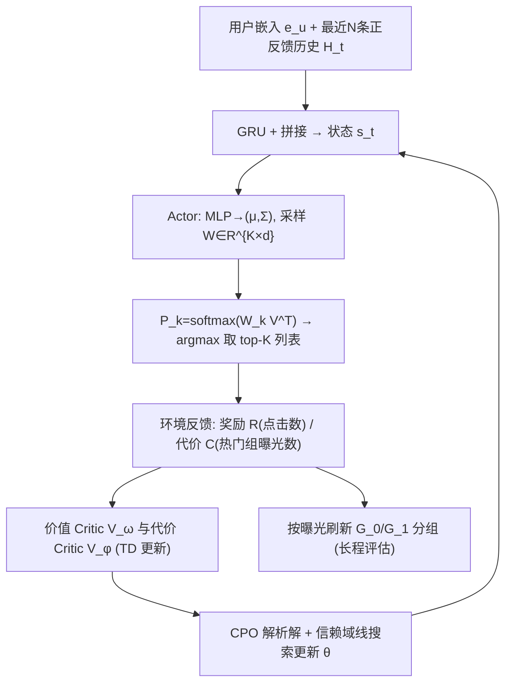
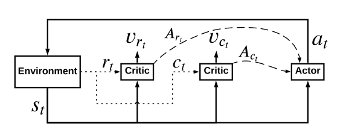
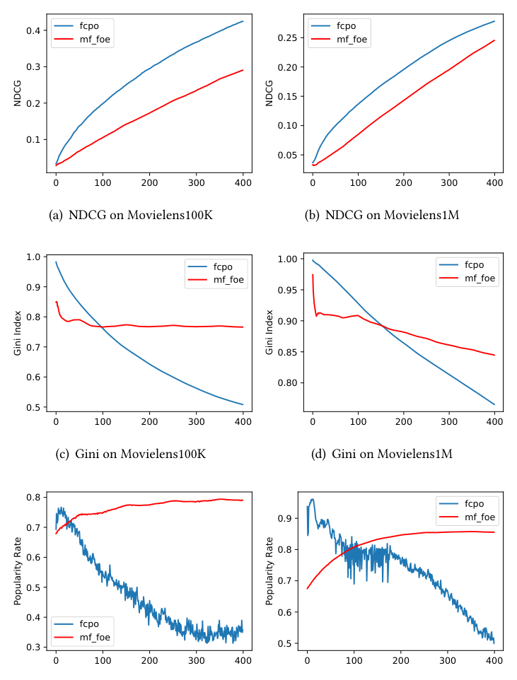

# Towards Long-term Fairness in Recommendation (面向推荐系统长期公平性)

- **会议/期刊**: WSDM 2021
- **作者与机构**: Yingqiang Ge, Shuchang Liu, Ruoyuan Gao, Yikun Xian, Yunqi Li, Xiangyu Zhao, Changhua Pei, Fei Sun, Junfeng Ge, Wenwu Ou, Yongfeng Zhang（Rutgers University / Michigan State University / Alibaba Group）
- **推荐链路定位**: 重排（列表生成策略，端到端序列决策）
- **研究方向**: 去偏公平与工业架构 / 强化学习与动态探索
- **论文原文**: [https://arxiv.org/abs/2101.03584v1](https://arxiv.org/abs/2101.03584v1)
- **开源代码**: [https://github.com/TobyGE/FCPO](https://github.com/TobyGE/FCPO)

## TL;DR (1分钟核心速览)

现有公平推荐几乎都是**静态一次性**求解：受保护分组（如热门/长尾）固定，用带约束优化解一次就收工。本文指出静态人口平价会诱发"组内新马太效应"——长尾组 $G_1$ 中某高点击物品被反复推荐，短期合规、长期更不公。作者将推荐建模为**约束马尔可夫决策过程 (CMDP)**，用动态流行度分组 + 单 Actor 双 Critic 的约束策略优化 (FCPO) 逐步校正曝光；在 ML-100K/1M 的 400 步长程模拟下，NDCG@20 相对最优基线提升 26.6%–43.2%，且 Gini 与流行度率持续低于静态重排基线 FOE。

## Background & Motivation (背景与核心矛盾)

- **主流范式**: 公平推荐分个体/群体两类，主流做法是在排序目标上加群体公平约束（Demographic Parity、Exact-K），或对 top-$N$ 结果做重排（FOE 线性规划），一次性输出"公平"列表。
- **前人局限**: (1) 把分组标签视为常量，忽略推荐策略本身会改变物品流行度，进而改变分组归属与约束本身；(2) 只评估公平的即时影响，无法约束多轮交互后的累积曝光偏斜。
- **核心洞察 (Key Insight)**: 文中四物品例子给出漂亮反例——$G_0=\{A,B\}$、$G_1=\{C,D\}$，每次推荐 2 个，DP 约束下候选为 AC/BC/AD/BD；若$D$点击率更高，模型会在满足组公平的前提下持续推$D$，最终$G_1$ 内部出现新的"马太效应"。**看似公平的静态决策，在长程上制造了新的不公平。**
- **本文切入点**: 把每次迭代的曝光约束写进 CMDP 的 cost 函数，让策略随环境（分组标签）变化实时调整，用长程累计 cost 上界保证"任何时刻都满足公平"。

## Method (核心方法设计)

### 1. 整体框架 (Overall Architecture)

推荐过程被形式化为 CMDP $\mathcal{M}=(\mathcal{S},\mathcal{A},P,R,C,\mu,\gamma_r,\gamma_c)$：状态为用户嵌入与最近$N$次正反馈历史经 GRU 编码的拼接；动作为长度$K$的物品列表；奖励为列表内正反馈条数；代价为列表内落入敏感组（热门组$G_0$）的物品数。模型采用 **一 Actor 双 Critic** 的 Actor-Critic 结构：Actor 输出高斯分布并采样"理想物品向量"再与全库物品内积打分；价值 Critic 估计$V_\omega$用于策略梯度，代价 Critic 估计$V_\phi$用于 CPO 的约束梯度与信赖域线搜索。每轮在线交互产生轨迹存入回放池，用 CPO 解析解更新$\theta$，并对两个 Critic 做 TD 更新；测试阶段既可冻结参数做短期评估，也可持续更新参数 + 动态刷新分组做长程评估。

<figure class="paper-figure" markdown="span">
  <figcaption>图1：所提方法的示意图。</figcaption>
</figure>

### 2. 关键设计拆解 (Key Designs)

1. **Exact-K 公平约束 → 逐迭代线性代价上界**：痛点是把"组间曝光比 $\le\alpha$"这类比例约束塞进 RL 很难，因为它是比值而非可加量。作者做了一步漂亮代数改写：由$\mathrm{Exposure}_t(G_0)/\mathrm{Exposure}_t(G_1)\le\alpha$与两者之和为$K$，推出等价的可加约束$C(s_t,a_t,s_{t+1})\le \alpha' K$，其中$\alpha'=\alpha/(1+\alpha)$，进而得到累计代价上界$d=\sum_{t=1}^{T}\gamma_c^{t}\alpha' K$。这样**比例公平被降解为单条线性约束**，CMDP 得以只含一个约束，从而直接套用 CPO 的解析解。
2. **高斯隐向量采样 + 全库 softmax 打分（Actor）**：直接对 $|\mathcal{I}|$维离散动作做策略梯度方差极大。Actor 先由$(\mu,\Sigma)=\mathrm{MLP}(s_t)$采样$W\sim\mathcal{N}(\mu,\Sigma)\in\mathbb{R}^{K\times d}$，再把$W$的每一行视为第$k$个位置的"理想物品原型"，用$P_k=\mathrm{softmax}(W_kV^{\top})$在**全物品集**上打分取$\arg\max$。位置间共享物品嵌入但各自独立采样，天然产生列表内多样性；同时对全库打分意味着召回与重排在策略内部一体完成，避免了"top-$N$ 候选池被热门物品占满"的死锁。
3. **训练目标、约束与推理开销**：损失由三部分组成——CPO 的带约束策略更新 $\theta_{k+1}=\arg\max_{\theta} g^{\top}(\theta-\theta_k)$，s.t.$c+b^{\top}(\theta-\theta_k)\le 0$、$\tfrac{1}{2}(\theta-\theta_k)^{\top}H(\theta-\theta_k)\le\delta$，加上两个 Critic 的 MSE：$\mathcal{L}(\omega)=\sum_t(y_t-V_\omega(s_t))^2$、$\mathcal{L}(\phi)=\sum_t(y_t-V_\phi(s_t))^2$。无需负采样（全库 softmax 自带归一化）。推理时单核 CPU 下 ML-100K 一次全库 1682 物品生成$K=100$ 列表约 3 小时，与 FOE 仅重排 200 候选的 90 分钟同量级，但候选覆盖全库。

## Experimental Setup & Evaluation Protocol (实验设置与评估协议)

- **数据集与预处理**:

| 数据集 | #Users | #Items | #Interactions | 稀疏度/密度 | 特征/场景说明 |
| :--- | :---: | :---: | :---: | :---: | :--- |
| Movielens-100K | 943 | 1,682 | 100,000 | 6.305% | 用户 id/物品 id/评分/时间戳，无侧信息 |
| Movielens-1M | 6,040 | 3,706 | 1,000,209 | 4.468% | 同上，规模约 10 倍 |

- **数据划分与防穿越 (Splitting Strategy)**: 按**每个用户的时间戳排序**后 4:1 顺序切分训练/测试，训练集最后一条物品移入验证集（逐用户时序切分，非全局时间戳切分）。分组为**基于曝光次数的流行度分桶**：曝光量 top 20% 物品为热门组 $G_0$，其余 80% 为长尾组$G_1$；长程评估中该分组随推荐曝光**动态重算**。
- **排名评测协议 (Ranking Protocol)**: 非 Full-Ranking 也非采样排序，而是**离线日志驱动的在线模拟**——RL Agent 按轨迹逐条生成 top-$K$，用测试集日志判定正反馈（点击），指标为 Recall/F1/NDCG@$\{5,10,20\}$，公平指标为 Gini Index（个体级）与 Popularity Rate（组级，越低越公平）。显著性$p<0.01$。
- **对比基线与超参设置**: 传统排序 MF / BPR-MF / NCF；RL 排序 LIRD（状态表示被替换为与 FCPO 一致以公平对比）；静态公平重排 FOE 的三种变体 MF-FOE / BPR-FOE / NCF-FOE（因 $|I|\times|I|$线性规划开销，仅对 top-200 重排）。FCPO 用 PMF 预训练并冻结 100 维嵌入，$|H_t|=5$，2 层 GRU，Actor/双 Critic 均为 2 隐层 tanh MLP，Critic 用 LBFGS；约束强度$\alpha'=1/0.8/0.4$ 对应 FCPO-1/2/3。

## Key Experimental Results (实验关键数据)

### 1. 主实验对比 (Main Results)

Movielens-100K/1M，$K=20$（%）：Gini 与 PopRate 越低越公平。

| 方法 | ML100K Recall↑ | ML100K NDCG↑ | ML100K Gini↓ | ML100K PopRate↓ | ML1M Recall↑ | ML1M NDCG↑ | ML1M Gini↓ | ML1M PopRate↓ |
| :--- | :---: | :---: | :---: | :---: | :---: | :---: | :---: | :---: |
| MF | 7.443 | 5.684 | 97.03 | 99.92 | 4.650 | 4.574 | 98.74 | 99.86 |
| BPR-MF | 8.093 | 5.787 | 97.01 | 99.78 | 5.143 | 4.632 | 97.61 | 98.96 |
| NCF | 6.983 | 6.510 | 98.80 | 100.0 | 4.589 | 5.080 | 99.42 | 100.0 |
| LIRD | 8.999 | 5.787 | 98.81 | 100.0 | 5.643 | 4.632 | 99.46 | 95.00 |
| MF-FOE | 4.179 | 4.367 | 82.98 | 90.98 | 3.220 | 4.021 | 90.44 | 98.68 |
| BPR-FOE | 4.404 | 4.332 | 83.78 | 90.70 | 3.387 | 4.158 | 89.01 | 95.78 |
| NCF-FOE | 4.251 | 4.633 | 90.44 | 100.0 | 2.954 | 4.011 | 95.04 | 100.0 |
| **FCPO-1** | **14.48** | **9.323** | 96.75 | 85.85 | **8.027** | **6.432** | 99.34 | 91.70 |
| **FCPO-2** | **10.41** | **7.104** | 94.78 | **65.55** | **6.417** | **5.133** | 97.41 | 71.35 |
| **FCPO-3** | **3.329** | **2.871** | **73.23** | **36.94** | **3.716** | **3.515** | **87.70** | **61.45** |
| **Improv.%** | **+60.9** | **+43.2** | — | — | **+42.2** | **+26.6** | — | — |

（Improv.% 为 FCPO-1 相对最优准确率基线的提升；FCPO-3 在 Gini 上较 MF-FOE 再降 11.8%/3.0%，PopRate 降 59.4%/37.7%）

### 2. 消融实验 (Ablation Study)

原文未提供组件级消融，仅有**约束强度扫描**与**效率对照**，后者恰是 FCPO 相对 FOE 的核心增量：

| 变体 / 配置 | $\alpha'$ | ML100K NDCG@20 | ML100K Gini@20 | ML100K PopRate@20 | 全库选品耗时 (ML100K) |
| :--- | :---: | :---: | :---: | :---: | :---: |
| FCPO-1（弱约束） | 1.0 | 9.323 | 96.75 | 85.85 | ~3h / 1682 物品 |
| FCPO-2（中约束） | 0.8 | 7.104 | 94.78 | 65.55 | 同上 |
| FCPO-3（强约束） | 0.4 | 2.871 | 73.23 | 36.94 | 同上 |
| MF-FOE（重排 200） | — | 4.367 | 82.98 | 90.98 | 1.5h / 200 物品 |
| MF-FOE（重排 400） | — | — | — | — | 6.5h / 400 物品 |
| MF-FOE（重排 800） | — | — | — | — | 60.5h / 800 物品 |

（ML-1M 上 FOE 重排 200/400/800 分别耗时 10.5h/43.5h/397h，FCPO 全库 3706 物品约 11.6h）

### 3. 关键实验发现 (Key Findings)

1. **精度提升不是来自公平、而是来自信赖域 RL 本身**：FCPO-1 与 LIRD 共享完全相同的 GRU 状态表示，仅把 PPO 式更新换成 CPO，ML100K Recall@20 就从 8.999 涨到 14.48（+60.9%）；作者归因于 CPO 的信赖域线搜索稳定了策略学习，说明"公平约束框架"与"训练稳定性"可以双赢。
2. **约束强度是平滑可调的性能阀门，而非二值开关**：$\alpha'$ 从 1.0→0.8→0.4，NDCG@20 从 9.323→7.104→2.871，PopRate 从 85.85→65.55→36.94，Gini 从 96.75→73.23，呈单调可控的 Pareto 前沿；图 3 的 NDCG–Negative Gini / Long-tail Rate 曲线上，同等 Gini 下 FCPO 的 NDCG 显著高于 FOE，同等 NDCG 下公平性更好，即**前沿整体外推**。
3. **静态重排的"公平"会在一轮内饱和，动态策略能持续下压**：图 4 显示 MF-FOE 每轮内 Gini/PopRate 迅速收敛，只有等标签刷新重训才能再降；FCPO 则在 400 步中持续压低两项指标，代价是曲线抖动更大（策略在动态调整）。但 MF-FOE 的准确率曲线全程落后 FCPO，说明其为公平牺牲了更多精度。

<figure class="paper-figure" markdown="span">
  <figcaption>图4：在Movielens100K（第一列）和Movielens1M（第二列）上的长期性能。X轴为推荐步数，y轴为从开始到当前步的累计物品曝光上的评估指标（第一行：NDCG，第二行：Gini，第三行：流行度率）。</figcaption>
</figure>

## Highlights & Limitations (亮点、对比与审稿批判)

- **与代表作对比 (vs. Prior Work)**: 相比 FOE（Singh & Joachims）的静态后处理重排，本文把公平内嵌进序列决策，分组标签随时间演化；相比 LIRD 等 RL 推荐，本文引入第二条 Critic 显式估计代价并把比例约束降解为线性累计约束；相比 Saito / Morik 的动态公平工作，本文的关键差异是**分组标签本身动态**（他们只处理效用动态）。
- **可迁移亮点**: (1) 比值型公平约束 → 可加线性约束的代数降解技巧 $\alpha'=\alpha/(1+\alpha)$，可迁移到任何"每批$K$ 条、要求组间配额"的场景；(2) 用隐向量采样 + 全库 softmax 替代固定候选池重排，绕开"重排池被热门物品占满导致公平失效"的工程陷阱。
- **审稿级局限批判**: (1) **评估协议偏弱**——反馈来自日志回放而非真实在线交互，且未做 Full-Ranking 全库排序，长程结论依赖 400 步模拟的可信度，缺乏真实 A/B；(2) **工程可扩展性存疑**——Actor 需对全库 $|\mathcal{I}|$做 softmax，$|H_t|=5$、双 Critic、LBFGS 与信赖域线搜索叠加后，在工业亿级物品上需要近似检索与分布式改造；论文单核 CPU 3–11 小时的开销也未讨论 GPU 加速与实际延迟预算。

## Rating (四维评分)

- **方法创新性 (Novelty)**: ⭐⭐⭐⭐ （首次在分组标签动态变化的前提下定义长期曝光公平，并用 CMDP + 双 Critic CPO 落地，但 CPO 本体沿用 Achiam 2017，增量主要在问题建模与约束降解）
- **评估协议与实验扎实度 (Protocol & Experiments)**: ⭐⭐⭐ （覆盖 ML-100K/1M、400 步长程曲线与效率对比，基线含静态公平重排；但缺组件级消融，反馈为日志模拟而非在线，数据集仅两个且同源）
- **写作与数学规范度 (Clarity & Rigor)**: ⭐⭐⭐⭐ （从比值约束推导线性累计上界的链条严谨清晰，CMDP/CPO 预备知识完整；Gini 与 Popularity Rate 两套公平指标定义明确，但长程评估中"标签刷新频率"对结论的敏感性未做分析）
- **工业落地与复现价值 (Industrial & Practical Value)**: ⭐⭐⭐⭐ （代码开源、官方复现友好，全库 softmax 免负采样设计对工业重排有启发；但全库打分与信赖域线搜索的在线时延成本需大幅工程折衷）

