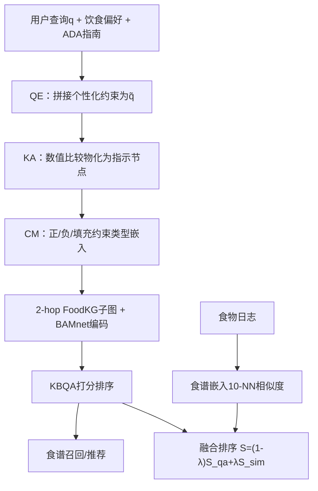
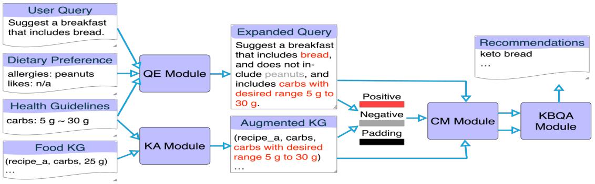

# Personalized Food Recommendation as Constrained Question Answering over a Large-scale Food Knowledge Graph (大规模食物知识图谱上约束问答式个性化食物推荐)

- **会议/期刊**: WSDM 2021
- **作者与机构**: Yu Chen, Ananya Subburathinam, Ching-Hua Chen, Mohammed J. Zaki; RPI, IBM Research
- **推荐链路定位**: 召回（KBQA候选食谱检索/排序）
- **研究方向**: 图神经网络与知识图谱推荐
- **论文原文**: [https://arxiv.org/abs/2101.01775v1](https://arxiv.org/abs/2101.01775v1)
- **开源代码**: [https://github.com/hugochan/PFoodReq](https://github.com/hugochan/PFoodReq)

## TL;DR (1分钟核心速览)

针对传统食物推荐忽视显式查询、健康约束与FoodKG知识的问题，本文将推荐转化为FoodKG上的约束KBQA，用QE、KA、CM统一注入饮食偏好/ADA指南并处理数值比较与否定。自建benchmark上pFoodReQ相对BAMnet在MAP/MAR/F1绝对提升59.6/58.8/60.6个百分点。

## Background & Motivation (背景与核心矛盾)

- **主流范式**: 食谱推荐多按内容/行为历史做矩阵补全或分类，以评分或点击为监督。
- **前人局限**: 不响应“含面包的早餐”等显式需求；不处理过敏/营养指南；未利用FoodKG百万食谱与营养三元组。
- **核心洞察 (Key Insight)**: 个性化要求可统一改写为对食谱实体的附加约束，推荐即从KG子图检索满足约束的食谱。
- **本文切入点**: 在IR式KBQA上外挂查询扩展、KG增强、约束类型标记，并融合食物日志相似度。

## Method (核心方法设计)

### 1. 整体框架 (Overall Architecture)

输入为自然语言查询$q$、用户饮食偏好与ADA健康指南；QE将个性化条件拼入查询，KA把营养数值比较物化为符号指示节点，CM为正/负/填充约束词注入类型嵌入。随后在主题实体2-hop FoodKG子图上用BAMnet联合编码查询与候选食谱，按点积打分排序；若启用食物日志，则用食谱嵌入近邻扩展子图并融合相似度。训练用三元组hinge损失，推理按分数阈值$\theta$保留多答案。

<figure class="paper-figure" markdown="span">
  <figcaption>图4：pFoodReQ架构：QE、KA和CM分别表示查询扩展、KG增强和约束建模。正约束为红色，负约束为灰色，非约束（或填充）为黑色。</figcaption>
</figure>

### 2. 关键设计拆解 (Key Designs)

1. **查询扩展 QE：把画像与指南变成显式约束**：原查询只含用户显式意图，无法覆盖过敏与营养需求；将约束$c_i$顺序拼接，得到$\tilde{q}=q\oplus c_1\oplus\cdots\oplus c_m$，使同一查询可按用户画像生成不同KBQA输入。直觉是让检索器“看见”个性化条件，而非依赖隐式用户ID。
2. **KG增强 KA + 约束建模 CM：分别处理数值比较与否定**：神经编码器难以可靠比较数值，KA对营养节点$v$与约束$g$定义$\mathbb{I}_g(v)=1$若$v\in\mathrm{range}(g)$否则$0$，命中则用$g$替换$v$，否则置空，从而把比较交给符号层。否定约束则用$m_i\in M$标记查询词及候选上下文词，约束嵌入与词嵌入拼接，显式区分“含花生”与“不含花生”。
3. **训练目标、负采样与推理**：总损失为$L=\sum_{a^+\in A^+,a^-\in A^-}\max(0,1+S_{qa}(\tilde{q},a^-)-S_{qa}(\tilde{q},a^+))$，负例从候选答案集随机采样；推理无需负采样，按$S_{qa}$排序并保留最高分附近$\theta$内候选。食物日志场景再以$S(\tilde{q},f,a_i)=(1-\lambda)\tilde{S}_{qa}(\tilde{q},a_i)+\lambda\tilde{S}_{sim}(f,a_i)$融合食谱相似度，$\lambda=0.3$。

## Experimental Setup & Evaluation Protocol (实验设置与评估协议)

- **数据集与预处理**: FoodKG约100万食谱、6700万三元组；基于Reddit 156条真实食谱请求归纳56个模板，结合ADA指南生成QA benchmark。该任务无传统user-item交互，统计按QA样本计，无5-core过滤。

| 数据集/划分 | #Examples | Avg. #Answers | Avg. #Constraints | 说明 |
| :--- | :---: | :---: | :---: | :--- |
| Train | 4,621 | 3.2 | 5.0 | 模板生成查询+偏好+指南 |
| Dev | 1,540 | 2.9 | 5.0 | 超参选择 |
| Test (in-domain) | 1,542 | 2.6 | 5.0 | 同分布食谱标签 |
| Test (out-of-domain) | 727 | 3.0 | 5.0 | 23个训练未见recipe tags |
| Test (total) | 2,269 | 2.7 | 5.0 | 含OOD |

- **数据划分与防穿越 (Splitting Strategy)**: 固定train/dev/test；OOD测试基于23个训练与验证均未出现的recipe tags构造。未报告用户级时间切分。
- **排名评测协议 (Ranking Protocol)**: 从主题实体2-hop KG子图抽取候选答案并全候选排序，报告MAP、MAR与macro-F1；测试阶段非采样负例排序，也不是百万食谱全库Full-Ranking。
- **对比基线与超参设置**: BOW、MatchNN、BAMnet及个性化版P-BOW、P-MatchNN；GloVe 300d，$h=2$，$d_m=40$，Adam，batch 32；pFoodReQ的$\theta=0.9$，+RecipeSim的$\theta=0.2$。未报告显著性检验。

## Key Experimental Results (实验关键数据)

### 1. 主实验对比 (Main Results)

| Method | MAP | MAR | F1 |
| :--- | :---: | :---: | :---: |
| BOW | 2.1 | 2.0 | 2.3 |
| MatchNN | 2.7 | 2.7 | 3.0 |
| BAMnet | 3.1 | 3.0 | 3.1 |
| P-BOW | 4.5 | 4.4 | 4.2 |
| P-MatchNN | 45.5 | 45.1 | 41.2 |
| **pFoodReQ** | **62.7** | **61.8** | **63.7** |
| Improv. vs BAMnet (abs) | +59.6 | +58.8 | +60.6 |

### 2. 消融实验 (Ablation Study)

| Method | MAP | MAR | F1 |
| :--- | :---: | :---: | :---: |
| pFoodReQ | **62.7** | **61.8** | **63.7** |
| w/o KA | 58.5 | 57.8 | 58.6 |
| w/o CM | 29.7 | 29.3 | 25.9 |
| w/o QE | 4.5 | 4.5 | 4.2 |

### 3. 关键实验发现 (Key Findings)

1. **QE是性能主开关**：移除后MAP从62.7跌至4.5、F1从63.7跌至4.2，平均下降58.3个点，说明个性化约束若未显式进入查询，KBQA几乎退化为无语义约束的候选排序。
2. **CM对否定约束不可或缺**：去掉CM后F1降至25.9，MAP降至29.7；去掉KA后F1仅降至58.6，表明数值比较可由符号层稳定兜底，而“不过敏/不含某食材”的负向语义更依赖类型标记。
3. **食物日志融合与人工评价一致增益**：+RecipeSim在新ground-truth下将MAP从27.3提至34.5、F1从32.6提至36.6；人工评分pFoodReQ为7.76，高于P-MatchNN的7.05与BAMnet的3.82，说明约束满足与历史相似度共同提升感知质量。

## Highlights & Limitations (亮点、对比与审稿批判)

- **与代表作对比 (vs. Prior Work)**: 相比BAMnet，本文不改KBQA主干而外挂个性化约束；相比P-MatchNN，CM/KA对否定与数值约束更稳；相比早期食物QA demo，本文首次系统处理过敏、营养指南与食物日志。
- **可迁移亮点**: 约束类型标记可迁移到电商/内容推荐中的“排除项”建模；符号数值比较物化可在神经排序前过滤硬约束，降低学习难度。
- **审稿级局限批判**: 候选仅来自2-hop子图，未验证百万食谱全库召回；benchmark由模板与模拟日志生成，ADA指南转结构化仍偏手工，且缺少线上延迟与A/B证据。

## Rating (四维评分)

- **方法创新性 (Novelty)**: ⭐⭐⭐⭐ （将食物推荐重构为约束KBQA，QE/KA/CM三件套针对否定与数值比较，问题建模新颖）
- **评估协议与实验扎实度 (Protocol & Experiments)**: ⭐⭐⭐ （自建benchmark含OOD与人工评价，但子图候选排序、模板生成和缺少显著性检验限制外推）
- **写作与数学规范度 (Clarity & Rigor)**: ⭐⭐⭐⭐ （框架与公式清晰，约束类型和符号比较定义直观；复杂度与误差分析较少）
- **工业落地与复现价值 (Industrial & Practical Value)**: ⭐⭐⭐ （代码开源、KG约束思路可落地健康饮食App，但依赖人工指南结构化与子图候选，线上召回开销未评估）

