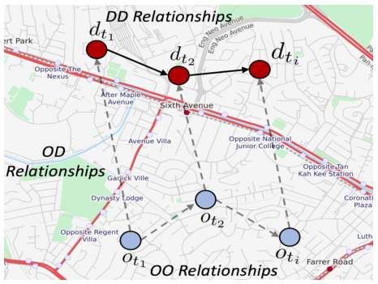
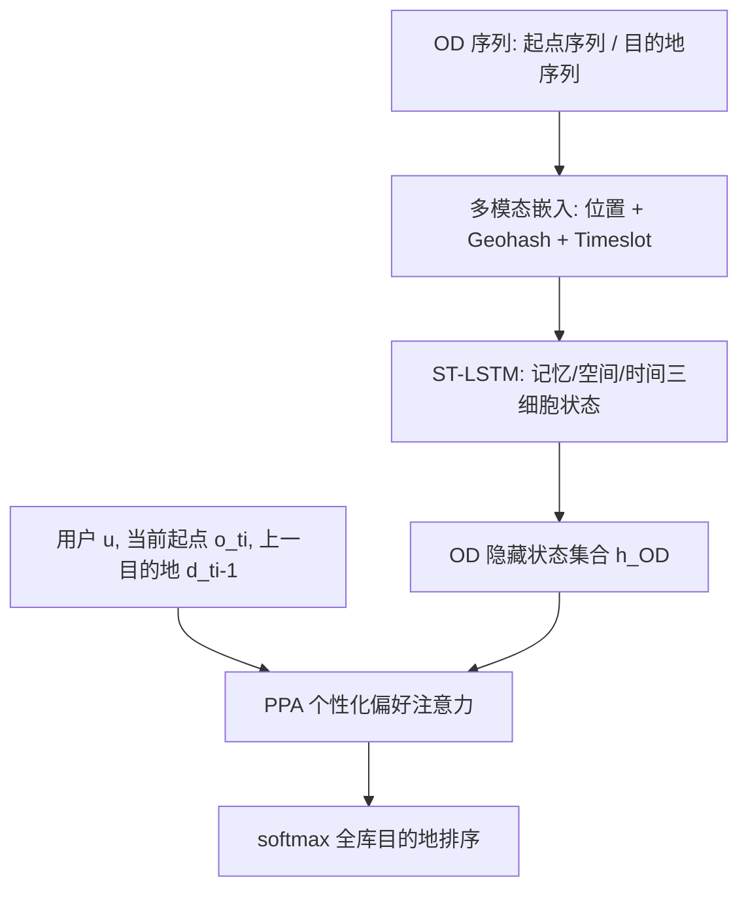
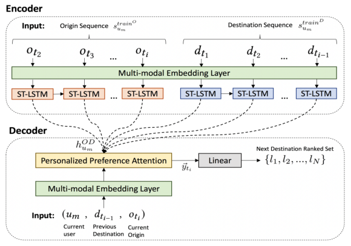

# Origin-Aware Next Destination Recommendation with Personalized Preference Attention (起点感知的个性化偏好注意力下一目的地推荐)

- **会议/期刊**: WSDM 2021
- **作者与机构**: Nicholas Lim, Yong Liang Goh, Renrong Weng, Rui Tan (GrabTaxi Holdings)；Bryan Hooi, See-Kiong Ng, Xueou Wang (NUS / Grab-NUS AI Lab)
- **推荐链路定位**: 召回（候选目的地全库排序）
- **研究方向**: 时空轨迹与 POI 本地生活推荐 / 序列与会话推荐
- **论文原文**: [https://arxiv.org/abs/2012.01915v3](https://arxiv.org/abs/2012.01915v3)
- **开源代码**: 暂未开源

## TL;DR (1分钟核心速览)

现有下一 POI 推荐只吃历史目的地序列，忽略了网约车场景中“用户当前在哪上车”这一强约束，导致同一个用户无论身处何地都收到同一批推荐。本文提出 STOD-PPA 编码-解码模型：用 ST-LSTM 以 Geohash 局部视图 + 全库距离向量全局视图构造独立的时空细胞状态来学 OO/DD/OD 关系，再用 PPA 解码器把用户嵌入放进注意力打分。在 7 个 Grab 真实 OD 轨迹数据集上以全库排序的 Acc@K/MAP 评测，Acc@1 相对 SOTA（LSTPM-OD）在 SE-1 上从 0.3683 提升到 0.4173（+13.3%）。

## Background & Motivation (背景与核心矛盾)

- **主流范式**: 下一 POI 推荐以 RNN/LSTM 序列模型为主流，ST-RNN、HST-LSTM、STGN、LSTPM 通过把相邻目的地之间的空间/时间间隔注入门控或额外细胞状态来建模时空规律。
- **前人局限①（无起点感知）**: LBSN 数据只记录 check-in 目的地，无 origin 信息，推荐结果与用户当前所在位置无关，在网约车场景中完全不实用（会推荐几十公里外的目的地）。
- **前人局限②（未来信息穿越 + 仅局部视图）**: ST-RNN/HST-LSTM/STGN 用 $d_{t_{i-1}}$与待预测的$d_{t_i}$之间的间隔$\Delta d_{t_i}$作为输入，推理时$d_{t_i}$ 未知，属于训练-推理不一致；且只关注相邻点对，无法从城市级全局视角学关系。
- **核心洞察 (Key Insight)**: 网约车 OD 轨迹天然含起点，起点序列与目的地序列各自携带 OO 与 DD 转移，而 $o_{t_i}\!\to\! d_{t_i}$ 的 OD 关系需要显式建模；同时“当前点到全库所有点的距离向量”是可离线预计算的、不含未来信息的全局信号。
- **本文切入点**: 把时空因子拆成“局部 Geohash 语义 + 全局间隔向量”，灌进独立的时空细胞状态以打通 OO/DD/OD，再用注意力解码得到起点条件化的排序。

<figure class="paper-figure" markdown="span">
  <figcaption>图1：用户轨迹示意图，包含起点序列（蓝色节点）和目的地序列（红色节点），可用于交通领域预测下一个目的地𝑑𝑡𝑖。地图 © OpenStreetMap 贡献者，CC BY-SA。</figcaption>
</figure>

## Method (核心方法设计)

### 1. 整体框架 (Overall Architecture)

输入为用户的 OD 元组序列，训练时拆成起点序列 $s^{O}_{u_m}=\{o_{t_2},\dots,o_{t_i}\}$与目的地序列$s^{D}_{u_m}=\{d_{t_1},\dots,d_{t_{i-1}}\}$（删去首起点与末目的地，使编码器与解码器共享同一批输入以支持按用户批训练）。两路序列分别过一个 ST-LSTM 得到 OO 与 DD 编码，拼接为$h^{OD}_{u_m}$；解码器以「用户嵌入 + 当前起点 + 上一目的地」为 query，对全部隐藏状态做个性化注意力加权求和，再经线性层与 softmax 在$|L|$个位置全库打分。训练完成后编码器离线冻结，只把预计算的$h^{OD}_{u_m}$ 留存在线检索。

<figure class="paper-figure" markdown="span">
  <figcaption>图4：STOD-PPA 示意图。</figcaption>
</figure>

### 2. 关键设计拆解 (Key Designs)

1. **ST-LSTM 双视图时空细胞状态**：痛点是不引入未来目的地就无法刻画时空因子。作者为空间与时间各建一套门控与细胞状态，输入同时取局部视图嵌入（Geohash 单元 $\mathbf{l}^{geo}$、3 小时时段$\mathbf{l}^{slot}$）与全局视图向量（对全库$|L|$ 个位置的 Haversine 距离 / OD 时间差），如
$c^{s}_{t_i}=f^{s}_{t_i}\odot c^{s}_{t_{i-1}}+i^{s}_{t_i}\odot\tilde{c}^{s}_{t_i},\quad i^{s}_{t_i}=\sigma(\mathbf{W}^{s}_{i}\mathbf{l}^{geo}_{t_i}+\mathbf{V}^{s}_{i}\Delta\mathbf{s}_{l_{t_i}}+\mathbf{U}^{s}_{i}h_{t_{i-1}}+\mathbf{b}^{s}_{i})$，
三路细胞状态融合为 $h_{t_i}=o_{t_i}\odot\tanh(\mathbf{W}_{h}(c_{t_i}\|c^{s}_{t_i}\|c^{t}_{t_i}))$。直觉：Geohash 负责“商圈/住宅区”这类区域语义，全局距离向量负责“跨格但仍邻近”的相似性，二者互补且全程不需要$d_{t_i}$ 的任何信息。
2. **PPA 个性化偏好注意力解码**：前人把用户嵌入与隐状态相加或拼接，个性化只是偏置项。本文改为让用户嵌入参与注意力打分本身：
$\alpha_i=\frac{\exp(\sigma_{LR}(\mathbf{W}_{A}(\mathbf{u}_m\|\mathbf{o}_{t_i}\|\mathbf{d}_{t_{i-1}}\|h_i)))}{\sum_{p\in h^{OD}_{u_m}}\exp(\sigma_{LR}(\mathbf{W}_{A}(\mathbf{u}_m\|\mathbf{o}_{t_i}\|\mathbf{d}_{t_{i-1}}\|h_p)))}$，
$y_{t_i}=\sum_i\alpha_i\odot h_i$，$P(d_{t_i}|o_{t_i},d_{t_{i-1}},u_m)=\mathrm{softmax}(\mathbf{W}_{loc}y_{t_i})$。因为 query 中含当前起点$o_{t_i}$，注意力分布随起点变化，天然实现 origin-aware 与可解释权重。
3. **训练目标与推理开销**：位置预测视为 $|L|$类多分类，损失为交叉熵$\mathcal{L}=-\sum\log P(d^{\ast}_{t_i}|o_{t_i},d_{t_{i-1}},u_m)$，**无负采样**（softmax 全库归一化，等价于 Full-Ranking 训练）；Adam + lr 1e-4、15 epoch、batch=1 用户。推理时编码器离线，在线只跑一次$O(|h^{OD}|)$ 注意力与一次矩阵乘，成本远低于重跑 RNN。

## Experimental Setup & Evaluation Protocol (实验设置与评估协议)

- **数据集与预处理**: Grab 2019 年 7 个东南亚国家的真实用户级 OD 轨迹（国家匿名）。预处理同 STGN：剔除 OD 元组 <10 的用户、被 <10 个用户访问的位置。

| 数据集 | #Users | #Locations | #Origins / #Dest. | #Trips |
| :--- | :---: | :---: | :---: | :---: |
| SE-1 | 2,662 | 1,694 | 1,131 / 563 | 23,730 |
| SE-3 | 2,677 | 1,469 | 972 / 497 | 21,164 |
| SE-6 | 1,363 | 1,001 | 642 / 359 | 21,156 |
| SE-7 | 3,301 | 2,044 | 1,315 / 729 | 23,019 |

- **数据划分与防穿越**: 按用户内时间戳升序，前 **70% 训练 / 后 30% 测试**（时间切分，预测未来目的地），非 Leave-One-Out；另设冷启动划分（仅保留 <10 次出行的用户）。
- **排名评测协议**: 无偏 **Full-Ranking**（softmax 覆盖全部 $|L|$ 个位置后排序），指标 Acc@{1,5,10} 与 MAP；无采样负例。
- **对比基线与超参**: TOP / U-TOP / TAXI / MF（非序列）、RNN / GRU / LSTM、HST-LSTM、STGN、STGCN、SOTA 的 LSTPM 及其 OD 扩展 LSTPM-OD（为公平起见，RNN 系与 LSTPM 均改为拼接 $o_{t_i}\|d_{t_{i-1}}$）；嵌入与隐维均 256，Geohash 精度 5（≈4.9km×4.9km），8 个三小时时段；序列模型报告 10 次随机种子均值 ± 标准差（未做显著性检验）。

## Key Experimental Results (实验关键数据)

### 1. 主实验对比 (Main Results)

| Dataset | Metric | U-TOP | LSTM | HST-LSTM | STGN | LSTPM | LSTPM-OD | **STOD-PPA** | Improv. |
| :--- | :--- | :---: | :---: | :---: | :---: | :---: | :---: | :---: | :---: |
| SE-1 | Acc@1 | 0.1344 | 0.2039 | 0.1103 | 0.0294 | 0.3402 | 0.3683 | **0.4173** | +13.3% |
| SE-1 | Acc@5 | 0.5275 | 0.2978 | 0.2181 | 0.1012 | 0.5001 | 0.5357 | **0.5615** | +4.8% |
| SE-1 | MAP | 0.2956 | 0.2517 | 0.1666 | 0.0724 | 0.4162 | 0.4482 | **0.4865** | +8.5% |
| SE-4 | Acc@1 | 0.0856 | 0.1652 | 0.0830 | 0.0359 | 0.2798 | 0.3047 | **0.3329** | +9.3% |
| SE-5 | Acc@1 | 0.1063 | 0.1249 | 0.0546 | 0.0242 | 0.2507 | 0.2739 | **0.3049** | +11.3% |
| SE-7 | Acc@1 | 0.0719 | 0.1078 | 0.0586 | 0.0206 | 0.2231 | 0.2407 | **0.2709** | +12.5% |
| SE-7 | MAP | 0.1902 | 0.1398 | 0.0954 | 0.0455 | 0.2774 | 0.3022 | **0.3289** | +8.8% |

### 2. 消融实验 (Ablation Study)

| 变体 | 改动 | Acc@1 结果趋势 |
| :--- | :--- | :--- |
| **STOD-PPA** | 完整模型 | 7/7 数据集最优 |
| OD-PPA | 去掉 ST-LSTM 时空细胞状态，仅用 LSTM | 全线下降（图 5） |
| Decoder-only | 跳过编码器，直接用原始序列项 | 大幅下降（图 6） |
| Encoder-only | 以 $h_{o_{t_i}}\|h_{d_{t_{i-1}}}$ 替代注意力加权 | 明显下降（图 6） |
| Add. / Concat. 用户嵌入 | 替代注意力打分中的 $\mathbf{u}_m$ | 均低于 PPA（图 7） |
| LSTPM → LSTPM-OD | 仅加入起点拼接（对照，SE-1 Acc@1） | 0.3402 → 0.3683 |
| 冷启动（表 3） | 仅保留 <10 次出行用户 Acc@1 | 6/7 数据集第一，SE-6 由 0.1922→0.2154 |

### 3. 关键实验发现 (Key Findings)

1. **起点信息是最大单一增益源但也最易被浪费**：LSTPM 仅靠拼接起点就拿到 +8.3%（0.3402→0.3683），而 STOD-PPA 在同一输入上再拿 +13.3%，说明收益来自 OD 关系的显式建模而非“多一列特征”。
2. **局部+全局双视图不可替代**：去掉时空细胞状态后所有数据集 Acc@1 下降；而 HST-LSTM/STGN 因只能用 $d_{t_{i-2}}\!\to\!d_{t_{i-1}}$ 的间隔（避免未来信息穿越）性能反而极低（SE-1 Acc@1 仅 0.0294/0.1103），验证“预计算的全库间隔向量”是兼顾合规与效果的关键。
3. **个性化入口位置比个性化强度更重要**：用户嵌入参与注意力打分优于相加/拼接（图 7）；案例研究（SE-7 用户 3250）中注意力将 93% 概率集中到真值 1671，证明 PPA 权重本身可作为推荐理由输出。

## Highlights & Limitations (亮点、对比与审稿批判)

- **与代表作对比 (vs. Prior Work)**: 相比 STGN/LSTPM 用“未来目的地间隔”或长短期偏好分解，本文把时空因子做成可离线预计算的全库向量并引入独立细胞状态；相比 LSTPM-OD 的起点拼接，本文让起点进入注意力 query 实现真正的条件化推荐。
- **可迁移亮点**: ①「查询点→全库距离向量」这一无穿越的全局视图编码，可直接迁移到打车/外卖/到店等任意带 origin 的召回场景；②把用户嵌入放进 attention 打分而非拼接，是低成本提升个性化的通用技巧。
- **审稿级局限批判**: ①全部数据集为同一公司 7 个国家私有数据，无 Gowalla/Foursquare 公开基准，跨域可比性弱；②Geohash 精度（5）、时段数（8）为人工设定且未做敏感性分析，仅给出 $H_{dim}$ 与 epoch 的不敏感曲线；③注意力需对全部历史隐藏状态做 softmax，长序列用户在线延迟随历史长度线性增长，且未与 ANN 检索结合验证工业可行性。

## Rating (四维评分)

- **方法创新性 (Novelty)**: ⭐⭐⭐⭐ （首次形式化 origin-aware 下一目的地推荐，并用“双视图时空细胞状态 + 用户嵌入入注意力”给出干净的机制解，但组件本身均为 LSTM/Attention 的工程化组合）
- **评估协议与实验扎实度 (Protocol & Experiments)**: ⭐⭐⭐⭐ （7 个真实数据集、Full-Ranking 评测、10 次种子均值 ± 方差、含冷启动与多组消融；扣分在无公开数据集与显著性检验）
- **写作与数学规范度 (Clarity & Rigor)**: ⭐⭐⭐⭐ （公式与符号一致、图 1–2 的局部/全局动机图解清晰；但时空细胞状态的复杂度与参数量未分析，部分消融仅有柱状图无数值）
- **工业落地与复现价值 (Industrial & Practical Value)**: ⭐⭐⭐⭐ （编码器离线预计算 + 解码器轻量在线，贴合打车 App 实时推荐；位置/Geohash/时段嵌入可增量更新；但无开源代码，冷启动场景增益有限）

