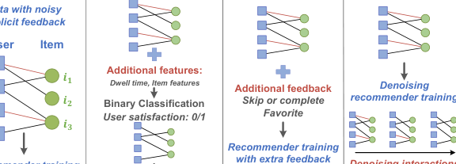
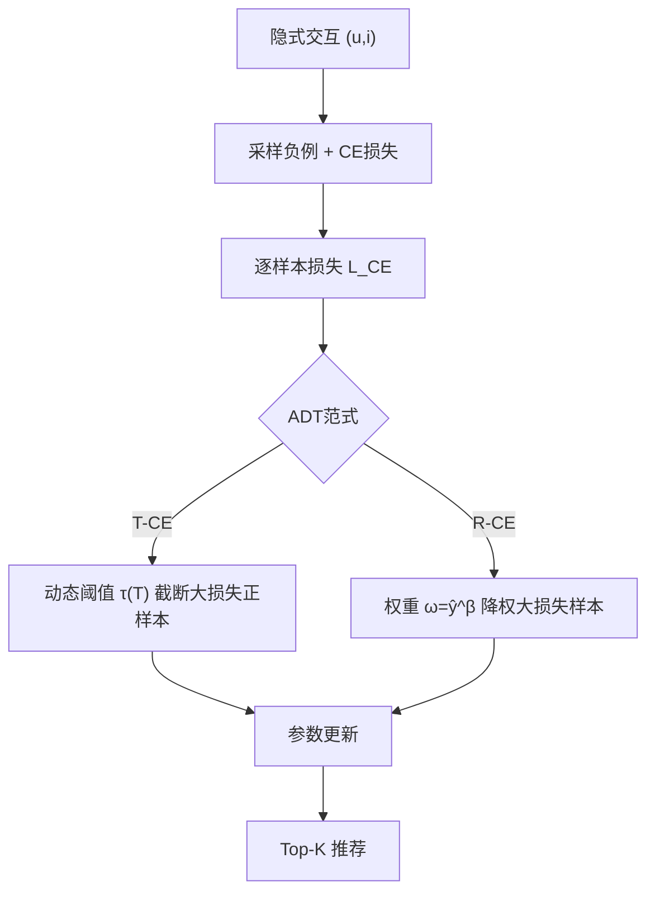
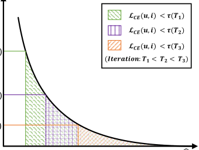

# Denoising Implicit Feedback for Recommendation (隐式反馈去噪推荐)

- **会议/期刊**: WSDM 2021
- **作者与机构**: Wenjie Wang, Fuli Feng, Xiangnan He, Liqiang Nie, Tat-Seng Chua; NUS, USTC, SDU
- **推荐链路定位**: 召回/精排通用训练策略
- **研究方向**: 自监督对比学习与交互去噪
- **论文原文**: [论文原文链接](https://arxiv.org/abs/2006.04153v2)
- **开源代码**: [开源代码仓库链接](https://github.com/WenjieWWJ/DenoisingRec)

## TL;DR (1分钟核心速览)

隐式反馈中点击/购买不等于真实满意，假阳性交互会误导推荐训练。本文观察到假阳性样本在训练早期损失更大，提出ADT：用动态阈值截断大损失正样本（T-CE）或按预测分重加权（R-CE），无需额外反馈。在Adressa/Amazon-book/Yelp上采用全库未交互排序评测，NeuMF+T-CE平均提升15.62%，GMF/CDAE也一致提升。

## Background & Motivation (背景与核心矛盾)

- **主流范式**: 推荐系统默认用点击/购买等隐式反馈训练CF模型（GMF/NeuMF/CDAE），以二元交叉熵或BPR损失优化。
- **前人局限**: 假阳性交互（用户交互但不满意）普遍存在；已有方案需额外反馈（停留时长、评分、favorite/skip）或预识别负体验，额外数据稀疏且难采集。
- **核心洞察**: 深度模型存在“记忆效应”：早期先学简单干净模式，假阳性交互因更接近负样本而损失更大；后期模型仍会拟合所有交互，导致泛化下降。
- **本文切入点**: 仅依赖训练损失本身，训练中动态剪枝/降权大损失正交互，不引入任何额外数据。

<figure class="paper-figure" markdown="span">
  <figcaption>图1：正常训练（a）、两种已有解决方案（b）和（c）与无额外数据的去噪训练（d）的对比。用户-物品图中的红线表示假阳性交互。</figcaption>
</figure>

## Method (核心方法设计)

### 1. 整体框架 (Overall Architecture)

模型输入用户-物品隐式交互，每批采样未交互负例，计算正负样本CE损失。ADT在每轮训练中读取逐样本损失：T-CE按动态阈值丢弃大损失正样本，R-CE按预测置信度降低大损失样本权重；更新参数后继续训练。推理时与原始GMF/NeuMF/CDAE完全一致，仅训练阶段增加逐样本损失排序/阈值计算，在线无额外开销。

### 2. 关键设计拆解 (Key Designs)

1. **T-CE 动态截断**：痛点：固定阈值不适应损失下降；核心：$\mathcal{L}_{T-CE}(u,i)=0$when$\mathcal{L}_{CE}(u,i)>\tau(T)$and$\bar{y}_{ui}=1$, otherwise$\mathcal{L}_{CE}(u,i)$。丢弃率$\epsilon(T)=\min(\alpha T,\epsilon_{\max})$，每轮丢弃损失最大的$\lfloor\epsilon(T)|\bar{D}_T|\rfloor$个正样本。直觉：大损失正样本更像假阳性，早期剪掉可防止记忆噪声，后期逐步增大丢弃率。

<figure class="paper-figure" markdown="span">
  <figcaption>图4：针对已观测交互（即 ¯𝑦𝑢𝑖= 1）的 T-CE 损失示意图。𝑇𝑖为迭代次数，𝜏(𝑇𝑖)表示阈值。虚线区域表示有效损失，大于 𝜏(𝑇𝑖) 的损失值被截断。</figcaption>
</figure>

2. **R-CE 自适应重加权**：痛点：硬截断可能误删干净难样本；核心：$\mathcal{L}_{R-CE}(u,i)=\omega(u,i)\mathcal{L}_{CE}(u,i)$，正样本$\omega(u,i)=\hat{y}_{ui}^{\beta}$，负样本$(1-\hat{y}_{ui})^{\beta}$。直觉：预测分越低（损失越大）权重越小，避免异常大损失主导优化；$\beta$控制难易样本权重差。

3. **训练目标、负采样与推理效率**：总损失为批内正负样本的CE加权/截断和；负采样为均匀采样未交互物品（每批采样$\bar{D}_{neg}$，正负一起更新）；推理与正常模型完全一致，仅训练时多一次排序/阈值，几乎无额外在线开销。

## Experimental Setup & Evaluation Protocol (实验设置与评估协议)

- **数据集与预处理**:

| 数据集 | #Users | #Items | #Interactions | 密度 | #FP Interaction |
| :--- | :---: | :---: | :---: | :---: | :---: |
| Adressa | 212,231 | 6,596 | 419,491 | 0.030% | 247,628 |
| Amazon-book | 80,464 | 98,663 | 2,714,021 | 0.034% | 199,475 |
| Yelp | 45,548 | 57,396 | 1,672,520 | 0.064% | 260,581 |

假阳性定义：Adressa停留<10s；Amazon/Yelp评分<3。训练与验证保留全部交互（含假阳性），测试仅保留真阳性。

- **数据划分与防穿越**: 沿用前作比例划分（训练/验证/测试），未采用全局时间戳切分；测试阶段剔除假阳性，避免用噪声标签评估。
- **排名评测协议**: 无偏Full-Ranking（全库未交互排序）：对测试用户，在除训练正样本外的所有物品上打分排序；Amazon/Yelp取K=50/100，Adressa取K=3/20；指标为Recall@K、NDCG@K。
- **对比基线与超参设置**: 基线为GMF、NeuMF、CDAE；额外对比NMTR、NR（使用额外反馈）。GMF/NeuMF嵌入$d=32$，CDAE隐层200；Adam lr=0.001，batch=1024；ADT超参$\epsilon_{\max}\in\{0.05,0.1,0.2\}$，$\beta\in\{0.05,\ldots,1.0\}$，$\epsilon_N\in\{1k,\ldots,30k\}$。原文未明确报告显著性检验，以多模型/多数据集一致提升为证据。

## Key Experimental Results (实验关键数据)

### 1. 主实验对比 (Main Results)

| 模型 | Amazon R@50 | Amazon R@100 | Amazon N@50 | Amazon N@100 | Yelp N@50 | Avg RI |
| :--- | :---: | :---: | :---: | :---: | :---: | :---: |
| GMF | 0.0609 | 0.0949 | 0.0256 | 0.0331 | 0.0352 | - |
| GMF+T-CE | 0.0707 | 0.1113 | 0.0292 | 0.0382 | 0.0359 | 7.14% |
| GMF+R-CE | 0.0682 | 0.1075 | 0.0275 | 0.0362 | 0.0366 | 4.34% |
| NeuMF | 0.0512 | 0.0829 | 0.0211 | 0.0282 | 0.0304 | - |
| NeuMF+T-CE | 0.0725 | 0.1158 | 0.0289 | 0.0385 | 0.0323 | **15.62%** |
| NeuMF+R-CE | 0.0628 | 0.1018 | 0.0248 | 0.0334 | 0.0320 | 8.77% |
| CDAE | 0.0989 | 0.1507 | 0.0414 | 0.0527 | 0.0471 | - |
| CDAE+T-CE | **0.1088** | **0.1645** | **0.0454** | **0.0575** | **0.0504** | 5.36% |
| CDAE+R-CE | 0.1022 | 0.1560 | 0.0424 | 0.0542 | 0.0488 | 2.46% |

### 2. 消融实验 (Ablation Study)

| GMF变体 (Amazon-book) | R@50 | R@100 | N@50 | N@100 |
| :--- | :---: | :---: | :---: | :---: |
| GMF | 0.0609 | 0.0949 | 0.0256 | 0.0331 |
| GMF+NMTR | 0.0616 | 0.0967 | 0.0254 | 0.0332 |
| GMF+NR | 0.0615 | 0.0958 | 0.0254 | 0.0331 |
| GMF+T-CE | **0.0707** | **0.1113** | **0.0292** | **0.0382** |
| GMF+R-CE | 0.0682 | 0.1075 | 0.0275 | 0.0362 |

### 3. 关键实验发现 (Key Findings)

1. T-CE在NeuMF上平均提升15.62%，Amazon-book R@50从0.0512到0.0725（+41.6%），说明大损失截断最受益于高容量、易记忆噪声的NeuMF；CDAE仅+5.36%，因其随机去噪已有一定鲁棒性。
2. T-CE整体优于R-CE（GMF 7.14% vs 4.34%，NeuMF 15.62% vs 8.77%），但R-CE在Yelp的GMF N@50略高（0.0366 vs 0.0359）；T-CE在Adressa对NeuMF略降（N@20 0.1840 vs 0.1886），提示小物品空间下截断比例需调低。
3. 与使用额外反馈的NMTR/NR相比，GMF+T-CE在Amazon-book R@50=0.0707，明显高于NMTR 0.0616和NR 0.0615；图9显示T-CE召回近半假阳性但精度仅约10%，说明“误删干净样本”的代价可被去噪收益覆盖。

## Highlights & Limitations (亮点、对比与审稿批判)

- **与代表作对比 (vs. Prior Work)**: 与负体验识别（需dwell time/gaze）和额外反馈融合（NR/NMTR）不同，ADT只用隐式交互和训练损失，不依赖额外数据；与CDAE随机加噪去噪不同，ADT针对自然假阳性而非随机噪声。
- **可迁移亮点**: 逐样本损失动态截断/重加权可迁移到BPR、平方损失、多任务精排；T-CE的drop-rate调度和R-CE的$\hat{y}^\beta$重加权可直接用于CTR/CVR噪声标签。
- **审稿级局限批判**: 1) T-CE在Amazon-book上precision仅约10%，会误删大量干净难样本，且$\epsilon_{\max}/\epsilon_N$超参搜索空间大；2) 评测仅离线全库排序，未报告显著性检验与线上A/B；假阳性标签依赖评分/停留时间等辅助信号，真实场景中可能不准确。

## Rating (四维评分)

- **方法创新性 (Novelty)**: ⭐⭐⭐⭐ （将记忆效应/大损失假阳性现象系统化，提出T-CE/R-CE两种通用损失范式，简单有效但理论深度有限）
- **评估协议与实验扎实度 (Protocol & Experiments)**: ⭐⭐⭐⭐ （三个真实数据集、三种推荐模型、全库排序与稀疏分桶分析完整；但未报告显著性检验，Adressa上T-CE对NeuMF略降）
- **写作与数学规范度 (Clarity & Rigor)**: ⭐⭐⭐⭐⭐ （公式简洁、算法伪代码清晰、T-CE/R-CE图示直观；对记忆效应和超参分析到位）
- **工业落地与复现价值 (Industrial & Practical Value)**: ⭐⭐⭐⭐ （开源代码，训练时仅增加逐样本损失排序/阈值，在线推理零额外开销；但需调$\epsilon_{\max}/\epsilon_N/\beta$，且依赖假阳性可识别假设）

