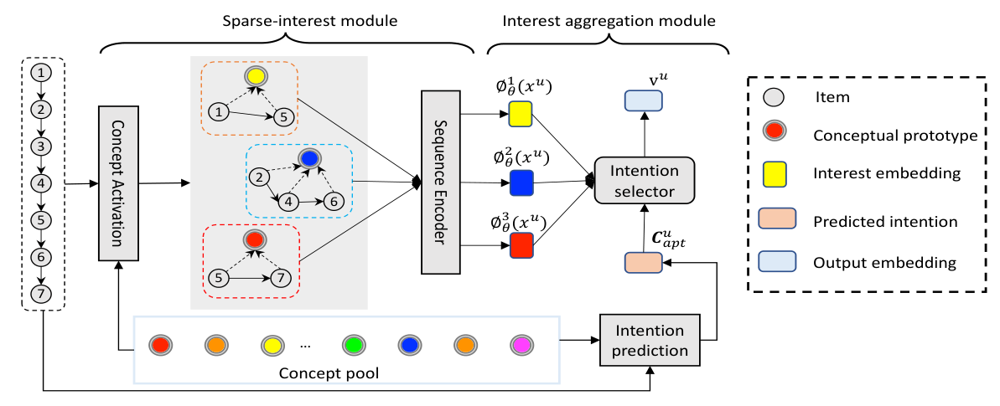
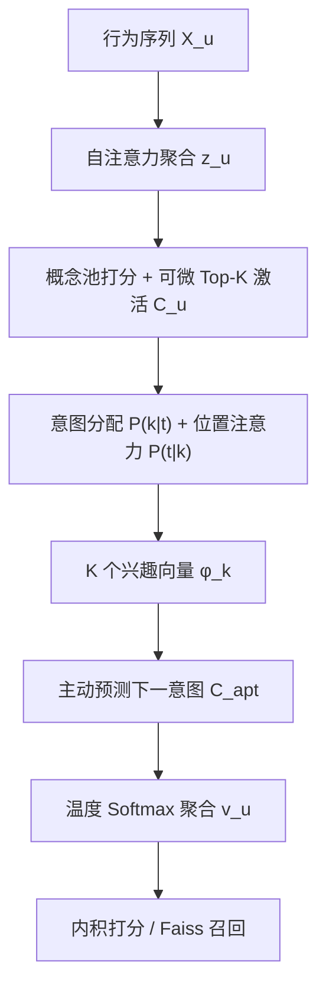

# Sparse-Interest Network for Sequential Recommendation (稀疏兴趣网络用于序列推荐)

- **会议/期刊**: WSDM 2021 (Virtual Event)
- **作者与机构**: Qiaoyu Tan, Jianwei Zhang, Jiangchao Yao, Ninghao Liu, Jingren Zhou, Hongxia Yang, Xia Hu（Texas A&M University / 阿里巴巴）
- **推荐链路定位**: 召回（匹配阶段 Matching Stage，ANN 全库检索）
- **研究方向**: 序列与会话推荐 / 协同过滤与双塔召回
- **论文原文**: [https://arxiv.org/abs/2102.09267v1](https://arxiv.org/abs/2102.09267v1)
- **开源代码**: 暂未开源

## TL;DR (1分钟核心速览)

序列推荐普遍把用户历史压成**单一向量**，而实测（淘宝近 50 次行为仅约 10 个类目）表明该类向量被最近高频行为主导，当下一物品的同概念物品不在近期主导时即预测失败。SINE 维护 $L$个（可达 5000）概念原型，用可微 top-$K$选择算子为每个用户稀疏激活少量原型，再以"主动预测下一意图"替代标签式选择来聚合$K$ 个兴趣向量。在 Leave-One-Out + 全库排序协议下，Taobao HR@50 17.69 / NDCG@50 10.41（vs MIND 15.35 / 8.35），4B 交互工业集 HR@50 相对提升 34.06%。

## Background & Motivation (背景与核心矛盾)

- **主流范式**: GRU4Rec / Caser / SASRec 用 RNN、CNN 或自注意力编码行为序列，输出单个 $D$ 维用户向量，再与物品向量内积做召回。
- **前人局限**: 其一，单向量容量不足——多概念混杂序列中，近期高频概念吃掉全部表征预算（图 1 显示 "In/Out" 命中率 0.49 vs 0.35，近期五行为主时命中率 0.31 vs 0.12）。其二，现有多兴趣方案（MIND 的胶囊动态路由、MCPRN/DisenRec 的隐原型）把兴趣数绑定于簇数，簇数上千即每用户需上千向量，工业上不可扩展。
- **核心洞察 (Key Insight)**: 真实系统的用户兴趣天然**稀疏**——一个人只触达数千类目中的极少数；因此不必"每人每概念一向量"，只需从大池中激活少数原型。
- **本文切入点**: 把"概念池 → 稀疏激活 → 多兴趣编码 → 意图主动预测聚合"四步端到端联合训练，同时学到聚类结构与用户兴趣。

<figure class="paper-figure" markdown="span">
  ![图1：在Taobao\[51\]上进行下一物品预测时，基于单嵌入的SASRec\[21\]的top@100命中与未命中分析。左侧展示了“In”和“Out”设置下的预测结果。“In”表示最近50个行为中交互过与下一预测物品同类别的相似物品，否则为“Out”。右侧展示了相似物品在最近5个行为中的频率。若相似物品在过去交互中占主导，SASRec更倾向于正确预测下一物品。](../../../../assets/papers/2102.09267v1/figure_1.png)<figcaption>图1：在Taobao[51]上进行下一物品预测时，基于单嵌入的SASRec[21]的top@100命中与未命中分析。左侧展示了“In”和“Out”设置下的预测结果。“In”表示最近50个行为中交互过与下一预测物品同类别的相似物品，否则为“Out”。右侧展示了相似物品在最近5个行为中的频率。若相似物品在过去交互中占主导，SASRec更倾向于正确预测下一物品。</figcaption>
</figure>
<figure class="paper-figure" markdown="span">
  <figcaption>图2：SINE的架构（彩色查看效果更佳）。以用户行为序列为输入，稀疏兴趣模块旨在从大规模兴趣组池中自适应地激活其兴趣，并输出多兴趣嵌入。随后，兴趣聚合模块通过主动预测用户下一意图，帮助选择最偏好的兴趣用于下一物品推荐。SINE能够以端到端方式聚类物品并推断用户稀疏兴趣集合。</figcaption>
</figure>

## Method (核心方法设计)

### 1. 整体框架 (Overall Architecture)

输入用户行为序列 $\mathbf{x}^{(u)}$经嵌入层得$\mathbf{X}_u\in\mathbb{R}^{n\times D}$。稀疏兴趣模块先用自注意力聚出虚拟概念向量$\boldsymbol{z}_u$，与概念池$\mathbf{C}\in\mathbb{R}^{L\times D}$打分并取 top-$K$，得激活原型$\mathbf{C}_u$；随后由"意图分配"（物品–原型余弦相似）与"位置注意力"双路权重加权重构出$K$个兴趣向量。兴趣聚合模块先把序列投影到意图空间得到意图序列，再自注意力预测下一意图$\mathbf{C}^u_{apt}$，以其为 query 对$K$个兴趣向量做温度 softmax 聚合得最终$\boldsymbol{v}_u$，与物品表内积训练、上线走 Faiss 检索。

### 2. 关键设计拆解 (Key Designs)

1. **可微 Top-K 稀疏概念激活**：痛点是从 $L$（5000）个原型中"选择"是不可导的离散操作。本文用 top-$K$索引 + Sigmoid 门控做直通近似：$\boldsymbol{s}_u=\langle\mathbf{C},\boldsymbol{z}_u\rangle$，$\mathbf{C}_u=\mathbf{C}(\text{idx},:)\odot\sigma(\boldsymbol{s}_u(\text{idx})\mathbf{1}^\top)$。选择决定"用哪几个原型"，门控值决定"用得多强"，从而把$O(L)$的门控压到$O(K)$ 的实际计算，正是稀疏性带来的可扩展性。

2. **双路注意力兴趣编码（余弦而非内积）**：仅靠注意力权重无法区分"哪个物品属于哪个概念"。本文先算意图分配 $P_{k|t}\propto\exp(\text{LN}(\mathbf{X}^u_t\mathbf{W}_3)\cdot\text{LN}(\mathbf{C}^u_k))$，再乘带位置嵌入的位置注意力$P_{t|k}$，得$\phi^k_\theta=\text{LN}(\sum_t P_{k|t}P_{t|k}\mathbf{X}^u_t)$。此处刻意用**归一化余弦**：内积下模型易把全部质量塌缩到少数原型（model collapse），余弦对尺度不敏感，保证$K$ 个兴趣向量真正分工。

3. **主动意图预测聚合与训练目标**：MIND 式"用下一物品标签挑兴趣"在推断期无标签，训练/测试存在鸿沟。本文令意图序列 $\tilde{\mathbf{X}}_u=\mathbf{P}_u\mathbf{C}_u$，自注意力预测$\mathbf{C}^u_{apt}$，再以$\mathbf{e}^u_k=\text{softmax}(\mathbf{C}^{u\top}_{apt}\phi^k_\theta/\tau)$聚合（$\tau=0.1$近似 one-hot）。总损失为采样 softmax 似然 + 原型去相关正则：$\mathcal{L}=\mathcal{L}_{like}+\lambda\cdot\frac{1}{2}(\|\mathbf{M}\|_F^2-\|\text{diag}(\mathbf{M})\|_F^2)$，其中$\mathbf{M}$为原型协方差矩阵；负采样为 Sampled Softmax（MovieLens 5 个、其余 10 个负样本），无需难负样本挖掘；推断仅需一次 top-$K$选择与$K$ 路 Faiss 检索。

## Experimental Setup & Evaluation Protocol (实验设置与评估协议)

- **数据集与预处理**: Amazon 采用**非 5-core** 的 Book 全量稀疏版本（比 MIND 原文设定更难），Taobao 仅用点击行为。

| 数据集 | #Users | #Items | #Interactions | 稀疏度/密度 | 特征/场景说明 |
| :--- | :---: | :---: | :---: | :---: | :--- |
| MovieLens | 6,040 | 3,952 | 1,000,209 | ~4.2% | 电影评分，稠密小规模 |
| Amazon | 8,026,324 | 2,330,066 | 22,507,155 | ~0.00012% | 电商浏览/评分，极稀疏 |
| Taobao | 987,994 | 4,162,024 | 100,150,807 | ~0.0024% | 淘宝点击，含 9,439 类目 |
| ULarge (工业) | 106,527,123 | 25,000,000 | 4,000,000,000 | ~0.00015% | 阿里 2020.3.29–4.4 日志，14,874 叶子类目 |

- **数据划分与防穿越 (Splitting Strategy)**: 全部数据集采用 `Leave-One-Out`（每用户最后 1 次交互为测试、倒数第 2 次为验证、其余训练），测试输入序列含验证行为（与 SASRec 一致）。
- **排名评测协议 (Ranking Protocol)**: 公开集为**无偏 Full-Ranking**——测试时把用户所有未交互物品视为负样本计算 HR/NDCG@10/50/100；工业集 ULarge 走离线 HR@50/100/500。另用 NMI 定量评估学习到的原型与真实类目层级的对齐度。
- **对比基线与超参设置**: 单嵌入 GRU4Rec/Caser，多嵌入 SASRec/MIND/MCPRN；$D=128$、序列长度 20、batch 128、Adam lr=0.001、$\lambda=0.5$；$K$搜索 {4,8,12,16}、$L$搜索 {50,100,...,5000}（MovieLens$K{=}4,L{=}50$；Taobao$K{=}8,L{=}1000$；ULarge$K{=}8,L{=}5000$）。原文主表未报告显著性检验。

## Key Experimental Results (实验关键数据)

### 1. 主实验对比 (Main Results)

| 数据集 / 指标 | MovieLens HR@10 | MovieLens NDCG@10 | Amazon HR@50 | Amazon NDCG@50 | Taobao HR@50 | Taobao NDCG@50 | Taobao HR@100 | Taobao NDCG@100 |
| :--- | :---: | :---: | :---: | :---: | :---: | :---: | :---: | :---: |
| GRU4Rec | 14.61 | 5.66 | 1.70 | 0.51 | 9.41 | 3.60 | 12.43 | 4.08 |
| Caser | 15.44 | 6.13 | 2.60 | 0.81 | 10.71 | 4.96 | 13.50 | 5.68 |
| SASRec | **17.34** | **7.84** | 3.17 | 1.01 | 13.36 | 5.64 | 15.73 | 6.38 |
| MIND | 15.62 | 6.58 | 3.85 | 1.29 | 15.35 | 8.35 | 17.49 | 8.72 |
| MCPRN | 15.82 | 6.77 | 3.42 | 1.18 | 14.32 | 7.34 | 16.43 | 7.67 |
| **SINE** | 16.34 | 7.06 | **4.57** | **1.61** | **17.69** | **10.41** | **20.64** | **10.89** |
| Improv. (vs 最优基线) | -5.8% | -9.9% | **+18.7%** | **+24.8%** | **+15.2%** | **+24.7%** | **+18.0%** | **+24.9%** |

工业集 ULarge（HR%）：SINE 12.24 / 21.12 / 40.81（@50/@100/@500），对比次优 MIND 的 9.13 / 19.31 / 39.09，Improv. 分别为 **34.06% / 9.37% / 4.40%**。

### 2. 消融实验 (Ablation Study)

| 数据集 | 变体 | HR@50 | HR@100 | 说明 |
| :--- | :--- | :---: | :---: | :--- |
| Taobao | SINE-cate | 12.45 | 15.33 | 用真实类目作为原型 |
| Taobao | SINE-label | 16.22 | 18.74 | MIND 式标签注意力（K·N 再排序） |
| Taobao | **SINE** | **17.69** | **20.64** | 学习原型 + 主动意图聚合 |
| ULarge | SINE-cate | 7.18 | 17.46 | — |
| ULarge | SINE-label | 10.09 | 20.33 | — |
| ULarge | **SINE** | **12.24** | **21.12** | — |

原型聚类质量（ULarge NMI vs 阿里类目体系）：Level-1 **0.09** / Level-2 **0.37** / Leaf **0.29**。

### 3. 关键实验发现 (Key Findings)

1. **多兴趣 > 单嵌入，但收益与领域兴趣分散度强相关**：Taobao 上 SINE 相对 SASRec 的 HR@50 提升 32.4%（17.69 vs 13.36），Amazon 相对提升 44.2%（4.57 vs 3.17）；而 MovieLens 上 SINE 反落后 SASRec 5.8%（16.34 vs 17.34），说明电影域兴趣本就不分散，稀疏原型池难以提供额外容量。
2. **"学习到的原型"优于"专家类目"，"主动预测"优于"标签选择"**：SINE-cate（直接用 9,439 个真实类目）在 Taobao 掉至 12.45，低于 SINE 的 17.69（−29.6%），证明细粒度类目噪声大、概念需联合聚类；SINE-label 掉至 16.22（−8.3%），量化了 MIND 式标签路由的训练–推断鸿沟代价。
3. **学习到的概念是"粗粒度虚拟类目"，且增益集中于头部**：NMI 对 Level-2 最高（0.37 > Leaf 0.29 > Level-1 0.09），与 $K{=}8$ 覆盖 Taobao 约 9,000 类目的事实一致；工业集上 HR@50 涨 34.06% 但 HR@500 仅涨 4.40%，说明稀疏兴趣主要改善头部排序而非全量召回覆盖。

## Highlights & Limitations (亮点、对比与审稿批判)

- **与代表作对比 (vs. Prior Work)**: 与 SASRec 相比，SINE 不只是多头注意力的"隐式多向量"，而是显式概念原型驱动、可解释可聚类；与 MIND 相比，兴趣数从"固定胶囊数"解耦为"大池 + 稀疏 top-$K$"，且用可预测的意图 query 取代标签式路由；与 MCPRN/DisenRec 相比，兴趣向量数$K\ll L$，从$O(L)$降到$O(K)$，是本文能上 4B 工业数据的关键。
- **可迁移亮点**: (1) top-$K$ + Sigmoid 门控的直通近似，可复用于任何"大码本稀疏选择"场景（如语义 ID 选择、专家路由）；(2) 用 LayerNorm + 余弦相似替代内积做原型分配，是抑制原型塌缩的低成本正则，可直接搬进多兴趣召回。
- **审稿级局限批判**: (1) 训练用 Sampled Softmax（仅 5–10 负样本），而评估为全库 Full-Ranking，训练目标与评测分布不一致，未与全库 softmax / 难负样本对比；(2) $K$、$L$、$\lambda$需按数据集网格搜索（Taobao$L{=}1000$vs ULarge$L{=}5000$），概念池规模随物品量线性增长，且推断需$K$ 次 Faiss 查询，在线延迟与内存开销未量化；(3) 消融仅覆盖 Taobao/ULarge，缺少对双路注意力中"余弦 vs 内积"与"位置嵌入"的直接对照，削弱了机制归因强度。

## Rating (四维评分)

- **方法创新性 (Novelty)**: ⭐⭐⭐⭐ （把"大池稀疏 top-$K$ 激活"引入多兴趣序列召回，概念显式化并与聚合模块端到端联合，思路清晰且切中工业扩展性痛点）
- **评估协议与实验扎实度 (Protocol & Experiments)**: ⭐⭐⭐⭐ （三公开集 + 4B 工业集，Leave-One-Out + 全库排序规范，含 NMI 聚类的定量案例分析与两变体消融；但缺显著性检验与训练/评测负样本一致性讨论）
- **写作与数学规范度 (Clarity & Rigor)**: ⭐⭐⭐⭐ （四模块公式链条完整、符号统一，top-$K$ 可微近似与余弦归一化的动机均有文献或实证支撑；复杂度与推断延迟未给出形式化分析）
- **工业落地与复现价值 (Industrial & Practical Value)**: ⭐⭐⭐⭐ （百万到亿级用户、4B 交互上验证，检索侧天然契合 Faiss 多路召回；但代码未开源、超参敏感且缺少线上 A/B 与延迟指标）

