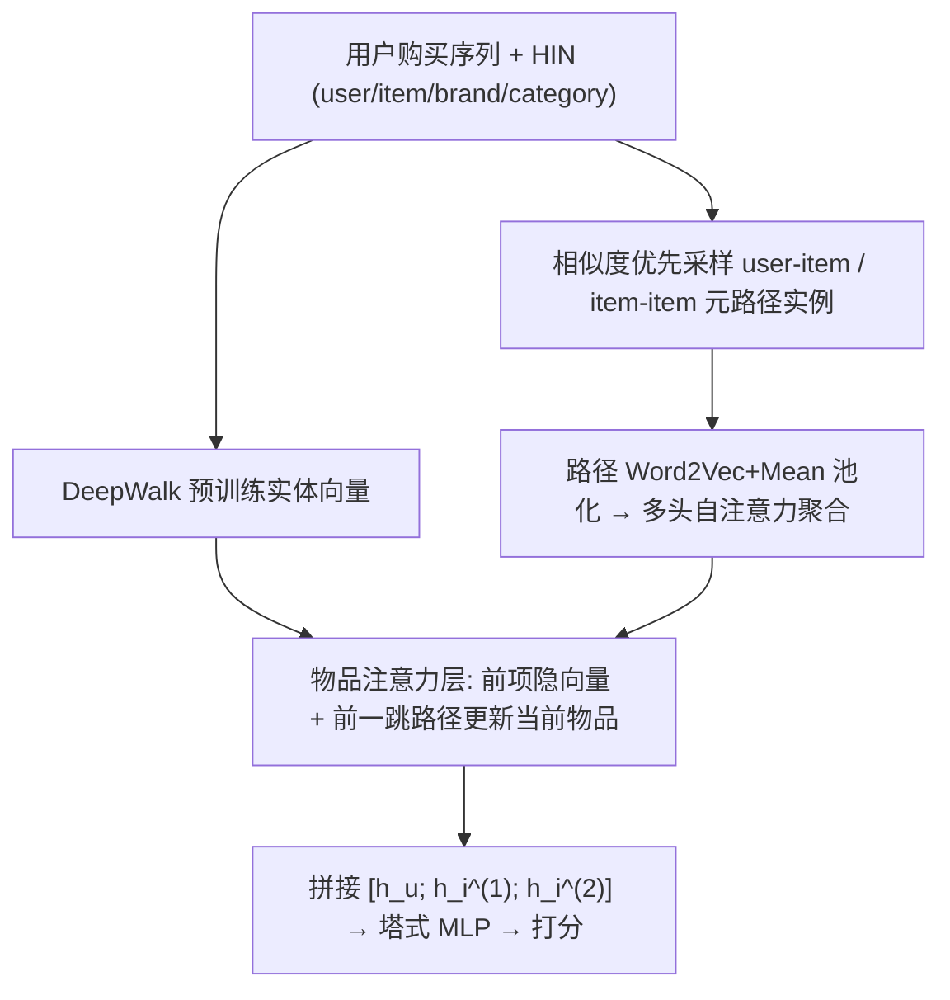

# Temporal Meta-path Guided Explainable Recommendation (时序元路径引导的可解释推荐)

- **会议/期刊**: WSDM 2021 (The 14th ACM International Conference on Web Search and Data Mining)
- **作者与机构**: Hongxu Chen, Yicong Li, Xiangguo Sun, Guandong Xu (University of Technology Sydney / Southeast University), Hongzhi Yin (University of Queensland)
- **推荐链路定位**: 召回（Top-K 下一物品预测）
- **研究方向**: 序列与会话推荐 / 图神经网络与知识图谱推荐
- **论文原文**: [https://arxiv.org/abs/2101.01433v1](https://arxiv.org/abs/2101.01433v1)
- **开源代码**: [https://github.com/Abigale001/TMER](https://github.com/Abigale001/TMER)

## TL;DR (1分钟核心速览)

现有路径式可解释推荐把知识图谱当作**静态图**，忽略了用户购买行为的时序演化；而已有的时序方案（如 KARN）把用户点击历史当作整体粗粒度处理，序列建模与推荐机制割裂。本文提出 TMER：用**相邻物品间的 item-item 元路径实例**直接刻画"为什么这次会买下一件"，替代 LSTM/GRU 的时序编码，并用多路径自注意力聚合复杂购买动机。在 Amazon 三数据集上采用 `Sampled Ranking (1:500)` 协议，HR@1 相对最强基线提升 30.4%（Musical Instruments）、36.8%（Automotive），NDCG@10 最高提升 53.0%。

## Background & Motivation (背景与核心矛盾)

- **主流范式**: 基于元路径的可解释推荐从用户-物品异构信息网络 (HIN) 中抽取 $UIBI$、$UICI$ 等路径实例作为推荐证据（代表工作 MCRec），或进一步用 LSTM/GRU 编码用户会话序列（GRU4Rec、KARN）。
- **前人局限**: (1) 静态图范式丢弃了时序——"用户先买手机、再买手机壳"的解释若退化为"相似用户也买过"，会掩盖真实因果链；(2) KARN 一类方法虽引入序列，但用户历史被整体聚合，且序列建模与路径推理是两个独立模块，粒度太粗。
- **核心洞察 (Key Insight)**: 用户**相邻两次购买的物品之间的高阶路径**本身就是"下一件的购买理由"，例如 *手机 $\xrightarrow{\text{same brand}}$耳机* 表示兼容性动机，*手机壳$\xrightarrow{\text{co-buy}}$ 手机膜* 表示互补性动机。因此 item-item 路径天然既是时序信号，又是解释信号。
- **本文切入点**: 把任务重构为序列推荐，但用"item-item 元路径实例 + 自注意力聚合"这一轻量算子代替重型 RNN 完成时序传递。

## Method (核心方法设计)

### 1. 整体框架 (Overall Architecture)

输入为用户及其按时序排列的最新 12 个购买物品，以及由 user/item/brand/category 构成的 HIN。首先用 DeepWalk 在用户-物品二部图上做随机游走预训练实体向量（作者实测优于 GraphSAGE/GAT，因为路径中的高阶共购传递性对推荐更关键）。随后按相似度优先采样得到 user-item 与 item-item 两类元路径实例，经 Word2Vec+Mean 池化为路径向量，再由多头自注意力学习"多动机组合特征"。关键一步是**物品注意力更新层**：用前一个物品的隐向量与前一跳路径实例共同更新当前物品表示，逐位串联完成时序建模。最后拼接 $[h_u; h_i^{(1)}; h_i^{(2)}]$ 送入塔式 MLP 输出打分。

### 2. 关键设计拆解 (Key Designs)

1. **物品注意力更新层（替代 RNN 的时序传递算子）**：痛点是 RNN/LSTM 重且长程依赖易衰减。TMER 用两层残差式门控，把"上一物品的隐状态"与"上一跳路径实例"融合，并乘以 $h_i$ 做物品自身的门控保留：

$$\mathbf{h}_i^{(1)}=\mathrm{ReLU}\left(\mathbf{W}_{i-1}\mathbf{h}_{i-1}+\mathbf{W}_{\phi}^{(1)}\mathbf{h}_{\phi_{i-1\to i}}+\mathbf{b}_i^{(1)}\right)\odot \mathbf{h}_{i-1},\quad \mathbf{h}_i^{(2)}=\mathrm{ReLU}\left(\mathbf{W}_i\mathbf{h}_i+\mathbf{W}_{\phi}^{(2)}\mathbf{h}_{\phi_{i-1\to i}}+\mathbf{b}_i^{(2)}\right)\odot \mathbf{h}_i$$

序列首项没有前驱，作者用 $u\to i_1$的 user-item 实例填补：$\mathbf{h}_{i=1}=\mathrm{ReLU}(\mathbf{W}_i\mathbf{h}_i+\mathbf{W}_{\phi}\mathbf{h}_{\phi_{u\to i}}+\mathbf{b}_i)\odot\mathbf{h}_i$。直觉是：路径实例的长度可控地决定了"记忆"的长短程配比，比固定结构的 RNN 更灵活且更轻。

2. **双视角元路径实例 + 多头自注意力组合**：单一用户-物品路径只能表达泛化购物兴趣，无法刻画"买手机壳"的具体动机。TMER 区分两类实例：user-item（$UIBI, UICI, UIBICI, UICIBI$）刻画长期口味，item-item（$ICIUI, IBIUI, ICICI, IBIBI, IUIUI$等 4–6 跳）刻画短期具体理由。由于多路径代表多个并存动机（朋友同款／热销匹配／颜色偏好），用标准多头自注意力$\mathrm{Softmax}(Q_\phi K_\phi^\top/\sqrt{d_k})V_\phi$学习路径权重，权重即解释。为解决路径数量立方级爆炸，按**当前节点与候选出边节点的嵌入相似度**做优先采样，取 top-$k$ 子路径。

3. **训练目标、负采样与推理效率**：损失函数采用负采样隐式反馈损失 $\mathcal{L}_{u,i}=-\mathbb{E}_{j\sim P_{neg}}\log\left(1-r_{u,j}\right)$，$P_{neg}$ 为**均匀分布**（无难负样本挖掘）。MLP 采用塔式结构（逐层减半隐层维度）+ Sigmoid 输出。推理时需对每个候选物品沿预采样路径计算物品注意力，开销主要来自路径实例查表，避开了 RNN 的逐步递推。

## Experimental Setup & Evaluation Protocol (实验设置与评估协议)

- **数据集与预处理**: 来自 Amazon 三品类，构建含 user/item/brand/category 的 HIN；每个用户取**最新 12 件商品**并按时序排序，前 2 件作为 bridge（用于构造首项路径），中间 4 件训练，后 6 件测试。

| 数据集 | #Users | #Items | #Interactions | 稀疏度/密度 | 特征/场景说明 |
| :--- | :---: | :---: | :---: | :---: | :--- |
| Musical Instruments | 1,450 | 11,457 | 未报告（12/用户） | 极高稀疏 | 1,185 品牌 / 429 类别 |
| Automotive | 4,600 | 36,663 | 未报告（12/用户） | 极高稀疏 | 3,790 品牌 / 1,592 类别 |
| Toys and Games | 9,300 | 58,743 | 未报告（12/用户） | 极高稀疏 | 5,404 品牌 / 820 类别 |

- **数据划分与防穿越 (Splitting Strategy)**: 按**全局时间戳排序后的用户级时序切分**（前 2 bridge / 中 4 训练 / 后 6 测试），非 Leave-One-Out。
- **排名评测协议 (Ranking Protocol)**: `Sampled Ranking`——每个正样本混合 $N=500$个随机负样本，在 501 个候选中排序，报告$K\in\{1,5,10,20\}$ 的 HR@K 与 NDCG@K。**注意：负样本仅 500，且非全库排序，指标绝对值偏高，横向可比性需谨慎。**
- **对比基线与超参设置**: 5 个基线覆盖四类——会话序列 GRU4Rec、注意力可解释 NARRE、元路径 MCRec、特征交叉 NFM、HIN 分解机 FMG。TMER 学习率按数据集取 $5\text{e-}6$/$5\text{e-}5$/$1\text{e-}4$，$d_k=100$，双隐层塔式 MLP。**未报告显著性检验**。

## Key Experimental Results (实验关键数据)

### 1. 主实验对比 (Main Results)

| 数据集 | Metric | GRU4Rec | NARRE | MCRec | NFM | FMG | **TMER** | Improv.% |
| :--- | :--- | :---: | :---: | :---: | :---: | :---: | :---: | :---: |
| Musical | HR@1 | 0.6493 | 0.6324 | 0.5922 | 0.3929 | 0.4174 | **0.8467** | +30.4% |
| Musical | HR@10 | 0.6502 | 0.6764 | 0.6522 | 0.4631 | 0.6466 | **0.9739** | +44.0% |
| Musical | NDCG@10 | 0.0632 | 0.1572 | 0.1590 | 0.1013 | 0.1221 | **0.2432** | +53.0% |
| Automotive | HR@1 | 0.6537 | 0.6633 | 0.6360 | 0.3362 | 0.4032 | **0.9072** | +36.8% |
| Automotive | HR@10 | 0.6576 | 0.7064 | 0.6412 | 0.6024 | 0.8324 | **0.9697** | +16.5% |
| Automotive | NDCG@10 | 0.0743 | 0.4536 | 0.2138 | 0.3527 | 0.3360 | **0.4953** | +9.2% |
| Toys | HR@1 | 0.7776 | 0.8235 | 0.6580 | 0.3563 | 0.4562 | **0.8339** | +1.3% |
| Toys | HR@10 | 0.7792 | 0.8933 | 0.6668 | 0.7335 | 0.8704 | **0.9580** | +7.2% |
| Toys | NDCG@10 | 0.2947 | 0.2933 | 0.1855 | 0.2566 | 0.1462 | **0.3274** | +11.6% |

### 2. 消融实验 (Ablation Study)

| 变体 | Musical HR@1 | Musical HR@20 | Musical NDCG@20 | Automotive HR@1 | Automotive NDCG@20 |
| :--- | :---: | :---: | :---: | :---: | :---: |
| **TMER 完整** | **0.8733** | **0.9871** | **0.2817** | **0.9072** | **0.5253** |
| w/o user-item 自注意力 (TMER-RUI) | 0.7844 | 0.8733 | 0.2393 | 0.9060 | 0.5155 |
| w/o item-item 自注意力 (TMER-RII) | 0.7757 | 0.8641 | 0.2147 | 0.8942 | 0.5104 |

### 3. 关键实验发现 (Key Findings)

1. **item-item 路径是收益主要来源，而非 user-item 路径**：移除 item-item 自注意力（TMER-RII）后 Musical 上 NDCG@20 从 0.2817 掉到 0.2147（**-23.8%**），移除 user-item 则掉到 0.2393（-15.1%），说明"相邻物品间的具体购买理由"比"用户-物品泛化兴趣"更决定下一件的推荐精度。
2. **时序建模与可解释性统一带来了对 RNN 的结构性优势**：GRU4Rec 在 Automotive 上 NDCG@10 仅 0.0743，而 TMER 达 0.4953（6.7 倍），差距远超超参调优所能弥补的范围，印证了"纯序列无知识"与"纯知识无序列"两派各自的失效边界。
3. **类别比品牌更有信息量**：图 5 的元路径消融显示，包含 category 的路径组合在 NDCG@10 上普遍优于仅含 brand 的组合（Musical 与 Automotive 两数据集一致），作者归因于 brand 元信息在 Amazon 上更稀疏（黑块无元信息的物品大量存在），导致 brand 路径断链。

## Highlights & Limitations (亮点、对比与审稿批判)

- **与代表作对比 (vs. Prior Work)**: 相较 **MCRec**（静态 HIN + user-item 路径共注意力），TMER 增加了 item-item 时序路径层，把"解释"从"相似性证据"升级为"因果式购买理由链"；相较 **KARN**（LSTM 编码整体点击历史 + 路径连通性分开建模），TMER 让路径同时承担序列传递与解释双重职能，无需 RNN；相较 **GRU4Rec**，TMER 引入了知识图谱的多跳语义，序列不再只是 ID 序列。
- **可迁移亮点**: (1) "用实体间路径实例替代 RNN 做时序传递"这一思路可迁移到短视频、电商详情页等已有丰富 side-info 图但算力受限的召回场景；(2) 以"路径注意力权重即解释"的方式为黑盒序列模型提供可审计的推荐理由，适合需要可解释性的合规场景。
- **审稿级局限批判**: (1) **评估协议偏弱**——仅 1:500 采样排序而非全库 Full-Ranking，且数据集只保留每用户 12 件交互、训练仅 4 件，训练信号极稀薄，指标绝对值（如 HR@20 = 0.9865）已接近饱和，容易夸大方法差距；(2) **可解释性仅靠定性案例验证**（用户 $u_{273}$的路径展示），没有人工评估或解释质量的量化指标；此外 top-$k$路径采样数$k$、元路径集合的手工枚举（4–6 跳组合）都对最终性能敏感，而论文未给出敏感性曲线，工程落地时路径预采样与存储开销也会随图谱规模急剧增长。

## Rating (四维评分)

- **方法创新性 (Novelty)**: ⭐⭐⭐⭐ （用 item-item 元路径实例替代 RNN 承担时序传递，将"解释路径"与"序列信号"统一为同一算子，思路简洁且有明确物理直觉）
- **评估协议与实验扎实度 (Protocol & Experiments)**: ⭐⭐⭐ （三数据集 + 5 基线 + 消融较完整，但采样排序仅 1:500、每用户仅 4 条训练样本、无显著性检验，指标接近饱和削弱说服力）
- **写作与数学规范度 (Clarity & Rigor)**: ⭐⭐⭐ （公式定义清晰、符号表规范，但损失函数写作 $\log(1-r_{u,j})$ 缺少正样本项、元路径跳数表述前后不一致，复杂度分析缺失）
- **工业落地与复现价值 (Industrial & Practical Value)**: ⭐⭐⭐⭐ （代码已开源，模型轻量无 RNN 递推、可并行计算路径注意力，对拥有成熟知识图谱的电商召回链路具有较强的可复现与迁移价值）

