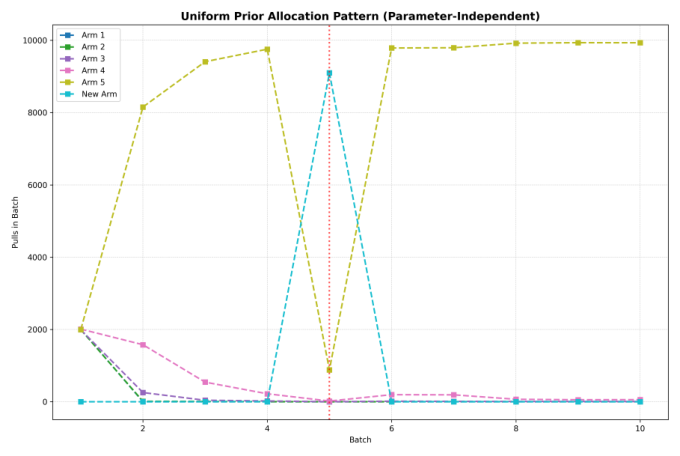
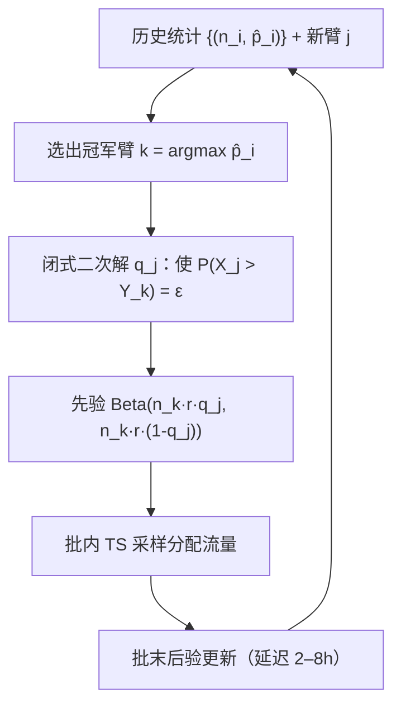

# Dynamic Prior Thompson Sampling for Cold-Start Exploration in Recommender Systems (面向推荐系统冷启动探索的动态先验汤普森采样)

- **会议/期刊**: WSDM 2022
- **作者与机构**: Zhenyu Zhao, David Zhang, Ellie Zhao, Ehsan Saberian（Roblox）
- **推荐链路定位**: 重排 / 展示层候选流量分配（thumbnail 个性化）
- **研究方向**: 冷启动与长尾推荐 / 强化学习与动态探索推荐
- **论文原文**: [https://arxiv.org/abs/2602.00943v1](https://arxiv.org/abs/2602.00943v1)
- **开源代码**: 暂未开源

## TL;DR (1分钟核心速览)

大规模推荐的冷启动探索长期默认使用 `Beta(1,1)` 均匀先验，隐含假设新物品成功率 50%，而真实内容 base rate 常低至 0.5%–9%，导致系统性过度探索弱物品；叠加 2–8 小时的批式后验更新延迟，先验在数小时内主宰流量分配。本文提出 Dynamic Prior TS：以现任冠军臂 $k$的观测分布为锚，闭式求解二次方程得到新臂先验均值$q_j$，使$\Pr(X_j>Y_k)=\varepsilon$在引入时刻精确成立。800 组蒙特卡洛验证平均偏差$<0.01$；批式仿真累计奖励相对均匀先验 +9.5%（8797.67 vs 8034.38）；百万用户在线实验 QPTR +0.19%（$p=0.016$）、后悔曝光相对降 21.0%。

## Background & Motivation (背景与核心矛盾)

- **主流范式**: 冷启动探索主流采用 Thompson Sampling——为每个臂维护 Beta 后验并采样取最大，新臂以 `Beta(1,1)` 初始化后靠贝叶斯更新逐步收敛。
- **前人局限 ①**: 均匀先验等价于「新臂成功率 50%」的强乐观断言，在低 base rate 内容市场里会持续把流量灌给弱物品，形成曝光—数据的自我强化回路。
- **前人局限 ②**: 生产环境为批式更新（2–8 h 一次），$[t_0, t_0+\Delta t)$ 内新臂在策略视角下仍是「无数据」，先验完全主导分配；强制探索（forced exploration）虽保证曝光，却引入探索/利用期的硬相位跳变，需人工调度且对非平稳反馈脆弱；元学习类冷启动需大量离线训练且跨品类迁移差。
- **核心洞察 (Key Insight)**: 探索强度不应是绝对常数，而应是「相对于现任冠军分布」的相对量——只要直接控制 $\Pr(X_j>Y_k)=\varepsilon$，探索率就成为可设定、可解释的产品旋钮，且在批式延迟窗口内依然成立。
- **本文切入点**: 用正态近似把 Beta 后验化为高斯，将概率约束平方后得到关于先验均值 $q_j$ 的一元二次方程，取保守根闭式求解。

<figure class="paper-figure" markdown="span">
  <figcaption>图4：（模拟研究）均匀先验分配模式显示，由于乐观的 Beta(1, 1) 假设，流量持续过度分配给表现较弱的新臂。这说明均匀先验与低成功率运行环境不匹配，而这正是动态先验的动机。</figcaption>
</figure>

## Method (核心方法设计)

### 1. 整体框架 (Overall Architecture)

模型无任何训练参数，本质是把 TS 的「先验选择」这一超参数升级为可推导的量。每个批次开始时读取各臂 $(n_i,\hat p_i)$，选出观测成功率最高的冠军臂$k$；对新引入臂$j$，用冠军臂的样本量$n_k$、成功率$\hat p_k$与目标$\varepsilon$、先验强度$r$求解二次方程得$q_j$，实例化$\mathrm{Beta}(n_k r q_j,\,n_k r(1-q_j))$作为先验；批内所有请求对该先验做 TS 采样分配流量，批末聚合反馈更新$(n,\hat p)$，下一批重新求解。由于先验有效样本量$n_k r$ 固定，新臂在首个批次即拥有「可解释的探索份额」，而非靠乐观初值碰运气。

### 2. 关键设计拆解 (Key Designs)

1. **相对先验参数化（以冠军臂为锚）**：痛点是把新臂先验写成与业务无关的常量。本文将先验均值拆为 $q_j$与强度$r$两个自由度：$\alpha_{\text{prior},j}=n_k r q_j,\ \beta_{\text{prior},j}=n_k r(1-q_j)$，有效样本量$n_k r$决定「先验能压住多久的噪声」，$q_j$决定「初始探索多少」。这样先验既随系统成熟度（$n_k$增大）自动变「硬」，又可被$\varepsilon$ 单独调参。

2. **闭式二次解（精确探索概率控制）**：令 $X_j\sim\mathcal{N}\!\left(q_j,\frac{q_j(1-q_j)}{n_k r}\right)$、$Y_k\sim\mathcal{N}\!\left(\frac{\hat p_k+r q_j}{1+r},\frac{\mu_{\text{win}}(1-\mu_{\text{win}})}{n_k(1+r)}\right)$，把$\Pr(X_j>Y_k)=\varepsilon$ 写为标准正态分位约束：

$$\frac{\mu_{\text{new}}-\mu_{\text{win}}}{\sqrt{\sigma_{\text{new}}^2+\sigma_{\text{win}}^2}}=z_\varepsilon=\Phi^{-1}(\varepsilon)$$

两边平方并代入方差表达式，即得 $A_q q_j^2+B_q q_j+C_q=0$（系数由$T=z_\varepsilon^2$、$C_{n_k}=n_k r(n_k+n_k r)$与$\hat p_k$ 组合而成），取保守根

$$q_j=\frac{-B_q-\sqrt{B_q^2-4A_qC_q}}{2A_q}$$

若根落在 $(0,\hat p_k)$之外则回退$q_j=\varepsilon\hat p_k$。物理直觉：$z_\varepsilon$把「想要的探索概率」翻译成「先验均值须低于冠军多少」，$\varepsilon<0.5$时必有$q_j<\hat p_k$，故先验天生保守，不会重演 50% 乐观偏差。

3. **训练目标、负采样与推理开销**：无损失函数、无负采样、无梯度训练；每批仅一次 $O(1)$的二次方程求解与一次全臂采样，新增算力可忽略。理论保证$|\Pr(X_j>Y_k)-\varepsilon|\le O(1/\sqrt{n_k})$，误差随冠军样本量自然收缩；$r$在生产中按数据 SLA 标定（7 天滑窗下$r=0.1$ ≈ 16.8 小时等效样本，恰好覆盖 3–7 h 延迟并保证 24 h 内可被真实反馈覆盖）。

## Experimental Setup & Evaluation Protocol (实验设置与评估协议)

本文无公开 benchmark，采用「理论验证—离线仿真—在线 A/B」三级评估，故以配置表替代数据集统计：

| 评估阶段 | 参数配置 | 规模与重复 |
| :--- | :--- | :--- |
| 蒙特卡洛验证 | $p\in\{0.005,0.01,0.02,0.03,0.05\}$，$n\in\{10^4{\sim}10^7\}$，$\varepsilon\in\{0.01,0.03,0.05,0.1\}$，$r\in\{0.01,0.05\}$| 800 组配置，每组$10^5$ 次采样 |
| 批式仿真 | 5 个初始臂 $p\in[0.05,0.09]$；第 5 批注入弱新臂$p_{\text{new}}=0.01$；$r\in\{0.01,0.001\}$ | 10 批 × 10,000 pulls，独立重复 10 次 |
| 在线实验 | $r=0.1$；T1$\varepsilon=3\%$，T2$\varepsilon=10\%$ | 20 天，百万级用户，缩略图个性化 |

- **数据划分与防穿越 (Splitting Strategy)**: 在线实验采用 **game-level 随机化**（而非用户级）以阻断同一游戏内探索训练数据在实验组间的泄漏；对照组为线上现网逻辑（新缩略图引入即 **hard reset**，丢弃全部后验并以 `Beta(1,1)` 重启）。
- **排名评测协议 (Ranking Protocol)**: 非传统 Full-Ranking / Sampled Ranking。离线用累计奖励（cumulative reward）；在线主指标 QPTR（会话时长超过阈值才算合格播放完播），辅以 **Regretted Impressions**（事后回溯分配给非冠军臂的曝光占比）与 Breakout Rate；因果估计使用按游戏曝光加权的 **Difference-in-Differences (DiD)** 回归，上线前 A/A 检验 $p>0.05$。
- **对比基线与超参**: 均匀先验 `Beta(1,1)`；固定时域强制探索（$\alpha\in\{0.01,0.03,0.05,0.10\}$，$K\in\{1,2\}$批）；显著性以 95% 置信区间不重叠及$p<0.05$ 判定。

## Key Experimental Results (实验关键数据)

### 1. 主实验对比 (Main Results)

**批式仿真累计奖励（新臂为弱臂的压力测试）**

| 方法 | $\varepsilon$/$\alpha$|$r$/$K$ | 累计奖励 | 95% CI |
| :--- | :---: | :---: | :---: | :---: |
| **Dynamic Prior** | **0.01** | **0.001** | **8797.67** | [8663.65, 8931.68] |
| Fixed-Horizon Forced Expl. | 0.03 | 1 | 8761.67 | [8733.37, 8789.96] |
| Fixed-Horizon Forced Expl. | 0.01 | 1 | 8743.67 | [8571.92, 8915.41] |
| Dynamic Prior | 0.05 | 0.01 | 8739.33 | [8647.93, 8830.74] |
| Fixed-Horizon Forced Expl. | 0.05 | 1 | 8727.33 | [8596.51, 8858.16] |
| Dynamic Prior | 0.01 | 0.01 | 8725.67 | [8683.32, 8768.01] |
| Uniform Prior | – | – | 8034.38 | [8019.18, 8049.57] |
| *Improv. (最优 vs 均匀)* | | | *+9.5%* | |

**在线 A/B（20 天，Mid-flight Insertion）**

| 组 | $\varepsilon$| QPTR 提升 |$p$ 值 | Regretted Imps. | Breakout Rate |
| :--- | :---: | :---: | :---: | :---: | :---: |
| C（hard reset） | – | – | – | 64.1% | 基线 |
| T1 | 3% | +0.20% | 0.034 | 52.1% | 71.65% |
| **T2（上线配置）** | **10%** | **+0.19%** | **0.016** | **50.6%** | **71.73%** |

### 2. 消融实验 (Ablation Study)

无模块消融，以 $\varepsilon$/$r$ 双因素敏感性作为等价证据（固定压力测试环境）：

| 配置 | 累计奖励 | 相对最优降幅 |
| :--- | :---: | :---: |
| $\varepsilon=0.01,\ r=0.001$ | 8797.67 | 0 |
| $\varepsilon=0.05,\ r=0.01$ | 8739.33 | −0.66% |
| $\varepsilon=0.01,\ r=0.01$ | 8725.67 | −0.82% |
| $\varepsilon=0.05,\ r=0.001$ | 8706.00 | −1.04% |
| $\varepsilon=0.1,\ r=0.01$ | 8705.67 | −1.05% |

### 3. 关键实验发现 (Key Findings)

1. **探索目标 $\varepsilon$是一阶旋钮，$r$是二阶**：固定$\varepsilon=0.01$时把$r$从 0.001 换到 0.01 仅损失 72 分（8797.67→8725.67），而$r$固定为 0.01 时把$\varepsilon$从 0.01 放宽到 0.1 损失 92 分——说明$\varepsilon$的变化对效果的影响比$r$更大，$r$ 则主要影响先验稳定性，可用于对齐数据延迟。
2. **动态先验在“弱新臂”压力场景下优势最大**：新臂真实成功率 1% 时，均匀先验因 `Beta(1,1)` 的乐观假设持续超额分配，累计奖励仅 8034.38，比最优动态先验低 763 分（−9.5%）且 CI 完全不重叠；强制探索最优配置（8761.67）虽接近，却对 $(\alpha,K)$敏感（$\alpha=0.01,K=1$ 的标准误高达 87.62，为全表最大），印证其相位跳变带来的不稳定。
3. **3% 探索已足够发现强内容，10% 主要用于生态可观测性**：T1 与 T2 的 Breakout Rate 为 71.65% vs 71.73%（$p=0.984$，无显著差异），而 T2 在 QPTR 增益持平的前提下将后悔曝光压到 50.6%（相对 −21.0%）；最终因 3% 在开发者看板上「几乎不可见」引发创造者不满，生产上线选择$\varepsilon=10\%, r=0.1$。

## Highlights & Limitations (亮点、对比与审稿批判)

- **与代表作对比 (vs. Prior Work)**: 相对 `Beta(1,1)` 均匀先验，本文把「先验值」从隐含 50% 的常量改为由冠军臂分布反推的变量；相对 forced exploration，探索是 TS 决策规则的**内生**部分，后验一变即平滑退化，无硬相位边界；相对元学习/上下文冷启动，本文零训练、零离线数据依赖，仅需现有 $(n,\hat p)$ 统计量即可落地。
- **可迁移亮点**: ①「概率式先验参数化」可移植到任何 Beta/Bernoulli 后验系统（多臂创意优选、配额分配、A/B 灰度放量）；②把业务期望的探索强度 $\varepsilon$ 作为超参而非事后监控指标，使冷启动探索从「调参玄学」变为可审计的产品约定。
- **审稿级局限批判**: ① 闭式解建立在 Beta→正态近似上，理论与仿真覆盖 $n_k\ge10^4$，真正冷启动起步（几十次曝光）时$O(1/\sqrt{n_k})$的近似误差未被验证；② 在线验证仅覆盖单一缩略图场景与单一 Bernoulli 主指标，$+0.19\%$虽显著但绝对幅度小，且 game-level 随机化 + DiD 仍难完全排除创作者行为混杂；③ 未开源实现，$r$ 需按各系统数据 SLA 重新标定，迁移成本未量化。

## Rating (四维评分)

- **方法创新性 (Novelty)**: ⭐⭐⭐⭐ （把冷启动先验从常量工程改成可闭式求解的概率约束，思路干净且首次实现 TS 内生的精确探索率控制，但本质仍是先验工程而非新决策规则）
- **评估协议与实验扎实度 (Protocol & Experiments)**: ⭐⭐⭐⭐ （800 组蒙特卡洛 + 批式仿真 + 百万级在线三层验证，game-level 随机化与 DiD 因果设计严谨，欠缺多场景、多目标与冷启动极早期样本的验证）
- **写作与数学规范度 (Clarity & Rigor)**: ⭐⭐⭐⭐ （从约束到二次方程的推导链条完整、$q_j$保守根与回退策略交代清楚，但$A_q,B_q,C_q$ 系数表达式冗长且近似误差仅给上界未给实测分布）
- **工业落地与复现价值 (Industrial & Practical Value)**: ⭐⭐⭐⭐ （生产可直接上线、无训练开销、每批仅一次二次求解；闭源与 $r$ 需按管道延迟重标定削弱了复现便利性）

