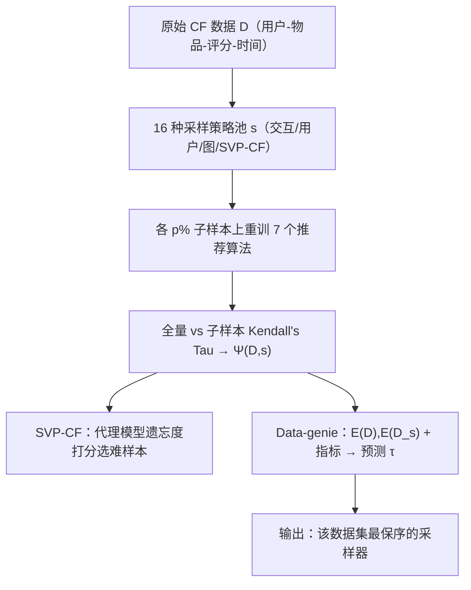

# On Sampling Collaborative Filtering Datasets (协同过滤数据集采样研究)

- **会议/期刊**: WSDM 2022
- **作者与机构**: Noveen Sachdeva, Julian McAuley (UCSD)；Carole-Jean Wu (Facebook AI Research)
- **推荐链路定位**: 评测基准 / 数据子采样（服务于召回至精排全链路的快速原型迭代）
- **研究方向**: 协同过滤与双塔召回 / 去偏公平与工业架构
- **论文原文**: [https://arxiv.org/abs/2201.04768v1](https://arxiv.org/abs/2201.04768v1)
- **开源代码**: [https://github.com/noveens/sampling_cf](https://github.com/noveens/sampling_cf)

## TL;DR (1分钟核心速览)

推荐算法通常在数据集子样本上训练与评测，但「怎么采」几乎无人研究。本文以 Kendall's Tau 构造排名保持性指标 $\Psi$，系统比较 16 种采样策略在 3 类反馈场景、7 个算法、6 个数据集上的表现，提出代理遗忘度驱动的 SVP-CF（及其去偏版 SVP-CF-Prop）与采样器推荐器 Data-genie。实验表明固定策略需保留 50–60% 数据才能保序，Data-genie 动态选样仅需 10% 数据即可保序（衰减极小），净获 5.8× 训练加速，并避免约 20k lbs CO₂ 排放。

## Background & Motivation (背景与核心矛盾)

- **主流范式**: 为快速实验/共享/降低算力碳排，业界普遍在 user-item 交互矩阵的随机抽样、head 用户裁剪或图采样子集上训练与调参推荐模型。
- **前人局限**: 其一，随机抽样与「按交互数取稠密子集」等 ad-hoc 做法会系统性丢弃长尾，导致基准过拟合于头部群体，损害公平性；其二，现有 coreset 方法（submodular、bi-level 优化、SVP）均为分类数据设计，无法处理 CF 数据的异质性、多指标性与 MNAR 缺失。
- **核心洞察 (Key Insight)**: 绝对指标值（MSE/AUC）难以在子样本上复现，但「算法之间的相对排名」是可保的；一个高偏差低方差的采样器比低偏差高方差的采样器更有用，因为排名顺序仍被保持。
- **本文切入点**: 把采样质量问题转化为「排名保持性」的可度量回归/排序问题，并用代理模型的重要性打分 + 元学习式预测器分别解决「采什么」与「选哪个采样器」。

## Method (核心方法设计)

### 1. 整体框架 (Overall Architecture)

模型分三层：第一层是采样器池（交互级 Random/Stratified/Temporal、用户级 Random/Head、图级 Centrality/Random-walk/Forest-fire，以及 SVP-CF 4 个变体，共 16 种）；第二层是全量重训练循环——对每个 $p\in\{80,60,40,20,10,1\}\%$子样本、每种反馈场景$f$与指标$m$，重训 7 个算法并计算全量 vs 子样本的 Kendall's Tau，聚合为性能度量$\Psi(\mathcal{D},s)=\lambda\sum_{f}\sum_{m}\sum_{p}\tau(\mathbf{R}_{f,m},\mathbf{R}^{s,p}_{f,m})$；第三层是 Data-genie，用数据集低维表征直接回归/排序预测$\hat{\tau}$，从而在毫秒级内为新数据集选出最优采样器，避免全量扫描。

### 2. 关键设计拆解 (Key Designs)

1. **SVP-CF：用代理模型的「遗忘事件」定义样本难度**：分类 coreset 的 SVP 依赖经验风险，无法直接搬到 CF。作者改为训练廉价代理 $\mathcal{P}$（Bias-only 或 MF，均可覆盖三种反馈场景），以跨 epoch 的预测误差/成对逆序数定义难度，只保留最「难」的用户或交互：
$\Delta(u,i|\mathcal{P})=\sum_{e=1}^{E}\big(\mathcal{P}_e(u,i)-r_{ui}\big)^2$（显式）或$\sum_{e}\sum_{j\sim I_u^-}\mathbb{I}\big(\mathcal{P}_e(u,i)>\mathcal{P}_e(u,j)\big)$（隐式/序列）。直觉：简单样本对所有算法都简单，删掉它们不会改变算法排序。
2. **SVP-CF-Prop：对 MNAR 长尾做倾向性校正**：直接对偏斜数据采样会放大原有偏差，故用逆倾向加权重要性 $\mathcal{I}_p(u,i|\mathcal{P})=\Delta(u,i|\mathcal{P})/p_{u,i}$，其中$p_{u,i}=p_u\cdot p_i$分解为 sigmoid 曲线$p_u=\big[1+C_u e^{-A\log(N_u+B)}\big]^{-1}$。命题 3.1 证明：在理想倾向下$\mathcal{I}_p$是$\Delta$ 的无偏估计，从而把观测分布拉回无偏目标分布。
3. **Data-genie：绕过重训直接预测保序性**：两种数据集表征——手工特征（用户/物品频次分布、邻接矩阵 Top-100 特征值、跳数分布、连通分量大小，共 53 维）与无监督 InfoGraph-GCN（32 维最大化图级/节点级互信息）。预测头 $\hat{\tau}=\Phi(E(\mathcal{D}_f),E(\mathcal{D}^{s,p}_f),m)$支持两种训练：逐点 MSE 回归（输出经$\tanh$限于$[-1,1]$）与 BPR 式成对排序目标$\arg\min_\Phi\sum_{s_i\succ s_j}-\ln\sigma(\hat{\tau}_{s_i}-\hat{\tau}_{s_j})$。全流程无负采样、无梯度反传，推理仅需两次$E$与一次$\Phi$。

## Experimental Setup & Evaluation Protocol (实验设置与评估协议)

- **数据集与预处理**: 仅剔除交互数 $<3$ 的用户（保持最宽松预处理，避免先天头部偏置）：

| 数据集 | #Users | #Items | #Interactions | 密度 | 场景说明 |
| :--- | :---: | :---: | :---: | :---: | :--- |
| Amazon Magazine | 3.1k | 1.3k | 12.7k | 0.31% | 评论文本域，极稀疏 |
| ML-100k | 943 | 1.7k | 100k | 6.3% | 稠密电影评分 |
| Amazon Luxury | 29.7k | 8.4k | 126k | 0.05% | 长尾奢侈品类 |
| Amazon Video-games | 181k | 55.3k | 973k | 0.01% | 极稀疏大规模 |
| BeerAdvocate | 18.6k | 64.3k | 1.51M | 0.13% | 长序列（均值 81.5） |
| Goodreads Comics | 133k | 89k | 4.37M | 0.04% | 超大规模长尾 |

- **数据划分与防穿越**: 显式/隐式反馈按每用户交互历史做随机 `80/10/10` 划分；序列反馈采用 `Leave-Last-Two-Out`（倒数第二/最后一条分别作验证/测试）。关键防穿越设计：**只对训练集采样，验证与测试集永不采样**，保证子样本与全量数据共享同一评测集。
- **排名评测协议**: 严格遵守无偏 `Full-Ranking`（全库未交互物品排序），显式计算 MSE，隐式/序列计算 AUC、Recall@100、nDCG@10；不使用负采样估计指标。
- **对比基线与超参**: 7 个算法覆盖三场景（PopRec、Bias-only、MF、NeuMF、MVAE、SVAE、SASRec），两两组合成表 1 的「场景-算法-指标」适用矩阵；小数据集网格搜索隐层 $\{4,8,16,32,50\}$、dropout$\{0,0.3,0.5\}$、学习率$\{0.001,0.006,0.02\}$，大数据集固定 lr=0.006。总计训练约 40 万个模型、累计约 9 个月 GPU 时间。Data-genie 的$(m,p)$ 组合按 70/15/15 划分，以 P@1 衡量采样器排序准确率。

## Key Experimental Results (实验关键数据)

### 1. 主实验对比 (Main Results)

下表为各采样策略的 $\Psi$（Kendall's Tau 均值，越高越能保持算法排序），保留代表性策略与数据集列：

| 采样策略（类别） | Magazine | ML-100k | Video-games | BeerAdv. | Goodreads | 平均 $\Psi$ |
| :--- | :---: | :---: | :---: | :---: | :---: | :---: |
| Random Interaction（交互） | 0.428 | 0.551 | 0.047 | 0.455 | 0.552 | 0.407 |
| Temporal（交互，最近 x 天） | 0.289 | 0.569 | -0.020 | **0.539** | 0.634 | 0.405 |
| Random User（用户） | 0.436 | 0.622 | 0.170 | 0.344 | 0.582 | 0.431 |
| Head User（用户，去尾） | 0.369 | 0.403 | 0.110 | -0.040 | -0.020 | 0.190 |
| Centrality（图，PageRank） | 0.307 | 0.464 | 0.063 | 0.011 | 0.343 | 0.266 |
| Random-walk（图） | **0.596** | 0.500 | 0.306 | 0.137 | 0.442 | 0.396 |
| SVP-CF w/ MF（交互） | 0.418 | 0.674 | 0.326 | 0.425 | **0.662** | **0.484** |
| SVP-CF w/ Bias-only（交互） | 0.380 | 0.684 | **0.348** | 0.365 | 0.600 | 0.468 |
| SVP-CF-Prop w/ Bias-only（用户） | 0.434 | **0.751** | 0.107 | 0.506 | 0.637 | 0.445 |

### 2. 消融实验 (Ablation Study)

针对 Data-genie 的表征 $E$与预测头$\Phi$ 做消融（MSE 越低、P@1 越高越好）：

| 变体 | MSE | P@1 (%) |
| :--- | :---: | :---: |
| 随机选采样器（方差基线） | 0.234 | 25.2 |
| 固定最优静态采样器 | – | 30.6 |
| 手工特征 + 最小二乘 | 0.187 | 31.7 |
| 手工特征 + XGBoost | 0.116 | 43.9 |
| 手工特征 + Data-genie-Reg | **0.101** | 51.2 |
| 手工特征 + Data-genie-Rank | – | 51.2 |
| GCN + XGBoost | 0.123 | 43.9 |
| GCN + Data-genie-Reg | 0.129 | 48.8 |
| GCN + Data-genie-Rank | – | **53.7** |

### 3. 关键实验发现 (Key Findings)

- **去尾采样是灾难点**：Head User 平均 $\Psi$ 仅 0.190，在 BeerAdvocate 与 Goodreads 上甚至为负（-0.04 / -0.02），即算法排名被完全反转；Centrality 同为 0.266，实证支持了「禁止只取稠密子集」的警告。
- **SVP-CF 在极稀疏长尾场景收益最大**：Video-games 上 Random 交互采样 $\Psi$仅 0.047（几乎无保序能力），SVP-CF w/ Bias-only 提升至 0.348（约 7×）；平均$\Psi$ 从 0.407 提升到 0.484。
- **采样会系统性偏袒简单模型**：以 MLE 估计算法排名上升概率，1% 极端采样下 Bias-only/PopRec 排名上升概率最高，SASRec/SVAE/MVAE 等参数重型模型排名下降，说明小样本上复杂模型过拟合；同时 AUC 受影响最小、nDCG@10 最敏感，说明采样对 Top 位置精度伤害更大。
- **采样率与选样策略的权衡**：固定策略需保留 50–60% 数据才保序，而 Data-genie 动态选样在 10% 数据下仍接近 Pareto 前沿，端到端 5.8× 加速，将周级 RecSys 开发周期的碳排从约 20k lbs 降至 3.4k lbs。

## Highlights & Limitations (亮点、对比与审稿批判)

- **与代表作对比 (vs. Prior Work)**: 相较 SVP/Coreset（面向分类、需标签风险）与随机-walk/Forest-fire 图采样（仅保结构、不管下游排序），本文首次把「采样器质量」定义为跨算法 Kendall's Tau，并用 Data-genie 把选择过程从「重训 40 万模型」压缩到毫秒级预测；相比同作者关于数据划分（Leave-One-Out vs 比例划分）的研究，本文聚焦训练集内部采样而非评测切分。
- **可迁移亮点**: ① $\Psi$ 这一「排名保持性」度量可直接迁移到召回评测集构造、离线 A/B 预筛与基准数据蒸馏；② 逆倾向加权的遗忘度打分（SVP-CF-Prop）是把任意分类 coreset 方法适配 MNAR 交互数据的通用模板。
- **审稿级局限批判**: 其一，Data-genie 的训练监督信号来自仅 6 个数据集 × 16 个采样器 × 7 个算法的有限组合，跨域（如短视频、广告 CTR）外推能力尚未验证，且需先付出一次全量重训成本才能构建标签；其二，$\Psi$ 是全局平均指标，掩盖了「谁被采样伤害最多」的群体公平性，文中亦承认公平性分析留作未来工作；此外 SVP-CF 需额外训练代理模型，在万亿级工业数据上代理本身的成本与采样收益之比未讨论。

## Rating (四维评分)

- **方法创新性 (Novelty)**: ⭐⭐⭐⭐ （将采样质量重构为跨算法排名保持问题，并用去偏遗忘度与元预测器双管齐下，视角新颖但组件多为已有技术的巧妙组合）
- **评估协议与实验扎实度 (Protocol & Experiments)**: ⭐⭐⭐⭐⭐ （6 数据集 × 3 场景 × 7 算法 × 16 采样器 × 6 采样率、约 40 万次重训，严格 Full-Ranking 且验证/测试集不采样，规模罕见）
- **写作与数学规范度 (Clarity & Rigor)**: ⭐⭐⭐⭐ （$\Psi$ 与无偏性命题 3.1 定义清晰、符号自洽，但各采样器细节与超参附录略简）
- **工业落地与复现价值 (Industrial & Practical Value)**: ⭐⭐⭐⭐ （代码开源、推理毫秒级、附碳排量化分析，落地门槛低；主要短板是构建 Data-genie 训练标签仍需一次昂贵全量扫描）

