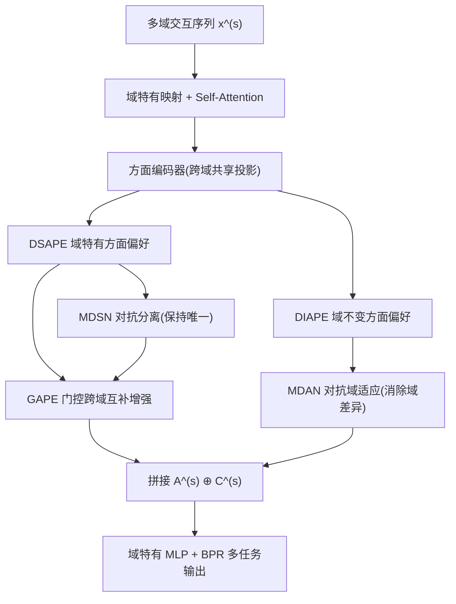
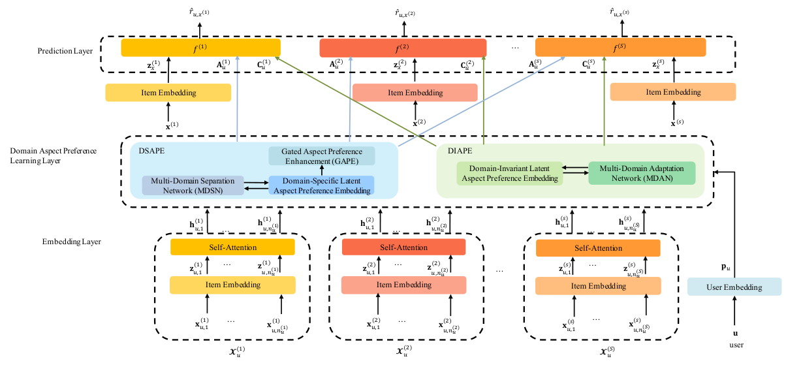
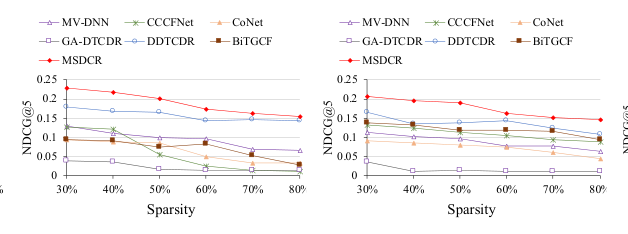

# Multi-Sparse-Domain Collaborative Recommendation via Enhanced Comprehensive Aspect Preference Learning (多稀疏域协同推荐：增强的综合方面偏好学习)

- **会议/期刊**: WSDM 2022
- **作者与机构**: Xiaoyun Zhao, Ning Yang (四川大学)，Philip S. Yu (UIC)
- **推荐链路定位**: 精排（跨域多目标打分）
- **研究方向**: 跨域与多场景推荐 / 冷启动与长尾推荐
- **论文原文**: [arxiv 2201.05973](https://arxiv.org/abs/2201.05973v1)
- **开源代码**: 暂未开源

## TL;DR (1分钟核心速览)

现有 CDR 方法要么假定"至少有一个富域"（single-target），要么重度依赖域不变偏好（dual-target），在真实的全稀疏多域场景下会因负迁移而退化。MSDCR 把 $S$ 个相关域全部当作稀疏域，从**方面（aspect）粒度**同时学习"域特有偏好"（对抗分离 + 门控跨域增强）与"域不变偏好"（对抗域适应）并拼接送入各域 MLP。在 Douban Movie/Book/Music（800 重叠用户，稀疏度 0.022%–0.075%）上，采用 leave-one-out + 99 随机负采样协议，Movie-Music 场景 NDCG@5 相比最强基线 DDTCDR 提升 31.2%（0.2541 vs 0.1937）。

## Background & Motivation (背景与核心矛盾)

- **主流范式**: Single-target CDR 从富源域向稀疏目标域迁移；dual-target CDR 用域不变（domain-invariant）偏好做双向迁移；图方法（BiTGCF/GA-DTCDR）再叠加 GCN 高阶传播。
- **前人局限**: ①"至少一域稠密"的假设在真实平台普遍失效（本文三个域稀疏度均 < 0.08%）；②过度依赖域不变偏好会抹平域特有信号，跨稀疏域迁移时反而产生负迁移——实验中 CoNet/GA-DTCDR 甚至远弱于单域 NCF。
- **核心洞察 (Key Insight)**: 稀疏交互只揭示用户在某域的**部分**偏好，但用户在其它域暴露的"互补方面偏好"（如只在图书域看到的武侠、只在电影域看到的科幻）可被推断过来；前提是域特有表征必须**足够可区分**，否则无法构成有意义的互补。
- **本文切入点**: 把"可区分的域特有偏好"与"不可区分的域不变偏好"用两个方向相反的对抗目标分别学习，再用门控自适应决定迁移多少。

## Method (核心方法设计)

### 1. 整体框架 (Overall Architecture)

每个域 $s$用独立映射$\mathbf{z}=W^{(s)}\mathbf{x}^{(s)}$+ 域内 self-attention 得到注意力物品表征$\mathbf{h}$，与共享用户向量$\mathbf{p}_u$拼接后进入**共享投影矩阵**的方面编码器，得到$M$个潜在方面的表征矩阵。DSAPE 分支输出域特有方面偏好$\tilde{A}^{(s)}_u$，经 MDSN 对抗分离保持唯一性、经 GAPE 吸收其它域的互补信息得到增强的$A^{(s)}_u$；DIAPE 分支经 MDAN 对抗域适应输出域不变偏好$C^{(s)}_u$。二者拼接后与物品特征一起送入域特有 MLP$f^{(s)}$ 打分，各域 BPR 损失加权求和做多任务联合训练。

<figure class="paper-figure" markdown="span">
  <figcaption>图2：MSDCR 的架构。</figcaption>
</figure>

### 2. 关键设计拆解 (Key Designs)

1. **MDSN：用"弱判别器"逼出域可区分性**。痛点：若各域特有偏好同质化，跨域互补就无信息可用。做法是训练域分离判别器 $\psi$（MLP+softmax）预测方面表征来自哪一域，但**反常用意地最大化**判别损失（故意训练成弱判别器），DSAPE 则最小化该损失：

$$\min_{\Theta_{ds}}\max_{\Theta_{\psi}}\mathcal{L}_{ds}=-\sum_{u=1}^{N}\sum_{s=1}^{S}\sum_{i=1}^{S}y^{(i)}_{u,s}\log\hat{y}^{(i)}_{u,s}$$

直觉：连"退化判别器"都能分开的表征，必然在隐空间强可分——与 DANN 让判别器越强越好恰好相反，这保证了域特有分支不会被域不变分支吞掉。

2. **GAPE：以"乘积×差值"隐式度量互补性**。痛点：不同方面、不同域之间的互补强度不均等，手工加权不可行。门控矩阵由逐元素积与差值共同生成：

$$G^{(s,s')}_u=\sigma\!\left(W^{(s')}_g\left[(\tilde{A}^{(s)}_u\odot\tilde{A}^{(s')}_u)\oplus(\tilde{A}^{(s)}_u-\tilde{A}^{(s')}_u)\right]+B^{(s')}_g\right)$$

乘积项衡量**可行性**（两域该方面偏好好都非零，说明用户真的关心该方面），差值项衡量**有意义性**（同一方面在两域取值不同，如图书域"武侠" vs 电影域"科幻"，迁移才带来新信息）。增强表征即对各域门控加权后拼接再过 sigmoid 融合层：$A^{(s)}_u=\sigma(W^{(s)}_e[\cdots\oplus(G^{(s,s')}_u\odot\tilde{A}^{(s')}_u)\oplus\cdots]+B^{(s)}_e)$。

3. **MDAN 与训练目标**。域不变分支用**强**判别器：$\min_{\Theta_{di}}\max_{\Theta_{\phi}}-\mathcal{L}_{da}$，即判别器最小化交叉熵变强，DIAPE 最小化同一交叉熵以"骗过"它，从而得到域不可分表征（与 MDSN 的对抗方向严格对称）。总目标为

$$\min_{\Theta_{ds},\Theta_{da},\Theta_{f}}\max_{\Theta_{\psi},\Theta_{\phi}}\ \mathcal{L}_{ds}+\mathcal{L}_{da}+\mathcal{L}_{f}+\lambda\|\Theta\|_2^2,\quad \mathcal{L}_f=\frac{1}{S}\sum_{s}\frac{1}{|T^{(s)}|}\sum_{(u,x^+,x^-)}\log(\hat{r}_{u,x^+}-\hat{r}_{u,x^-})$$

负样本为均匀随机采样，各域参数交替更新；推理时每域一次 MLP 前向，$M$个方面的门控计算带来$O(S^2Md)$ 的额外开销，对 800 用户规模可忽略，但用户量级增大时门控矩阵是主要成本。

## Experimental Setup & Evaluation Protocol (实验设置与评估协议)

- **数据集与预处理**（Douban，仅保留跨域重叠用户，未做 5-core 过滤）：

| 数据集 | #Users | #Items | #Interactions | 稀疏度 | 特征/场景说明 |
| :--- | :---: | :---: | :---: | :---: | :--- |
| Movie | 800 | 154,886 | 93,074 | 0.075% | 导演/编剧/演员/类型/国家等 one-hot、multi-hot |
| Book | 800 | 165,461 | 29,781 | 0.022% | 作者/出版社/译者/层级 |
| Music | 800 | 166,447 | 30,487 | 0.023% | 演奏者/流派/专辑/介质 |

- **数据划分与防穿越**: 每域按 **70%/10%/20% 随机比例划分** train/valid/test，重复 5 次取均值；构造 Movie-Book、Movie-Music、Book-Music 三个双域与 Movie-Book-Music 三域场景。
- **排名评测协议**: **Sampled Ranking**——leave-one-out，将测试正样本与 99 个随机负样本混排（正负比 1:99），非全库 Full-Ranking；指标 HR@{5,10}、NDCG@{5,10}。
- **对比基线与超参**: 8 个基线，含单域 NCF/AMCF、single-target MV-DNN/CCCFNet、dual-target CoNet/DDTCDR/GA-DTCDR/BiTGCF；嵌入维度与方面数 $(d,M)$按场景取$(128,5)/(32,7)/(16,8)$，预测 MLP 为 256-128 两层，两个判别器各 1 层 128 神经元，Adam 优化。

## Key Experimental Results (实验关键数据)

### 1. 主实验对比 (Main Results)

Movie-Music 双域场景（Table 3），"Improv."为相对最强基线的提升：

| Model | Movie NDCG@5 | Movie NDCG@10 | Movie HR@10 | Music NDCG@5 | Music NDCG@10 | Music HR@10 |
| :--- | :---: | :---: | :---: | :---: | :---: | :---: |
| NCF (单域) | 0.1501 | 0.2230 | 0.3727 | 0.1172 | 0.1708 | 0.3620 |
| AMCF (单域) | 0.1719 | 0.2143 | 0.3862 | 0.1285 | 0.1958 | 0.4250 |
| MV-DNN (S-T) | 0.1105 | 0.1570 | 0.2893 | 0.1265 | 0.1689 | 0.2769 |
| CoNet (D-T) | 0.0645 | 0.1192 | 0.2585 | 0.1258 | 0.1558 | 0.2656 |
| DDTCDR (D-T) | 0.1937 | 0.2216 | 0.3504 | 0.1871 | 0.2308 | 0.3019 |
| BiTGCF (D-T) | 0.1542 | 0.1997 | 0.3334 | 0.1361 | 0.2006 | 0.3152 |
| **MSDCR** | **0.2541** | **0.2815** | **0.4456** | **0.2258** | **0.3027** | **0.4596** |
| Improv. | +31.2% | +27.0% | +15.4% | +20.7% | +31.2% | +8.1% |

其余场景同向：Movie-Book 中 Movie/Book NDCG@5 为 0.2497/0.2086（+11.8%/+17.6%），Book-Music 中 0.1996/0.2162（+29.8%/+21.4%）；但 Movie-Book 的 Book HR@10 为 0.4371，**低于** NCF 的 0.4631，说明头部命中率上单域模型并非全面落后。

### 2. 消融实验 (Ablation Study)

Movie-Book-Music 三域场景，NDCG@5（Table 6）：

| Variant | Movie | Book | Music | 说明 |
| :--- | :---: | :---: | :---: | :--- |
| w/o DSAPE | 0.1928 | 0.0927 | 0.2715 | 去掉域特有分支 |
| w/o DIAPE | 0.2156 | 0.2110 | 0.2061 | 去掉域不变分支 |
| w/o Sep | 0.2417 | 0.1291 | 0.1911 | 去掉 MDSN 对抗分离 |
| w/o Enhan | 0.1798 | 0.1340 | 0.1712 | 去掉 GAPE 门控增强 |
| Single-Target | 0.2748 | 0.2280 | 0.1509 | 去掉多任务协同 |
| **MSDCR** | **0.2967** | **0.2897** | **0.2965** | 完整模型 |

### 3. 关键实验发现 (Key Findings)

1. **全稀疏设定下传统 CDR 会负迁移**：Movie-Music 电影域 CoNet/GA-DTCDR 的 NDCG@5 仅 0.0645/0.0378，反而低于单域 NCF 的 0.1501；MSDCR 则达 0.2541，说明"域不变偏好"在双稀疏时是噪声源而非信号源。
2. **域特有分支是稀疏域的主命脉**：去掉 DSAPE 后 Book 域 NDCG@5 从 0.2897 崩至 0.0927（−68%），Book 域本就是最稀疏域；而去掉 GAPE 时 Movie 域跌至 0.1798（−39%），证明"唯一性"与"互补迁移"缺一不可——单独保留门控增强（w/o Sep，0.2417）无法弥补可区分性缺失。
3. **域越多越强**：同一 Movie 域在三域场景 NDCG@5 为 0.2967，高于双域 Movie-Music 的 0.2541 与 Movie-Book 的 0.2497；图 3 的稀疏度曲线亦显示训练数据被随机剔除至 80% 时 MSDCR 与基线差距反而拉大，说明互补方面偏好在极端稀疏下收益更显著。

<figure class="paper-figure" markdown="span">
  <figcaption>图3：性能随稀疏度的变化。</figcaption>
</figure>

## Highlights & Limitations (亮点、对比与审稿批判)

- **与代表作对比**: 相比 DDTCDR（正交约束的跨域映射）与 BiTGCF（GCN 双向迁移），MSDCR 不依赖"富源域"假设，也放弃了"只学域不变偏好"的路线，改为方面级"特有+不变"双通道；相比 AMCF 的方面分解，它把方面从单域扩展到 $S$ 域并加入门控互补度量，这是本质差异。
- **可迁移亮点**: ①"弱判别器对抗"（最大化判别损失以获得可分表征）可直接移植到多场景/多任务的特有塔与共享塔解耦；②$(\odot,\ -)$ 双算子门控是一套轻量的"互补性打分器"，可迁移到多行为、多模态融合的加权。
- **审稿级局限批判**: ①评测仅用 1:99 随机负采样排序，未做全库 Full-Ranking，且随机负样本易高估绝对指标，头部位置（HR@10）甚至在 Movie-Book 的 Book 域被 NCF 反超；②仅 800 个重叠用户 + 十万级物品的极端稀疏设定，泛化性结论受限；③两个方向相反的对抗目标交替优化，训练稳定性与对 $\lambda$、$(d,M)$的敏感性缺乏分析，且未报告训练耗时；④论文自称"multi-target"，但四组实验最大仅到三域，$S$增大时门控的$O(S^2)$ 组合膨胀未讨论。

## Rating (四维评分)

- **方法创新性 (Novelty)**: ⭐⭐⭐⭐ （方面级"特有/不变"双通道 + 方向相反的双对抗 + 乘积-差值门控，机制组合新颖且有清晰直觉，但单点算子仍属对抗域适应与门控融合的常规变体）
- **评估协议与实验扎实度 (Protocol & Experiments)**: ⭐⭐⭐ （覆盖 3 双域 + 1 三域场景与 8 个基线、含稀疏度曲线，但仅 1:99 采样排序、800 用户、无显著性检验与全库排序）
- **写作与数学规范度 (Clarity & Rigor)**: ⭐⭐⭐⭐ （公式与符号完整、两个判别器的对抗方向解释清楚；但式(4)(8) 排版有多处 OCR/符号不严谨，缺复杂度与收敛性分析）
- **工业落地与复现价值 (Industrial & Practical Value)**: ⭐⭐⭐ （无需图构建、纯 MLP 前向易部署，多任务多域结构贴合真实业务；但未开源、对抗训练调参成本高，$S$ 增大时门控开销上升）

