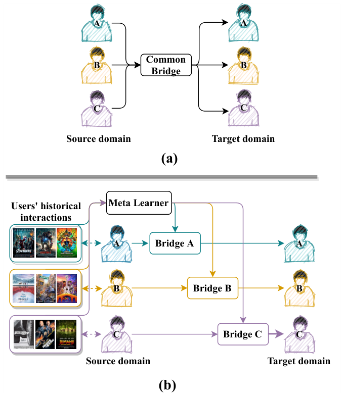
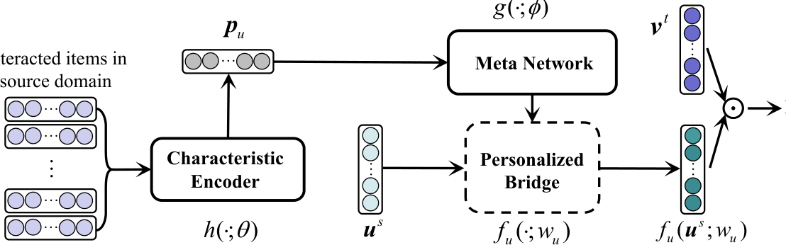
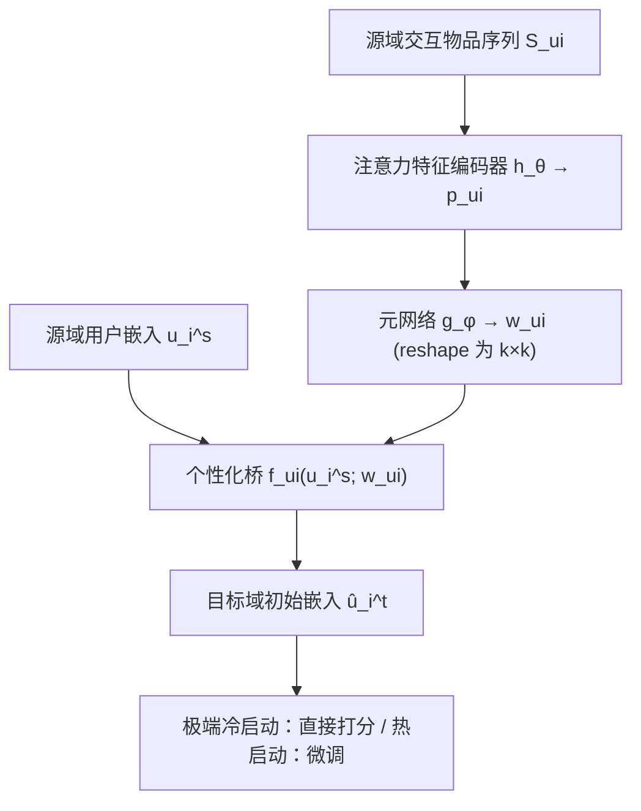

# Personalized Transfer of User Preferences for Cross-domain Recommendation (跨域推荐中的用户偏好个性化迁移)

- **会议/期刊**: WSDM 2022
- **作者与机构**: Yongchun Zhu, Zhenwei Tang, Yudan Liu, Fuzhen Zhuang (通讯), Ruobing Xie, Xu Zhang, Leyu Lin, Qing He（中科院计算所、北航、腾讯微信搜索应用部）
- **推荐链路定位**: 召回层用户表征冷启动初始化（桥接映射 + 下游 MF/DNN 打分）
- **研究方向**: 跨域与多场景推荐 / 冷启动与长尾推荐
- **论文原文**: [https://arxiv.org/abs/2110.11154v3](https://arxiv.org/abs/2110.11154v3)
- **开源代码**: [https://github.com/easezyc/WSDM2022-PTUPCDR](https://github.com/easezyc/WSDM2022-PTUPCDR)

## TL;DR (1分钟核心速览)

跨域冷启动（CDR）的关键是"偏好桥"，但 EMCDR/SSCDR/DCDCSR 等全部为所有用户学一个共享映射函数，无法刻画用户间差异极大的跨域偏好关系。本文提出 PTUPCDR：用注意力编码用户在源域的交互物品得到"可迁移特征向量"，再由元网络 $g_\phi$直接生成该用户专属的桥接层参数（$k\times k$），并以**任务导向损失**（直接回归目标域评分）而非映射损失训练，避开不可靠的用户嵌入监督。在 Amazon 三组跨域任务的评分预测（MAE/RMSE）上，极端冷启动（$\beta=80\%$）相对最优基线 MAE 降 3.84%–8.80%，$\beta=20\%$ 时最高降 10.68%，且可无缝挂到 GMF/YouTube DNN 等神经基座上。

## Background & Motivation (背景与核心矛盾)

- **主流范式**: 基于桥接（bridge-based）的 CDR——先在源/目标域分别预训练用户嵌入，再学一个映射把源域用户向量搬到目标域特征空间，作为冷启动用户初始嵌入（CMF、CST、EMCDR、SSCDR、DCDCSR）。
- **前人局限**: ①共享桥假设"所有用户的两域偏好关系同构"，但个体差异下该关系因人而异，单一线性映射只能输出高度聚集的变换嵌入，无法覆盖目标域用户的弥散分布；②桥函数常用**映射导向**损失 $\min\sum\|\hat{\boldsymbol{u}}^t_i-\boldsymbol{u}^t_i\|^2$ 训练，强依赖目标域用户嵌入质量——交互稀疏用户的嵌入本身就不准，等于用噪声当标签。
- **核心洞察**: 偏好桥应由"用户特征"决定，而用户特征可从源域交互物品中提取（不同物品对迁移贡献不同，如科幻片对推荐硬摇滚有帮助、喜剧/剧情几乎无关）；同时，评分是 ground truth，比中间产物"用户嵌入"更可靠、样本量也大 $M$ 倍。
- **本文切入点**: 把桥函数参数化进元网络，用注意力提纯的用户特征生成个性化桥，并以目标域评分回归端到端训练。<figure class="paper-figure" markdown="span">
  <figcaption>图1：(a) 现有 CDR 方法中，所有用户共享同一个公共桥接函数。(b) 提出的 PTUPCDR 利用元网络为每个用户生成个性化桥接函数。</figcaption>
</figure>

## Method (核心方法设计)

### 1. 整体框架 (Overall Architecture)

流程为三阶段：**预训练**（源域与目标域各自用 MF 学 $\boldsymbol{u}^s,\boldsymbol{v}^s,\boldsymbol{u}^t,\boldsymbol{v}^t$）→ **元训练**（源域交互序列经注意力编码器$h_\theta$得到用户可迁移特征$\boldsymbol{p}_{u_i}$，元网络$g_\phi$输出个性化桥参数$\boldsymbol{w}_{u_i}$，桥$f_{u_i}$把$\boldsymbol{u}^s_i$变换为$\hat{\boldsymbol{u}}^t_i$，并用重叠用户在目标域的真实评分做监督）→ **初始化与推理**（极端冷启动直接用$\hat{\boldsymbol{u}}^t_i$打分；热启动以$\hat{\boldsymbol{u}}^t_i$ 为初值、用新交互微调）。核心闭环是"特征→桥参数→嵌入→评分"，元网络只作用于用户侧，故与任意基座兼容。<figure class="paper-figure" markdown="span">
  <figcaption>图2：面向跨域推荐的用户偏好个性化迁移（PTUPCDR）以源域中用户特征嵌入为输入，利用元网络为每个用户生成个性化桥接函数。然后，借助个性化桥接函数，可获得转换后的用户嵌入作为初始嵌入。</figcaption>
</figure>

### 2. 关键设计拆解 (Key Designs)

1. **注意力特征编码器（提纯可迁移特征）**：痛点是把用户历史物品无差别平均会引入大量与迁移无关的噪声。改为对源域物品嵌入做注意力加权求和，$a_j=\mathrm{softmax}\big(h(\boldsymbol{v}^s_j;\theta)\big)$，$\boldsymbol{p}_{u_i}=\sum_{v^s_j\in S_{u_i}}a_j\boldsymbol{v}^s_j$；注意力由物品嵌入自身学出而非依赖目标域信息，故冷启动用户（目标域零交互）也能用。物理直觉：让"跨域语义相关"的物品主导特征，天然滤波。
2. **元网络生成个性化桥（把共享映射换成参数生成）**：$\boldsymbol{w}_{u_i}=g(\boldsymbol{p}_{u_i};\phi)$，再 reshape 为$k\times k$作为桥函数参数（而非输入），$\hat{\boldsymbol{u}}^t_i=f_{u_i}(\boldsymbol{u}^s_i;\boldsymbol{w}_{u_i})$。桥本身沿用与 EMCDR 相同的单层线性结构，保证"只改个性化、不靠加深网络取胜"，从而公平验证了个性化的价值。
3. **任务导向优化与训练开销**：损失直接从映射对齐改成评分回归（用户嵌入与目标物品 $v_j$内积），${\mathcal{L}}=\frac{1}{|\mathcal{R}_{to}|}\sum_{r_{ij}\in\mathcal{R}_{to}}\big(r_{ij}-\hat{\boldsymbol{u}}^{t\top}_{i}\boldsymbol{v}_j\big)^2$，其中$\mathcal{R}_{to}$为重叠用户在目标域的评分。相比映射损失，既绕开不准的用户嵌入，又把监督样本从$|U_o|$扩到$M|U_o|$、缓解过拟合。该任务为评分回归，**无需负采样**（非 InfoNCE/BPR），推理仅需一次前向生成$k^2$参数，$d=10$ 时开销可忽略。

## Experimental Setup & Evaluation Protocol (实验设置与评估协议)

- **数据集与预处理**: Amazon review 的 **5-core** 版本（每用户/物品至少 5 条评分），直接使用全量数据而非抽样；域间物品严格不重叠（$V_s\cap V_t=\varnothing$），只有用户重叠。

| 任务 | 源域(物品/评分) | 目标域(物品/评分) | 重叠用户 |
| :--- | :---: | :---: | :---: |
| Task1 Movie→Music | 50,052 / 1,697,533 | 64,443 / 1,097,592 | 75,258 |
| Task2 Book→Movie | 367,982 / 8,898,041 | 50,052 / 1,697,533 | 123,960 |
| Task3 Book→Music | 367,982 / 8,898,041 | 64,443 / 1,097,592 | 16,738 |

- **数据划分与防穿越**: **Leave-User-Out** 冷启动划分——按比例 $\beta\in\{20\%,50\%,80\%\}$ 随机抽取重叠用户，整体移除其在目标域的全部评分作为测试用户，其余重叠用户训练桥函数；热启动进一步对测试用户按**时间戳 1:1 切分**，前段作冷启动集、后段作热启动集，明确规避信息泄漏。五次随机重复取均值。
- **排名评测协议**: 本文是**评分预测**任务，指标为 MAE / RMSE，**不做 Full-Ranking 全库排序，也无采样排序**；显著性用 $p<0.05$的成对 t 检验（表中$*$）。
- **对比基线与超参**: TGT（仅目标域 MF）、CMF（共享用户嵌入矩阵）、DCDCSR（按用户稀疏度加权桥）、SSCDR（半监督桥）、EMCDR（共享线性桥，最强基线）；泛化实验替换基座为 MF / GMF / YouTube DNN。$d=10$，batch 512，Adam 学习率在$\{0.001,0.005,0.01,0.02,0.1\}$中网格搜索，元网络隐藏层$2k$、输出$k^2$。

## Key Experimental Results (实验关键数据)

### 1. 主实验对比 (Main Results)

极端冷启动 MAE（越低越好，☆为原文最强基线 EMCDR）：

| 任务 (β) | TGT | CMF | DCDCSR | SSCDR | EMCDR☆ | PTUPCDR | Improv. |
| :--- | :---: | :---: | :---: | :---: | :---: | :---: | :---: |
| Task1 (20%) | 4.4803 | 1.5209 | 1.4918 | 1.3017 | 1.2350 | **1.1504** | 6.86% |
| Task1 (80%) | 4.5020 | 2.4186 | 2.7194 | 1.5046 | 1.5008 | **1.4049** | 6.39% |
| Task2 (20%) | 4.1831 | 1.3632 | 1.3971 | 1.2390 | 1.1162 | **0.9970** | 10.68% |
| Task2 (80%) | 4.2123 | 2.1577 | 2.3618 | 1.3172 | 1.3156 | **1.1999** | 8.80% |
| Task3 (20%) | 4.4873 | 1.8284 | 1.8411 | 1.5414 | 1.3524 | **1.2286** | 9.15% |
| Task3 (80%) | 4.5204 | 3.0130 | 3.1405 | 1.6414 | 1.7191 | **1.5784** | 3.84% |

RMSE 同向最优（提升 1.59%–5.69%）；含 $*$标记的场景均通过$p<0.05$ 成对 t 检验。

### 2. 消融实验 (Ablation Study)

原文未逐项拆解"注意力 / 元网络 / 任务损失"三个模块，其可验证的退化对照即共享桥 + 映射损失的 EMCDR（≈ w/o 个性化 + w/o 任务导向），其余以 t-SNE 与案例替代：

| 配置 (MAE, β=20%) | Task1 | Task2 | Task3 | 说明 |
| :--- | :---: | :---: | :---: | :--- |
| TGT（无迁移） | 4.4803 | 4.1831 | 4.4873 | 目标域单独训练，冷启动完全失效 |
| 共享桥 + 映射损失（EMCDR） | 1.2350 | 1.1162 | 1.3524 | 退化为"无个性化 + 无任务导向" |
| 个性化桥 + 任务导向（PTUPCDR） | **1.1504** | **0.9970** | **1.2286** | 完整模型，全场景最优 |

### 3. 关键实验发现 (Key Findings)

1. **个性化在监督更稀缺时收益更稳**：$\beta=80\%$（可用于训练桥的重叠用户仅剩 20%）时 Task2 仍降 8.80%、Task1 降 6.39%，说明共享桥在样本少时最易欠拟合个体差异；而 DCDCSR 在$\beta=80\%$ 甚至劣于 CMF（Task1: 2.7194 vs 2.4186），其稀疏度加权的启发式在此失效。
2. **提升来自"分布对齐"而非更强网络**：t-SNE 显示 EMCDR 的变换嵌入高度聚集、偏离弥散的真实目标嵌入，PTUPCDR 变换嵌入铺开且与目标分布贴合；案例中注意力把科幻片权重拉高、剧情/喜剧压低，从而成功推荐硬摇滚 CD，证明"个性化 + 注意力滤波"是增益主因。
3. **可与工业基座、热启动两段复用**：把桥接到 GMF / YouTube DNN（桥作用于 user tower 输出）后仍稳定最优；热启动阶段以变换嵌入初始化，PTUPCDR 在 $\beta=20/50/80\%$ 全档优于 TGT/CMF/EMCDR，说明它提供的是"更好的初始化"而非只对冷启动有效的 trick。

## Highlights & Limitations (亮点、对比与审稿批判)

- **与代表作对比 (vs. Prior Work)**: EMCDR 学单一共享线性桥 + 映射损失；SSCDR 引入半监督但桥仍共享；DCDCSR 用稀疏度加权仍不改"共享"本质；TMCDR 虽用元学习，但目标只是更稳地训练一个**公共**桥。PTUPCDR 的本质差异是元网络**输出桥参数**（parameter-generating）而非输出嵌入，个性化发生在函数空间。
- **可迁移亮点**: ①"任务导向损失替代中间嵌入对齐"这一思路可直接搬到跨域序列推荐、LLM 用户画像迁移等任何存在"中间表征不可靠"的桥接场景；②用注意力对源域行为做可迁移性滤波，可作为跨域序列特征选择的通用前置模块。
- **审稿级局限批判**: ①**评估面窄**：仅评分回归 MAE/RMSE、维度 $d=10$、无 Full-Ranking 或 Top-N 指标，与真实推荐排序目标（召回/精排）存在落差；②**元网络开销与冷启动前提**：每用户需生成$k^2$参数（$k$ 增大时存储与计算线性膨胀），且强依赖"冷启动用户在源域有充分交互 + 域间物品完全不重叠"的设定，跨域物品共享或源域也冷启动时方法不成立；③**消融不完整**：未量化注意力模块与任务导向损失的单独贡献，个性化收益与"元网络正则效应"混杂。

## Rating (四维评分)

- **方法创新性 (Novelty)**: ⭐⭐⭐⭐ （把 CDR 桥接从"共享映射"重构为"元网络生成参数"，问题建模角度新颖，但技术组件本身较常规）
- **评估协议与实验扎实度 (Protocol & Experiments)**: ⭐⭐⭐⭐ （三任务 × 三档 $\beta$ + 五种子 + t 检验 + 跨基座泛化与热启动，覆盖较全；扣分在缺 Top-N 排序指标与逐模块消融）
- **写作与数学规范度 (Clarity & Rigor)**: ⭐⭐⭐⭐ （三阶段流程、公式与算法伪码清晰，与 EMCDR 控制变量对比严谨；元网络与传统元学习的差异论证略简）
- **工业落地与复现价值 (Industrial & Practical Value)**: ⭐⭐⭐⭐ （代码开源、桥接模块可插拔到任意双塔 user tower，只需源域行为即可为冷启动用户提供初值，工程改造成本低）

