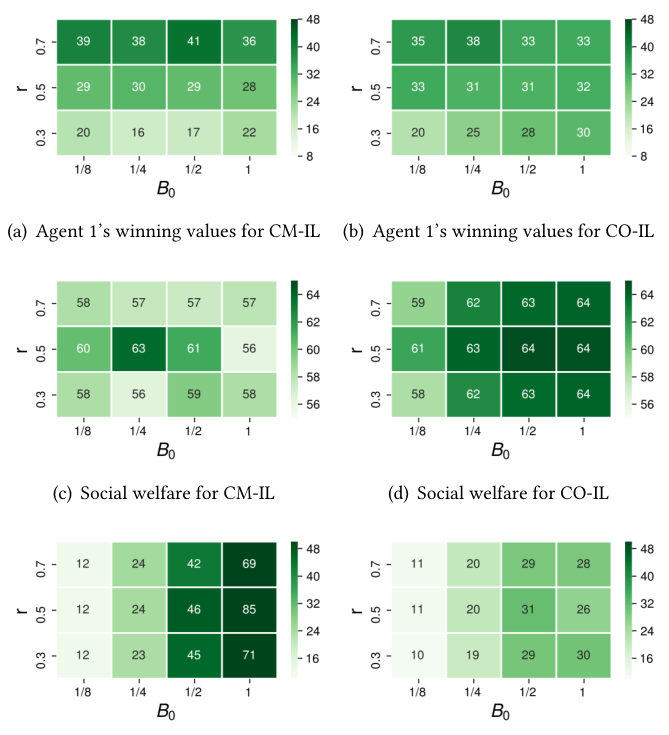
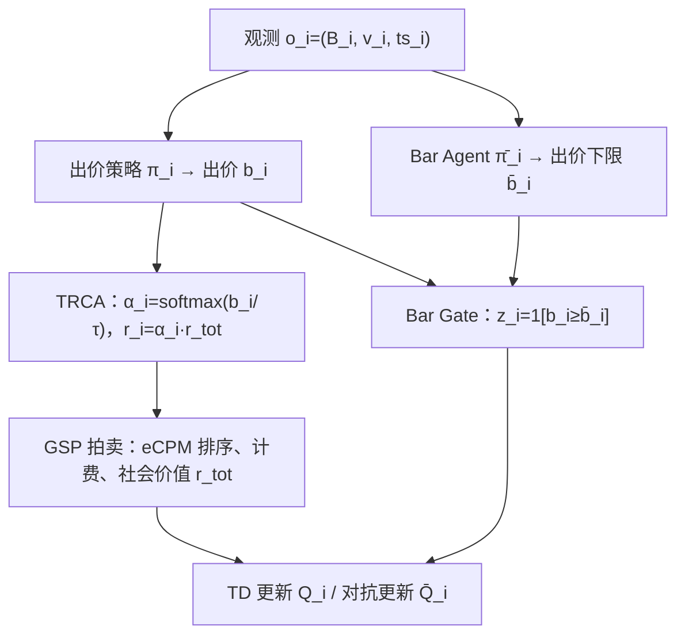
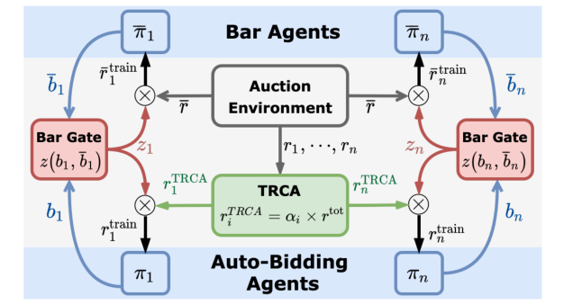

# A Cooperative-Competitive Multi-Agent Framework for Auto-bidding in Online Advertising (在线广告自动出价的合作-竞争多智能体框架)

- **会议/期刊**: WSDM 2022
- **作者与机构**: Chao Wen, Miao Xu, Zhilin Zhang, Zhenzhe Zheng 等（南京航空航天大学、上海交通大学、阿里巴巴）
- **推荐链路定位**: 精排后置的广告竞价出价层（eCPM 排序与 GSP 计费）
- **研究方向**: CTR/CVR 预估与特征交叉 / 强化学习与动态探索推荐
- **论文原文**: [https://arxiv.org/abs/2106.06224v2](https://arxiv.org/abs/2106.06224v2)
- **开源代码**: [https://github.com/chaovven/maab](https://github.com/chaovven/maab)

## TL;DR (1分钟核心速览)

自动出价长期被建模为"单智能体 + 平稳市场价"的孤立优化，忽略了同一场 GSP 拍卖中多个出价智能体的相互影响。本文提出 MAAB：用温度正则化信用分配（TRCA）把社会福利按 softmax 出价权重分配给各智能体，形成混合合作-竞争范式；再用 bar agent（仅在训练期存在）对抗性地抬高个性化出价下限以补回平台收入；最后用按目标分组的均值智能体支撑百万级广告主训练。离线仿真中社会福利 105.3（vs. CM-IL 104.1），收入较 CO-IL 提升 20.5%；淘宝 1% 流量在线 A/B 社会福利 +4.6%。

## Background & Motivation (背景与核心矛盾)

- **主流范式**: 以 DQN 类单智能体 RL（DQN-S）求解预算约束下的赢量价值最大化，把其他竞胜者的行为隐式塞进"市场价"环境里。
- **前人局限**: ① 纯竞争（CM-IL，各智能体只吃自身 $r_i$）在预算不均衡时催生**寡头垄断**——预算充足者激进抬价抢占曝光，系统层面分配低效；② 纯合作（CO-IL，共享$r_{tot}$）虽提社会福利，却学出**集体压价合谋**，平台收入骤降（图 2 中$B_0=1$ 时收入 28/26/30 vs. 竞争版 69/85/71）。
- **核心洞察 (Key Insight)**: 竞争与合谋并非"选边"问题，而是一段由**奖励分配权重**连续调控的谱——两端都不能要，中间存在兼顾个体效用与社会福利的均衡点。
- **本文切入点**: 用一条带温度 $\tau$ 的 softmax 信用分配把"竞争/合作"变成可调旋钮，再用对抗式 bar agent 约束合谋的副作用。

<figure class="paper-figure" markdown="span">
  <figcaption>图 2：CM-IL 与 CO-IL 的收敛性能。</figcaption>
</figure>

## Method (核心方法设计)

### 1. 整体框架 (Overall Architecture)

每个出价智能体 $i$观测$o^t_i=(B^t_i, v^t_i, ts^t_i)$（剩余预算、该曝光的预估价值如 pCTR/pCVR×bid、剩余步数），输出出价$b^t_i$；同时对应的 bar agent$\bar{\pi}_i$输出个性化出价下限$\bar{b}^t_i$。只有$b^t_i$进入 GSP 拍卖，拍后得到社会价值$r_i$、支付$p$；TRCA 将总回报$r_{tot}$按出价权重重新分配，bar gate 依据$b_i\ge\bar{b}_i$ 决定是否发放奖励，两侧以对抗方式同步更新；部署时丢弃 bar agent，只保留按目标分组的均值策略做单次前向出价。

<figure class="paper-figure" markdown="span">
  <figcaption>图 3：MAAB 的架构。</figcaption>
</figure>

### 2. 关键设计拆解 (Key Designs)

1. **温度正则化信用分配 TRCA（把竞争/合作变成连续旋钮）**：痛点在于 CM-IL/CO-IL 只对应 $\alpha_i$的两个退化端点。本文令$r_i^{TRCA}=\alpha_i r_{tot}$，其中$\alpha_i=\exp(b_i/\tau)/\sum_{j}\exp(b_j/\tau)$。直觉：出价越高对$r_{tot}$贡献越大、分得越多，故个体仍有抬价动机（保收入）；但分配总量始终是社会福利，故不会退化为你死我活的零和。定理 4.1 给出：当$v_1\ge 2v_2$，或$v_1<2v_2$时$\tau\ge (b_{\min}-b_{\max})\log(2v_2/v_1-1)$，即$b_1\ge b_2$出现合作，$\tau$越大越合作、$\tau\to 0$退化为 CM-IL、$\tau\to\infty$ 退化为 CO-IL。
2. **Bar Agent 与 Bar Gate（对抗式修补合作带来的收入损失）**：合作范式下智能体倾向压低出价保留预算，等价于合谋。本文给每个智能体配一个 bar agent 输出个性化下限 $\bar{b}_i$，并设门控$z_i=z(b_i,\bar{b}_i)=\mathbb{I}[b_i\ge\bar{b}_i]$，两侧奖励为$r^{train}_i=z_i r^{TRCA}_i$、$\bar{r}^{train}_i=z_i p$。妙处在于：bar agent 想抬价增收入，出价智能体想压价省预算，二者形成最大下界式的对抗平衡；且 bar 只在训练期生效，$\bar{b}_i$ 与 reserve price 不同——**无需改动 GSP 机制**。
3. **均值智能体与训练目标**：百万广告主逐一出价既稀疏又训不动，故按优化目标（CLICK/CONV/CART）分组，为每组训一个均值策略 $\pi_i$；个体出价由均值价经优势缩放得到$b^e_{i,k}=b^t_i\cdot\mathrm{clip}(A^e_{i,k})$，$A^e_{i,k}=v^e_{i,k}/v_i$；组级奖励与支付在时间步内累加$r^t_i=\frac{1}{|E_t|}\sum_{e\in E_t,k\in G_i}v^e_{i,k}x^e_k$。各智能体用 DQN 式 TD 损失$\mathcal{L}(\theta_i)=\mathbb{E}[(y_i-Q_i(o_i,b_i;\theta_i))^2]$、$y_i=r^{train}_i+\gamma\max_{b'_i}Q_i(o'_i,b'_i;\hat{\theta}_i)$ 独立更新，**无需负采样**（竞价对手由环境给出），推理成本为每组一次前向。

## Experimental Setup & Evaluation Protocol (实验设置与评估协议)

- **数据集与预处理**: 阿里巴巴搜索广告 2020-11-18 六小时拍卖日志，按 [14] 方式从全量日志中随机抽 1/150 训练、同法抽测：

| 数据集 | #曝光机会 | #每曝光候选 | #交互规模 | 场景/特征说明 |
| :--- | :---: | :---: | :---: | :--- |
| Alibaba Offline Log | 705,140 | ≈400 广告 | 日均约 100 亿次拍卖 | 每条含广告主 id、时间戳、目标（CLICK/CONV/CART）、曝光价值、人工出价 |
| Taobao Online A/B | 1% 全量流量 | — | 2021-01-30 ~ 02-03 | 分布式 TF 训练，Q 网络每 2 小时更新 |

- **数据划分与防穿越**: 非 Leave-One-Out、非比例划分，而是**日志回放式 episode 仿真**——按时间戳顺序回放曝光流，预算按 $B_i=P\times B_0\times r[i]$预先设为该 episode 总支付的分片（$B_0=1/4$），避免用未来支付泄漏预算。
- **排名（竞价）评测协议**: 采用**全量候选无偏竞价**——每场约 400 个召回广告全部参与 eCPM 排序与 GSP 二价计费，不做负采样；指标为社会福利（三组归一化赢量价值之和）与平台收入（累计 GSP 期望 CPC 支付）。
- **对比基线与超参**: MSB（人工出价）、DQN-S（单智能体）、CM-IL、CO-IL、MIX-IL、MAAB-fix；两种预算设置 $r=[1,1,1]$与$[1.5,0.5,1]$；结果取 3 次独立运行、训练 3.5M 步的均值 ± 标准差。

## Key Experimental Results (实验关键数据)

### 1. 主实验对比 (Main Results)

| 设置 | 方法 | CLICK | CONV | CART | Revenue | Social Welfare |
| :--- | :--- | :---: | :---: | :---: | :---: | :---: |
| $r=[1,1,1]$ | MSB | 24.7 | 21.8 | 18.0 | 16.9 | 64.5 |
| | DQN-S | **29.3** | 35.8 | **36.0** | 68.3 | 101.0 |
| | CM-IL | 27.8 | 41.3 | 35.0 | **86.8** | 104.1 |
| | CO-IL | 27.3 | 41.3 | 35.6 | 66.9 | 104.3 |
| | **MAAB** | 28.0 | **41.8** | 35.5 | 80.6 | **105.3** |
| $r=[1.5,0.5,1]$ | DQN-S | **37.1** | 25.1 | 34.8 | 75.5 | 97.0 |
| | CM-IL | 35.3 | 29.2 | 35.1 | **85.0** | 99.6 |
| | CO-IL | 30.7 | **35.3** | 37.0 | 52.9 | 103.0 |
| | **MAAB** | 31.3 | 33.5 | **38.6** | 69.0 | **103.4** |

MAAB 社会福利较最强基线 CM-IL 分别 **+1.2% / +3.8%**，收入较 CO-IL 分别 **+20.5% / +30.4%**。在线 A/B（CM-IL 归一化为 100）：MAAB 社会福利 **104.6**、收入 **96.1**。

### 2. 消融实验 (Ablation Study)

| 变体 | Social Welfare | Platform Revenue |
| :--- | :---: | :---: |
| MIX-IL（去 bar agent） | 104.0 ± 3.3 | 99.6 ± 18.2 |
| MAAB-fix ($\bar{b}=1$) | **104.5** ± 1.4 | 114.3 ± 17.1 |
| MAAB-fix ($\bar{b}=4$) | 99.3 ± 0.4 | **164.9** ± 1.3 |
| MAAB（自适应 bar） | 103.9 ± 1.2 | 134.6 ± 8.2 |
| $\tau=0$（≡CM-IL） | 99.6 | 79.3 |
| $\tau=2$ | 101.2 | 74.8 |
| $\tau=\infty$（≡CO-IL） | 101.9 | 57.5 |

### 3. 关键实验发现 (Key Findings)

- **$\tau$是真正的旋钮而非装饰**：$\tau$从 0 到$\infty$，社会福利 99.6→101.9（+2.3）而收入 79.3→57.5（-27%），收益/代价高度不对称，$\tau=2$ 落在近似帕累托拐点（101.2 / 74.8），说明"适度合作"才是工程最优解而非全合作。
- **bar agent 是收入的关键增量，且优于固定下限**：去掉 bar 后收入仅 99.6；固定 $\bar{b}=1$提至 114.3 但需手调、$\bar{b}=4$ 直接把社会福利打到 99.3；自适应 bar 在与社会福利无损（103.9 vs. 104.5）的前提下把收入推到 134.6（**较 MIX-IL +35.1%**），证明"个性化 + 训练期对抗"比"全局常数 reserve price"更精细。
- **离线收益可迁移但收入项存在 sim-to-real gap**：在线 A/B 复现了社会福利 +4.6%（CLICK/CONV/CART 分别 32.9/50.3/21.4 全面优于 CM-IL 的 31.4/48.2/20.4），但收入 96.1 < 100，说明离线日志回放低估了真实市场对抬价的弹性，bar agent 的下限在线上偏保守。

## Highlights & Limitations (亮点、对比与审稿批判)

- **与代表作对比 (vs. Prior Work)**: 相比 DQN-S 的单智能体"市场价平稳"假设，本文显式建模智能体互搏；相比 CO-IL 与合作式 MARL（Jin et al. 的聚类合作博弈），本文不靠改环境/加收入硬约束，而是靠奖励重分配 + 对抗 bar agent 同时守住社会福利与收入；相比 reserve price 路线（需改动拍卖机制），本文的 bar 仅存在于训练期，**零机制侵入**。
- **可迁移亮点**: ① softmax 温度信用分配可作为任意"多目标/多业务方"场景的连续权衡旋钮（如多任务精排中各目标权重、平台与商家双边效用）；②"训练期挂一个对抗 agent、部署期摘掉"是廉价且无需推理开销的正则化范式，可直接搬到多场景联合建模。
- **审稿级局限批判**: ① 定理 4.1 仅覆盖两智能体单轮拍卖，$n\ge 3$与多轮预算耦合下的均衡存在性/收敛性未证；② bar agent 对抗训练明显不稳（收入标准差 8.2，$\bar{b}=4$ 时反而 1.3，方差随 bar 强度剧烈变化），原文亦承认 bar gate 的奖励设计仍需改进；③ 离线仿真基于日志回放，pCTR/pCVR 与竞争者行为分布固定，存在分布漂移风险；④ 未与同期 Guan et al. 的"收入约束"方法做实验对齐。

## Rating (四维评分)

- **方法创新性 (Novelty)**: ⭐⭐⭐⭐ （把竞争/合作从二元选择变为温度连续调控，并给出两智能体合作阈值定理，信用分配视角在出价场景是新的）
- **评估协议与实验扎实度 (Protocol & Experiments)**: ⭐⭐⭐⭐ （离线全量竞价仿真 + 3 次重复 ± 标准差 + 淘宝 1% 流量在线 A/B，双指标闭环；但缺 $n\ge3$ 规模与竞品对齐实验）
- **写作与数学规范度 (Clarity & Rigor)**: ⭐⭐⭐⭐ （三种范式统一到 $\alpha_i$框架下叙述清晰，bar gate 与 reserve price 的区别交代到位；均值智能体的组级转移与$Q$ 更新推导略简）
- **工业落地与复现价值 (Industrial & Practical Value)**: ⭐⭐⭐⭐⭐ （代码开源，均值智能体把百万智能体压到 3 个组策略，bar agent 部署期移除、无额外推理开销，已在淘宝展示广告上线）

