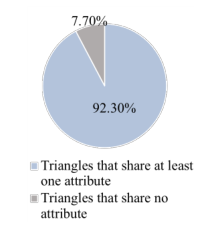
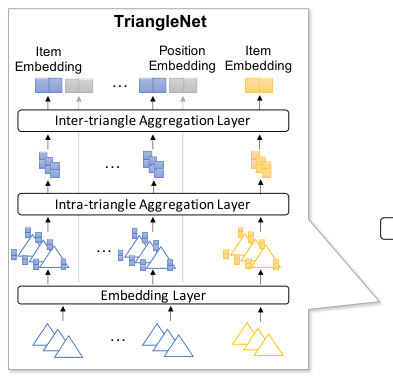
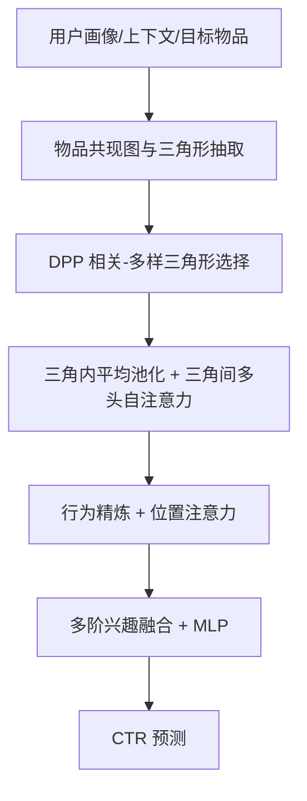

# Triangle Graph Interest Network for Click-through Rate Prediction（三角形图兴趣网络用于点击率预测）

- **会议/期刊**: WSDM 2022
- **作者与机构**: Wensen Jiang, Yizhu Jiao 等；阿里巴巴、复旦大学
- **推荐链路定位**: 精排
- **研究方向**: CTR/CVR 预估与特征交叉 / 图神经网络与知识图谱推荐
- **论文原文**: [论文原文链接](https://arxiv.org/abs/2202.02698v1)
- **开源代码**: [开源代码仓库链接](https://github.com/alibaba/tgin)

## TL;DR (1分钟核心速览)

针对 CTR 预测中用户动机隐晦、行为稀疏及图邻居偏热门/相似的问题，TGIN 将物品共现图中的三角形作为兴趣单元，用 DPP 选出相关且多样的三角形，再以三角内池化、三角间注意力与多阶兴趣融合建模。Amazon Books/Electronics 上 AUC 达 0.8934/0.7944，较 DMIN 提升 4.49%/1.95%；工业集 AUC +0.0041，线上 EPU +3.20%。

## Background & Motivation (背景与核心矛盾)

- **主流范式**: DIN/DIEN/DMIN 从用户历史点击序列抽取兴趣；GIN 引入物品-物品共现图，用加权邻居增强行为表示。
- **前人局限**: 单物品或序列建模难以判定“用户为何点这个物品”，稀疏用户更易失效；图邻居加权采样又偏向热门、相似商品，难以跳出既有兴趣做多样探索。
- **核心洞察 (Key Insight)**: 统计显示 92.30% 的三角形三节点至少共享一个属性；不同三角形共享属性差异明显（约 49% 同品类，仅 6% 相似销量），即“三角内同质、三角间异质”，且 3-clique 同质性 0.909 高于 2-clique 的 0.817，4/5-clique 又过少。
- **本文切入点**: 把三角形当作最小兴趣单元，并用 DPP 在相关性与多样性之间选少量三角，兼顾动机识别与兴趣扩展。

<figure class="paper-figure" markdown="span">
  <figcaption>图2：三角形的观察。左图显示大多数三角形具有三个共享相同属性的节点。右图表明不同三角形共享的属性各不相同。</figcaption>
</figure>
图2：三角形同质/异质统计（92.30% 共享至少一属性，跨三角属性分布差异明显）。

## Method (核心方法设计)

### 1. 整体框架 (Overall Architecture)

TGIN 先用滑动窗口（窗口 3）从训练集行为构建物品-物品共现图，并为行为序列与目标物品抽取 0/1/2 阶三角形；随后用 DPP 选少量相关且多样的三角形，经三角内平均池化得到兴趣单元表示，再用多头自注意力聚合三角间信息；行为精炼层与位置感知注意力刻画兴趣漂移，多阶融合后与用户/上下文/目标特征拼接进 MLP 输出 CTR。图3 为整体架构。

<figure class="paper-figure" markdown="span">
  <figcaption>图3：TGIN 的模型架构。首先，我们从物品-物品图中引入多样且相关的三角形来表示潜在的用户兴趣单元。然后，通过三角形内和三角形间聚合丰富用户行为表示。最后，不同阶的三角形有助于捕捉多级用户兴趣，从而提升点击率预测的性能。</figcaption>
</figure>
图3：TGIN 整体架构（三角抽取/选择、三角内-间聚合、多阶兴趣融合）。

### 2. 关键设计拆解 (Key Designs)

1. **三角形抽取与相关性打分（近邻三角 + 哈希/Bloom 加速）**：痛点是大图三角枚举昂贵且含孤立噪声；本文只取中心物品近邻的 k 阶三角，用 Hashmap/Bloom Filter 判边，三角相关性 $r_i=\sqrt{w_i^{\mathrm{in}}w_i^{\mathrm{out}}}$，内权为三边均值，外权为中心连边权和与距离和之比。直觉：近邻三角既相关，又能过滤孤立物品噪声。
2. **DPP 相关-多样三角选择（打破热门/相似偏置）**：加权邻居采样易偏热门相似；对三角集合 $\mathcal{T}$定义$p(\mathcal{S})=\frac{\det(\mathbf{L}_{\mathcal{S}})}{\det(\mathbf{L}+\mathbf{I})}$，核$\mathbf{L}=\mathrm{Diag}\{\exp(\alpha\mathbf{r})\}\mathbf{C}\mathrm{Diag}\{\exp(\alpha\mathbf{r})\}$，$\alpha=\theta/(2(1-\theta))$。$\theta$越大越重多样性，相似度矩阵$\mathbf{C}$ 抑制同质三角，从而引入同店、同品牌等意外兴趣。
3. **三角聚合、多阶融合与训练目标**：三角内平均池化 $H_b=\mathrm{Average}(Tr_b)$，三角间 MHA 得$Z_b$；辅助损失$\mathcal{L}_{\text{aux}}=-\frac{1}{N}\sum_{i=1}^{N}\sum_{t}\left[\log\sigma(b_i^\top z_{i+1})+\log(1-\sigma(b_i^\top\hat{z}_{i+1}))\right]$用下一行为监督表示，总损失$\mathcal{L}_{\text{total}}=\mathcal{L}_{\text{target}}+\lambda\mathcal{L}_{\text{aux}}$。负例从全物品集排除已点击采样；在线三角索引离线预计算，服务约 30ms。

## Experimental Setup & Evaluation Protocol (实验设置与评估协议)

- **数据集与预处理**: Amazon Books/Electronics 沿用 [36] 的评论行为序列；工业集为 AliExpress 展示广告 30 天日志，前 29 天点击作行为、预测第 30 天点击。正文未披露 5-core 过滤与密度。

| 数据集 | #Users | #Items | #Interactions | 稀疏度/密度 | 特征/场景说明 |
| :--- | :---: | :---: | :---: | :---: | :--- |
| Books | 603,668 | 367,982 | 603,668 | — | Amazon 评论预测，1,600 类 |
| Electronics | 192,403 | 63,001 | 192,403 | — | Amazon 评论预测，801 类 |
| Industrial | 9M | 62M | 1B | — | AliExpress 广告日志，7,131 类 |

- **数据划分与防穿越 (Splitting Strategy)**: 公共集按用户时间排序构造行为序列，沿用 [36]；图仅用训练集构建以避免测试边泄漏；正文未披露具体 train/valid/test 比例。工业集按“前 29 天行为→第 30 天点击”时间切分。
- **排名评测协议 (Ranking Protocol)**: 采用 AUC 二分类评估，非 Full-Ranking 或 Sampled Ranking；辅助损失负例从全物品集排除已点击采样，主任务负采样比例未披露。
- **对比基线与超参设置**: 对比 Wide&Deep、PNN、DIN、GIN、MIMN、DIEN、DMIN；物品/用户 embedding $d=18$，位置维度 2，lr=0.001，batch=128，窗口 3，最大三角阶 2，行为长度 10/20/15，三角数$n=10$（效率实验$n=5$）。公共表报告 ±std，正文未报告显著性检验。

## Key Experimental Results (实验关键数据)

### 1. 主实验对比 (Main Results)

| 模型 | Books AUC | Electronics AUC |
| :--- | :---: | :---: |
| Wide&Deep | 0.7735 | 0.7456 |
| PNN | 0.7799 | 0.7543 |
| DIN | 0.7880 | 0.7603 |
| GIN | 0.7967 | 0.7684 |
| MIMN | 0.8262 | 0.7563 |
| DIEN | 0.8453 | 0.7792 |
| DMIN | 0.8550 | 0.7778 |
| TGIN w/o AuxLoss | 0.8808 | 0.7908 |
| **TGIN** | **0.8934** | **0.7944** |
| **Improv. vs DMIN** | **+4.49%** | **+1.95%** |

工业集：TGIN 0.6732，DMIN 0.6691，绝对 AUC +0.0041；在百亿级流量场景中作者称该增幅已值得部署。

### 2. 消融实验 (Ablation Study)

| 变体 | Books 趋势 | Electronics 趋势 | 观察 |
| :--- | :--- | :--- | :--- |
| BaseModel(MeanAgg) | 优于 DIN | 优于 DIN | 三角单元本身有效 |
| BaseModel(WeightAgg) | 接近最优 | 最佳聚合 | 稀疏数据权重池化更稳 |
| BaseModel(AttentionAgg) | 最佳聚合 | 次优 | 长序列适合注意力 |
| BaseModel+AuxLoss | 明显提升 | 提升较小 | 辅助监督利于兴趣学习 |
| TGIN full | 最高 | 最高 | DPP 多样选择再增益 |

### 3. 关键实验发现 (Key Findings)

1. **三角形单元本身有效**：TGIN w/o AuxLoss 已达 0.8808/0.7908，分别超过 DMIN 的 0.8550/0.7778；结合 92.30% 三角共享属性、3-clique 同质性 0.909，说明三角能过滤孤立噪声并暴露共享属性。
2. **DPP 多样选择与辅助损失叠加增益明确**：全模型较 w/o AuxLoss 提升 +0.0126/+0.0036 AUC；49% 三角同品类但仅 6% 相似销量，验证“相关但异质”的三角可带来跨属性探索，最终较 DMIN 提升 4.49%/1.95%。
3. **工业与线上收益可量化**：工业 AUC 0.6732 vs DMIN 0.6691；AliExpress 一周 A/B 中 UV L-P +3.62%、L-GMV +3.16%、EPU +3.20%，平均响应约 30ms；训练 430s/epoch，低于 GIN 457s、DMIN 1309s、DIEN 1354s、MIMN 7954s。

## Highlights & Limitations (亮点、对比与审稿批判)

- **与代表作对比 (vs. Prior Work)**: GIN 用加权邻居扩展行为，易偏热门/相似；DIN/DIEN/DMIN 只从历史序列抽兴趣，难解动机隐晦与稀疏；TGIN 以三角为兴趣单元并用 DPP 显式控制相关-多样，因而兼具动机识别与探索。
- **可迁移亮点**: 三角 motif 可替换为其他高阶模体；DPP 的相关-多样选择可迁移到图召回、序列增强与重排候选去同质化。
- **审稿级局限批判**: 三角抽取与 DPP 依赖离线图索引，图更新频率与存储开销未充分讨论；公共集是 Amazon 评论代理任务，仅用 AUC、无校准/全库排序与冷启动分桶，线上收益也缺少长期留存与因果归因。

## Rating (四维评分)

- **方法创新性 (Novelty)**: ⭐⭐⭐⭐ （三角兴趣单元与 DPP 多样选择组合新颖，但 DPP、MHA 均为成熟组件）
- **评估协议与实验扎实度 (Protocol & Experiments)**: ⭐⭐⭐⭐ （公共集+工业集+线上 A/B 较完整，但缺显著性检验、冷启动与排序协议）
- **写作与数学规范度 (Clarity & Rigor)**: ⭐⭐⭐⭐ （核心公式清楚，部分符号与训练负采样细节略简）
- **工业落地与复现价值 (Industrial & Practical Value)**: ⭐⭐⭐⭐⭐ （开源代码、30ms 在线服务与明确 A/B 收益，工程参考价值强）

