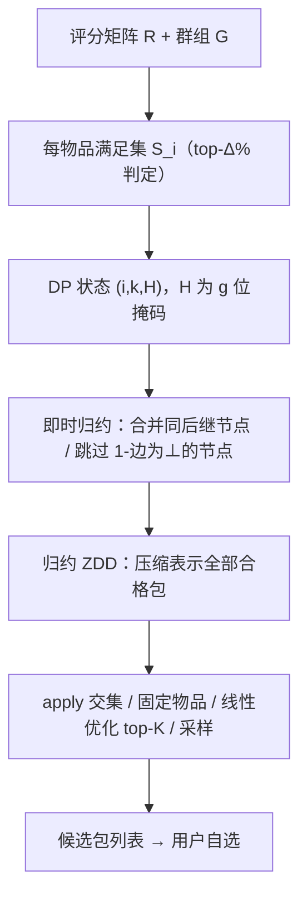
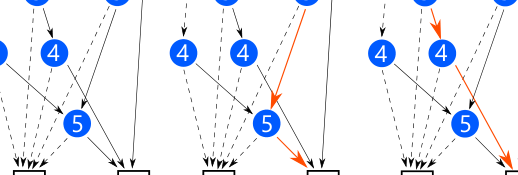

# Enumerating Fair Packages for Group Recommendations (面向群组推荐的公平包枚举)

- **会议/期刊**: WSDM 2022
- **作者与机构**: Ryoma Sato（京都大学 / RIKEN AIP，单作者）
- **推荐链路定位**: 重排 / 包级（bundle）候选生成与过滤
- **研究方向**: 去偏公平与可信推荐 / 社交与群组推荐
- **论文原文**: [https://arxiv.org/abs/2105.14423v2](https://arxiv.org/abs/2105.14423v2)
- **开源代码**: [https://github.com/joisino/fape](https://github.com/joisino/fape)（`pip install fape`）

## TL;DR (1分钟核心速览)

群组包推荐（package-to-group）中，比例公平 (proportionality) 与无嫉妒 (envy-freeness) 的现有方法（SPGreedy / EFGreedy / GFAR 等）都只**最大化打分并输出唯一一个包**，这在标准 top-$K$推荐范式下是不合理的：分数最高的包可能因未观测原因被群体拒绝。本文不做近似，而是**精确枚举全部公平包**，并将其表示为 ZDD（零压缩决策图）这一压缩结构，证明问题以群组规模$g$为参数是固定参数可解 (FPT)，时间复杂度$O(n(K+g)2^g)$，在 MovieLens-1M 上数秒内枚举$10^{12}$ 个合格包；在 ML-1M / Amazon 上三目标归一化总分达 2.888 / 2.825，较最优基线提升 6.3% / 15.7%。

## Background & Motivation (背景与核心矛盾)

- **主流范式**: 群组推荐先由单用户偏好（评分矩阵 $R$，可用 item-CF 或 MF 补全）聚合出群体效用，包推荐则把一组物品视为统一整体；公平性用 proportionality（用户 top-$\Delta\%$ 物品被包覆盖）与 envy-freeness（组内横向比较仍排前列）度量。
- **前人局限 1**: Serbos 等与 Lin 等只能输出**一个**最优包，用户无备选；且公平最大化已被证明 NP-hard，故前作全部退化为贪心近似，无法保证最优。
- **前人局限 2**: 组合空间随物品数指数爆炸（$10^{12}$ 级合格包），逐个生成候选在工程上完全不可行。
- **核心洞察 (Key Insight)**: NP-hard 的根源在于物品数 $n$、包大小$K$维度，而**群组规模$g$在真实场景恒为小量**（既有文献默认$g=8$、最大 8–16，如家庭/同车出行）；把$g$ 作为参数，问题即落入 FPT。
- **本文切入点**: 用 $g$位掩码状态做 DP，再用 ZDD 一次性**自底向上构造已归约的决策图**，把指数级解集压缩为$O(nK2^g)$ 个节点，从而"枚举全部"与"高效过滤"同时成立。

## Method (核心方法设计)

### 1. 整体框架 (Overall Architecture)

输入群组 $G$、包大小$K$、评分矩阵$R$与阈值$\tau$。首先对每个物品$i$预计算"喜欢$i$的成员集合"$S_i=\{u\in G\mid R_{ui}\in \text{top-}\Delta\%(R_{u:})\}$（envy-freeness 版本则换成组内 top-$\Delta\%$的成员集）。随后以$(i,k,H)$为状态（已扫到第$i$个物品、已选$k$个、已满足成员集合$H\subseteq G$）做动态规划，并在构造过程中即时执行 ZDD 的**节点合并**与**1-边剪枝**，直接得到归约 ZDD；该 ZDD 的根到$\top$的每条路径即一个合格包。最后在 ZDD 上做交集（比例公平∧无嫉妒∧类目约束）、超集/排除（固定或屏蔽物品）、线性布尔优化（取偏好最大或 top-$K$）与均匀/加权采样，输出给用户自主挑选。

<figure class="paper-figure" markdown="span">
  <figcaption>图1：ZDD 示例：虚线和实线分别表示 0-边和 1-边。(a) 表示集合族 {{1, 3, 5}, {1, 2}, {2, 3, 4}, {4, 5}} 的 ZDD。(b) 对应 {1, 3, 5} 的路径。(c) 对应 {2, 3, 4} 的路径。(d) 表示 {1, 2, 3, 4, 5} 的幂集的 ZDD。</figcaption>
</figure>

### 2. 关键设计拆解 (Key Designs)

1. **FPT 动态规划（把 NP-hard 压成 $2^g$掩码枚举）**：朴素枚举$O(n^K)$不可行；本文观察到"包是否满足$H$中全部成员"只需记录被满足成员集合。递推为$B_{i,k,H}=B_{i-1,k,H}\lor\bigvee_{F:F\cup S_i=H}B_{i-1,k-1,F}$，即"不选物品$i$"或"选$i$后由$F$补齐到$H$"。因每个$F$只对应唯一$H$，求和项实际只有一个非零项，三重循环代价$O(n(K+g)2^g)$，从而 **NP-hard 问题在$g$ 小时可精确求解**。
2. **ZDD 压缩枚举（一个结构装下 $10^{12}$个包）**：若把 DP 表逐条展开成包，输出规模指数爆炸。本文将状态图直接做成 ZDD：0-边$\mathfrak{x}_{i,k,H}\xrightarrow{0}\mathfrak{x}_{i+1,k,H}$（不选$i$，满足集不变），1-边$\mathfrak{x}_{i,k,H}\xrightarrow{1}\mathfrak{x}_{i,k+1,H\cup S_i}$（选$i$，新满足$S_i$且包大小 +1）；终态在$|H|\ge\tau$且$k=K$时接$\top$，否则接$\bot$。关键在于**边构造边归约**：1-边指向$\bot$的节点直接跳过（该物品对任何解都无用），同索引同后继的节点合并为等价类，避免先生成冗余图再归约的内存浪费；归约后规模上界$O(nK2^g)$，远小于解集本身。
3. **训练目标、负采样与推理效率**：本文为组合优化/枚举，无梯度训练与负采样；"目标函数"由用户以查询形式给出——线性布尔优化 $\arg\max_{P\in\mathfrak{A}}\sum_{i\in P}w_i$在$O(\|\mathfrak{A}\|)$内完成（置$w_i=\sum_{u\in G}R_{ui}$即最大偏好，置$w_i=-\mathrm{Var}(\{R_{ui}\}_{u\in G})$即最小分歧），交集/并集走 apply 操作。推理开销由$g$主导：$g$ 每 +1，时间约翻倍，这是唯一的规模化瓶颈。

## Experimental Setup & Evaluation Protocol (实验设置与评估协议)

- **数据集与预处理**（Amazon 严格 10-core 迭代过滤；MovieLens 用官方五个规模版本）：

| 数据集 | #Users | #Items | #Interactions | 稀疏度 | 特征/场景说明 |
| :--- | :---: | :---: | :---: | :---: | :--- |
| MovieLens-100k | 943 | 1,682 | 100,000 | 93.7% | 朋友共同看电影的包推荐 |
| MovieLens-1M | 6,040 | 3,706 | 1,000,209 | 95.5% | 默认设置数据集 |
| MovieLens-10M / 20M / 25M | 69,878 / 138,493 / 162,541 | 10,677 / 26,744 / 59,047 | 10M / 20M / 25M 级 | >99% | 可扩展性压测（仅报 #Items） |
| Amazon Home&Kitchen | 1,395 | 1,171 | 25,445 | 98.4% | 电商 bundle 推荐，10-core |

- **数据划分与防穿越 (Splitting Strategy)**: 无 train/test 时间切分；评分矩阵视为**已知/离线补全**（前作用 item-CF 或 MF 补全），因此不存在穿越问题。评估通过**合成群组**：Random（均匀采样）、Similar（与已选成员 PCC $\ge C_{\text{sim}}$）、Divergent（最小 PCC$\le C_{\text{div}}$），默认$g=8$、$K=4$、$\Delta=5$、$\tau=g$。
- **排名评测协议 (Ranking Protocol)**: **非** Full-Ranking/Sampled Ranking 的 top-$N$指标；改为**包级多目标打分**：proportionality、envy-freeness 各除以$g$、preference 归一化至$[0,1]$，三者求和为 Total Score（上限 3）。随机 10 个群组取均值±标准差，未报告显著性检验。
- **对比基线与超参设置**: 7 个公平包基线——AveRanking、LMRanking（排序式）、GreedyVar、GreedyLM（$\lambda=0.5$）、GFAR、SPGreedy、EFGreedy（贪心式）。默认$K=4$、$g=8$，单核 Xeon E7-4830 计时。

## Key Experimental Results (实验关键数据)

### 1. 主实验对比 (Main Results)

| 方法 | ML-1M Prop↑ | ML-1M EF↑ | ML-1M Pref↑ | ML-1M Total↑ | Amazon Prop↑ | Amazon EF↑ | Amazon Pref↑ | Amazon Total↑ |
| :--- | :---: | :---: | :---: | :---: | :---: | :---: | :---: | :---: |
| AveRanking | **1.000** | 0.725 | **0.911** | 2.636 | **1.000** | 0.500 | **0.939** | 2.439 |
| LMRanking | 0.988 | 0.588 | 0.876 | 2.451 | 0.912 | 0.425 | 0.924 | 2.261 |
| GreedyVar | 0.912 | 0.750 | 0.812 | 2.474 | 0.787 | 0.637 | 0.859 | 2.284 |
| GreedyLM | 0.950 | 0.775 | 0.813 | 2.538 | 0.662 | 0.600 | 0.853 | 2.115 |
| GFAR | 0.950 | 0.762 | 0.812 | 2.525 | 0.762 | 0.650 | 0.871 | 2.284 |
| SPGreedy | **1.000** | 0.525 | 0.851 | 2.376 | **1.000** | 0.375 | 0.867 | 2.242 |
| EFGreedy | 0.925 | **1.000** | 0.792 | 2.717 | 0.750 | 0.838 | 0.854 | 2.441 |
| **Ours (FAPE)** | **1.000** | **1.000** | 0.888 | **2.888** | **1.000** | **0.912** | 0.913 | **2.825** |
| Improv.% (vs. best baseline) | — | — | −2.5% | **+6.3%** | — | **+8.8%** | −2.8% | **+15.7%** |

### 2. 消融实验 (Ablation Study)

| 变体（同一 ZDD 上的不同取用方式） | ML-1M Prop | ML-1M EF | ML-1M Pref | ML-1M Total | Amazon Total |
| :--- | :---: | :---: | :---: | :---: | :---: |
| 交集 ZDD + 线性优化（最优包） | 1.000 | 1.000 | 0.888 | **2.888** | **2.825** |
| 取第 10 优包 | 1.000 | 1.000 | 0.887 | 2.887 | 2.824 |
| 取第 100 优包 | 1.000 | 1.000 | 0.881 | 2.881 | 2.805 |
| ZDD 内均匀随机采样 | 1.000 | 1.000 | 0.720 | 2.720 | 2.774 |
| 仅按偏好优化（≈AveRanking 行为） | 1.000 | 0.725 | 0.911 | 2.636 | 2.439 |

### 3. 关键实验发现 (Key Findings)

1. **"精确枚举"直接换来双公平同时达标**：EFGreedy 专为 envy-freeness 设计却只能在 ML-1M 上做到 EF=1.000 而牺牲 Prop（0.925）；本文通过 Prop-ZDD 与 EF-ZDD 的 apply 交集，在两个数据集上同时取得 Prop=1.000 与 EF=1.000 / 0.912，Amazon 上 EF 反超 EFGreedy 8.8%，说明**单目标贪心无法逼近帕累托前沿，而枚举+交集可以**。
2. **公平的代价极小**：相对偏好最优的 AveRanking，本文偏好仅降 2.5%（ML-1M）/2.8%（Amazon），总分却提升 6.3% / 15.7%，量化了"牺牲极少效用换取大幅公平"的可行区间。
3. **压缩结构使"备选丰富度"几乎免费**：即使从 ZDD 中**均匀随机**抽包，ML-1M 总分仍有 2.720（高于全部 7 个基线中的 6 个），第 100 优包仅比最优低 0.007；同时运行时间随数据集规模（1,682→59,047 物品）与包大小 $K$(2→8) 呈**线性**增长，而合格包数呈指数增长（$>10^{12}$ 个 / 数秒）。

## Highlights & Limitations (亮点、对比与审稿批判)

- **与代表作对比 (vs. Prior Work)**: 相较 SPGreedy / EFGreedy（贪心避重、只改最后一项、解多样性差）与 AveRanking / LMRanking（排序式根本无法产出多包），本文是**首个不依赖近似、一次性给出全部合格包**的方法；与 Lin 等的 NP-hard 结论并不矛盾——本文指出其难度仅关于 $n,K$，关于$g$ 是 FPT。
- **可迁移亮点**: (1) 把"集合组合约束"编码成 $g$位掩码 + 即时归约 ZDD，可直接迁移到**捆绑推荐、 Playlist 生成、多目标重排的可行解空间建模**；(2) 用$w_i=-\mathrm{Var}(\{R_{ui}\})$ 做线性优化实现"最小分歧包"，是一种无需额外训练的公平后处理算子。
- **审稿级局限批判**: (1) **群组规模是硬上限**——时间随 $g$指数增长（Fig. 3(c)），$g>16$基本不可用，难以覆盖社群体量场景；(2) **评估偏薄**——仅 10 个合成群组、无真实群组标签、无显著性检验，且 ZDD 内存与构造开销（最坏$nK2^g$ 节点）未报告；(3) 偏好矩阵假设已补全，补全误差对公平判定的传播未做敏感性分析。

## Rating (四维评分)

- **方法创新性 (Novelty)**: ⭐⭐⭐⭐⭐ （将 NP-hard 的公平包问题重定义为以群组规模为参数的 FPT 问题，并用即时归约 ZDD 精确压缩指数解集，理论贡献远超常规启发式）
- **评估协议与实验扎实度 (Protocol & Experiments)**: ⭐⭐⭐ （数据集规模与参数扫描充分、基线覆盖 7 个代表作，但仅 10 个合成群组、无显著性检验、无真实群组数据验证）
- **写作与数学规范度 (Clarity & Rigor)**: ⭐⭐⭐⭐⭐ （DP 递推、ZDD 归约规则与复杂度定理层层对应，伪代码与图 2 的合并/跳过规则一一可核，证明干净）
- **工业落地与复现价值 (Industrial & Practical Value)**: ⭐⭐⭐⭐ （开源 `fape` 库可 pip 安装，包级候选生成天然契合 bundle/playlist 场景；但 $g$ 指数复杂度与 ZDD 常驻内存限制了大规模线上部署，宜作离线候选池构建）

